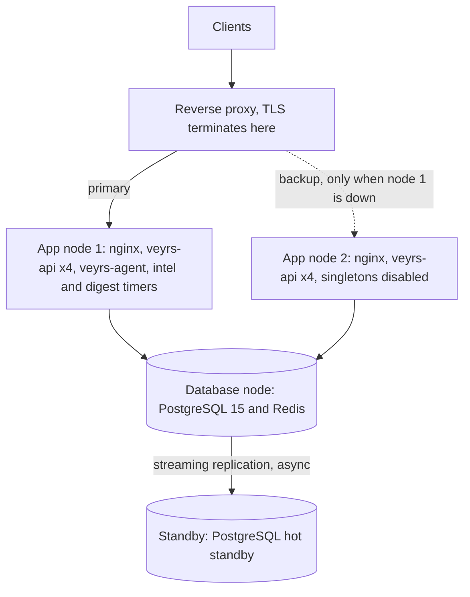

# High availability: runbook

Topology decision and rationale: [ADR 0007](ADRs/0007-stateless-app-nodes.md).

> [!NOTE]
> Verification status. The application-node facts (units, singletons, vhosts) were
> observed live on 2026-11-17. The database tier, the standby and the proxy were not
> observable for this revision; their descriptions come from earlier runbooks and
> measurements (dates given below) and are marked as such. The hosts and history of the
> reference installation are in the internal environment record.

## The map



**Legend.** Boxes are hosts or containers, cylinders are data stores. The solid
arrow from the proxy is normal traffic; the dotted arrow is the backup upstream.
Node 1 carries the singleton units (`veyrs-agent`, `veyrs-intel-sync.timer`,
`veyrs-digest.timer`); node 2 has the same software with those units disabled or
absent. Redis is **not** replicated.

| Role | Runs | Notes |
|---|---|---|
| Reverse proxy | TLS termination, upstream `{node 1, node 2 as backup}` | preserves the `Host` header; see the proxy requirements below |
| Application node 1 (primary) | nginx, `veyrs-api` (uvicorn, 4 workers), `veyrs-agent`, `veyrs-intel-sync.timer`, `veyrs-digest.timer` | takes all traffic |
| Application node 2 (secondary) | nginx, `veyrs-api` | takes traffic only when node 1 is down; agent and intel timer installed but **disabled** |
| Database node | PostgreSQL 15, Redis with `requirepass` | the single point of failure for writes |
| Standby | PostgreSQL 15 streaming replica | promotion is manual |

Each application node keeps a **local** PostgreSQL only for the test database
`veyrs_test`; it is not production data.

## What is protected, and what happens

| Failure | Effect on the user | Intervention |
|---|---|---|
| `veyrs-api` dies on one node | none, the proxy retries on the other | none |
| a whole application node shuts down | none | none |
| both application nodes go down | full outage | start one |
| the database node goes down | full outage | promote the standby, or restore from backup |
| `veyrs-agent` stopped (node 1 down) | scheduled scans do not run | enable it on node 2 (below) |

Measured on a reference installation on 2026-08-17 with two equal upstream peers:
stopping `veyrs-api` on one node returned 200 for 20 of 20 requests; stopping the whole
node returned 200 for 25 of 25 in 6 s; with both alive, 30 concurrent requests split
14 and 16. Re-measured on 2026-08-18 after node 2 became `backup`: 20 requests in
normal operation all went to node 1; with nginx stopped on node 1, 15 of 15 returned
200 and all were served by node 2; ten requests right after node 1 recovered still went
to node 2, and ten requests about 15 s later went to node 1.

> [!NOTE]
> **Failback is not instantaneous.** After the primary recovers, nginx keeps sending
> to the backup until `fail_timeout` (10 s) expires. That is correct, because retrying
> sooner is how a half-started node gets traffic, but it explains a window in which
> the secondary serves while the primary is already alive.

### Requirements on the proxy

An upstream consistent with the measured behaviour (names and addresses are examples):

```nginx
upstream veyrs_app {
    server 192.0.2.83:80 max_fails=2 fail_timeout=10s;   # node 1
    server 192.0.2.86:80 backup;                         # node 2
}
server {
    listen 443 ssl;
    server_name veyrs.example.com;
    location / {
        proxy_pass http://veyrs_app;
        proxy_connect_timeout 3s;       # mandatory, see below
        proxy_set_header Host $host;
        proxy_set_header X-Forwarded-For $proxy_add_x_forwarded_for;
        proxy_set_header X-Forwarded-Proto $scheme;
    }
}
```

`proxy_connect_timeout 3s` is mandatory and not cosmetic. Without it the **hard** loss
of a node (the address disappears, there is no RST) leaves the connection hanging until
the 60 s default before the retry: the first test with a node powered off scored 19 of
20 for exactly that reason. Every hostname the proxy forwards must also be listed in the
console vhost's `server_name` on **both** nodes: a missing name does not 404, it falls
through to the documentation site with HTTP 200
([Services](operations/services.md#hostnames-and-the-default-server)). List the proxy's
address in `VEYRS_FORWARDED_ALLOW_IPS` on both nodes, or every user is rate-limited as
the proxy. `sites-enabled/` must hold symlinks to `sites-available/`: a loose file
once made an edit a silent no-op, because `nginx -t` passes while the edited file is not
the running one.

## Runbooks

### Promote node 2 to the singleton node (node 1 lost for a prolonged period)

**First confirm node 1 is not running the singletons.** Two runners claiming the same
jobs corrupt state.

```bash
# on node 2, as root
systemctl enable --now veyrs-agent veyrs-intel-sync.timer
# when node 1 comes back, and node 2 was promoted:
# on node 1
systemctl disable --now veyrs-agent veyrs-intel-sync.timer
```

Exactly one node runs each singleton, always. `veyrs-digest.timer` should likewise run on
one node only (the reference installation installs it on node 1 only). `install.sh`
leaves a timer you disabled disabled on re-run.

### Take a node out of rotation (planned maintenance)

No proxy change is needed: stopping `nginx` or `veyrs-api` on the node is enough, and
the passive health check marks it down after 2 failures within 10 s. To take it out
explicitly, comment its `server` line in the proxy's upstream file and reload nginx
there.

### Add a third application node

1. Provision a host from a backup or image of an existing node, with the same OS and `/opt/veyrs` tree, or run `install.sh --skip-postgres --skip-redis --skip-bootstrap` ([Installation](operations/installation.md)).
2. On the node: disable `veyrs-agent`, `veyrs-intel-sync.timer`, and the local `postgresql` and `redis-server` if present.
3. Put the **same** `VEYRS_SECRET_KEY` and `VEYRS_ENCRYPTION_KEY` in its `.env`, point `VEYRS_DATABASE_URL` and `VEYRS_REDIS_URL` at the database node, and set `VEYRS_TEST_DATABASE_URL` to `127.0.0.1`.
4. Add the node's `/32` to `pg_hba.conf` on the database node and reload PostgreSQL.
5. Raise `max_connections` if needed (each worker can hold 30 connections), then add the node to the proxy upstream.

Step 4 is deny-by-default on purpose: a new node does not talk to the vulnerability
database until somebody authorises it.

## Constraints that must be respected

- **Do not point `VEYRS_TEST_DATABASE_URL` at the production database host.** The suite creates and destroys schema; it would compete with production and defeat the physical separation that backs the guard in `tests/conftest.py`.
- **Do not open `pg_hba.conf` by CIDR.** A `/24` turns any container on the LAN into a client of the vulnerability database.
- **The `.env` of every node shares the JWT signing secret** (`VEYRS_SECRET_KEY`) and the encryption key. If the signing secret is rotated, rotate it on all nodes at once, or tokens issued by one node are rejected by the other.
- **Run `init-db` on one node per upgrade** and deploy nodes one at a time ([Upgrade and rollback](operations/upgrade-rollback.md#multi-node-rolling-upgrade)).
- **The documentation and product-site roots are local state on each node.** They are interchangeable only while both nodes sit on the same commit and both run the builders. After any documentation change: update and rebuild on **both**, then compare `md5sum` of the trees.

## What this does NOT cover

- **Loss of the physical host** that carries every container. If the application nodes, the database, the standby and the off-host dump copy share one machine, it is a full outage and every copy goes with it. The off-host copy only protects against this when its target is a different physical machine that is always on; a standby on a host that sleeps for days is absent exactly when needed, and while it sleeps the primary retains WAL up to `max_slot_wal_keep_size` and then invalidates the slot.
- **The database node is a single point of failure for writes.** A streaming standby exists, but promotion is manual.
- **Batch work during a node 1 outage** (scheduled scans, the intelligence sync) pauses until an operator promotes node 2.
- **Nothing alerts on a failed unit.** See [Monitoring](operations/monitoring.md).

---

## The database standby

Phase 1 made the application nodes disposable. It did not address the fact that **all of
VEYRS can live on one physical host, backups included**: "we have nightly backups" is
true and irrelevant if the backup store is on the machine that fails.

### What exists (earlier measurement, 2026-08-17)

| | |
|---|---|
| Method | PostgreSQL 15 streaming replication, physical replication slot |
| Mode | asynchronous, `hot_standby = on`, `hot_standby_feedback = on` |
| Measured lag | about 1 ms and 0 bytes at idle |
| Verification | `veyrs-replcheck.timer` every 15 minutes |

The standby's tuning (`shared_buffers`, `work_mem`, `max_connections`) **mirrors the
primary's**: a standby tuned smaller than its primary becomes a capacity incident the
moment it is promoted.

### `max_slot_wal_keep_size` is not optional

A replication slot with no bound is a space bomb. If the standby is down over a weekend,
the primary faithfully retains every WAL segment for it and fills its own disk: the
replica takes production down. Set `max_slot_wal_keep_size` (the reference installation
uses 20 GB). With the bound, the slot is invalidated instead (`wal_status = 'lost'`,
rebuild the standby with `pg_basebackup`) and the primary keeps serving.
`veyrs-replcheck.sh` checks for exactly that state, because an invalidated slot is worse
than a missing one: it looks configured, and the standby can never catch up on its own.

### Promotion is manual, and stays manual

Automatic promotion without fencing produces two primaries, and two primaries produce
divergent security data: findings closed on one side and open on the other, with no way
to tell afterwards which was true.

```bash
# 1. Confirm the primary is really gone. Two primaries cannot be reconciled.
ssh root@<db-primary> 'systemctl status postgresql@15-main'

# 2. Promote (Debian paths; adjust for your distribution).
ssh root@<db-standby> 'su postgres -c "/usr/lib/postgresql/15/bin/pg_ctl promote -D /var/lib/postgresql/15/main"'
ssh root@<db-standby> 'su postgres -c "psql -tAc \"select pg_is_in_recovery()\""'   # expect: f

# 3. Point every application node at it (VEYRS_DATABASE_URL in .env), then restart.
for n in <app-node-1> <app-node-2>; do
  ssh root@$n "sed -i 's/@<db-primary-address>:5432/@<db-standby-address>:5432/' /opt/veyrs/.env && systemctl restart veyrs-api"
done

# 4. Redis is NOT replicated. It holds only expiring keys: rate-limit counters, e-mail and
#    Telegram MFA codes and their send throttles, OIDC flow and hand-off state, pending
#    RADIUS challenges (docs/database/README.md, "What Redis holds"). Losing it loses no
#    business data, but until VEYRS_REDIS_URL points at a working Redis the limiter falls
#    back to per-process windows and e-mail/Telegram MFA, OIDC and RADIUS-challenge
#    sign-ins fail closed. Point VEYRS_REDIS_URL at a Redis on a surviving node, or stand
#    one up on the new primary.

# 5. pg_hba.conf on the new primary must list the application nodes by /32, not CIDR.
```

After promotion, rebuild a new standby and take a fresh backup
([Backup and DR](operations/backup-dr.md#loss-of-the-database-node)).

### What the standby still does not cover

- **Redis is not replicated.** Deliberate: it holds only expiring keys (rate-limit counters, MFA codes, OIDC and RADIUS sign-in state), not a system of record. Promotion needs the one manual step above; until it is done, e-mail/Telegram MFA, OIDC and RADIUS-challenge sign-ins fail closed (`security/mfa_delivery.py:19-22`, `services/oidc_auth.py:226`, `services/radius_auth.py:379`).
- **A standby on the same physical host as the primary** protects against losing the database node, not the host.

---

## Logical backups

Streaming replication is not a backup: it replicates a `DROP TABLE` faithfully and within
milliseconds. Three timers on the database node provide the independent copy
(specified in [Backup and DR](operations/backup-dr.md#scheduled-logical-backups)):

| Unit | Schedule | What it does |
|---|---|---|
| `veyrs-pgdump.timer` | 02:15 daily | `pg_dump -Fc` as `postgres`, integrity checks, push to a different machine, retention (7 days local, 30 days off-host) |
| `veyrs-pgverify.timer` | Sunday 04:30 | restores the latest dump into a scratch database and compares row counts and the RLS policy count with production |
| `veyrs-replcheck.timer` | every 15 min | slot active and not lost, walsender streaming, lag under 128 MB |

First measured run on the reference installation (2026-08-17): 444 MB, 78 data
sections, verified byte-for-byte on the target by SHA-256; the weekly proof compared 78
tables and 61 policies. The 2026-10-26 production figures were 89 tables and 72
policies.

### The trap that makes the script look paranoid

**`pg_dump` run as the `veyrs` role leaves a truncated archive that looks like a
backup.** VEYRS has row level security with FORCE, which applies to the table owner too,
so the dump is refused partway through with *"query would be affected by row-level
security policy"*, after `-Fc` has already written a plausible file (measured on
2026-09-21: 392 KB where the good dump is 509 MB). See
[Disaster recovery](DISASTER_RECOVERY.md). So `veyrs-pgdump.sh`:

1. refuses to run unless the connected role is a superuser;
2. counts the tenant-scoped canary tables **before** dumping, so the check has a reference that did not come from the dump;
3. asserts a size floor (20 MB) and the presence of `TABLE DATA` sections for every canary with live rows;
4. only then rotates old backups: a new backup is never trusted before it is proven, and an old one is never deleted before the new one is.

Weekly, `veyrs-pgverify.sh` goes further and actually restores. Two details the
restore path depends on: `createdb -E UTF8 -T template0` (inheriting `SQL_ASCII` from
`template1` makes psycopg return `bytes` while `pg_restore` reports zero errors), and
restoring as `postgres` **without** `--no-owner` (`--role=veyrs` submits the restore to
row level security and foreign-key validation fails).

### The off-host copy is unprivileged

The dump is pushed as a dedicated account whose key is `restrict`-ed and which owns only
the destination directory. A root key on the target would turn a compromise of the
database node into root on the backup host, which in a platform whose whole job is
knowing where the exposure is would be an unusually poor outcome.

### Still missing

Nothing watches for a `failed` systemd unit on this fleet. `veyrs-intel-sync` failed
three consecutive nights before anyone noticed, and these timers have the same blind
spot: they fail loudly into a journal nobody reads. The fix is fleet-wide alerting, not
another VEYRS-local check ([Monitoring](operations/monitoring.md#what-to-alert-on)).
