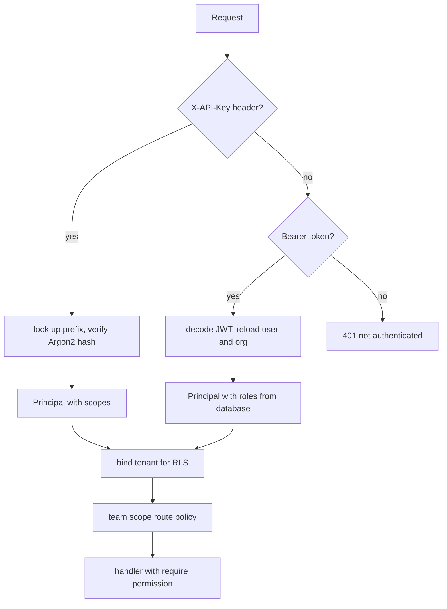

# API user guide

Examples below were captured from a running installation (read-only GET requests); organisation ids, user ids, e-mail addresses and host names are replaced by placeholders. Structure and field names are unmodified.

## Base URL, versioning and discovery

| Item | Value | Source |
|---|---|---|
| Base path | `/api/v1` (`settings.api_prefix`) | `backend/veyrs/config.py:66` |
| Versioning | The version is part of the path. Only `v1` exists; the router tree is assembled in `api/v1/__init__.py`. | `backend/veyrs/api/v1/__init__.py` |
| OpenAPI document | `GET /api/v1/openapi.json`, unauthenticated; **not served in production** unless `VEYRS_EXPOSE_OPENAPI=true` (always served in development) | `backend/veyrs/main.py` |
| Swagger UI / ReDoc | `/docs`, `/redoc`; same rule as the OpenAPI document | `backend/veyrs/main.py:66-67` |
| Size of the contract | 336 routes, 266 paths (extracted from the running app) | `extract/routes.json`, `extract/openapi.json` |
| Product version | `GET /healthz` returns it | `backend/veyrs/main.py:99` |

All paths in this guide are relative to `https://veyrs.example.com/api/v1` unless they start with `/healthz`, `/readyz` or `/metrics`.

## Authentication

Every route except the probes, the OpenAPI document, the login family and a few SSO redirects requires a credential. The principal is resolved in `get_principal` (`backend/veyrs/security/deps.py`): an `X-API-Key` header wins over a bearer token.



**Legend:** rectangles are processing steps, diamonds are decisions; the final step 403s when the principal lacks the permission named in the route decorator.

### JWT bearer tokens (people)

1. `POST /auth/login` with `identifier` (a username or e-mail; the older `email` field is still accepted), `password`, and optionally `organization` (or `organization_slug`) and `mfa_code` (`LoginRequest`, `api/v1/schemas.py:117`).
2. The response is a `TokenPair`: `access_token`, `refresh_token`, `token_type`, `expires_at`, `organization_id`, `user_id`, `permissions` (`api/v1/schemas.py:175`).
3. Send `Authorization: Bearer <access_token>`. Access tokens are HS256-family JWTs (`settings.jwt_algorithm`) valid for 30 minutes by default (`access_token_minutes`, `config.py:56`); a native install made with `install.sh` writes `VEYRS_ACCESS_TOKEN_MINUTES=60` into `.env` (`install.sh:1015`), so read the deployed value rather than assuming 30.
4. Renew with `POST /auth/refresh` (`{"refresh_token": "..."}`). Refresh tokens last 14 days and **rotate on every use**; presenting an already-rotated token revokes every refresh token in the same family (`api/v1/auth.py:560`; all of one user's sessions share a family, so a replay signs out every device).
5. `POST /auth/logout` revokes refresh tokens (204).

```bash
curl -s -X POST https://veyrs.example.com/api/v1/auth/login \
  -H 'Content-Type: application/json' \
  -d '{"identifier":"analyst@example.com","password":"<password>","organization":"acme"}'
```

Login behaviours you must handle (`api/v1/auth.py:364-560`):

| Response | Meaning |
|---|---|
| 200 `TokenPair` | Signed in. |
| 401 `{"detail": "..."}` generic | Wrong password, unknown user, disabled user, disabled org and locked account all look identical (anti-enumeration). 10 failed attempts lock the account for 15 minutes (`MAX_FAILED`, `LOCK_MINUTES`, `auth.py:58-59`). |
| 401 `{"detail": {"error": "mfa_required", "method": ...}}` | A second factor is needed; repeat the login with `mfa_code` (TOTP, e-mail or Telegram code, or a recovery code). For RADIUS challenges, also send `radius_challenge` from the first response. |
| 409 `{"detail": {"error": "organization_required", "organizations": [...]}}` | The identifier exists in several tenants; resend with `organization`. |
| 429 | Auth-path rate limit (see below). |

Permissions are **re-read from the database on every request**, not taken from the token (`_principal_from_jwt`, `deps.py:110-140`), so a revoked role applies at once. A deleted, inactive, locked user or a deactivated organisation gets 401.

### API keys (machines)

Send `X-API-Key: veyrs_<prefix>_<secret>`. Keys are minted in the console or with `POST /api-keys` (permission `apikey:write`; see [authentication-accounts](../functional/authentication-accounts.md)); the clear text is shown once and only an Argon2 hash is stored (`security/auth.py:133-141`). The key carries explicit `scopes` (permission strings, wildcards allowed) and is never a superuser. API keys are **never narrowed by team scope** (`deps.py` comment on `Principal.scope`): an importer must see the whole estate. A revoked, expired or malformed key yields 401.

### Agent credentials

Scan agents use `X-Agent-Token` on the `/agents/self/*` data-plane routes (heartbeat, claim, events, result, inventory, fail), which are separate from the human/API-key routes (`api/v1/agents.py:237+`). Job-scoped routes also need the job's `lease_token`, passed as a query parameter (`api/v1/agents.py:268-330`), which means it can appear in proxy access logs. Enrolment (`POST /agents`) needs `agent:admin` and returns the token once. See [agents](../functional/agents.md).

### OIDC single sign-on handoff

For browsers only: `GET /auth/sso` says whether SSO is offered; `GET /auth/oidc/{org_slug}/start` returns the identity-provider URL; the provider redirects to `GET /auth/oidc/callback`, which redirects the browser to the console with a one-time handoff code (60 s TTL, `services/oidc_auth.py:300`); the console swaps it with `POST /auth/oidc/exchange` for a normal `TokenPair`. The organisation slug must be known up front. Details: [authentication-accounts](../functional/authentication-accounts.md).

### Platform administrator routes

`/admin/updates*` and `/admin/system/*` require `is_superuser` and refuse API keys (`platform_admin: true` in `extract/routes.json`).

## Authorization and permissions

A permission is `resource:action`, action in `read | write | delete | admin`, over 29 resources (`security/permissions.py`, `extract/permissions.json`). Role grants may use `resource:*` or `*:*`; `expand()` turns them into concrete strings. Each route declares what it needs with `Depends(require("asset:write"))`; a typo raises `ValueError` at import time, so a route can never be silently open (`deps.py:177-194`). A missing permission returns:

```json
{"detail": "missing permission: asset:write"}
```

with status 403 (`Principal.require`, `deps.py:62-67`). The full route-to-permission matrix is generated in [reference/permissions.md](../reference/permissions.md); each endpoint page under `api/reference/` states its permission. Some routes check at run time rather than by decorator (for example the `/notifications` self-service routes and `/reports/{slug}/export`, whose permission depends on the report), so `permissions: []` in the route table does not mean unauthenticated.

Ten built-in roles are seeded: `org-admin, security-manager, security-engineer, team-lead, asset-owner, compliance-officer, executive, auditor, service-account, read-only`.

## Tenant scoping and team scope

- **Organisation (tenant).** Every principal carries an `organization_id`. After authentication the session is bound with `set_tenant` so PostgreSQL row-level security applies even to a query that forgot its filter (`deps.py:182,216`, `db.py`). Cross-tenant reads return **404, not 403**, so existence is not disclosed. See [database](../database/README.md).
- **Team scope.** A user may be restricted to some teams. `GET /auth/me` reports it (`"scope": {"restricted": false, ...}`) and `GET /auth/me/scope` explains what is hidden. The check `enforce_route_policy` (`security/scope.py:228`) works on route **tags**: tags in `SCOPED_TAGS` (for example assets, vulnerability management, ticketing, dashboards and reports, policies, cvss, risk register) are filtered to the caller's teams; `EXEMPT_TAGS` (authentication, intelligence and knowledge, threat intelligence, operations, administration, saved views) are served unfiltered; `REFUSED_TAGS` (agents, ai, compliance, engagements, integrations, asset sources) answer **403** to a team-scoped caller (`scope.py:98`). A route whose tag is in none of the sets is also refused rather than served unfiltered.
- Estate-wide actions attempted by a team-scoped caller (exporting the asset register, editing SLA policy) return 403 with an explanation via `refuse_if_restricted` (`scope.py:247`).

## Conventions

### Pagination

There are two input conventions, both returning the same envelope (`Page`, `api/v1/schemas.py:84`):

| Style | Parameters | Used by (examples) |
|---|---|---|
| Page and size | `page` (>=1, default 1), `size` (default 50, usually max 200) | assets, findings, business services, attribution changes |
| Limit and offset | `limit` (default 50-100, max 200-500 depending on the route), `offset` (>=0) | admin users/audit/teams, agents, compliance, engagements, CMDB, integrations |

```json
{"items": [ ... ], "total": 101, "limit": 1, "offset": 1, "page": 2, "size": 1}
```

Pagination bounds are enforced by FastAPI `Query(ge=, le=)`; going outside them is a 422. Parameters unknown to a route (for example `page_size` on `/assets`) are **silently ignored**, not rejected: a real call with `?page=1&page_size=2` returned the default 50 rows. Since 0.41.0 a route that builds `Page(limit=, offset=)` directly gets `page` and `size` derived from them (before, it reported `page: 1, size: 50` whatever was asked), and `total` is the real row count everywhere. Not every list returns `Page`; some return a bare array or a domain-specific object (check the reference page).

### Filtering and sorting

There is no generic filter grammar. Each list route declares its own query parameters and sort keys; for example `GET /findings` accepts `order` restricted by regex to `risk|sla|detected|severity` (`api/v1/findings.py:192`) and `GET /intel/cve` accepts `order` in `risk|published|epss|cvss|id` (`api/v1/intel.py:77`). An unsupported `order` value is a 422.

### Closed query grammars

Two places expose a closed grammar instead of raw SQL, and both are safe by construction:

- **Natural-language search.** `POST /ai/search` turns a question into a validated structured query; `GET /ai/search/grammar` returns the allowed fields (permission `ai:read`). See [ai](../functional/ai.md).
- **Report builder.** The client posts a JSON spec (entity, filters, group_by, aggregates, sort, limit); the server compiles it from a curated catalogue, and anything outside the catalogue is a 422 naming it (`GET /report-builder/catalog` lists it). See [dashboards-reports](../functional/dashboards-reports.md).

### Idempotency

There is **no** `Idempotency-Key` mechanism in the API. Idempotency is a property of specific operations: importers and feed loaders are idempotent by content hash, knowledge publishing is "one-way and idempotent" (`api/v1/knowledge.py:734`), ITSM push is digest-guarded (`services/itsm.py:6`), and `POST /findings/{id}/remediation` returns the existing ticket if one exists (`api/v1/tickets.py:221`). Repeating other `POST` calls creates duplicates; use the `GET` first.

### Correlation ids and timing

Send `X-Correlation-ID` to choose your own trace id; otherwise one is generated. A client value is kept only if it is 1 to 64 characters of `[A-Za-z0-9._:-]` (longer values are truncated to 64, anything else is replaced by a generated id), because it is stored in the audit tables. Every response carries `X-Correlation-ID` and `X-Response-Time-ms` (`observability.py:199,226-227`), and error bodies from the custom handlers include `correlation_id`. Quote it when reporting a problem; it also appears in the JSON log line.

### Security headers and CORS

All responses carry `X-Content-Type-Options`, `X-Frame-Options: DENY`, `Referrer-Policy`, a strict `Content-Security-Policy`, HSTS and cross-origin policies (`observability.py` `SECURITY_HEADERS`). CORS allows only origins from `VEYRS_CORS_ORIGINS`, the methods GET, POST, PATCH, PUT, DELETE, OPTIONS and the headers Authorization, Content-Type, X-API-Key, Accept-Language, X-Correlation-ID (`main.py:78-87`). Note `X-Agent-Token` is not in that list, which is fine because agents are not browsers.

## Error envelope

There are two shapes, depending on who raised the error.

| Shape | Raised by | Example |
|---|---|---|
| `{"detail": <string or object>}` | `HTTPException` in routes and dependencies (401, 403, 404, 409, 422 raised by hand, 502, 503) | `{"detail":"asset not found"}` |
| `{"error": <code>, "detail": ..., "correlation_id": ...}` | Handlers registered in `main.py` and the rate limiter | `validation_error`, `secret_storage_unavailable`, `internal_error`, `rate_limited` |

Handlers in `backend/veyrs/main.py`:

| Exception | Status | Body | Notes |
|---|---|---|---|
| `RequestValidationError` | 422 | `{"error":"validation_error","detail":[{"loc","msg","type"}],"correlation_id"}` | Never echoes the submitted value, because bodies carry credentials and vulnerability detail (`main.py:134`). |
| `SecretError` | 503 | `{"error":"secret_storage_unavailable","detail":"a stored credential could not be read or stored; ...","correlation_id"}` | Vault down or sealed, or the encryption key changed; the reason is logged, not returned (`main.py:150`). Run `veyrs secrets status` on the host. |
| `SQLAlchemyError` | 500 | `{"error":"internal_error","correlation_id"}` | Logged with traceback; no database detail leaks (`main.py:166`). |
| `IntegrityError` (unique violation) | 409 | `{"error":"conflict","detail":"a record with the same unique value already exists","correlation_id"}` | SQLSTATE 23505 only; other integrity errors stay 500. |
| Anything else uncaught | 500 | `{"error":"internal_error","detail":"internal server error","correlation_id"}` | Produced by the request-context middleware (no stack trace; the traceback is in the log under the correlation id). |

Some 401/409 `detail` values are objects (for example `{"error": "mfa_required", ...}`), so clients should treat `detail` as `string | object | list`.

### Real error responses

Missing credential (401):

```http
GET /api/v1/auth/me HTTP/1.1

HTTP/1.1 401 Unauthorized
www-authenticate: Bearer
x-ratelimit-limit: 240
x-ratelimit-remaining: 239
x-correlation-id: 7f7e8e8e-0000-0000-0000-000000000000

{"detail":"not authenticated"}
```

Invalid token (401, same body: a malformed, expired or forged token is not distinguished):

```http
GET /api/v1/assets HTTP/1.1
Authorization: Bearer garbage

HTTP/1.1 401 Unauthorized
{"detail":"not authenticated"}
```

Validation failure (422) from `GET /api/v1/assets?page=0&size=999`:

```json
{
  "error": "validation_error",
  "detail": [
    {"loc": ["query", "page"], "msg": "Input should be greater than or equal to 1", "type": "greater_than_equal"},
    {"loc": ["query", "size"], "msg": "Input should be less than or equal to 200", "type": "less_than_equal"}
  ],
  "correlation_id": "28bf0a90-0000-0000-0000-000000000000"
}
```

Not found (404) for `GET /api/v1/assets/00000000-0000-0000-0000-000000000000`:

```json
{"detail":"asset not found"}
```

Missing permission (403): produced by `Principal.require` and shown above. It could not be triggered live because the only available token was a superuser; the body is read from the code.

### Status code cheat sheet

| Code | Typical cause |
|---|---|
| 400 | OIDC callback errors (HTML page) |
| 401 | No, invalid or expired credential; failed login; user or org disabled |
| 403 | Missing permission; team-scoped caller on an estate-wide route; platform-admin-only route |
| 404 | Unknown id, or id in another tenant or outside your team scope |
| 409 | Illegal state transition; conflicting configuration (ticketing mode, MFA already enrolled, organisation required) |
| 413 | Upload over the ceiling (see Uploads): imports, documents, control catalogues, CMDB exports |
| 422 | Validation, an empty upload, or a rule violation raised by hand (for example an empty version range) |
| 429 | Rate limit |
| 502 | An external connector (ITSM, scanner, LLM provider) failed |
| 503 | Dependency unavailable (`SecretError`, MFA delivery) |

## Rate limiting

Implemented in `backend/veyrs/security/ratelimit.py` as middleware running inside the request-context middleware, so a 429 still gets a correlation id and security headers (`main.py:72-76`).

| Traffic | Budget | Key | Setting |
|---|---|---|---|
| Paths containing `/auth/login`, `/auth/refresh`, `/auth/mfa`, `/auth/password` | 10 per 60 s | client IP only (so rotating the e-mail does not evade it) | `VEYRS_AUTH_RATE_LIMIT_PER_MINUTE` |
| All other routes | 240 per 60 s | SHA-256 prefix of the bearer token, else API-key prefix, else IP | `VEYRS_RATE_LIMIT_PER_MINUTE` |
| `/healthz`, `/readyz`, `/metrics`, any `OPTIONS` | exempt | | |

Every response carries `X-RateLimit-Limit` and `X-RateLimit-Remaining`. When exceeded:

```http
HTTP/1.1 429 Too Many Requests
Retry-After: 37
X-RateLimit-Limit: 240
X-RateLimit-Remaining: 0

{"error":"rate_limited","detail":"limit of 240 requests per minute exceeded"}
```

Storage is Redis (fixed per-minute bucket `veyrs:rl:<key>:<minute>`, shared by all workers and nodes). Without Redis it falls back to a per-process sliding window, which allows roughly N times the rate with N workers. It **fails open**: a Redis error allows the request and logs a warning. The client IP is `request.client.host` as resolved by uvicorn's trusted-proxy list; `X-Forwarded-For` is never read directly.

## Uploads and exports

| Operation | Endpoint | Ceiling | Source |
|---|---|---|---|
| Scan-result import (multipart `file`, `source`, flags) | `POST /integrations/imports` | 128 MB | `api/v1/integrations.py:31` |
| Knowledge document | `POST /documents` | 32 MB | `api/v1/knowledge.py:27` |
| Compliance control catalogue (CSV) | `POST /compliance/frameworks/{id}/controls:import` | 8 MB | `api/v1/compliance.py:32` |
| CMDB export file | `POST /asset-sources/{source_id}/upload` | 64 MB | `services/cmdb.py:65` |
| Software update chunk | `PUT /admin/updates/uploads/{upload_id}/{name}` | 8 MB per chunk, 1 GB total | `services/updates.py:82-83` |
| Agent result | `POST /agents/self/...` result route | 64 MB | `services/agents.py:57` |

Route handlers read uploads in 64 KiB chunks and answer 413 as soon as the cap is crossed (since 0.41.0), instead of reading the whole body first. nginx also caps bodies on `/api/` at 128 MB (`infrastructure/nginx-veyrs-console.conf:69`). Uploads use `multipart/form-data`:

```bash
curl -s -X POST https://veyrs.example.com/api/v1/integrations/imports \
  -H "Authorization: Bearer $TOKEN" \
  -F file=@scan.nessus -F source=nessus -F create_assets=false
```

Exports are plain `GET`/`POST` responses with `Content-Disposition: attachment`: fixed reports via `GET /reports/{slug}/export?format=json|csv|xlsx|pdf` (`services/reporting.py:36`), the report builder via `POST /report-builder/export?format=csv|xlsx|json` (default csv, `api/v1/report_builder.py:45`). Cells that begin with `=`, `+`, `-`, `@`, tab or CR are neutralised against spreadsheet formula injection (`services/reporting.py:385`). Exports are audited.

## Probes and metrics

| Path | Auth | Behaviour |
|---|---|---|
| `GET /healthz` | none | Liveness; always 200 while the process runs. Says nothing about the database. |
| `GET /readyz` | none | Checks `SELECT 1` on the database and a Redis `PING`; 200 `{"status":"ok","checks":{...}}` or 503 `{"status":"degraded",...}`. |
| `GET /metrics` | `Authorization: Bearer <VEYRS_METRICS_TOKEN>` | Prometheus text. Wrong or missing token gives **404**, not 401, and in production with no token configured it is always 404. Counters are per worker process: one scrape samples one worker. |

Live captures:

```json
{"status":"ok","app":"VEYRS","version":"0.39.1"}
{"status":"ok","checks":{"database":"ok","redis":"ok"}}
```

## Worked examples

### Who am I: `GET /auth/me` (permission: any authenticated principal)

```http
GET /api/v1/auth/me HTTP/1.1
Authorization: Bearer <access token>

HTTP/1.1 200 OK
x-ratelimit-limit: 240
x-ratelimit-remaining: 239
x-correlation-id: 39124ba2-0000-0000-0000-000000000000
x-response-time-ms: 8.9
```

```json
{
  "id": "<user-uuid>",
  "email": "admin@example.com",
  "username": null,
  "full_name": "VEYRS Administrator",
  "locale": "en",
  "job_title": null,
  "organization_id": "<org-uuid>",
  "is_superuser": true,
  "mfa_enabled": false,
  "mfa_method": null,
  "last_login_at": "2026-11-16T16:21:54.245945Z",
  "permissions": ["agent:admin", "agent:delete", "agent:read", "..."],
  "roles": ["org-admin"],
  "teams": ["apps", "platform", "security"],
  "scope": {"restricted": false, "team_ids": [], "include_unowned": false},
  "preferences": {"dashboard_team_id": "<team-uuid>"},
  "active_scanning": false,
  "ticketing_mode": "internal",
  "ticketing_usable": true,
  "risk_register_enabled": true
}
```

The console uses `permissions`, `ticketing_mode` and `risk_register_enabled` to decide what to render; the server still authorises every call.

### A paginated list: `GET /assets?page=2&size=1` (permission `asset:read`)

```json
{
  "items": [
    {
      "id": "<asset-uuid>",
      "name": "Cloud",
      "asset_type": "server",
      "external_id": null,
      "hostname": "Cloud",
      "ip_addresses": ["192.0.2.10"],
      "criticality": "medium",
      "data_classification": "internal",
      "exposure": "internal",
      "environment": "production",
      "tags": [],
      "compensating_controls": [],
      "source": "example-source",
      "is_active": true,
      "last_seen_at": "2026-09-07T20:17:41.458332Z",
      "team_id": null,
      "owner_id": null
    }
  ],
  "total": 101,
  "limit": 1,
  "offset": 1,
  "page": 2,
  "size": 1
}
```

(Some fields trimmed for length.) Findings paginate the same way: `GET /findings?size=1` returned `"total": 1972`, and each item carries `state`, `severity`, `risk_score`, `risk_level`, the four component risks, `sla_due_at`, `sla_breached`, `escalation_level`, `owning_team_name`.

### Threat intelligence: `GET /intel/cve/CVE-2023-44487` (permission `cve:read`)

```json
{
  "cve_id": "CVE-2023-44487",
  "state": "Analyzed",
  "title": "HTTP/2 Rapid Reset Attack Vulnerability",
  "published_at": "2023-10-10T14:15:10.883000+00:00",
  "severity": "high",
  "cvss": {
    "score": 7.5,
    "vector": "CVSS:3.1/AV:N/AC:L/PR:N/UI:N/S:U/C:N/I:N/A:H",
    "v3": {"score": 7.5, "version": "3.1", "severity": "high"},
    "v4": {"score": null, "vector": null}
  },
  "epss": {"score": 0.99999, "percentile": 0.99998, "scored_on": "2026-11-16", "model_version": "v2026.06.15"},
  "kev": {"date_added": "2023-10-10", "due_date": "2023-10-31", "known_ransomware": false},
  "cwe_ids": ["CWE-400"],
  "exploit_known": true,
  "exploit_maturity": "attacked",
  "references": [{"url": "https://example.com/advisory", "source": "cve@mitre.org", "tags": ["Patch"]}]
}
```

(Abridged; `description`, `v2`, `age_days` and the full reference list were omitted.)

## Troubleshooting by symptom

| Symptom | Likely cause | Check |
|---|---|---|
| Every call returns 401 `not authenticated` | Token expired (30 min), user locked, or `Authorization` header stripped by a proxy | Decode `exp`; call `/auth/refresh`; check the proxy forwards `Authorization`. |
| 401 on a key that worked | Key revoked or expired | `GET /api-keys`. |
| 403 `missing permission: x:y` | Role lacks the grant | `GET /auth/me`, compare `permissions`; see [permissions](../reference/permissions.md). |
| 403 "cannot be narrowed to a team" | Caller is team-scoped on an estate-wide endpoint | `GET /auth/me/scope`. |
| 404 on an id that exists | Other tenant or outside your team scope | Same checks. |
| 422 with `loc: ["query", ...]` | Out-of-range pagination or bad enum | Compare against the route's parameters. |
| 429 | Rate limit; auth paths allow only 10/min per IP | Honour `Retry-After`; share one token per integration. |
| 503 `secret_storage_unavailable` | Vault sealed/unreachable or key changed | `veyrs secrets status` on the application host. |
| 500 `internal_error` | Database error | Search the log for the `correlation_id`. |
| `/readyz` 503 | Database or Redis unreachable | The `checks` object names which. |
