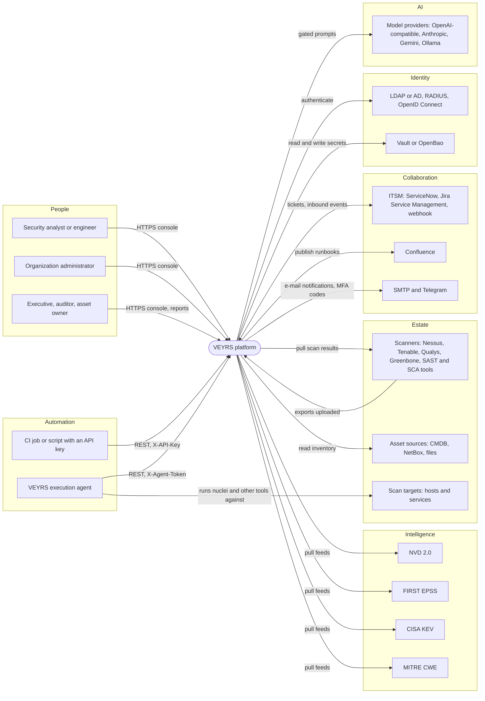
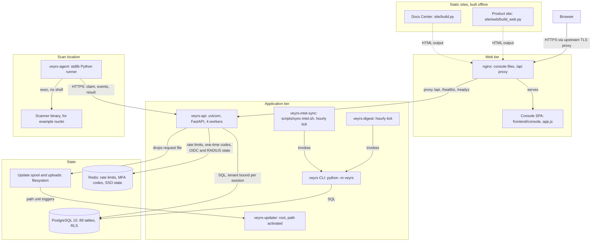
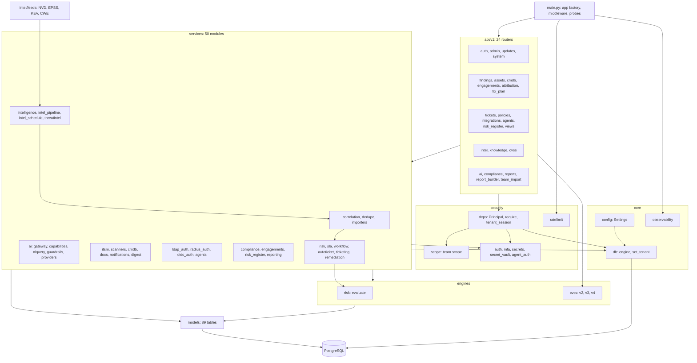

# C4 architecture diagrams

The diagrams use Mermaid `flowchart` with subgraphs rather than the C4 plugin syntax, so they render the same everywhere. Names match the code (service names, module names, table names). Terms are in the [glossary](../reference/glossary.md).

## 1. Level 1: System context

Who and what VEYRS talks to. Every integration is optional except the intelligence feeds (without them the platform scores against frozen data) and PostgreSQL and Redis (shown at level 2).

**Legend.** Rounded node = the system in scope. Rectangles = people or external systems, grouped by kind. Arrows point in the direction of the initiating call; `<-->` means calls in both directions (VEYRS creates tickets, the ITSM posts events back). Scanner exports reach VEYRS by upload, by VEYRS pulling from the scanner's API (Nessus, Tenable.io, Tenable.sc drivers), or through the agent, which runs its own scanner binaries (for example nuclei) against targets on its allowlist. Telegram carries MFA codes only; notifications go out in-app or by e-mail (`security/mfa_delivery.py`, `services/notifications.py` `TRANSPORTS`). Sources: `services/scanners.py`, `services/cmdb.py`, `services/itsm.py`, `services/itsm_inbound.py`, `services/docs.py`, `services/ldap_auth.py`, `services/radius_auth.py`, `services/oidc_auth.py`, `security/secret_vault.py`, `services/ai/providers.py`, `intel/feeds.py`.

| Relationship | Status | Evidence |
|---|---|---|
| Intelligence feeds (NVD, EPSS, KEV, CWE) | Verified | Timer and API observed on a live node; `intel/feeds.py` |
| Scanner upload and execution agent | Verified | Agent unit observed running on the primary node; `tests/test_phase16_agents.py` |
| ITSM, Confluence, asset sources, directory, RADIUS, OIDC, vault | Implemented | Code and unit tests; not exercised against live third parties in this review |
| AI providers | Implemented | `tests/test_phase6_ai.py` uses the deterministic provider only (ADR 0003) |

## 2. Level 2: Containers

A "container" here is a separately running process or data store inside one VEYRS installation, not a Docker container. The same diagram holds for the native install and the Compose stack; [deployment](deployment.md) maps it to hosts.

**Legend.** Cylinders = data stores. Boxes = processes. Solid arrows = runtime calls; dotted arrows = build-time output copied to a web root. Subgraphs group by tier. The intel and digest units are shell scripts that call the CLI; they hold no logic of their own. The agent reaches VEYRS only over HTTPS and only on `/api/v1/agents/self/*`. Redis holds no general cache: it keeps rate-limit windows (`security/ratelimit.py`), delivered MFA codes (`security/mfa_delivery.py`), OIDC flow and hand-off state (`services/oidc_auth.py:226,302`) and RADIUS challenges (`services/radius_auth.py:372-379`).

| Container | Technology | Source | Status | Evidence |
|---|---|---|---|---|
| veyrs-api | uvicorn 0.34, FastAPI 0.115, 4 workers | `infrastructure/systemd/veyrs-api.service`, `docker/entrypoint.sh` | Verified | Running on both live nodes; `/readyz` 200 with database and Redis ok |
| nginx and console | nginx, static JS | `infrastructure/nginx-veyrs-console.conf`, `docker/console.conf` | Verified | Vhost present on the live node |
| veyrs CLI | argparse, 20 top-level commands | `backend/veyrs/cli.py` | Implemented | Code read |
| veyrs-intel-sync, veyrs-digest | systemd timers or tick loop | `integrations/systemd/`, `infrastructure/systemd/`, `docker/tick.sh` | Verified | Both timers active on the live primary node |
| veyrs-updater | bash, systemd path unit | `scripts/veyrs-updater.sh`, `infrastructure/systemd/veyrs-updater.*` | Implemented | Not installed on the observed live nodes |
| veyrs-agent | Python standard library | `integrations/veyrs-agent/veyrs_agent.py` | Verified | Running on the live primary node |
| PostgreSQL, Redis | 15 and 7 | `docker/compose.yaml`, `INSTALL.md` | Verified | Reachable from the API (`/readyz`) |
| Docs Center, product site | Python standard library | `site/build.py`, `site/web/build_web.py` | Implemented | Code read |

## 3. Level 3: Components of the backend (veyrs-api)

The API container and the CLI share the same package, so this diagram is of `backend/veyrs/`. Arrows are real import directions between layers (see the matrix in [overview](overview.md#11-real-import-direction)); only the principal dependencies are drawn.

**Legend.** Boxes = Python packages or module groups; the cylinder is the database. Solid arrows = "imports or calls". Dotted = configuration read. Group labels are directory names under `backend/veyrs/`. Not drawn: `cli.py` (calls into services, intel, engines and security), `data/frameworks.py` (static catalogue read by `services/compliance.py`), and the `security → services` back-edges (`scope` → `services.teams`, `agent_auth` → `services.agents`).

Component responsibilities:

| Component | Responsibility | Key entry points |
|---|---|---|
| `main.py` | Composition root: middleware order, exception handlers, `/healthz`, `/readyz`, `/metrics` | `create_app()` |
| `api/v1/*` | Transport and authorization; thin handlers | `api_router` |
| `security/deps.py` | Resolve JWT or API key to a `Principal`, bind the tenant, check permissions | `get_principal`, `require`, `TenantSession` |
| `security/scope.py` | Team-level visibility and the route-tag policy | `resolve_for_user`, `enforce_route_policy` |
| `services/correlation.py` | CVE to installation to finding, the finding lifecycle, post-ingest pipeline | `process_finding`, `correlate_cve`, `ensure_finding` |
| `services/importers/` | Parsers and the normalizer that turns scanner output into findings | `run_import`, `ingest` |
| `services/dedupe.py` | Finding identity by algorithm | `resolve_identity`, `find_existing` |
| `engines/risk.py` | The scoring formula | `evaluate`, `BUILTIN_PROFILES` |
| `engines/cvss/` | Calculators and vector validation | `v2`, `v3`, `v4`, `detect_version` |
| `services/sla.py` | Deadlines, warnings, breaches, escalation | `apply_sla`, `evaluate_findings` |
| `services/workflow.py` | Trigger, condition, action registry | `trigger`, `ACTIONS` |
| `services/ai/gateway.py` | The only door to a model | `invoke` |
| `intel/feeds.py` and `services/intelligence.py` | Collect and ingest NVD, EPSS, KEV, CWE | `sync_nvd`, `ingest_nvd_pages` |
| `services/agents.py` | Agent enrolment, job queue, leases, result intake | `claim_next`, `submit_result` |
| `db.py` | Engine, session, tenant binding | `set_tenant`, `get_session` |

## 4. Code-level notes

The four modules below carry the invariants most likely to be broken by a well-meant change.

### 4.1 `db.py`: tenant binding

- `set_tenant(session, org_id)` runs `SELECT set_config('veyrs.current_org', :v, true)`. The third argument makes it transaction-local so a pooled connection cannot leak a tenant to the next request.
- The tenant is also stored in `session.info["veyrs_tenant"]` and re-applied by an `after_begin` listener on every new transaction. Without it, a handler that commits and keeps querying would read zero rows (RLS with no tenant matches nothing).
- A `connect` listener sets `statement_timeout = '30s'` and `idle_in_transaction_session_timeout = '60s'` on every connection.
- Invariant to preserve: any code path that reads a tenant table must bind a tenant first. Pre-auth reads (login, refresh, API key, agent token) are the four tables whose policy tolerates an unbound session.

### 4.2 `engines/risk.py`: scoring

- `evaluate(RiskInput, weights=, options=, profile_slug=)` computes four 0 to 100 sub-scores, a weighted mean (default weights 0.30 technical, 0.30 exploitability, 0.25 business, 0.15 exposure), then adjustments: KEV floor 75, internet-facing KEV floor 90, active-exploitation floor 80, age penalty 3 points per full 30 days (doubled past SLA, capped at 15), compensating-control credit applied to Exposure Risk only. Defaults are `DEFAULT_OPTIONS`; the five built-in profiles override them.
- The result carries an `explanation` with each factor's raw value, weight and points. The console renders it; it does not recompute it.
- `services/risk.py` wraps it (`score_finding`, `rescore_findings`, profile resolution, score history); `services/intel_pipeline.rescore_for_cves` is what the EPSS and KEV feeds call.
- Invariant to preserve: the function takes a dataclass and returns a result; it must not read the database, so it can be reused for what-if scoring.

### 4.3 `services/importers/base.py` with `services/correlation.py`: ingestion

- Parsers return `ScanRecord` objects and nothing else. `ingest()` decides asset identity, creates or updates `Vulnerability` and `Finding`, then calls `correlation.process_finding` (score, assign, SLA, auto-ticket, `finding.created` workflow if new).
- Records that cannot be tied to an asset in the tenant are rejected with a reason (up to 25 samples kept on the run).
- After the records, `engagements.reconcile_test` marks findings the test used to report and did not, and closes only past the absence threshold (see [data flows](data-flows.md#1-scan-import-to-verified-closure)).
- Invariant to preserve: reconciliation is scoped to the test's sightings. The old organization-wide `_close_missing` that marked an entire estate remediated from a three-host export was deleted (`importers/base.py:791-797`).

### 4.4 `services/ai/gateway.py`: the AI door

- `invoke()` returns an `AiResult` for every outcome, including refusals (`decision="blocked"`) and fallbacks (`decision="degraded"`). Each is audited in `ai_audit_log`.
- Provider choice orders explicit default first, then internal before external, then creation time (`select_provider`). The classification ceiling decides eligibility; an external provider defaults to ceiling `public`.
- Invariant to preserve: no other module calls a provider's `complete()`. A new AI feature builds an `AiRequest` and calls `invoke`.

## Sources

- `backend/veyrs/main.py`, `api/v1/__init__.py`, `db.py`, `engines/risk.py`
- `backend/veyrs/services/importers/base.py`, `services/correlation.py`, `services/ai/gateway.py`
- `integrations/systemd/`, `infrastructure/`, `docker/compose.yaml`
- Live read-only inspection of the primary and secondary application nodes on 2026-11-17 (unit lists, `/healthz`, `/readyz`)
