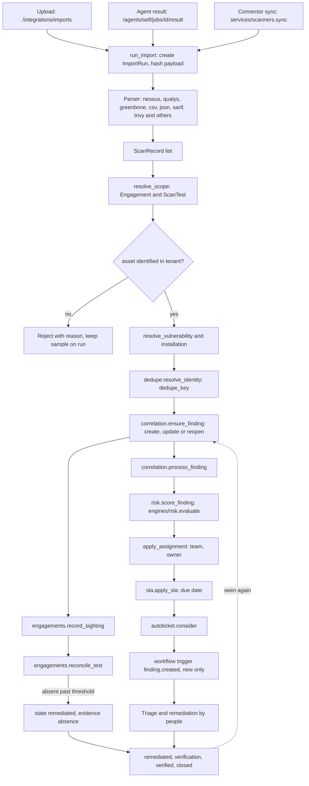
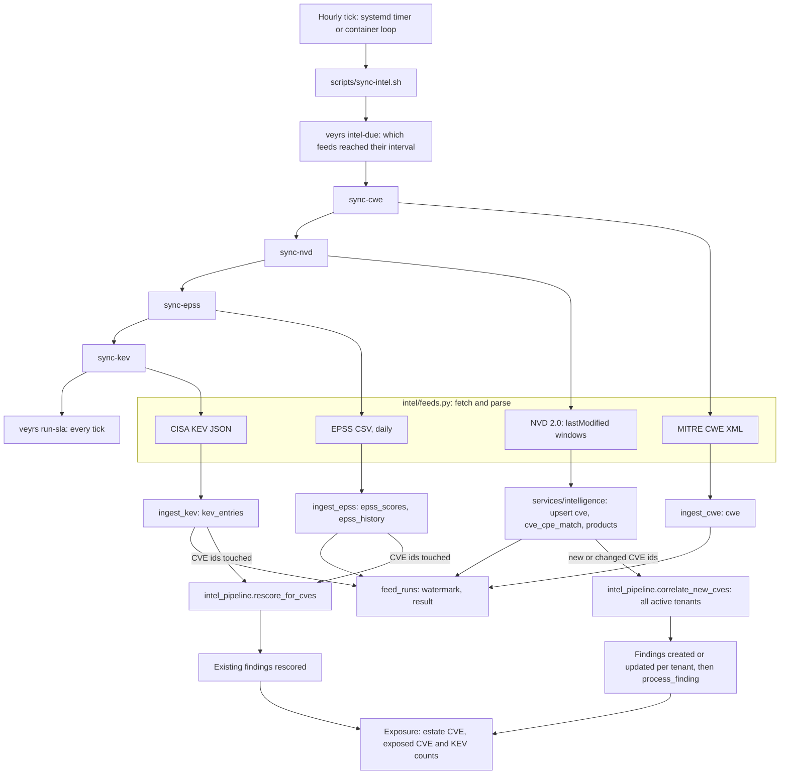
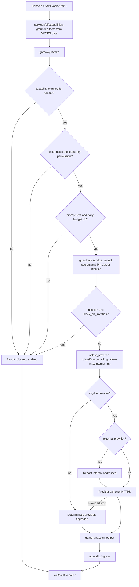
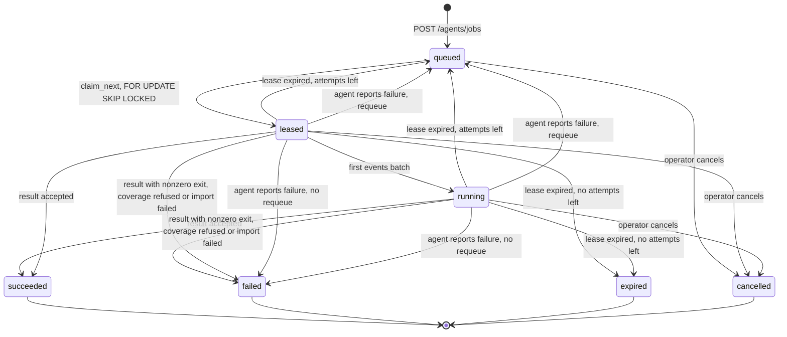
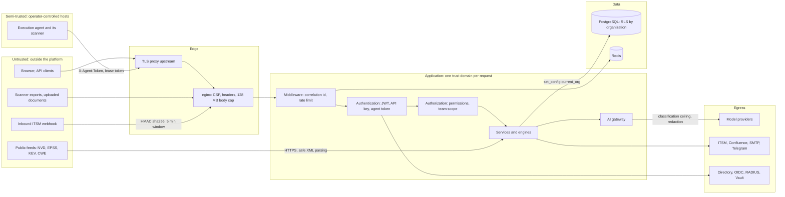

# Data flows

Terms such as finding, sighting, dedupe key and KEV are defined in the [glossary](../reference/glossary.md).

## 1. Scan import to verified closure

Three entry points converge on one pipeline and all call `importers.run_import`: `POST /api/v1/integrations/imports` (permission `importer:write`), an agent result (`POST /api/v1/agents/self/jobs/{id}/result`) and a scanner-connector sync (`services/scanners.sync`). Software inventories (`veyrs import-inventory`, `POST /api/v1/agents/self/inventory`, Nessus software-enumeration plugins) take a sibling path through the inventory services (`services/inventory.py`, `importers.ingest_inventory`) and feed the CVE correlation in section 2 instead of creating findings directly.

**Legend.** Rectangles = processing steps (names are functions or modules); diamond = decision; solid arrows = data or control flow; the dotted arrow is the regression path: a finding seen again in `remediated`, `verified` or `closed` is reopened as `new` with its SLA clock restarted.

| Stage | What happens | Source |
|---|---|---|
| Entry | Request body read in memory (nginx allows 128 MB; agent results are capped at 64 MB). The route checks `importer:write`. | `api/v1/integrations.py`, `services/agents.py:57` |
| `run_import` | Creates an `ImportRun` with content hash and options *before* parsing, so a failed parse is still a recorded failed run. | `services/importers/__init__.py:30` |
| Parse | A parser per format returns `ScanRecord`s. Format is named by the caller or detected from content. 6 classic and 14 modern parsers are registered. | `services/importers/parsers.py:417`, `parsers_modern.py:887` |
| Scope | Every import belongs to an engagement and a scan test; callers naming neither land in the tenant's "Continuous scanning" engagement. | `importers/base.py:597` |
| Asset resolution | A record with no hostname, FQDN or IP that resolves in the tenant is rejected with a reason (up to 25 samples). `create_assets` and `target_asset` options exist for formats with no host. | `importers/base.py:436` |
| Identity | One of four algorithms per scanner: `legacy` (default for scanners already in production), `unique_id_from_tool`, `hash_code`, `unique_id_or_hash_code`. | `services/dedupe.py:272` |
| Finding upsert | Creates the finding, updates it, or reopens it as a regression. | `services/correlation.py:445` |
| Pipeline | Score, assign, SLA, auto-ticket, then workflows if the finding is new, in that order because later steps read earlier results. | `services/correlation.py:576-609` |
| Reconciliation | Compares this run with the test's sightings. Findings not reported increment `consecutive_absences`; at the threshold for the engagement type (1 `ci_cd`, 2 `scheduled`, 0 never for `interactive`) they move to `remediated` with `evidence: "absence"`. | `services/engagements.py:231-330` |
| SLA sweep | `veyrs run-sla` on every intel tick: `warned`, `breached`, `escalated` events, each firing the matching workflow trigger and notifications. | `services/sla.py:337-476`, `scripts/sync-intel.sh` |
| Ticket loop | Auto-ticket is off by default (`DEFAULT_ENABLED = False`; when on: risk >= 70, at most 50 per hour). Resolving a `remediation` ticket advances the finding to `remediated`, never past it. An inbound ITSM event is advisory unless the operator enabled `inbound_transitions` for the connector. | `services/autoticket.py:69-86`, `services/ticketing.py:44,256-275`, `services/itsm_inbound.py` |
| Verification | A person moves `remediated` to `verification` to `verified` to `closed`; a failed verification returns the finding to `in_progress`. Transitions are validated against `ALLOWED_TRANSITIONS`; anything else is HTTP 409. | `models/vulnerability.py:48-66` |

Properties worth knowing:

- **Closure by absence is not verification.** The event records `evidence: "absence"` and reports must say so (`services/engagements.py:316`). An agent result may close findings only if its scan statistics attest coverage (at least 80 percent, `MIN_COVERAGE_PERCENT`); otherwise `close_absent` is forced off (`services/agents.py:845-1000`).
- **A partial export cannot close findings outside its scope.** The sighting set is per scan test, and since 0.41.0 absences count only on the assets the run covered ([ADR 0009](../ADRs/0009-closure-per-covered-asset.md)), so a three-host export cannot touch any other host, whether or not the test reported it before.
- **A ticketing failure cannot lose a finding.** `autoticket.consider` catches and logs; the finding is committed first.

## 2. Intelligence feeds to catalogue to exposure

**Legend.** Steps in the top row run in the fixed order CWE, NVD, EPSS, KEV, then the SLA sweep. The `intel-due` step skips feeds that are not due; the SLA sweep runs regardless. Cylinders are not drawn: all writes land in PostgreSQL. `feed_runs` is global (not under RLS); everything created in "Findings" is tenant data under RLS.

| Stage | Behaviour | Source |
|---|---|---|
| Schedule | `intel-due` reads the effective schedule across tenants (`organizations.settings.intel_schedule`) and the last successful `feed_runs` row per feed. | `services/intel_schedule.py:196` |
| NVD | Incremental by `lastModified`; windows of at most 120 days; 7 s between requests anonymous, 1 s with a key; default backfill 90 days, `--full` walks from 2002. | `intel/feeds.py:48-66` |
| EPSS | Daily CSV into `epss_scores` and snapshots into `epss_history`; history pruned to `VEYRS_EPSS_HISTORY_DAYS`. | `services/intelligence.py:503,660` |
| KEV | Catalogue into `kev_entries` with due date and ransomware flag. | `services/intelligence.py:715` |
| CWE | Dictionary refresh; runs first so placeholder rows NVD creates are named. | `intel/feeds.py:477` |
| Correlation | New or revised CVEs get full correlation against every active tenant's inventory; EPSS and KEV only rescore findings that already exist, because they change urgency, not applicability. | `services/intel_pipeline.py:51,91,146` |
| Failure semantics | A feed that fetches nothing is not recorded as a successful run. Records rejected by the database make the command exit 3 so a unit shows failed, not green. | `intel/feeds.py:494-545` |

Exposure is computed on read, not stored: a CVE is *exposed* for a tenant when it matches an installation (`services/intelligence.py:947-1030`). The product's value depends on installations carrying versions; an asset register without versions produces no findings (`integrations/fleet-import/collect_fleet.py` header).

> [!WARNING]
> Without the hourly tick the platform keeps scoring against intelligence frozen at the last run, and SLA deadlines stop being evaluated. The console does not warn about a stopped tick. Check `veyrs intel-due` and the timer (`systemctl list-timers 'veyrs*'`).

## 3. AI request to gateway to provider

**Legend.** Diamonds are policy checks; each refusal is a returned result (decision `blocked`), not an exception, and each is written to `ai_audit_log`. "Degraded" means the answer came from VEYRS data without a model and is labelled so. Defaults when a tenant has no `ai_policies` row: external providers off (`VEYRS_AI_ALLOW_EXTERNAL` defaults to false), local providers on, external ceiling `public`, secrets and PII redaction on, injection blocking on, 24,000 character prompt limit, 2,000 calls per day (`services/ai/gateway.py:88-120`).

Natural-language search has an extra constraint: a deterministic heuristic parser runs first; a model, if used, may only emit JSON that `nlquery.validate` accepts against the closed grammar, and VEYRS compiles the query and appends the tenant predicate itself ([ADR 0004](../ADRs/0004-closed-query-grammar.md)).

## 4. Agent job lifecycle

The agent queue is a table (`agent_jobs`). Request-level calls are in [sequences](sequences.md#4-agent-job-claim-lease-and-result).

**Legend.** Boxes are `JobState` values (`models/agent.py:66`); labels are the triggering action. `expired` is deliberately distinct from `failed`: nothing is known about whether the scan ran, so it must not be read as "the host was clean".

Lease expiry is evaluated by `reap_expired_leases`, which is called only by `POST /api/v1/agents/maintenance/reap` (permission `agent:write`). No shipped timer, script or CLI command calls it.

> [!IMPORTANT]
> A job whose agent dies keeps its `leased` or `running` state until something calls the reap endpoint. Schedule that call (for example from cron with an API key holding `agent:write`) on any installation that depends on agents. The `veyrs-agent.service` unit comment documents the endpoint but no timer is installed.

## 5. Trust boundaries

**Legend.** Each subgraph is a trust zone; an arrow that crosses a zone boundary is labelled with the control applied there where one exists. The second tenant barrier is the arrow into PostgreSQL: even if `authz` or a query is wrong, RLS returns zero rows for another tenant.

| Boundary | Control | Source |
|---|---|---|
| Internet to application | TLS terminated upstream; nginx adds CSP, `X-Frame-Options`, `nosniff`; API adds the same on every response | `infrastructure/nginx-veyrs-console.conf`, `observability.py:SECURITY_HEADERS` |
| Caller identity | Argon2id passwords, JWT with audience, API key prefix lookup then Argon2 verify, optional MFA; same 401 for every login failure | `security/auth.py`, `api/v1/auth.py:364-557` |
| Credential stuffing | Per-IP budget on auth paths; per-user lockout after repeated failures, shared between password and second factor | `security/ratelimit.py`, `api/v1/auth.py:104-114` |
| Client address | Only `request.client.host`, resolved by uvicorn through `--forwarded-allow-ips`; `X-Forwarded-For` is never read | `security/ratelimit.py:128`, `security/deps.py:audit_actor` |
| Tenant | Principal always carries an organization; RLS binds it in the database | `security/deps.py`, `db.py` |
| Agent to server | Separate credential type with its own header; may call only `/agents/self/*`; writes need the lease token | `security/agent_auth.py`, `services/agents.py:720` |
| Server to agent | The server never sends a command line; the agent builds argv locally, uses no shell, and re-checks its own allowlist | `integrations/veyrs-agent/veyrs_agent.py` header |
| Uploads and feeds | XML parsed with entity declarations refused; format-specific parsers; size caps | `services/xmlsafe.py`, `services/importers/parsers.py` |
| Inbound webhook | HMAC over `timestamp.body`, five-minute window; advisory by default | `services/itsm_inbound.py` |
| Outbound AI | Policy, redaction, classification ceiling, audit | `services/ai/gateway.py` |
| Stored credentials | Fernet envelope or external vault; unreadable secret returns 503 | `security/secrets.py`, `main.py:157` |

Threat analysis proper (assets, actors, residual risk) is in the [threat model](../THREAT_MODEL.md).

## Sources

- `backend/veyrs/services/importers/`, `services/correlation.py`, `services/engagements.py`, `services/sla.py`, `services/autoticket.py`, `services/ticketing.py`
- `backend/veyrs/intel/feeds.py`, `services/intel_pipeline.py`, `services/intel_schedule.py`, `scripts/sync-intel.sh`
- `backend/veyrs/services/ai/gateway.py`, `services/agents.py`, `security/agent_auth.py`
