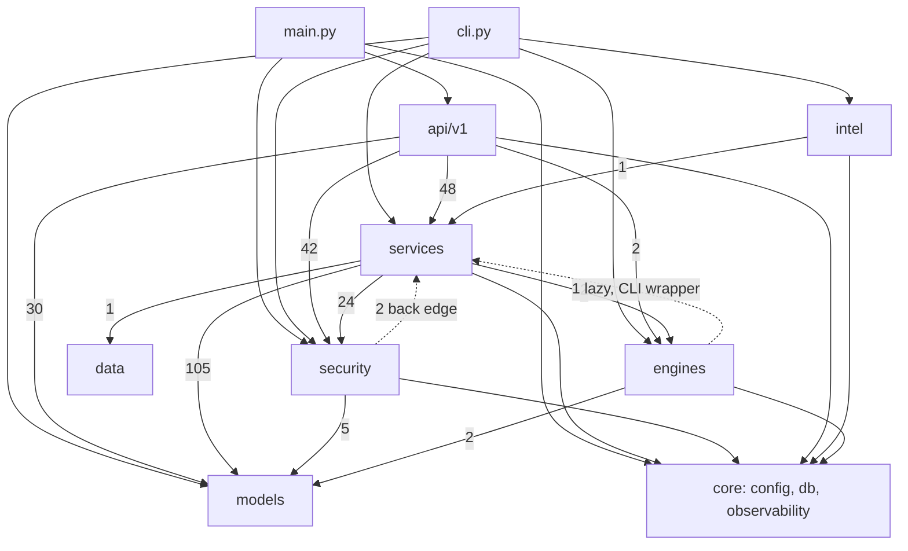
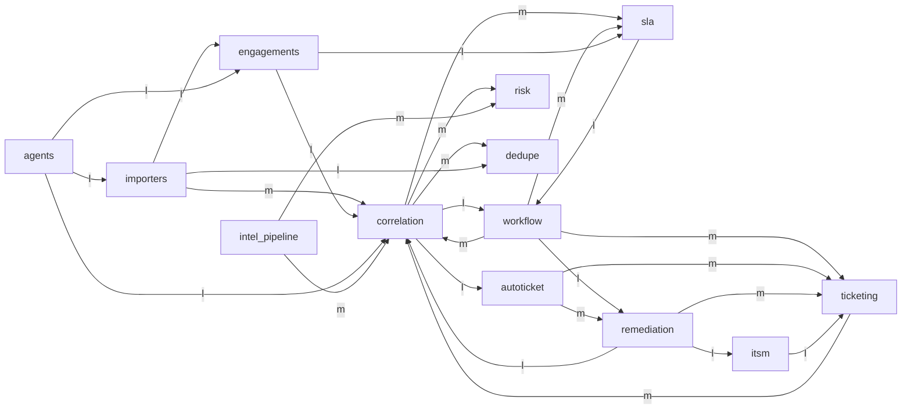

# Dependencies

## 1. Internal module dependencies

### 1.1 Method

The graph is derived, not drawn from memory. Every `.py` file under `backend/veyrs` (140 files) is parsed with Python's `ast` module; each `import` or `from ... import` that resolves to a `veyrs` module becomes an edge, including relative imports and imports inside functions. The result was grouped by directory. Reproduce it from the repository root:

```bash
python3 - <<'PY'
import ast, collections, os

ROOT = "backend/veyrs"
LAYERS = {"api", "services", "engines", "intel", "models", "security", "data"}

def layer(mod):
    parts = mod.split(".")
    if len(parts) > 1 and parts[1] in LAYERS:
        return parts[1]
    return "core:" + (parts[1] if len(parts) > 1 else "pkg")

edges = collections.Counter()
for dirpath, _, files in os.walk(ROOT):
    for name in files:
        if not name.endswith(".py"):
            continue
        path = os.path.join(dirpath, name)
        mod = path[len("backend/"):-3].replace("/", ".")
        pkg = mod if name == "__init__.py" else mod.rsplit(".", 1)[0]
        for node in ast.walk(ast.parse(open(path).read())):
            if not isinstance(node, ast.ImportFrom):
                continue
            if node.level:
                base = pkg.split(".")
                base = base[: len(base) - (node.level - 1)]
                if node.module:
                    targets = [".".join(base + [node.module])]
                else:
                    targets = [".".join(base + [a.name]) for a in node.names]
            elif node.module and node.module.startswith("veyrs"):
                targets = [node.module]
            else:
                continue
            for target in targets:
                if layer(mod) != layer(target):
                    edges[(layer(mod), layer(target))] += 1
for (a, b), n in sorted(edges.items()):
    print(f"{a} -> {b}: {n}")
PY
```

Run from the repository root; it reads files only. `grep -rEn "^\s*(from|import) veyrs" backend/veyrs` finds only one absolute import because the codebase uses relative imports throughout, which is why a regex over `^from veyrs` under-reports and the parser is needed.

### 1.2 Layer graph



**Legend.** Boxes are directories (or `main.py`, `cli.py`). Solid arrows are imports; the number is the count of import statements. Dotted arrows are the two places the layering is not strictly downward: `security` importing `services.teams` and `services.agents`, and `engines/risk.py` importing `services.risk` inside `run_cli()`. No edge points into `api` except from `main.py`. `models` has no outgoing edges.

### 1.3 Service cluster

Most services are leaves. One cluster is mutually dependent: the finding lifecycle. Edges below are import relations among services, each labelled "m" for module-level or "l" for function-local.



**Legend.** Arrow `A -->|m| B` means module A imports B at module level; `|l|` means inside a function. Not every service edge is drawn (for example `correlation` also imports `intelligence` and `versions`). Services import each other by module, so the cycle correlation, workflow, ticketing, autoticket, remediation, sla, itsm is a strongly connected component of seven modules that only loads because the edges closing each cycle are function-local (`correlation` to `workflow` and `autoticket`, `sla` to `workflow`, `workflow` to `remediation`, `remediation` to `correlation` and `itsm`, `itsm` to `ticketing`). Edge kinds were re-derived with `ast` (an import statement at module top level is "m", anything inside a function is "l") on 2026-11-17.

Fan-in (most imported services): `correlation` 9, `versions` 9, `audit` 6, `ticketing` 5, `intelligence` 4. Highest fan-out: `importers` 9, `correlation` 7, `agents` 6, `workflow` 5. `risk`, `notifications` and `audit` import no other service.

### 1.4 Findings from the graph

| Finding | Evidence | Consequence |
|---|---|---|
| The lifecycle services form a cycle held together by late imports | `services/correlation.py:598`, `services/sla.py` (`workflow` imported in `evaluate_findings`), `services/remediation.py`, `services/engagements.py` | A new module-level import among these seven can raise `ImportError` at startup. Add function-local imports, as the existing code does. |
| `agents` and `scanning` import each other | strongly connected pair in the parsed graph | Same caution. |
| `security` depends on `services` | `security/scope.py:42`, `security/agent_auth.py:26` | Security is not a leaf layer; do not import `security.scope` from `services.teams`. |
| `engines/risk.py` is not import-pure | `engines/risk.py:36`, `:546-548` | `evaluate()` is database-free; the file is not. |

## 2. External Python dependencies

Direct dependencies are declared with exact pins in `pyproject.toml`; `requirements.txt` is the full resolved lock (Python 3.11.2) so every node installs byte-identical software. Update both files together (`scripts/freeze-deps.sh`). Python 3.11 or newer is required (`requires-python`).

| Package | Pin | What VEYRS uses it for | Where |
|---|---|---|---|
| fastapi | 0.134.0 | HTTP framework, dependency injection, OpenAPI generation | `main.py`, `api/v1/*` (31 files) |
| starlette | 1.3.1 (transitive) | Middleware base classes | `observability.py`, `security/ratelimit.py` |
| uvicorn[standard] | 0.34.0 | ASGI server; `standard` brings `uvloop`, `httptools`, `websockets`, `watchfiles` | `infrastructure/systemd/veyrs-api.service`, `docker/entrypoint.sh` |
| python-multipart | 0.0.31 | Form and file upload parsing. Never imported by VEYRS; without it every upload endpoint fails at request time | scanner imports, document upload |
| pydantic | 2.10.4 | Request and response schemas | `api/v1/*` (18 files) |
| pydantic-settings | 2.7.0 | `Settings` from `VEYRS_*` environment and `.env` | `config.py` |
| SQLAlchemy | 2.0.36 | ORM and Core | 97 files |
| psycopg[binary] | 3.2.3 | PostgreSQL driver; selected by the `postgresql+psycopg://` URL, not imported directly | `config.py` default URL, `docker/init.sh` |
| redis | 5.2.1 | Rate-limit windows, short-lived MFA and inventory state, readiness ping | `security/ratelimit.py`, `security/mfa_delivery.py`, `services/software_inventory.py`, `main.py`, `cli.py` |
| argon2-cffi | 23.1.0 | Argon2id hashes for passwords, API keys, agent tokens | `security/auth.py` |
| cryptography | 50.0.0 | Fernet envelope for secrets at rest | `security/secrets.py` |
| PyJWT[crypto] | 2.15.1 | JWT encode and decode (HS256 access tokens), OIDC ID-token verification (RS/PS/ES against the provider JWKS; `at_hash` checked in `services/oidc_auth.py`). Replaced python-jose in 0.41.0 | `security/auth.py`, `services/oidc_auth.py` |
| email-validator | 2.3.0 | E-mail field validation | `api/v1/schemas.py` |
| ldap3 | 2.9.1 | LDAP and Active Directory authentication; imported lazily so a missing package degrades one page, not the API | `services/ldap_auth.py` |
| httpx | 0.28.1 | All outbound HTTP: feeds, ITSM, scanners, AI providers, vault, Telegram, CMDB | `intel/feeds.py`, `services/itsm.py`, `scanners.py`, `cmdb.py`, `ai/providers.py`, `security/secret_vault.py`, `mfa_delivery.py` (9 files) |
| reportlab | 5.0.0 | PDF report rendering | `services/reporting.py` |
| openpyxl | 3.1.5 | XLSX export and CMDB file import | `services/reporting.py`, `services/cmdb.py` |
| python-docx | 1.2.0 | DOCX text extraction for document intelligence | `services/documents.py` |
| pypdf | 6.21.4 | PDF text extraction | `services/documents.py` |
| segno | 1.6.6 | Server-side SVG QR code for TOTP enrolment (no third-party script in the console) | `security/mfa.py` |
| pytest | 8.3.4 | Test runner (optional `dev` extra; present in the lock) | `tests/` |

Notes:

- TOTP, RADIUS and the NVD, EPSS, KEV and CWE parsers are written on the standard library. `pyotp` was removed from the dependency set rather than adopted (`pyproject.toml` comment).
- `lxml` and `pillow` appear in `requirements.txt` as requirements of `python-docx` and `reportlab`; VEYRS code does not import them. `pillow` is also pinned directly in `pyproject.toml` so the lock cannot drift below the release that fixes its advisories (R-01).
- Since 0.41.0 `requirements.txt` carries sha256 hashes for every file of every pin and installs run with `--require-hashes` (R-21). `scripts/osv-check.py` queries OSV for every pin; `scripts/sbom.sh` writes a CycloneDX SBOM from the lock.
- XML from scanners and feeds is parsed through `services/xmlsafe.py`, which refuses entity declarations.
- Qdrant is not a dependency. `services/search.py` defines a `VectorBackend` interface with a `NullVectorBackend` default; no shipped code implements a Qdrant client, so semantic search is not available in 0.39.1 (see [overview](overview.md#4-patterns) and findings).

## 3. System and service dependencies

| Component | Version | Required | Used for | Evidence |
|---|---|---|---|---|
| Python | 3.11 or newer | Yes | Runtime; the container image uses 3.11 | `pyproject.toml`, `docker/Dockerfile` |
| PostgreSQL | 15 or newer, UTF8 encoding | Yes | All state; RLS | `INSTALL.md`, `docker/compose.yaml` (`postgres:15-bookworm`) |
| Redis | 7 in the container stack | Yes (rate limiting degrades without it; `/readyz` fails) | Rate-limit windows, short-lived state | `main.py:readyz`, `security/ratelimit.py` |
| nginx | system package or 1.28 in the console image | Yes for the console | Static files and `/api/` proxy | `infrastructure/nginx-veyrs-console.conf`, `docker/Dockerfile` |
| systemd | host installs | Yes for native | Service, timers, updater path unit | `infrastructure/systemd/`, `integrations/systemd/` |
| Docker with the compose plugin | any current | Docker shape only | Container stack | `docker/veyrs-docker.sh` |
| nuclei | 3.11.1, SHA-256 pinned | Optional (agent image) | Reference scanner for the agent | `docker/Dockerfile` (`agent` stage) |
| Outbound HTTPS to NVD, FIRST, CISA, MITRE | n/a | For fresh intelligence | Feeds | `config.py` URL settings |
| SMTP, Telegram | n/a | Optional | Notifications, MFA delivery | `services/notifications.py`, `security/mfa_delivery.py` |
| Vault or OpenBao (KV v2) | n/a | Optional | External secret store | `security/secret_vault.py` |
| AI providers, Ollama | n/a | Optional | AI capabilities | `services/ai/providers.py` |

The destinations VEYRS needs are enumerated by the product itself in **Administration, Network access** (`services/network_requirements.py`).

## 4. Frontend dependencies

None. The console is plain JavaScript with no package manager and no bundler; fonts (Inter, JetBrains Mono) are self-hosted under `frontend/console/fonts` so the CSP can stay `font-src 'self'` (`frontend/README.md`, `infrastructure/nginx-veyrs-console.conf`). The two static-site builders use only the Python standard library.

## Sources

- `pyproject.toml`, `requirements.txt`, `docker/Dockerfile`
- AST scan of `backend/veyrs/**/*.py` (script above)
