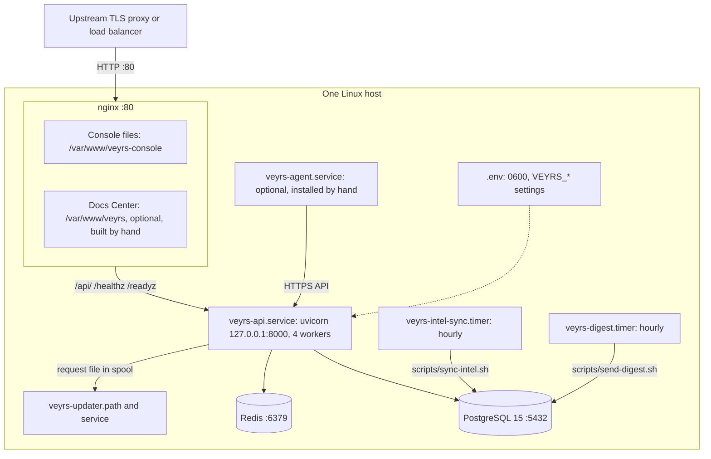
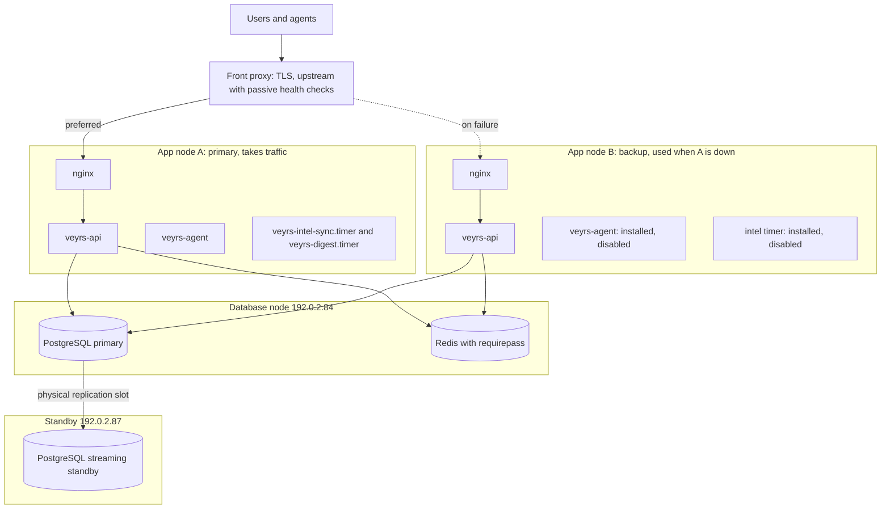
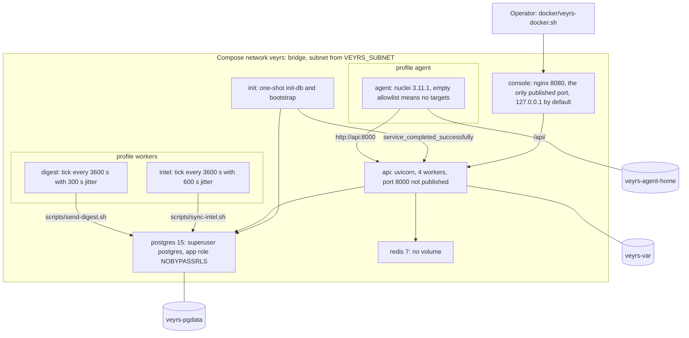

# Deployment architecture

VEYRS is the same application in every deployment: stateless API processes, one PostgreSQL database, Redis, nginx in front. The shapes differ in who supervises the processes and how many machines are involved. Hostnames and addresses below are examples (`veyrs.example.com`, `192.0.2.0/24`).

## 1. Shapes at a glance

| | Native, single node | Native, split with standby | Docker Compose |
|---|---|---|---|
| Intended for | Small production, labs | Production that must survive a process or host loss | Evaluation, development, a small single node |
| Supervisor | systemd | systemd | Docker (restart policy), `docker/veyrs-docker.sh` |
| Installer | `install.sh` or `veyrs-setup.sh` | `install.sh --skip-postgres --skip-redis` on each app node plus a separately built database node | `docker/veyrs-docker.sh init` then `up`, or `veyrs-setup.sh` |
| Application and database | Same host | Different hosts | One Compose project (or an external PostgreSQL via an overlay) |
| Background work | `veyrs-intel-sync.timer`, `veyrs-digest.timer` | Same, on exactly one app node | `intel` and `digest` services in profile `workers` (off by default) |
| Scan agent | `veyrs-agent.service`, installed by hand | Same, on exactly one app node | `agent` service in profile `agent` (off by default) |
| TLS | Terminated upstream of nginx | Terminated on the front proxy | Terminated upstream of the `console` container |
| Status | Verified | Verified | Implemented |

Status basis: the native single-node and split shapes were observed live (read-only) on 2026-11-17; the Compose stack was read but not started in this review.

The three properties that make all shapes the same system: the API holds no local state, configuration comes only from environment variables (`VEYRS_*`, listed in [configuration](../reference/configuration.md)), and probes are split into liveness `/healthz` (200 even if the database is gone) and readiness `/readyz` (503 if PostgreSQL or Redis fails).

## 2. Native deployment

### 2.1 Single node



**Legend.** Boxes are processes or unit files, cylinders are data stores, the dotted arrow is configuration. The agent normally runs on a host inside the network it scans and reaches the API through the proxy; it is drawn on the node only for the single-node case.

What `install.sh` does (nine steps, idempotent, never overwrites `.env`): preflight; system packages; Python interpreter choice; PostgreSQL role and UTF8 databases; Redis; pinned Python dependencies into `/opt/veyrs/venv`; configuration and secrets in `/opt/veyrs/.env`; `veyrs init-db`, `veyrs check` and `veyrs bootstrap`; the `veyrs-api` unit; the nginx vhost and console copy; verification against `/readyz` and a 401 on an unauthenticated call. It also installs `veyrs-updater.path`, and the two timers unless `--skip-timers` is given. It does **not** install `veyrs-agent.service`. Supported families: Debian/Ubuntu, openSUSE/SLES, RHEL/Rocky/Alma (five images measured, see `install.sh` header).

```bash
# On the target host, as root, from a checkout or an extracted release at /opt/veyrs.
sudo ./install.sh --dry-run    # print the plan, change nothing
sudo ./install.sh              # interactive; add --unattended and flags for automation
```

| Item | Location | Notes |
|---|---|---|
| Application tree | `/opt/veyrs` | `backend/`, `scripts/`, `docs/` |
| Virtualenv | `/opt/veyrs/venv` | Built from `requirements.txt` |
| Configuration | `/opt/veyrs/.env` | Mode 0600; holds `VEYRS_SECRET_KEY`, `VEYRS_ENCRYPTION_KEY`, `VEYRS_DATABASE_URL`, `VEYRS_REDIS_URL`. Losing the encryption key makes stored third-party credentials unreadable |
| API unit | `/etc/systemd/system/veyrs-api.service` | `uvicorn veyrs.main:app --host 127.0.0.1 --port 8000 --workers 4 --proxy-headers --forwarded-allow-ips=${VEYRS_FORWARDED_ALLOW_IPS}` |
| Timers | `veyrs-intel-sync.timer`, `veyrs-digest.timer` | `OnCalendar=hourly`, `RandomizedDelaySec` 600 and 300, `Persistent=true` |
| Updater | `veyrs-updater.path` watching `/var/lib/veyrs/update-requests/*.json` | Root half of the in-product update; the API may only drop a request file there |
| nginx vhost | `infrastructure/nginx-veyrs-console.conf`, installed into the distribution's conf directory | Serves the console, proxies `/api/` with a 300 s read timeout and 128 MB body limit |
| Ports | 80 (nginx), 8000 (loopback only), 5432 and 6379 if local | Firewall is changed only with `--open-firewall` |

The API unit is hardened (`NoNewPrivileges`, `ProtectSystem=strict`, `ProtectHome`, `PrivateTmp`, `MemoryDenyWriteExecute`, only `/opt/veyrs/var` and the update spool writable) but runs as `root` (`User=root`); `INSTALL.md` explains why and what that implies.

The proxy trust chain matters: uvicorn believes `X-Forwarded-For` only from the addresses in `VEYRS_FORWARDED_ALLOW_IPS` (default `127.0.0.1`, the local nginx). Behind a second proxy, add its address in `.env`, otherwise every user is recorded and rate-limited as that proxy.

Guided alternative: `sudo bash veyrs-setup.sh` asks every question up front, verifies the release signature (`SHA256SUMS.sig` against `release/allowed_signers`), refuses an external database role that is a superuser or has `BYPASSRLS`, and then drives `install.sh` (native) or `docker/veyrs-docker.sh` (Docker). It passes answers by environment, never by argument.

### 2.2 Split deployment with a standby (HA)

This is the production shape recorded in [ADR 0007](../ADRs/0007-stateless-app-nodes.md) and [ADR 0008](../ADRs/0008-state-off-host-and-proven-backups.md) and operated per [HIGH_AVAILABILITY](../HIGH_AVAILABILITY.md).



**Legend.** Solid arrows are normal traffic; the dotted arrow is the failover path in the proxy. Subgraphs are machines (containers or VMs). Node A is also the **singleton host**: the agent and the intelligence timer run on exactly one node because two runners claiming the same jobs is corruption and two feed syncs compete for one NVD rate limit. Addresses are documentation examples.

| Property | State |
|---|---|
| App node loss | Automatic: the proxy retries the surviving node; no DNS change |
| Why no sticky sessions | Sessions are `refresh_tokens` rows, access tokens are JWTs signed with a shared secret, rate limits are in shared Redis, uploads are processed in memory |
| Routing mode | ADR 0007 describes least-connections active/active; `HIGH_AVAILABILITY.md` records that node B was demoted to `backup` on 2026-08-18, so traffic goes to A unless it is down |
| Database loss | Outage until an operator promotes the standby (manual, four steps) or restores a dump. Automatic promotion is deliberately absent: two primaries cannot be reconciled |
| Redis | Single instance on the database node; **not replicated**. Holds rate-limit counters and cache only |
| Singleton failover | Manual: enable `veyrs-agent` and the intel timer on node B if A is lost for long |
| Backups | Nightly logical `pg_dump` as the PostgreSQL superuser (02:15), copied off-host with SHA-256 verification; weekly restore proof (Sunday 04:30); replication check every 15 minutes |
| Local test database | Each node keeps its own, never pointed at the production database (`VEYRS_TEST_DATABASE_URL`) |

> [!WARNING]
> Never take a backup with `pg_dump` as the application role. Row level security is forced on 73 tables, so the dump exits 0 with an archive that is truncated or empty. Use the shipped scripts (`infrastructure/backup/veyrs-pgdump.sh`, `scripts/backup.sh`, `docker/veyrs-docker.sh backup`), which dump as the superuser and verify.

Observed on 2026-11-17 (read-only inspection of the two application nodes of the reference installation): node A runs `veyrs-api`, `veyrs-agent`, `veyrs-intel-sync.timer` and `veyrs-digest.timer`, all active; node B runs only `veyrs-api`, with the agent and intel timer disabled and no digest timer unit installed. Both answered `/healthz` and `/readyz` with database and Redis `ok`, with uvicorn started as `--workers 4` and the front proxy address in `--forwarded-allow-ips`. The front-proxy routing and the database tier were not reachable from the inspection host and are taken from `HIGH_AVAILABILITY.md`, which records that the standby and all four containers currently share one physical host.

Build steps for an app node in this shape:

```bash
# On each application node, as root, from the release tree in /opt/veyrs.
# Supply DB_PASSWORD and REDIS_PASSWORD as environment variables (see
# ./install.sh --help), not as arguments, which are visible in ps(1).
sudo ./install.sh --skip-postgres --skip-redis \
  --db-host db.example.com --db-name veyrs --db-user veyrs \
  --redis-host db.example.com
```

The database node needs PostgreSQL 15 with the application role created `NOSUPERUSER NOCREATEDB NOCREATEROLE NOBYPASSRLS`, `pg_hba.conf` entries per app node (one `/32` each), Redis with a password, and the same `VEYRS_SECRET_KEY` and `VEYRS_ENCRYPTION_KEY` in every node's `.env`. See `INSTALL.md` section 2 for the database-side commands.

## 3. Docker Compose deployment



**Legend.** Subgraphs `workers` and `agent` start only when their Compose profile is selected. Cylinders are named volumes. `init` is the only container that holds the PostgreSQL superuser credentials. `api`, `console`, `intel`, `digest` and `agent` are `read_only` with `cap_drop: ALL`, `no-new-privileges` and a tmpfs `/tmp`; `init` keeps a reduced capability set so it can chown the data directory.

```bash
# On a Docker host with the compose plugin, as a user allowed to run docker,
# from the repository root.
docker/veyrs-docker.sh init              # writes docker/.env (0600) with generated secrets
docker/veyrs-docker.sh up                # builds or pulls, starts, waits for /readyz
docker/veyrs-docker.sh up --with-workers # also intel and digest (needed for real use)
docker/veyrs-docker.sh status            # health plus which background work is NOT running
```

| Decision | Why | Source |
|---|---|---|
| Application role is not a superuser | `POSTGRES_USER=veyrs` would make it one, and a superuser bypasses RLS silently. The superuser is `postgres`; `docker/initdb.d/10-app-role.sh` creates the role `NOSUPERUSER NOCREATEDB NOCREATEROLE NOBYPASSRLS` | `docker/compose.yaml`, `docker/initdb.d/10-app-role.sh` |
| Only `console` publishes a port | Makes the console's pinned address a trustworthy value for `VEYRS_FORWARDED_ALLOW_IPS`; with the API port open, any caller could forge a source address and defeat the auth rate limit | `docker/compose.yaml` (`api.expose`) |
| Superuser credentials reach `init` only | A long-lived network-facing process must not hold credentials that bypass tenant isolation | `docker/compose.yaml` (`init.environment`) |
| Workers reuse the host scripts | The feed order has one home: `scripts/sync-intel.sh` | `docker/compose.yaml`, `docker/tick.sh` |
| `workers` and `agent` are off by default | A first `up` would start a multi-hour NVD pull; the agent sends traffic to third parties | `docker/compose.yaml` header |
| External database overlay | `VEYRS_COMPOSE_OVERLAYS=compose.external-db.yaml` points the stack at a PostgreSQL outside Compose; the role is checked and refused if it is a superuser or has `BYPASSRLS` | `docker/compose.external-db.yaml`, `veyrs-setup.sh` |
| Images | `veyrs` (API, init, workers), `veyrs-console` (nginx plus static console), `veyrs-agent`; `python:3.11-slim` and `nginx:1.28-alpine` bases pinned by digest | `docker/Dockerfile` |

Container-specific limits: an empty `VEYRS_SECRET_KEY` makes `entrypoint.sh` refuse to start (with several workers each would sign tokens with a different random key). The `veyrs-var` volume exists for the self-update staging area; it is not where documents or reports are stored (see [overview](overview.md#42-stateless-nodes)). The in-product update (`veyrs-updater`) is a native-install mechanism; containers are updated by pulling new images.

## 4. Choosing a shape

| Requirement | Choose |
|---|---|
| Try the product in ten minutes | Compose, with `--with-workers` if you want data to age forward |
| One server, accept a short outage on failure | Native single node, backups scheduled |
| Survive loss of a process or one application host | Native split with a standby |
| Air-gapped host | Compose with the offline image bundle, or native with `--skip-timers` and a way to load intelligence |
| Kubernetes | Not shipped. The API is stateless and probe-separated, but there is no chart and no secret-management story beyond a 0600 `.env` |

## 5. Limits

| Limit | Detail | Severity |
|---|---|---|
| Database is a single point of failure | One PostgreSQL primary; promotion of the standby is manual; Redis is not replicated | High |
| Standby independence is not guaranteed | Per `HIGH_AVAILABILITY.md` the standby, the off-host dump copy and the backup datastore may share one physical host; check where each actually lives before relying on it | High |
| No migration tool | `init-db` and `sync-schema` add tables, columns, indexes and foreign keys and widen text columns. Drops, renames, narrowing and NOT NULL columns without defaults on non-empty tables are manual (`cli.sync_columns` prints the DDL). `migrations/` holds only a README | Medium |
| Background work depends on one tick | Intelligence refresh, SLA evaluation and the digest run only from the hourly ticks; nothing in the console shows a stopped tick, and the Compose `workers` profile is off by default | Medium |
| Agent lease reaping is unscheduled | `POST /api/v1/agents/maintenance/reap` is never called by a shipped timer | Medium |
| Singleton jobs are bound to one node | If node A is lost for long, an operator must enable the agent and intel timer on node B | Medium |
| No automatic failure alerting | No shipped alert on a failed unit; the sync once failed three nights unseen (ADR 0008) | Medium |
| Self-update is per node and native only | Not applicable to the container stack; node B observed without the updater units | Low |
| Metrics are per worker | `/metrics` reflects whichever of the 4 workers answered | Low |

## 6. Verifying a deployment

```bash
# On an application node, as root. Native install.
systemctl is-active veyrs-api
systemctl list-timers 'veyrs*' --no-pager
curl -fsS http://127.0.0.1:8000/healthz
curl -fsS http://127.0.0.1:8000/readyz        # 503 here means PostgreSQL or Redis is unreachable
cd /opt/veyrs && set -a && . ./.env && set +a && venv/bin/python -m veyrs check
venv/bin/python -m veyrs intel-due            # which feeds are due now and why
```

```bash
# On the Docker host, from the repository root.
docker/veyrs-docker.sh status
docker/veyrs-docker.sh cli check
```

An unauthenticated API call must return 401, not data: `curl -s -o /dev/null -w '%{http_code}\n' http://127.0.0.1:8000/api/v1/auth/me`.

## Sources

- `install.sh`, `veyrs-setup.sh`, `INSTALL.md`
- `infrastructure/systemd/*`, `integrations/systemd/*`, `infrastructure/nginx-veyrs-console.conf`, `infrastructure/backup/*`
- `docker/compose.yaml`, `docker/compose.external-db.yaml`, `docker/Dockerfile`, `docker/console.conf`, `docker/init.sh`, `docker/entrypoint.sh`, `docker/tick.sh`, `docker/veyrs-docker.sh`
- `docs/HIGH_AVAILABILITY.md`, ADR 0007 and ADR 0008
- Live read-only inspection of both application nodes, 2026-11-17
