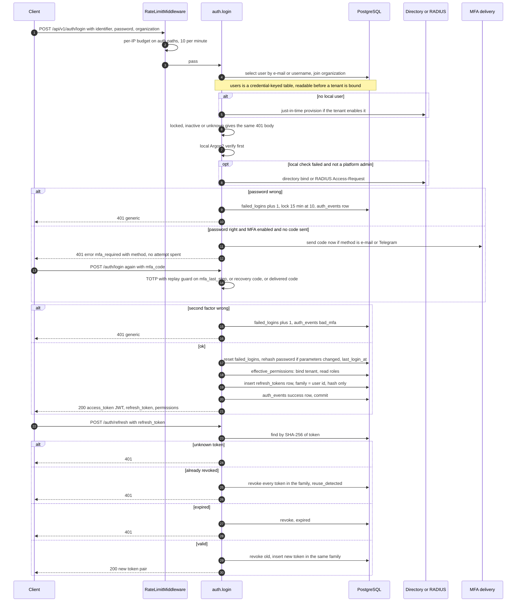
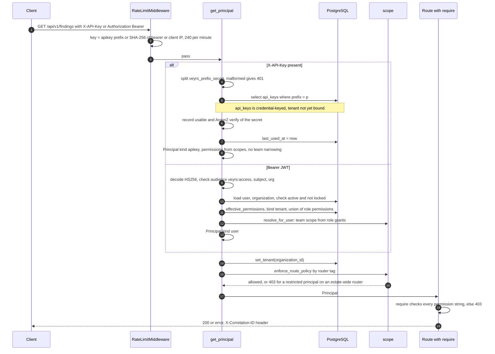
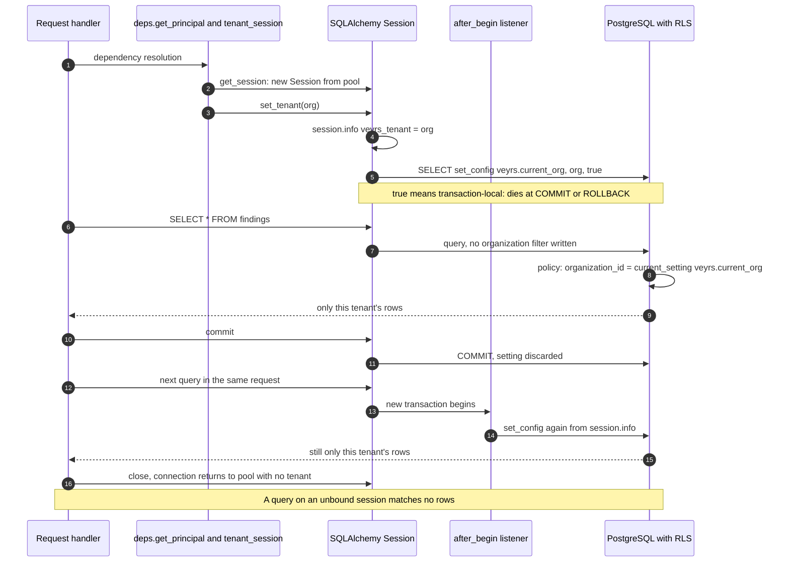
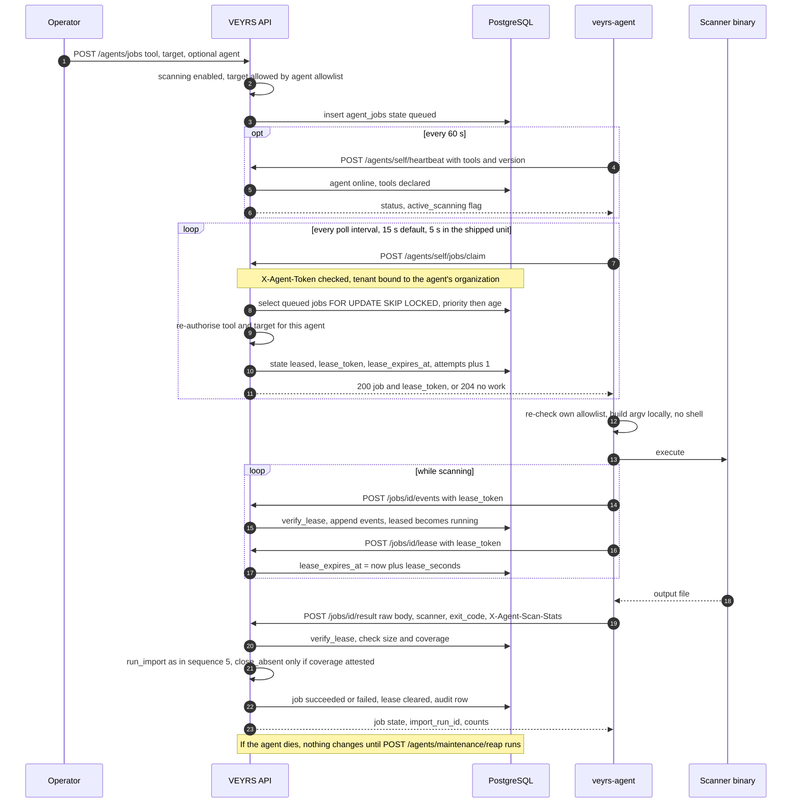
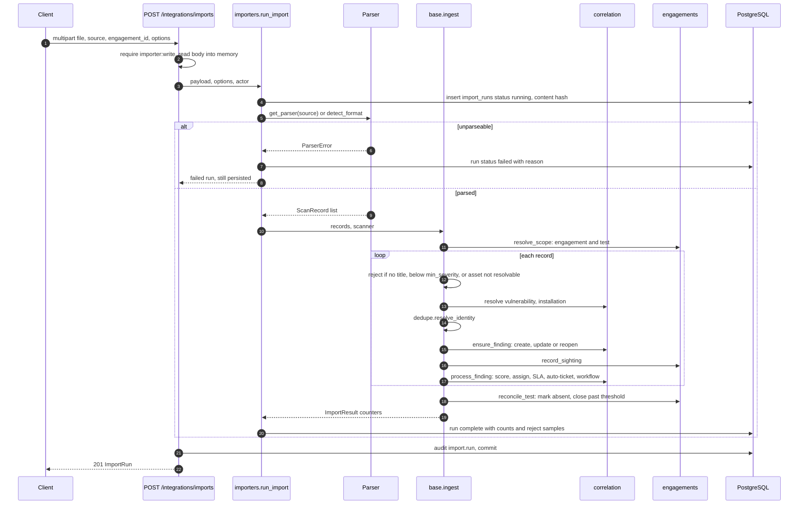
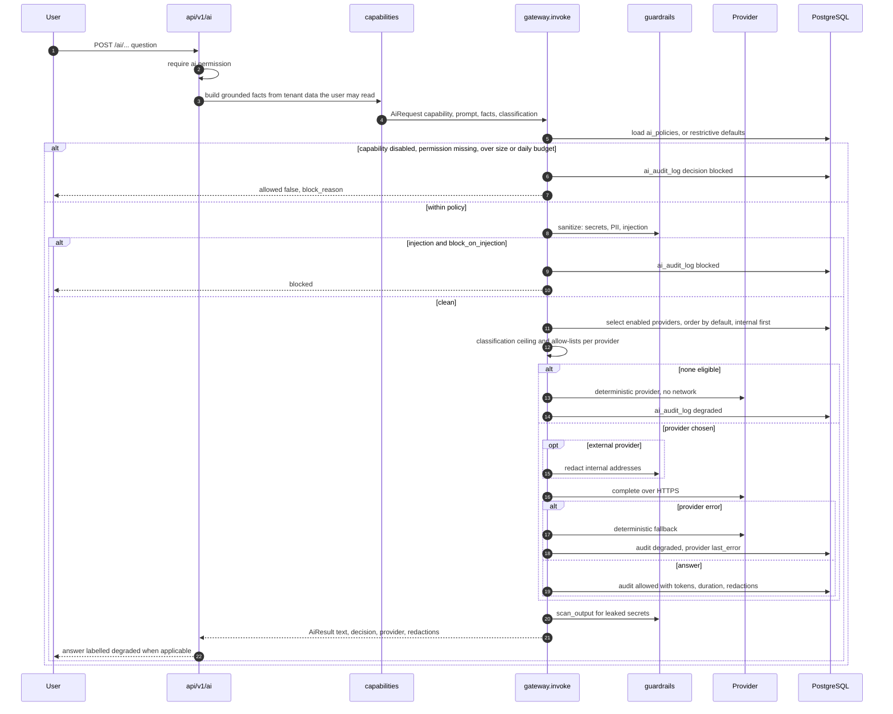

# Sequence diagrams

Participants use the names of the code (`get_principal`, `set_tenant`, `claim_next`). Tests that exercise the same behaviour are named where they exist. Request-independent flows (feeds, SLA sweep) are in [data flows](data-flows.md).

## 1. Password login, MFA and refresh

**Legend.** Solid arrows are calls, dashed arrows are responses, `Note` boxes explain the data-access rule. `alt`/`opt` blocks are the branches. Participant `A` is `api/v1/auth.py`. Defaults: access token 30 minutes (`access_token_minutes`), refresh token 14 days (`refresh_token_days`), 10 failed attempts then a 15-minute lock (`MAX_FAILED`, `LOCK_MINUTES`).

Design points visible in the sequence:

- The 401 body is identical for unknown user, wrong password, locked, inactive and disabled organization, and a missing user still burns an Argon2 verification so timing does not reveal existence (`auth.py:410`).
- When the same identifier exists in several tenants and no slug is supplied, VEYRS reveals the candidate slugs only after the password has been proven for more than one of them (HTTP 409 `organization_required`).
- An MFA challenge is not charged to the lockout budget; a wrong code is. Password failures and MFA failures share one counter on purpose (`auth.py:104-114`).
- If the MFA secret cannot be decrypted (key rotated), login fails closed rather than falling back to password only (`auth.py:507-520`).
- A directory login never writes a local password hash (`auth.py:534-546`).
- Permissions are not trusted from the token afterwards: every request re-reads them (see sequence 2).

Tests: `tests/test_phase2_core.py::test_refresh_rotates_and_reuse_kills_the_family`, `tests/test_phase24_mfa.py`, `tests/test_login_error_message.py`. Status: Implemented (code and tests read; not replayed against the live system).

## 2. API key and bearer authentication on a normal request

**Legend.** Same conventions as above. `GP` is `security/deps.get_principal`. The rate-limit key is derived from the request headers, never from `request.state`, because middleware runs before the dependency that would set it (`security/ratelimit.py:140-163`).

Properties:

- Permissions come from the database on every request, so a revoked role takes effect immediately, not at token expiry (`security/deps.py:131-134`).
- A token minted for another tenant is treated as forgery unless the user is a platform administrator (`security/deps.py:123-125`).
- API keys are never narrowed by team scope: an importer that silently saw a third of the estate would close findings it merely could not observe (`security/deps.py:50-54`).
- An agent token is rejected here: it uses another scheme word (`veyrsagent_`), so `split_api_key` fails on it (`security/auth.py:155-168`).

Tests: `tests/test_phase10_hardening.py::test_a_token_from_one_tenant_cannot_read_another`, `tests/test_phase26_scope.py`. Status: Implemented.

## 3. Tenant session binding (RLS)

**Legend.** `D` bundles two dependencies in `security/deps.py`. The policy text is `organization_id::text = NULLIF(current_setting('veyrs.current_org', true), '')` (`cli.py:58`). Four credential-keyed tables (`users`, `refresh_tokens`, `api_keys`, `exec_agents`) use a variant that also matches when no tenant is bound, which is what lets login find a user before knowing the tenant.

Why each step exists:

- **Transaction-local** so a pooled connection cannot carry one request's tenant into another (`db.py:54-56`).
- **`after_begin` re-bind** because a `commit()` ends the transaction; without it, handlers that create a ticket, commit, and then fire a workflow read zero rows (`db.py:57-80`).
- **Fail closed**: no tenant means no rows, not all rows.
- **Not a superuser**: a PostgreSQL superuser or a role with `BYPASSRLS` ignores the policies silently. The installers and `veyrs-setup.sh` refuse such a role; `tests/test_audit_rls.py::test_the_suite_is_not_running_as_a_role_that_bypasses_rls` guards the test suite.
- **Background jobs** bind per tenant in a loop (`services/intel_pipeline.py`) and restore the binding that was in force on entry.

Tests: `tests/test_audit_rls.py`, `tests/test_phase15_unified_ingest.py::test_tenant_isolation_holds_for_the_new_tables`, `tests/test_phase16_agents.py::test_agents_and_jobs_are_invisible_across_tenants`. Status: Verified for the policy and binding code by tests read; the RLS state of the live database was not queried.

## 4. Agent job claim, lease and result

**Legend.** `Op` can be a person or a script with `agent:write`. The agent holds no user permissions; every self route needs the agent token and, for writes to a job, the lease token returned once at claim.

Failure and edge behaviour:

| Situation | Result | Source |
|---|---|---|
| Disabled agent | 403 (not 401), so the agent can tell "rotate token" from "switched off" | `security/agent_auth.py:55-60` |
| Wrong or stolen lease token | Refused: only the current holder may write; terminal jobs refuse writes | `services/agents.py:720` |
| Lease expires | Requeued while `attempts < max_attempts`, else `expired`; only on a call to the reap endpoint | `services/agents.py:1197` |
| Empty result with no coverage statistics | Refused as a blind scanner; an empty result with attested coverage is accepted and may close findings | `api/v1/agents.py:323-345`, `services/agents.py:845` |
| Non-zero exit with no output | Job `failed`, no import | `services/agents.py:918-1000` |
| Result larger than 64 MB | Refused; split the scan | `services/agents.py:57` |

Tests: `tests/test_phase16_agents.py` (claim, lease, expiry, tenant isolation, end to end over HTTP), `tests/test_phase16_runner.py`. Status: Verified for the agent unit running on the primary node; Implemented for the protocol details above.

## 5. Scan import

**Legend.** Conventions as above. All DB writes happen on the tenant-bound session (sequence 3). A dry-run option parses and reports without persisting findings. Parse failures are stored as failed runs so the operator can see later why a file was rejected.

Tests: `tests/test_phase15_parsers.py`, `tests/test_phase15_unified_ingest.py`, `tests/test_phase8_integrations.py`. Status: Implemented.

## 6. AI gateway decision

**Legend.** `alt` branches are mutually exclusive outcomes; every outcome writes one `ai_audit_log` row (the audit write for a clean answer happens in `_finish`). Participant `PR` is any provider class in `services/ai/providers.py`. Facts are assembled by VEYRS before the call: the model supplies wording, not data.

Tests: `tests/test_phase6_ai.py` (default policy forbids external providers, confidential data cannot reach an external provider, degraded mode with no provider, provider failure, injection blocks, daily limit). The test suite never reaches a real provider ([ADR 0003](../ADRs/0003-ai-gateway.md)). Status: Verified by tests read; no live provider is configured in the observed environment.

## Sources

- `backend/veyrs/api/v1/auth.py:364-632`, `security/auth.py`, `security/deps.py`, `security/ratelimit.py`
- `backend/veyrs/db.py`, `cli.py:58-64`
- `backend/veyrs/security/agent_auth.py`, `services/agents.py`, `api/v1/agents.py:239-445`, `integrations/veyrs-agent/veyrs_agent.py`
- `backend/veyrs/services/importers/__init__.py`, `importers/base.py`
- `backend/veyrs/services/ai/gateway.py`
