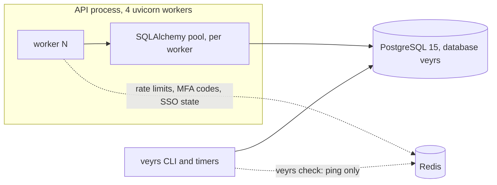
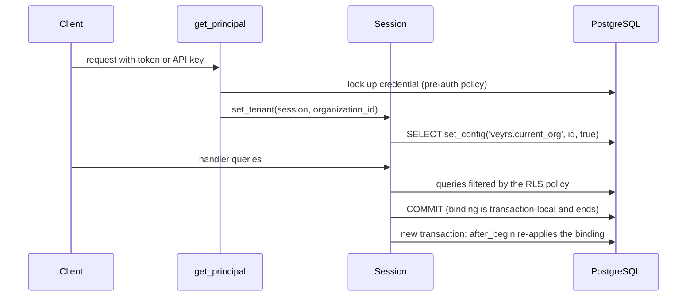

# Database architecture

VEYRS keeps all durable state in **one PostgreSQL 15+ database** (90 tables) and all short-lived coordination state in **Redis**. There is no Alembic and no migration directory: the SQLAlchemy models are the schema, and two CLI commands reconcile a live database with them.

| Fact | Value | Source |
|---|---|---|
| Engine | PostgreSQL 15 or newer; `install.sh` refuses an older major | `install.sh:99` (`MIN_PG_MAJOR=15`) |
| Driver and ORM | psycopg 3 through SQLAlchemy 2.0 (`postgresql+psycopg://` URL) | `backend/veyrs/config.py` (`database_url`) |
| Encoding | UTF8 is mandatory; create the database from `template0` | `INSTALL.md` section 2 |
| Extensions | none used by the schema (no `pg_trgm`, no `pgvector`, no `uuid-ossp`) | `grep` over `backend/veyrs/models` finds none |
| Primary keys | `UUID` generated in Python (`uuid.uuid4`), except `cve.id`, `cwe.id` (text identifiers) and the two 1:1 tables `epss_scores`/`kev_entries` (keyed by `cve_id`) | `backend/veyrs/models/base.py` (`uuid_pk`), `schema.json` |
| Foreign key actions | 216 FKs: 130 `ON DELETE CASCADE`, 86 `ON DELETE SET NULL`; none is `RESTRICT` or `NO ACTION` | `extract/schema.json` |
| Constraint types in use | primary key, foreign key, unique (and unique indexes). **No `CHECK` constraints and no PostgreSQL enum types**: states and kinds are `VARCHAR` validated by the application | `grep CheckConstraint\|Enum(` over `models/` is empty |
| Constraint names | fixed by a naming convention so DDL is reproducible | `backend/veyrs/models/base.py:16` (`NAMING`) |
| Table count guard | `docs/DATABASE.md` must state the real table count; `DATABASE_SCHEMA.md` must match the models | `tests/test_docs_are_current.py` |

## Engines



**Legend.** Solid arrows are durable-state access over the database role from `VEYRS_DATABASE_URL`; dashed arrows are Redis access through `VEYRS_REDIS_URL`. The CLI touches Redis only in `veyrs check` (a ping, `cli.py:495-501`); `mfa-test`, `mfa-setup` and `mfa-reset` deliver or reset factors without storing anything in Redis (`services/mfa_admin.py`). Worker count comes from `infrastructure/systemd/veyrs-api.service:23` (`--workers 4`).

### What PostgreSQL holds

Everything the product remembers: tenants, identities, assets, findings and their history, tickets, compliance evidence, uploaded document text, audit trails, feed catalogues. Binary uploads are **not** stored as files by default: `documents.text_content` holds the extracted text and `documents.storage_key` is optional (`backend/veyrs/models/knowledge.py`; `docs/DISASTER_RECOVERY.md` states the original bytes are not kept).

### What Redis holds

Redis is used only for keys that expire. The complete key families found in the code:

| Key pattern | Purpose | Lifetime | Source |
|---|---|---|---|
| `veyrs:rl:<identity>:<window>` | Rate-limit counters (general and `/auth/*` budgets) | window + 1 s | `backend/veyrs/security/ratelimit.py:108` |
| `veyrs:mfa:otp:<user_id>` | Hashed e-mail or Telegram sign-in code, with a try counter | `VEYRS_MFA_CODE_TTL`, default 300 s | `backend/veyrs/security/mfa_delivery.py:151` |
| `veyrs:mfa:sent:<user_id>`, `veyrs:mfa:count:<user_id>` | Send throttles: one message per 30 s, six per 15 minutes | 30 s / 15 min | `backend/veyrs/security/mfa_delivery.py:271` |
| `veyrs:oidc:flow:<state>` | OIDC authorisation state, nonce and PKCE verifier (single use) | 600 s | `backend/veyrs/services/oidc_auth.py:54,226` |
| `veyrs:oidc:handoff:<token>` | One-time hand-off from the SSO callback to the console | 60 s | `backend/veyrs/services/oidc_auth.py:55,302` |
| `veyrs:radius:ch:<challenge_id>` | Pending RADIUS challenge (single use) | 180 s (`CHALLENGE_TTL`) | `backend/veyrs/services/radius_auth.py:77,379` |

Failure behaviour differs per use, and this matters for operations:

- **Rate limiting fails open.** With Redis unreachable the limiter falls back to an in-process window (roughly N times the rate with N workers) or allows the request (`ratelimit.py:15`).
- **MFA codes and SSO state fail closed.** No Redis means no e-mail or Telegram code and no OIDC callback; login never degrades to password-only (`mfa_delivery.py:19-22`, `api/v1/auth.py:838`).
- **Account lockout is not in Redis.** It is stored in `users.failed_logins` and `users.locked_until`.

> [!NOTE]
> Until 2026-11-17 `docs/HIGH_AVAILABILITY.md` described Redis as holding "rate-limit counters and cache only". The code also keeps MFA codes and SSO state there, so losing Redis interrupts those sign-in methods (it loses no business data). The HA document now says so.

`veyrs check` and `GET /readyz` ping both PostgreSQL and Redis (`backend/veyrs/cli.py:481`, `backend/veyrs/main.py:105`).

## Connection management

All of it is in `backend/veyrs/db.py`.

| Setting | Value | Notes |
|---|---|---|
| Pool | `pool_size=10`, `max_overflow=20`, `pool_pre_ping=True` | Per worker process (`db.py:24-31`). |
| Session factory | `autoflush=False`, `expire_on_commit=False` | `db.py:33`. Code must `flush()` explicitly before queries that depend on pending rows. |
| Per-connection hardening | `SET statement_timeout = '30s'` and `SET idle_in_transaction_session_timeout = '60s'` on every new connection | `db.py:36-46`. Errors are swallowed (`contextlib.suppress`), so a failed `SET` is silent. |
| Per-request override | the report builder sets `statement_timeout` to 20 s with `set_config(..., true)` (transaction-local) | `backend/veyrs/services/report_builder.py:938` |
| FastAPI dependency | `get_session()` yields a `SessionLocal()` and always closes it | `db.py:82` |

**Pool arithmetic.** With the shipped service unit (4 workers) the ceiling is `4 x (10 + 20) = 120` connections from the API alone, before the CLI and timers. PostgreSQL's default `max_connections` is 100, so raise `max_connections` (the Docker manual sets 200) or lower workers before raising pool sizes. The same warning appears in `docs/DOCKER_COMPOSE_MANUAL.md`.

**The idle-in-transaction timeout shapes code.** A transaction idle for more than 60 s is killed by the server. That is why feed ingestion commits between pages and between EPSS batches instead of holding one transaction across network waits (`tests/test_phase21_inventory_correlation.py`, section 8).

## Session and tenant binding



**Legend.** `set_config(..., true)` is transaction-local, so a pooled connection cannot carry one request's tenant into another. The `after_begin` hook re-applies the binding after every `commit()` inside the same session.

- `set_tenant(session, org_id)` stores the value in `session.info["veyrs_tenant"]` and executes `SELECT set_config('veyrs.current_org', :v, true)` (`db.py:52-67`).
- The `after_begin` event on `Session` re-executes it for each new transaction (`db.py:74-79`). Without it, a handler that commits and keeps working would silently read zero rows, because a policy with no tenant matches nothing.
- Bound by: `get_principal` after resolving the credential (`security/deps.py:182`), the `TenantSession` dependency (`security/deps.py:211-220`), execution-agent authentication (`security/agent_auth.py:47,68`), and every CLI path that touches tenant tables (`cli.py:421,561,646`; `engines/risk.py:561`; `services/sla.py:533`; `services/secret_storage.py`; `services/digest.py`).
- `intel_pipeline` loops over tenants with `set_tenant` and restores the previous binding in a `finally` block (`services/intel_pipeline.py:72,170`).

> [!NOTE]
> The application layer is *explicit `organization_id` filters in every service*, not an enforcing query wrapper: `TenantSession` (`security/deps.py`) is a FastAPI dependency alias for a session already bound to the caller's tenant (the `db.py` docstring said otherwise until 0.41.0). What is enforced since 0.41.0 (`security/tenant_guard.py`): the production API refuses an RLS-bypassing role, and a debug-mode hook flags tenant-table statements run with no tenant bound. Only the analytics module has a source-level test (`tests/test_phase26_scope.py`) that fails when a query bypasses its scope helpers.

## Row level security model

Every table falls into exactly one of four classes. Counts are computed from the models by `scripts/gen-schema-doc.py` and listed in `DATABASE_SCHEMA.md`.

| Class | Tables | Policy | Rule in code |
|---|---|---|---|
| **strict** | 68 | `ENABLE` + `FORCE`, policy `veyrs_tenant_isolation`, no tenant bound = zero rows | every table with `organization_id`, except the sets below; includes `audit_log` and `ai_audit_log` (`RLS_TABLES_STRICT_NULLABLE`, `cli.py:56`) |
| **pre-auth** | 4 | same policy, but permissive while `veyrs.current_org` is unset | `users`, `refresh_tokens`, `api_keys`, `exec_agents` (`RLS_TABLES_PREAUTH`, `cli.py:48`) |
| **global** | 16 | no policy, not tenant data | the 14 catalogue and platform tables in `models/base.py` `GLOBAL_TABLES` (incl. `trusted_cas`, 0.40.0), plus `organizations` and `feed_runs` (neither carries `organization_id`) |
| **own policies** | 1 | `ENABLE` + `FORCE`, per-command policies from `schema_steps/step_auth.py` (since 0.41.0): any session inserts, a session reads only its bound organization's rows | `auth_events` |
| **app-only** | 1 | no policy; nullable `organization_id`, isolated by the application | `roles` (built-ins have no organization) |

68 + 4 + 1 + 16 + 1 = 90, so **73 tables carry `FORCE ROW LEVEL SECURITY`**.

The policy bodies are built from two constants in `backend/veyrs/cli.py:58-64`:

```sql
-- strict: applied to USING and WITH CHECK
organization_id::text = NULLIF(current_setting('veyrs.current_org', true), '')

-- pre-auth: visible while unbound, tenant-filtered once bound
organization_id::text = COALESCE(
    NULLIF(current_setting('veyrs.current_org', true), ''), organization_id::text)
```

`init_db` runs, per table, `ALTER TABLE ... ENABLE ROW LEVEL SECURITY`, `... FORCE ROW LEVEL SECURITY`, `DROP POLICY IF EXISTS veyrs_tenant_isolation`, and `CREATE POLICY veyrs_tenant_isolation ... USING (p) WITH CHECK (p)` (`cli.py:323-329`).

### Why FORCE, and why the role matters

Plain `ENABLE` exempts the table owner, and the application role owns every table it creates. `FORCE` makes the policy bind the owner too. A PostgreSQL **superuser or a `BYPASSRLS` role skips every policy silently**, so:

- The application role must be `NOSUPERUSER NOBYPASSRLS` and own the database. `docker/initdb.d/10-app-role.sh` creates it that way and keeps `postgres` as the only superuser; `veyrs-setup.sh` refuses an external database role that is a superuser or has `BYPASSRLS`.
- `tests/test_audit_rls.py` refuses to run as such a role, because every isolation assertion would pass vacuously.
- Operational tasks that must see every tenant (backup, restore, `DELETE FROM organizations`) run as a superuser or a dedicated `BYPASSRLS` role. See [backup-recovery.md](backup-recovery.md).
- The same tenant-blindness hits a hand-run `psql`: `SELECT * FROM findings` returns no rows until `SELECT set_config('veyrs.current_org', '<uuid>', false)` is issued (session-level here, unlike the application).

### Known isolation gaps

| Gap | Evidence | Status |
|---|---|---|
| `compliance_frameworks` is classed **global** (no RLS) yet has a nullable `organization_id` for tenant-authored custom frameworks; `compliance_controls` has no tenant column at all. Visibility of custom frameworks is enforced only in `api/v1/compliance.py:127,534`. | `cli.py:33-39`, `models/compliance.py` | Implemented, application-enforced only |
| Fixed in 0.41.0: `uq_compliance_frameworks_slug` was replaced by partial unique indexes, `(slug, version)` for built-ins and `(organization_id, slug, version)` for custom frameworks, and the 409 check in `create_framework` is scoped the same way. | `schema_steps/step_api.py` | Fixed |
| `auth_events` and `ai_audit_log.organization_id` have no foreign key to `organizations`; `auth_events` has its own row policies (since 0.41.0). | `schema.json`, `cli.py:33-39` | Implemented |
| The audit tables are described as insert/select-only for the API role "see infrastructure/rls.sql". That file does not exist and no `GRANT`/`REVOKE` exists in the code, so immutability is a property of the application, not of the database. | `backend/veyrs/models/audit.py:8-9`, `Glob infrastructure/` | Implemented as application-level only |

## Schema management

VEYRS has **no migration tool**. `migrations/README.md` says so, and `tests/test_docs_are_current.py` fails if the docs promise Alembic while `migrations/versions/` is empty. Two commands (`backend/veyrs/cli.py`) do all the work. Both connect with the application role, so that role must own the tables.

| Command | What it does | What it does not do |
|---|---|---|
| `python -m veyrs init-db` | 1. `Base.metadata.create_all()` (missing **tables**); 2. `sync_columns()`; 3. RLS enable/force/policy for every eligible table in one transaction; 4. `seed_roles()`; 5. `seed_compliance()` | Drop, rename, narrow or retype anything |
| `python -m veyrs sync-schema` | Runs only step 2 | Create tables, apply RLS, seed |

`sync_columns()` (`cli.py:67-230`) walks every model table that already exists and:

1. **adds missing columns** with `ADD COLUMN IF NOT EXISTS`, using the model's scalar default (`'{}'::jsonb` and `'[]'::jsonb` for `default=dict`/`list`). A `NOT NULL` column with no usable default on any table is **refused** and the three statements to backfill it are printed (`cli.py:138-147`);
2. **creates a foreign key only for a column it just added** (named `fk_<table>_<column>_<parent>`). A foreign key missing on a column that already existed is not repaired;
3. **creates every index declared in `table.indexes` that is missing by name**, composite and partial ones included (`CREATE INDEX IF NOT EXISTS`);
4. **creates missing named unique constraints** as `CREATE UNIQUE INDEX IF NOT EXISTS`; if duplicates already exist it prints the `GROUP BY ... HAVING count(*) > 1` query and counts the table as needing manual work (`cli.py:196-222`);
5. **widens** `VARCHAR(n)` to a longer `VARCHAR` or to `TEXT`, inside a savepoint so a refused `ALTER` (for example a dependent view) only reports the statement (`cli.py:233-253`).

It never drops, renames, narrows or otherwise retypes, and it does not reconcile `CHECK` constraints (the schema has none), changed defaults, nullability changes on existing columns, or changed foreign key actions.

> [!WARNING]
> **The deploy trap.** On a database that lacks a release's new tables, `sync-schema` prints `schema reconcile: 0 columns, 0 indexes, 0 constraints added` and exits 0, because it skips tables that do not exist (`cli.py:103-104`). The new endpoints then fail with `UndefinedTable`. Always run `init-db` on deploy: it is idempotent. `scripts/restore.sh` runs it unconditionally (`scripts/restore.sh`, last step).

> [!NOTE]
> `init-db` takes `ACCESS EXCLUSIVE` locks while it alters tables for RLS and recreates the policies, all in one transaction (`engine.begin()`, `cli.py:312`). That is PostgreSQL's behaviour for `ALTER TABLE` and `DROP/CREATE POLICY`; it is brief but not zero-impact on a busy node. This has not been measured live.

A destructive or semantic change (drop, rename, narrowing, retyping, backfilling a `NOT NULL` column, de-duplicating before a new unique key) is hand-written SQL, reviewed and run in a maintenance window. Because every foreign key is `CASCADE` or `SET NULL` there is no `RESTRICT` safety net: a mistaken `DELETE` on a parent removes or detaches children without error (see [lifecycle.md](lifecycle.md)).

The reconciler is covered by `tests/test_schema_reconcile.py` (unique-constraint names must be unique per table and explicit, `users.username` is unique per tenant, the reconciler reads unique constraints).

## Seeding

| What | When | Where |
|---|---|---|
| Built-in global roles (`organization_id IS NULL`), 10 of them | `init-db`, `bootstrap` if missing | `cli.py:365-389`, `security/permissions.py:57` |
| Compliance framework catalogues (global rows) | `init-db` | `cli.py:354`, `services/compliance.py:45` |
| First organization and administrator | `python -m veyrs bootstrap --org SLUG --email ADDR` (password from `--password`, else `VEYRS_BOOTSTRAP_PASSWORD`, else a prompt) | `cli.py:392` |
| Per-tenant workflows | `POST /api/v1/workflows/seed` | `api/v1/tickets.py:658` |
| Per-user saved views | seeded lazily on first list | `api/v1/views.py:74` |
| Per-tenant risk profiles (`seed_profiles`) and SLA policies (`seed_policies`) | **only called from tests**; no CLI step or route calls them | `services/risk.py:19`, `services/sla.py:100`; callers found only under `tests/` |

The last row matters: a new tenant created by `bootstrap` has **no `risk_profiles` and no `sla_policies` rows**. `resolve_profile` then returns `None` and the risk engine falls back to its built-in "balanced" weights, and `resolve_policy` returns `None` so no SLA due date is set until an administrator creates a policy (`services/risk.py:41-54`, `services/sla.py:191-201`). Status: Implemented, runtime behaviour not observed.

## Encryption at rest of columns

Reversible third-party credentials are sealed with Fernet (`cryptography`), implemented in `backend/veyrs/security/secrets.py`. The registry of sealed columns is `COLUMNS` in `backend/veyrs/services/secret_storage.py:52-67`, and a test enforces that every `*_enc` column is in it.

| Column | Holds |
|---|---|
| `ai_providers.api_key_enc` | AI provider API key |
| `itsm_connectors.credentials_enc`, `itsm_connectors.inbound_secret_enc` | ITSM credentials, inbound webhook secret |
| `scanner_connectors.credentials_enc` | scanner API credentials |
| `asset_sources.credentials_enc` | CMDB source credentials |
| `threat_sources.credentials_enc` | threat feed credentials |
| `webhook_endpoints.secret_enc` | webhook signing secret (no writer in the code; outbound webhooks are Partial) |
| `users.mfa_secret` | TOTP seed |
| `organizations.settings["ldap"]["bind_password_enc"]` (and the RADIUS and OIDC secrets alongside it) | directory secrets inside a JSONB value |

Not reversible, by design: `users.password_hash` (Argon2id), `api_keys.key_hash`, `refresh_tokens.token_hash`, `exec_agents.token_hash`, and `users.mfa_recovery_codes` (SHA-256 of each normalised code, `mfa_delivery.py`). Free text such as `documents.text_content`, `ai_messages.content` and `findings.evidence` is **not** encrypted at the column level.

**Stored formats** (`secrets.py` module docstring): `v1:<fernet token>` for local, `vault:<uuid>` when `VEYRS_SECRET_BACKEND=vault` (the database keeps only a reference), `vm1:<uuid>:<fernet token>` for mirror mode (both). `decrypt()` dispatches on the prefix, so a row written in one mode stays readable after the mode changes.

**Keys.** `VEYRS_ENCRYPTION_KEY` is a Fernet key (`veyrs keygen`). If empty it is derived from `VEYRS_SECRET_KEY` by HKDF-SHA256, and production refuses to boot without an explicit key. `VEYRS_ENCRYPTION_KEY_PREVIOUS` lists older keys, comma-separated, used to decrypt only; `_keyring()` builds a `MultiFernet` with the current key first (`secrets.py:109`).

**Rotation**, with the commands the CLI provides (`cli.py:764-786`, `services/secret_storage.py`):

1. Generate a key with `python -m veyrs keygen`; put it in `VEYRS_ENCRYPTION_KEY` and the old one in `VEYRS_ENCRYPTION_KEY_PREVIOUS` on every API node; restart.
2. Dry run: `python -m veyrs secrets rekey` reports how many local copies are still sealed under an old key and any row no configured key opens.
3. `python -m veyrs secrets rekey --apply` re-seals every local copy under the current key, one row per savepoint with compare-and-swap, so a value replaced mid-run is left alone. A second run converts nothing.
4. Remove `VEYRS_ENCRYPTION_KEY_PREVIOUS` everywhere and restart. Take a fresh backup, because older backups carry the old key.

`python -m veyrs secrets status|migrate --to local|mirror|vault [--apply]|gc [--apply]` move credentials between the local database and an external vault. Migration never blanks or deletes; `--to local` is a real rollback because old vault entries stay until `gc`.

> [!IMPORTANT]
> A backup that omits `VEYRS_ENCRYPTION_KEY` is a backup of unrecoverable ciphertext. `scripts/backup.sh` therefore copies `.env` into the archive, which makes the archive as sensitive as the database. See [backup-recovery.md](backup-recovery.md).

## Observations on a live node

Read-only checks on the primary application node (2026-11-17): `.env` defines `VEYRS_DATABASE_URL`, `VEYRS_REDIS_URL`, `VEYRS_ENCRYPTION_KEY` and `VEYRS_TEST_DATABASE_URL`; `VEYRS_SECRET_BACKEND` and `VEYRS_ENCRYPTION_KEY_PREVIOUS` are unset (local mode, no rotation in progress). A test-database URL in a production `.env` is unusual and worth removing from production nodes. Row counts, `pg_policies`, and the database node itself were not inspected.

## Sources

- `backend/veyrs/db.py`, `backend/veyrs/cli.py`, `backend/veyrs/models/base.py`
- `backend/veyrs/security/secrets.py`, `backend/veyrs/services/secret_storage.py`
- `backend/veyrs/security/ratelimit.py`, `backend/veyrs/security/mfa_delivery.py`, `backend/veyrs/services/oidc_auth.py`, `backend/veyrs/services/radius_auth.py`
- `docker/initdb.d/10-app-role.sh`, `install.sh`, `veyrs-setup.sh`, `infrastructure/systemd/veyrs-api.service`
- `extract/schema.json` (89 tables at extraction; 90 since 0.40.0)
