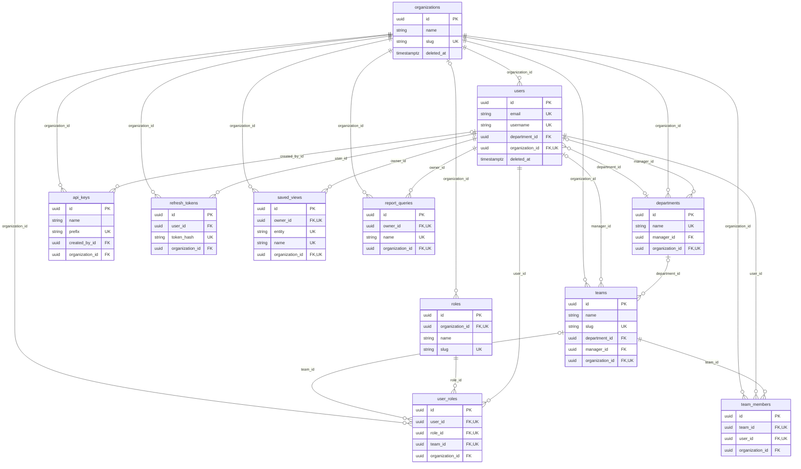
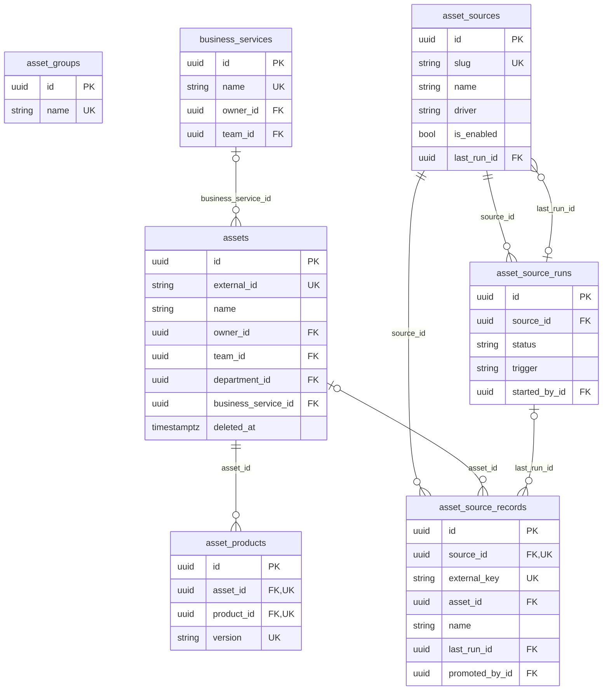
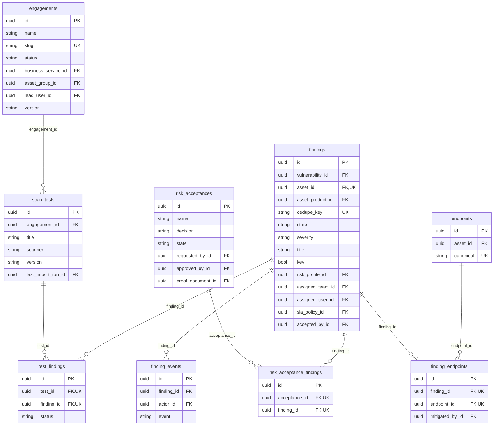
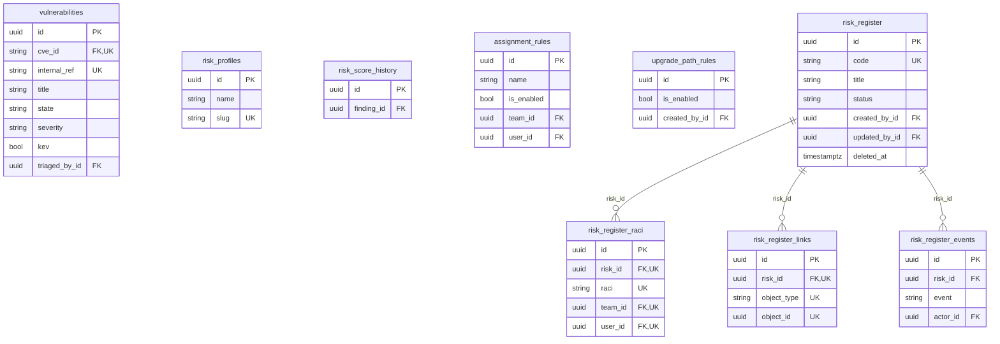
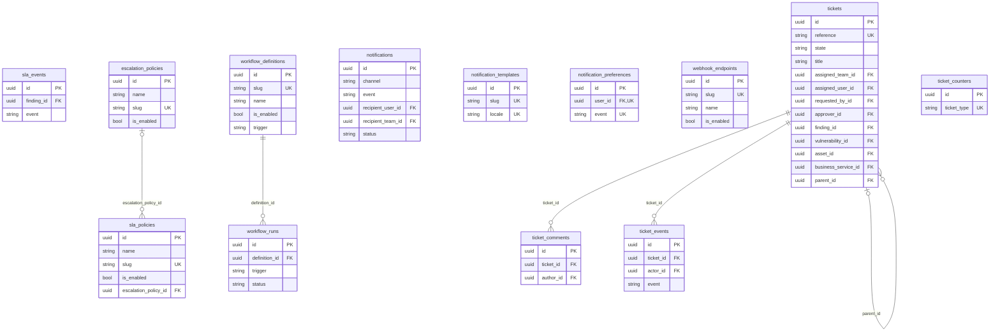
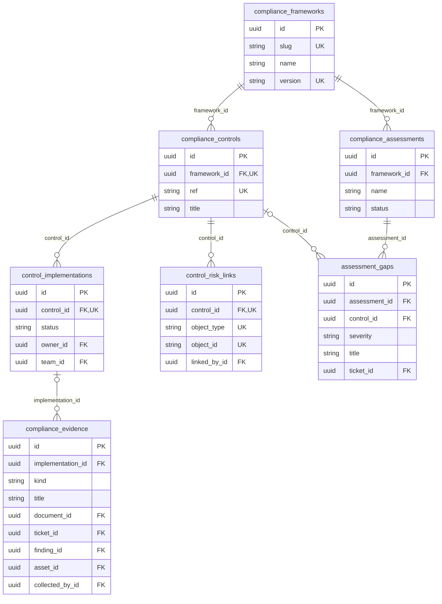
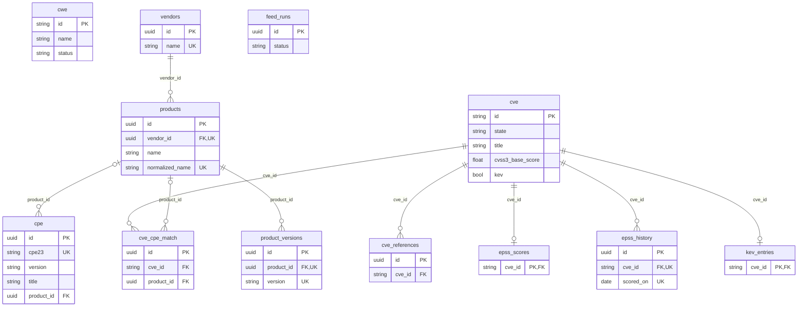
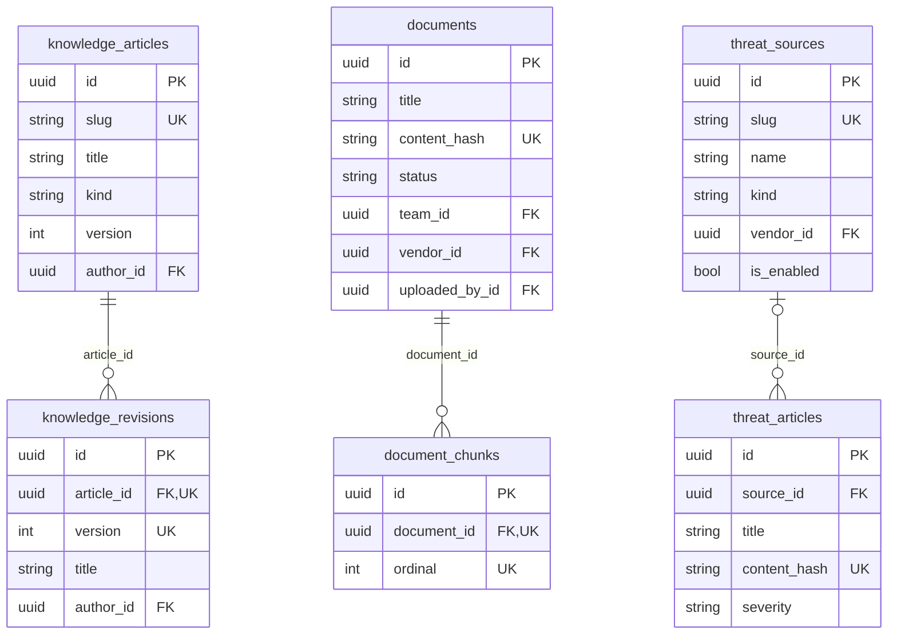
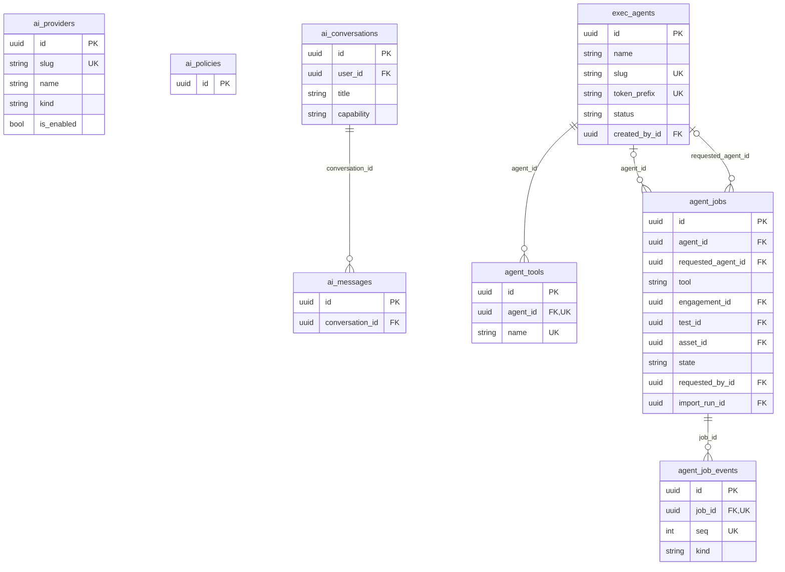
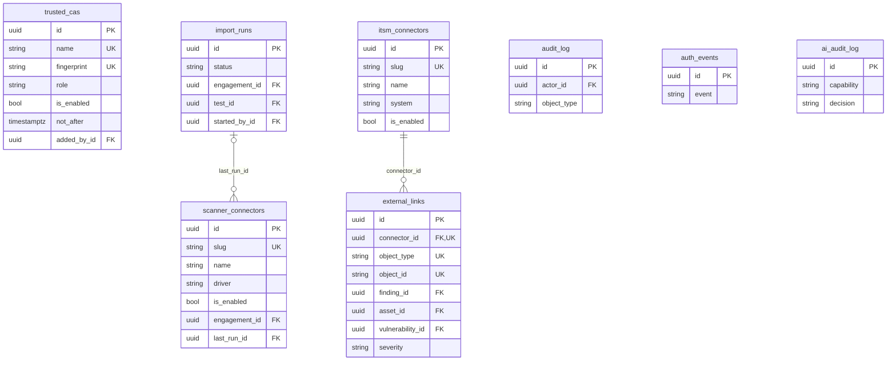

# Entity-relationship diagrams

The 90 tables are split into nine domains (the intelligence domain is drawn twice, so ten diagrams). **Every table is drawn in exactly one diagram and none was left out.** A foreign key whose parent lives in another diagram is not drawn as an edge; it is listed under the diagram of the child table in a "leaves this diagram" table, with the parent's diagram and the `ON DELETE` action.

Conventions that apply to all diagrams:

- Every tenant-owned table has `organization_id NOT NULL` with a foreign key to `organizations.id ON DELETE CASCADE`. That edge is drawn only in diagram 1.
- Exceptions without that foreign key or NOT NULL: `roles`, `audit_log`, `compliance_frameworks` (nullable `organization_id`), `auth_events` and `ai_audit_log` (nullable, no foreign key), and the 14 tables with no tenant column (`organizations`, `compliance_controls` and the 12 tables of diagram 7a).
- All primary keys are UUIDs except `cve.id` and `cwe.id` (text identifiers) and `epss_scores.cve_id`/`kev_entries.cve_id` (the primary key is the foreign key).
- Diagrams were generated from `extract/schema.json`, so table, column and foreign key names match the models exactly. Types are simplified (`string` is any `VARCHAR`, `jsonb` is `JSONB`, `timestamptz` is `TIMESTAMP WITH TIME ZONE`).
- The database declares no `CHECK` constraints and no enum types, so allowed values of columns such as `state`, `status` or `kind` are enforced by the application only.

| Diagram | Domain | Tables |
|---|---|---|
| 1 | Tenancy and identity | 11 |
| 2 | Assets and CMDB | 7 |
| 3 | Engagements, scans and findings | 9 |
| 4 | Vulnerabilities and risk | 9 |
| 5 | SLA, workflow and ticketing | 13 |
| 6 | Compliance | 7 |
| 7a | Intelligence catalogues | 12 |
| 7b | Knowledge | 6 |
| 8 | AI and agents | 8 |
| 9 | Integrations and audit | 8 |
| | **Total** | **90** |

### 1. Tenancy and identity

**Tables (11):** `organizations`, `users`, `roles`, `user_roles`, `teams`, `team_members`, `departments`, `api_keys`, `refresh_tokens`, `saved_views`, `report_queries`.

The root of every authorisation decision. `organizations` has no tenant column and no RLS; every other table here carries `organization_id` with `ON DELETE CASCADE`. Directory-derived role grants are `user_roles.origin = directory`; built-in roles have `roles.organization_id IS NULL`. Per-user preferences (`saved_views`, `report_queries`) are owned by a user and cascade with that user.

**Legend.** Boxes are tables, listed with their primary key, foreign key columns, columns that take part in a unique key (`UK`, often as part of a composite key shown in the table below) and a few identifying columns; the full column list is in [DATABASE_SCHEMA.md](../DATABASE_SCHEMA.md). `||` is exactly one parent, `|o` is an optional parent (nullable foreign key), `o{` is zero or more children, `o|` is zero or one child (one-to-one). Edge labels are the foreign key column.

Unique keys in this diagram:

| Table | Name | Columns | Kind |
|---|---|---|---|
| `organizations` | `ix_organizations_slug` | slug | unique index |
| `users` | `uq_users_organization_id_username` | organization_id, username | constraint |
| `users` | `uq_users_organization_id` | organization_id, email | constraint |
| `roles` | `uq_roles_organization_id` | organization_id, slug | constraint |
| `user_roles` | `uq_user_roles_user_id` | user_id, role_id, team_id | constraint |
| `teams` | `uq_teams_organization_id` | organization_id, slug | constraint |
| `team_members` | `uq_team_members_team_id` | team_id, user_id | constraint |
| `departments` | `uq_departments_organization_id` | organization_id, name | constraint |
| `api_keys` | `ix_api_keys_prefix` | prefix | unique index |
| `refresh_tokens` | `ix_refresh_tokens_token_hash` | token_hash | unique index |
| `saved_views` | `uq_saved_views_owner_name` | organization_id, owner_id, entity, name | constraint |
| `report_queries` | `uq_report_queries_owner_name` | organization_id, owner_id, name | constraint |

### 2. Assets and CMDB

**Tables (7):** `assets`, `asset_groups`, `business_services`, `asset_products`, `asset_sources`, `asset_source_runs`, `asset_source_records`.

Assets, the software installed on them, the business services they support, and the staging area for external inventory. A record from an external source is staged in `asset_source_records` and only promoted into `assets` by an explicit step (`asset_source_records.asset_id`, `promoted_at`). `assets` is soft-deleted (`deleted_at`). `asset_groups` is declared and referenced by `engagements.asset_group_id`, but no route or service in the code creates rows in it.

**Legend.** Boxes are tables, listed with their primary key, foreign key columns, columns that take part in a unique key (`UK`, often as part of a composite key shown in the table below) and a few identifying columns; the full column list is in [DATABASE_SCHEMA.md](../DATABASE_SCHEMA.md). `||` is exactly one parent, `|o` is an optional parent (nullable foreign key), `o{` is zero or more children, `o|` is zero or one child (one-to-one). Edge labels are the foreign key column. The edge from `organizations` (column `organization_id`, `ON DELETE CASCADE`) exists on every tenant table here and is not drawn.

Unique keys in this diagram:

| Table | Name | Columns | Kind |
|---|---|---|---|
| `assets` | `uq_assets_organization_id` | organization_id, external_id | constraint |
| `asset_groups` | `uq_asset_groups_organization_id` | organization_id, name | constraint |
| `business_services` | `uq_business_services_organization_id` | organization_id, name | constraint |
| `asset_products` | `uq_asset_products_asset_id` | asset_id, product_id, version | constraint |
| `asset_sources` | `uq_asset_sources_organization_id` | organization_id, slug | constraint |
| `asset_source_records` | `uq_asset_source_records_organization_id` | organization_id, source_id, external_key | constraint |

Foreign keys that leave this diagram (the parent is drawn in another diagram, so no edge is shown):

| Column | Parent | Parent diagram | On delete | Nullable |
|---|---|---|---|---|
| `assets.owner_id` | `users` | Tenancy and identity | SET NULL | yes |
| `assets.team_id` | `teams` | Tenancy and identity | SET NULL | yes |
| `assets.department_id` | `departments` | Tenancy and identity | SET NULL | yes |
| `business_services.owner_id` | `users` | Tenancy and identity | SET NULL | yes |
| `business_services.team_id` | `teams` | Tenancy and identity | SET NULL | yes |
| `asset_products.product_id` | `products` | Intelligence catalogues | CASCADE | no |
| `asset_source_runs.started_by_id` | `users` | Tenancy and identity | SET NULL | yes |
| `asset_source_records.promoted_by_id` | `users` | Tenancy and identity | SET NULL | yes |

### 3. Engagements, scans and findings

**Tables (9):** `engagements`, `scan_tests`, `endpoints`, `finding_endpoints`, `test_findings`, `risk_acceptances`, `risk_acceptance_findings`, `findings`, `finding_events`.

The spine of remediation work. A `findings` row is one vulnerability on one asset at one location, unique per `(organization_id, asset_id, dedupe_key)`. Engagements group scan tests; `test_findings` are the sightings used to decide reimport closure; `finding_endpoints` attach web endpoints to a finding; `risk_acceptance_findings` link findings to an approved acceptance; `finding_events` is the lifecycle history.

**Legend.** Boxes are tables, listed with their primary key, foreign key columns, columns that take part in a unique key (`UK`, often as part of a composite key shown in the table below) and a few identifying columns; the full column list is in [DATABASE_SCHEMA.md](../DATABASE_SCHEMA.md). `||` is exactly one parent, `|o` is an optional parent (nullable foreign key), `o{` is zero or more children, `o|` is zero or one child (one-to-one). Edge labels are the foreign key column. The edge from `organizations` (column `organization_id`, `ON DELETE CASCADE`) exists on every tenant table here and is not drawn.

Unique keys in this diagram:

| Table | Name | Columns | Kind |
|---|---|---|---|
| `engagements` | `uq_engagements_organization_id` | organization_id, slug | constraint |
| `endpoints` | `uq_endpoints_organization_id` | organization_id, canonical | constraint |
| `finding_endpoints` | `uq_finding_endpoints_organization_id` | organization_id, finding_id, endpoint_id | constraint |
| `test_findings` | `uq_test_findings_organization_id` | organization_id, test_id, finding_id | constraint |
| `risk_acceptance_findings` | `uq_risk_acceptance_findings_organization_id` | organization_id, acceptance_id, finding_id | constraint |
| `findings` | `uq_findings_organization_id` | organization_id, asset_id, dedupe_key | constraint |

Foreign keys that leave this diagram (the parent is drawn in another diagram, so no edge is shown):

| Column | Parent | Parent diagram | On delete | Nullable |
|---|---|---|---|---|
| `engagements.business_service_id` | `business_services` | Assets and CMDB | SET NULL | yes |
| `engagements.asset_group_id` | `asset_groups` | Assets and CMDB | SET NULL | yes |
| `engagements.lead_user_id` | `users` | Tenancy and identity | SET NULL | yes |
| `scan_tests.last_import_run_id` | `import_runs` | Integrations and audit | SET NULL | yes |
| `endpoints.asset_id` | `assets` | Assets and CMDB | CASCADE | yes |
| `finding_endpoints.mitigated_by_id` | `users` | Tenancy and identity | SET NULL | yes |
| `risk_acceptances.requested_by_id` | `users` | Tenancy and identity | SET NULL | yes |
| `risk_acceptances.approved_by_id` | `users` | Tenancy and identity | SET NULL | yes |
| `risk_acceptances.proof_document_id` | `documents` | Knowledge | SET NULL | yes |
| `findings.vulnerability_id` | `vulnerabilities` | Vulnerabilities and risk | CASCADE | no |
| `findings.asset_id` | `assets` | Assets and CMDB | CASCADE | no |
| `findings.asset_product_id` | `asset_products` | Assets and CMDB | SET NULL | yes |
| `findings.risk_profile_id` | `risk_profiles` | Vulnerabilities and risk | SET NULL | yes |
| `findings.assigned_team_id` | `teams` | Tenancy and identity | SET NULL | yes |
| `findings.assigned_user_id` | `users` | Tenancy and identity | SET NULL | yes |
| `findings.sla_policy_id` | `sla_policies` | SLA, workflow and ticketing | SET NULL | yes |
| `findings.accepted_by_id` | `users` | Tenancy and identity | SET NULL | yes |
| `finding_events.actor_id` | `users` | Tenancy and identity | SET NULL | yes |

### 4. Vulnerabilities and risk

**Tables (9):** `vulnerabilities`, `risk_profiles`, `risk_score_history`, `assignment_rules`, `upgrade_path_rules`, `risk_register`, `risk_register_raci`, `risk_register_links`, `risk_register_events`.

The tenant's view of a CVE (`vulnerabilities`), the scoring configuration (`risk_profiles`), the score history, assignment and upgrade-path rules, and the risk register, a separate register of risks that are not attached to an asset. The accountable owner of a risk is the single `risk_register_raci` row with `raci = 'A'`, enforced by a partial unique index.

**Legend.** Boxes are tables, listed with their primary key, foreign key columns, columns that take part in a unique key (`UK`, often as part of a composite key shown in the table below) and a few identifying columns; the full column list is in [DATABASE_SCHEMA.md](../DATABASE_SCHEMA.md). `||` is exactly one parent, `|o` is an optional parent (nullable foreign key), `o{` is zero or more children, `o|` is zero or one child (one-to-one). Edge labels are the foreign key column. The edge from `organizations` (column `organization_id`, `ON DELETE CASCADE`) exists on every tenant table here and is not drawn.

Unique keys in this diagram:

| Table | Name | Columns | Kind |
|---|---|---|---|
| `vulnerabilities` | `uq_vulnerabilities_organization_id` | organization_id, cve_id, internal_ref | constraint |
| `risk_profiles` | `uq_risk_profiles_organization_id` | organization_id, slug | constraint |
| `risk_register` | `uq_risk_register_organization_id` | organization_id, code | constraint |
| `risk_register_raci` | `uq_risk_register_raci_risk_id` | risk_id, raci, team_id, user_id | constraint |
| `risk_register_raci` | `uq_risk_register_one_accountable` | risk_id | partial unique index, WHERE raci = A |
| `risk_register_links` | `uq_risk_register_links_risk_id` | risk_id, object_type, object_id | constraint |

Foreign keys that leave this diagram (the parent is drawn in another diagram, so no edge is shown):

| Column | Parent | Parent diagram | On delete | Nullable |
|---|---|---|---|---|
| `vulnerabilities.cve_id` | `cve` | Intelligence catalogues | SET NULL | yes |
| `vulnerabilities.triaged_by_id` | `users` | Tenancy and identity | SET NULL | yes |
| `risk_score_history.finding_id` | `findings` | Engagements, scans and findings | CASCADE | no |
| `assignment_rules.team_id` | `teams` | Tenancy and identity | CASCADE | yes |
| `assignment_rules.user_id` | `users` | Tenancy and identity | SET NULL | yes |
| `upgrade_path_rules.created_by_id` | `users` | Tenancy and identity | SET NULL | yes |
| `risk_register.created_by_id` | `users` | Tenancy and identity | SET NULL | yes |
| `risk_register.updated_by_id` | `users` | Tenancy and identity | SET NULL | yes |
| `risk_register_raci.team_id` | `teams` | Tenancy and identity | CASCADE | yes |
| `risk_register_raci.user_id` | `users` | Tenancy and identity | CASCADE | yes |
| `risk_register_events.actor_id` | `users` | Tenancy and identity | SET NULL | yes |

### 5. SLA, workflow and ticketing

**Tables (13):** `sla_policies`, `sla_events`, `escalation_policies`, `workflow_definitions`, `workflow_runs`, `notifications`, `notification_templates`, `notification_preferences`, `webhook_endpoints`, `tickets`, `ticket_comments`, `ticket_events`, `ticket_counters`.

Due dates and breach events (`sla_policies`, `sla_events`, `escalation_policies`), workflow automation (`workflow_definitions`, `workflow_runs`), notification delivery (`notifications`, `notification_templates`, `notification_preferences`, `webhook_endpoints`), and the internal ticket queue. `ticket_counters` issues per-tenant references; it is also used for risk register codes (`ticket_type = 'risk_register'`). `notification_templates` and `webhook_endpoints` have readers in `services/notifications.py` but no writer in the code.

**Legend.** Boxes are tables, listed with their primary key, foreign key columns, columns that take part in a unique key (`UK`, often as part of a composite key shown in the table below) and a few identifying columns; the full column list is in [DATABASE_SCHEMA.md](../DATABASE_SCHEMA.md). `||` is exactly one parent, `|o` is an optional parent (nullable foreign key), `o{` is zero or more children, `o|` is zero or one child (one-to-one). Edge labels are the foreign key column. The edge from `organizations` (column `organization_id`, `ON DELETE CASCADE`) exists on every tenant table here and is not drawn.

Unique keys in this diagram:

| Table | Name | Columns | Kind |
|---|---|---|---|
| `sla_policies` | `uq_sla_policies_organization_id` | organization_id, slug | constraint |
| `escalation_policies` | `uq_escalation_policies_organization_id` | organization_id, slug | constraint |
| `workflow_definitions` | `uq_workflow_definitions_organization_id` | organization_id, slug | constraint |
| `notification_templates` | `uq_notification_templates_organization_id` | organization_id, slug, locale | constraint |
| `notification_preferences` | `uq_notification_preferences_organization_id` | organization_id, user_id, event | constraint |
| `webhook_endpoints` | `uq_webhook_endpoints_organization_id` | organization_id, slug | constraint |
| `tickets` | `uq_tickets_organization_id` | organization_id, reference | constraint |
| `ticket_counters` | `uq_ticket_counters_organization_id` | organization_id, ticket_type | constraint |

Foreign keys that leave this diagram (the parent is drawn in another diagram, so no edge is shown):

| Column | Parent | Parent diagram | On delete | Nullable |
|---|---|---|---|---|
| `sla_events.finding_id` | `findings` | Engagements, scans and findings | CASCADE | no |
| `notifications.recipient_user_id` | `users` | Tenancy and identity | CASCADE | yes |
| `notifications.recipient_team_id` | `teams` | Tenancy and identity | CASCADE | yes |
| `notification_preferences.user_id` | `users` | Tenancy and identity | CASCADE | no |
| `tickets.assigned_team_id` | `teams` | Tenancy and identity | SET NULL | yes |
| `tickets.assigned_user_id` | `users` | Tenancy and identity | SET NULL | yes |
| `tickets.requested_by_id` | `users` | Tenancy and identity | SET NULL | yes |
| `tickets.approver_id` | `users` | Tenancy and identity | SET NULL | yes |
| `tickets.finding_id` | `findings` | Engagements, scans and findings | SET NULL | yes |
| `tickets.vulnerability_id` | `vulnerabilities` | Vulnerabilities and risk | SET NULL | yes |
| `tickets.asset_id` | `assets` | Assets and CMDB | SET NULL | yes |
| `tickets.business_service_id` | `business_services` | Assets and CMDB | SET NULL | yes |
| `ticket_comments.author_id` | `users` | Tenancy and identity | SET NULL | yes |
| `ticket_events.actor_id` | `users` | Tenancy and identity | SET NULL | yes |

### 6. Compliance

**Tables (7):** `compliance_frameworks`, `compliance_controls`, `control_implementations`, `compliance_evidence`, `control_risk_links`, `compliance_assessments`, `assessment_gaps`.

Framework catalogues (global, except tenant-authored custom frameworks), per-tenant control implementations, evidence, links from controls to assets, findings or tickets, and assessments with their gaps.

**Legend.** Boxes are tables, listed with their primary key, foreign key columns, columns that take part in a unique key (`UK`, often as part of a composite key shown in the table below) and a few identifying columns; the full column list is in [DATABASE_SCHEMA.md](../DATABASE_SCHEMA.md). `||` is exactly one parent, `|o` is an optional parent (nullable foreign key), `o{` is zero or more children, `o|` is zero or one child (one-to-one). Edge labels are the foreign key column. The edge from `organizations` (column `organization_id`, `ON DELETE CASCADE`) exists on every tenant table here and is not drawn.

Unique keys in this diagram:

| Table | Name | Columns | Kind |
|---|---|---|---|
| `compliance_frameworks` | `uq_compliance_frameworks_builtin` | slug, version (WHERE organization_id IS NULL) | partial unique index (schema step `step_api`) |
| `compliance_frameworks` | `uq_compliance_frameworks_org` | organization_id, slug, version (WHERE organization_id IS NOT NULL) | partial unique index (schema step `step_api`) |
| `compliance_controls` | `uq_compliance_controls_framework_id` | framework_id, ref | constraint |
| `control_implementations` | `uq_control_implementations_organization_id` | organization_id, control_id | constraint |
| `control_risk_links` | `uq_control_risk_links_organization_id` | organization_id, control_id, object_type, object_id | constraint |

Foreign keys that leave this diagram (the parent is drawn in another diagram, so no edge is shown):

| Column | Parent | Parent diagram | On delete | Nullable |
|---|---|---|---|---|
| `control_implementations.owner_id` | `users` | Tenancy and identity | SET NULL | yes |
| `control_implementations.team_id` | `teams` | Tenancy and identity | SET NULL | yes |
| `compliance_evidence.document_id` | `documents` | Knowledge | SET NULL | yes |
| `compliance_evidence.ticket_id` | `tickets` | SLA, workflow and ticketing | SET NULL | yes |
| `compliance_evidence.finding_id` | `findings` | Engagements, scans and findings | SET NULL | yes |
| `compliance_evidence.asset_id` | `assets` | Assets and CMDB | SET NULL | yes |
| `compliance_evidence.collected_by_id` | `users` | Tenancy and identity | SET NULL | yes |
| `control_risk_links.linked_by_id` | `users` | Tenancy and identity | SET NULL | yes |
| `assessment_gaps.ticket_id` | `tickets` | SLA, workflow and ticketing | SET NULL | yes |

### 7a. Intelligence catalogues

**Tables (12):** `cve`, `cwe`, `cpe`, `cve_references`, `cve_cpe_match`, `epss_scores`, `epss_history`, `kev_entries`, `vendors`, `products`, `product_versions`, `feed_runs`.

Global reference data shared by every tenant: CVE records and their children, EPSS, CISA KEV, the CPE dictionary, the vendor/product/version catalogue, and the log of feed runs. None of these tables has a tenant column or RLS.

**Legend.** Boxes are tables, listed with their primary key, foreign key columns, columns that take part in a unique key (`UK`, often as part of a composite key shown in the table below) and a few identifying columns; the full column list is in [DATABASE_SCHEMA.md](../DATABASE_SCHEMA.md). `||` is exactly one parent, `|o` is an optional parent (nullable foreign key), `o{` is zero or more children, `o|` is zero or one child (one-to-one). Edge labels are the foreign key column. The edge from `organizations` (column `organization_id`, `ON DELETE CASCADE`) exists on every tenant table here and is not drawn.

Unique keys in this diagram:

| Table | Name | Columns | Kind |
|---|---|---|---|
| `cpe` | `ix_cpe_cpe23` | cpe23 | unique index |
| `epss_history` | `uq_epss_history_cve_id` | cve_id, scored_on | constraint |
| `vendors` | `ix_vendors_name` | name | unique index |
| `products` | `uq_products_vendor_id` | vendor_id, normalized_name | constraint |
| `product_versions` | `uq_product_versions_product_id` | product_id, version | constraint |

### 7b. Knowledge

**Tables (6):** `knowledge_articles`, `knowledge_revisions`, `documents`, `document_chunks`, `threat_sources`, `threat_articles`.

Tenant-scoped knowledge: runbook articles with revisions, uploaded documents split into chunks, and threat sources with their ingested articles.

**Legend.** Boxes are tables, listed with their primary key, foreign key columns, columns that take part in a unique key (`UK`, often as part of a composite key shown in the table below) and a few identifying columns; the full column list is in [DATABASE_SCHEMA.md](../DATABASE_SCHEMA.md). `||` is exactly one parent, `|o` is an optional parent (nullable foreign key), `o{` is zero or more children, `o|` is zero or one child (one-to-one). Edge labels are the foreign key column. The edge from `organizations` (column `organization_id`, `ON DELETE CASCADE`) exists on every tenant table here and is not drawn.

Unique keys in this diagram:

| Table | Name | Columns | Kind |
|---|---|---|---|
| `knowledge_articles` | `uq_knowledge_articles_organization_id` | organization_id, slug | constraint |
| `knowledge_revisions` | `uq_knowledge_revisions_article_id` | article_id, version | constraint |
| `documents` | `uq_documents_organization_id` | organization_id, content_hash | constraint |
| `document_chunks` | `uq_document_chunks_document_id` | document_id, ordinal | constraint |
| `threat_sources` | `uq_threat_sources_organization_id` | organization_id, slug | constraint |
| `threat_articles` | `uq_threat_articles_organization_id` | organization_id, content_hash | constraint |

Foreign keys that leave this diagram (the parent is drawn in another diagram, so no edge is shown):

| Column | Parent | Parent diagram | On delete | Nullable |
|---|---|---|---|---|
| `knowledge_articles.author_id` | `users` | Tenancy and identity | SET NULL | yes |
| `knowledge_revisions.author_id` | `users` | Tenancy and identity | SET NULL | yes |
| `documents.team_id` | `teams` | Tenancy and identity | SET NULL | yes |
| `documents.vendor_id` | `vendors` | Intelligence catalogues | SET NULL | yes |
| `documents.uploaded_by_id` | `users` | Tenancy and identity | SET NULL | yes |
| `threat_sources.vendor_id` | `vendors` | Intelligence catalogues | SET NULL | yes |

### 8. AI and agents

**Tables (8):** `ai_providers`, `ai_policies`, `ai_conversations`, `ai_messages`, `exec_agents`, `agent_tools`, `agent_jobs`, `agent_job_events`.

The AI gateway (providers, policy, conversations, messages) and the execution-agent subsystem (agents, the tools they declare, leased jobs, job output events). Job output streams through `agent_job_events` in the database rather than Redis pub/sub (`backend/veyrs/models/agent.py:308`).

**Legend.** Boxes are tables, listed with their primary key, foreign key columns, columns that take part in a unique key (`UK`, often as part of a composite key shown in the table below) and a few identifying columns; the full column list is in [DATABASE_SCHEMA.md](../DATABASE_SCHEMA.md). `||` is exactly one parent, `|o` is an optional parent (nullable foreign key), `o{` is zero or more children, `o|` is zero or one child (one-to-one). Edge labels are the foreign key column. The edge from `organizations` (column `organization_id`, `ON DELETE CASCADE`) exists on every tenant table here and is not drawn.

Unique keys in this diagram:

| Table | Name | Columns | Kind |
|---|---|---|---|
| `ai_providers` | `uq_ai_providers_organization_id` | organization_id, slug | constraint |
| `ai_policies` | `uq_ai_policies_organization_id` | organization_id | constraint |
| `exec_agents` | `uq_exec_agents_organization_id` | organization_id, slug | constraint |
| `exec_agents` | `uq_exec_agents_token_prefix` | token_prefix | constraint |
| `agent_tools` | `uq_agent_tools_organization_id` | organization_id, agent_id, name | constraint |
| `agent_job_events` | `uq_agent_job_events_organization_id` | organization_id, job_id, seq | constraint |

Foreign keys that leave this diagram (the parent is drawn in another diagram, so no edge is shown):

| Column | Parent | Parent diagram | On delete | Nullable |
|---|---|---|---|---|
| `ai_conversations.user_id` | `users` | Tenancy and identity | SET NULL | yes |
| `exec_agents.created_by_id` | `users` | Tenancy and identity | SET NULL | yes |
| `agent_jobs.engagement_id` | `engagements` | Engagements, scans and findings | SET NULL | yes |
| `agent_jobs.test_id` | `scan_tests` | Engagements, scans and findings | SET NULL | yes |
| `agent_jobs.asset_id` | `assets` | Assets and CMDB | SET NULL | yes |
| `agent_jobs.requested_by_id` | `users` | Tenancy and identity | SET NULL | yes |
| `agent_jobs.import_run_id` | `import_runs` | Integrations and audit | SET NULL | yes |

### 9. Integrations and audit

**Tables (7):** `import_runs`, `scanner_connectors`, `itsm_connectors`, `external_links`, `audit_log`, `auth_events`, `ai_audit_log`.

Connector and import bookkeeping plus the three append-only audit trails. `external_links` is a deliberately denormalised mirror of remote ITSM tickets and Confluence pages. `auth_events` and `ai_audit_log` have no foreign key to `organizations`; `audit_log` does (CASCADE).

**Legend.** Boxes are tables, listed with their primary key, foreign key columns, columns that take part in a unique key (`UK`, often as part of a composite key shown in the table below) and a few identifying columns; the full column list is in [DATABASE_SCHEMA.md](../DATABASE_SCHEMA.md). `||` is exactly one parent, `|o` is an optional parent (nullable foreign key), `o{` is zero or more children, `o|` is zero or one child (one-to-one). Edge labels are the foreign key column. The edge from `organizations` (column `organization_id`, `ON DELETE CASCADE`) exists on every tenant table here and is not drawn.

Unique keys in this diagram:

| Table | Name | Columns | Kind |
|---|---|---|---|
| `scanner_connectors` | `uq_scanner_connectors_organization_id` | organization_id, slug | constraint |
| `itsm_connectors` | `uq_itsm_connectors_organization_id` | organization_id, slug | constraint |
| `external_links` | `uq_external_links_organization_id` | organization_id, connector_id, object_type, object_id | constraint |

Foreign keys that leave this diagram (the parent is drawn in another diagram, so no edge is shown):

| Column | Parent | Parent diagram | On delete | Nullable |
|---|---|---|---|---|
| `import_runs.engagement_id` | `engagements` | Engagements, scans and findings | SET NULL | yes |
| `import_runs.test_id` | `scan_tests` | Engagements, scans and findings | SET NULL | yes |
| `import_runs.started_by_id` | `users` | Tenancy and identity | SET NULL | yes |
| `scanner_connectors.engagement_id` | `engagements` | Engagements, scans and findings | SET NULL | yes |
| `external_links.finding_id` | `findings` | Engagements, scans and findings | SET NULL | yes |
| `external_links.asset_id` | `assets` | Assets and CMDB | SET NULL | yes |
| `external_links.vulnerability_id` | `vulnerabilities` | Vulnerabilities and risk | SET NULL | yes |
| `audit_log.actor_id` | `users` | Tenancy and identity | SET NULL | yes |
| `trusted_cas.added_by_id` | `users` | Tenancy and identity | SET NULL | yes |

## References that are not foreign keys

The schema stores some references as plain columns. The database does not check them and does not cascade deletes through them; the application owns their integrity.

| Column | Points at | Note |
|---|---|---|
| `findings.import_run_id`, `test_findings.last_import_run_id` | `import_runs.id` | plain `UUID`; the value stays if the run row is deleted |
| `risk_score_history.risk_profile_id` | `risk_profiles.id` | plain `UUID`; the live reference is `findings.risk_profile_id` (`SET NULL`) |
| `sla_events.sla_policy_id` | `sla_policies.id` | plain `UUID`; the live reference is `findings.sla_policy_id` (`SET NULL`) |
| `notifications.finding_id`, `notifications.ticket_id`, `workflow_runs.finding_id`, `workflow_runs.ticket_id` | `findings.id`, `tickets.id` | plain `UUID`; "what the run was about" (`models/workflow.py:83`) |
| `risk_register_links.object_type` + `object_id` | asset, finding, vulnerability or control (`uuid`) | polymorphic link |
| `control_risk_links.object_type` + `object_id` | asset, finding or ticket (`varchar(80)`) | polymorphic link |
| `external_links.object_type` + `object_id` (+ `cve_id`) | finding, ticket or knowledge article | polymorphic; `finding_id`, `asset_id`, `vulnerability_id` are real `SET NULL` foreign keys, `cve_id` is text with none |
| `audit_log.object_type` + `object_id` | any audited object | text identifier |
| `auth_events.user_id`, `auth_events.organization_id`, `ai_audit_log.user_id`, `ai_audit_log.organization_id` | `users.id`, `organizations.id` | plain `UUID`; these rows are not removed when the user or organization is |
| `refresh_tokens.family_id` | a token family (no table) | groups rotated tokens so reuse revokes the whole family (`security/auth.py`) |

The code states no reason for most of these omissions; the practical effect is that the database neither checks the value nor deletes or nulls it when the target row goes away.

Source for the column list: every `*_id` column without a foreign key in `extract/schema.json`.

## Cascade behaviour in one paragraph

Because no foreign key is `RESTRICT`, deleting a parent never fails: 130 relations delete the children, 86 detach them (`SET NULL`). The chain that matters most is `organizations` (everything tenant-scoped, including `audit_log`) and `findings` (events, score history, SLA events, sightings, endpoint links and acceptance links are deleted with it; tickets, external links and compliance evidence are kept with the reference nulled). The full reasoning, and what is and is not deleted when an organization is removed, is in [lifecycle.md](lifecycle.md).
