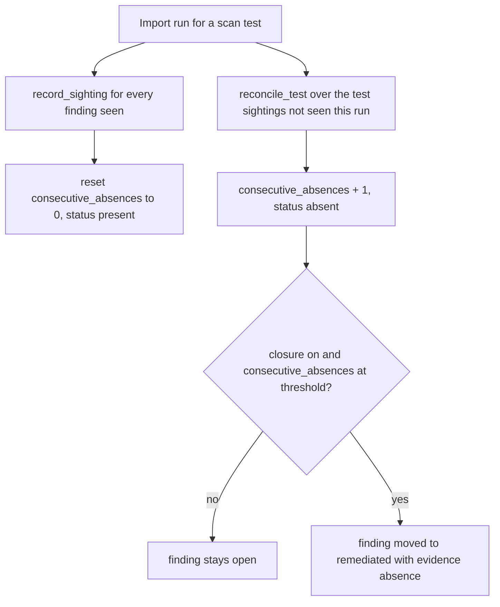

# Data lifecycle and retention

Two facts shape everything below.

1. **The application almost never deletes.** The only automatic deletion in the code base is the EPSS history prune and the wholesale replacement of a CVE's child rows. Everything else is soft-deleted, revoked, closed or simply kept.
2. **No foreign key is `RESTRICT`.** 130 of the 216 foreign keys cascade and 86 set the reference to `NULL`, so a manual `DELETE` on a parent never fails and silently removes or detaches children.

## Lifecycle of the major tables

"Writer" lists the module that creates rows (constructor or upsert found by code search); "Removal" is what can delete or retire them.

| Table(s) | Created or changed by | Removal and retention |
|---|---|---|
| `organizations` | `veyrs bootstrap` (`cli.py:392`), `PATCH /organization` for settings | Has `deleted_at` and `is_active` but **no route or command deletes or deactivates one**. Removal is SQL only. |
| `users`, `user_roles`, `team_members` | Admin API (`api/v1/admin.py`), login provisioning (`api/v1/auth.py`), CSV/team import, `veyrs bootstrap` | `DELETE /users/{id}` sets `deleted_at` and `is_active = false` (`admin.py:772`). Manual role grants are replaced; `origin = directory` grants are reconciled on every directory login (`auth.py:158`). Rows are never hard-deleted. |
| `refresh_tokens` | Created at login and on every rotation; `revoked_at` set on rotation, expiry, logout; a replay of a rotated token revokes the whole `family_id` (`api/v1/auth.py:575-625`) | **No code deletes expired or revoked rows**: the table grows with every login and refresh. |
| `api_keys` | Admin API | Revoked by `revoked_at`; never deleted by the application. |
| `assets`, `asset_products` | Asset API, importers, `veyrs import-inventory`, CMDB promotion, `services/inventory.py` | `DELETE /assets/{id}` soft-deletes (`deleted_at`, `is_active = false`; `api/v1/assets.py:523`). An import with `create_assets` that reports a host whose `import:<key>` row was soft-deleted **revives** that row (since 0.41.0; before, the run failed on the unique `(organization_id, external_id)`). `asset_products` rows for one `detected_by` source are deleted when an inventory import runs with `replace` and the product is no longer listed (`services/inventory.py:398`). |
| `asset_sources`, `asset_source_runs`, `asset_source_records` | CMDB sync (`services/cmdb.py`) | Records are upserted, flagged `is_absent`/`absent_since` when a pull sync no longer lists them, and un-flagged if they reappear (`cmdb.py:1103-1128`). Deleting a source cascades to its runs and records (`api/v1/cmdb.py:531`). |
| `cve`, `cve_references`, `cve_cpe_match`, `cpe`, `vendors`, `products`, `product_versions` | NVD sync (`veyrs sync-nvd`), KEV (can create a stub `cve` row), uploads | CVE rows are upserted. `cve_references` and `cve_cpe_match` of a CVE are **deleted and re-inserted** on every revision, because NVD rewrites the full list (`services/intelligence.py:350-358`). Catalogue rows are never deleted. |
| `epss_scores` | `veyrs sync-epss`: set-based `INSERT ... ON CONFLICT DO UPDATE`, then `cve.epss_score` is refreshed from it (`intelligence.py:586-625`) | One row per CVE, overwritten. |
| `epss_history` | Same sync, one row per CVE per scored day, unique `(cve_id, scored_on)` | **Pruned** by retention: see below. |
| `kev_entries` | `veyrs sync-kev` | Upserted; not deleted if CISA drops an entry (no delete code). |
| `feed_runs` | Every feed run writes one (`feed_run` context manager in `intelligence.py`) | Kept forever. |
| `vulnerabilities` | Created lazily per `(org, cve)` by correlation or per `(org, internal_ref)` by importers, both through `correlation.insert_vulnerability` | Never deleted by the application, except by `veyrs dedupe merge-duplicates --apply`, which merges rows that share `(cve_id, internal_ref)` after moving their findings, tickets and links. Deleting one cascades to its findings. |
| `findings` | Correlation and importers through `ensure_finding` (`correlation.py:445`) | Closed by state, never deleted by the application. See the next section. |
| `finding_events` | `record_event` on every state change, assignment, reopen (`correlation.py:383`) | Append-only in code; cascades from the finding. |
| `risk_score_history` | A row is added when a score is new or moves by at least 0.1 (`services/risk.py:104`) | Kept forever; cascades from the finding. |
| `sla_events`, `notifications`, `workflow_runs` | SLA sweep (`veyrs run-sla`), notification dispatcher, workflow engine | Kept forever. `notifications.status` is `pending`, `sent` or `failed` (`services/notifications.py:288-303`); `read_at` set by the user. |
| `tickets`, `ticket_comments`, `ticket_events`, `ticket_counters` | Ticket API and auto-ticketing (`services/ticketing.py`) | Closed or cancelled by state, never deleted. References are `VEYRS-<INC\|PRB\|CHG\|REQ\|REM\|EXC>-nnnnnn` from a per-tenant counter: the row is created with `INSERT ... ON CONFLICT DO NOTHING` and then taken `FOR UPDATE` (`ticketing.next_reference`, 0.41.0). |
| `risk_register` and children | Risk register API (`services/risk_register.py`) | **Soft delete** (`deleted_at`) with an event row, because "was this ever raised?" must stay answerable (`api/v1/risk_register.py:445`). Codes are `RISK-nnnnnn` from `ticket_counters` with `ticket_type = 'risk_register'`. RACI rows are deleted and recreated when the RACI is replaced (`risk_register.py:358`). |
| `engagements`, `scan_tests`, `test_findings`, `endpoints`, `finding_endpoints` | Importers and `services/engagements.py`, `services/endpoints.py` | State-driven; not deleted by the application. |
| `risk_acceptances`, `risk_acceptance_findings` | Acceptance workflow (`engagements.py`) | `pending`, `active`, `expired`, `revoked`, `rejected`; a job acts on expiry. Kept. |
| `compliance_*`, `control_*`, `assessment_gaps` | Compliance service and API | `compliance_evidence` has no update route: changed positions create new evidence (see `docs/DATABASE.md`). Frameworks seeded by `init-db` are rewritten idempotently. |
| `documents`, `document_chunks` | Document upload (`services/documents.py`) | `DELETE /knowledge/documents/{id}` hard-deletes the row (`api/v1/knowledge.py:429`); chunks cascade; `compliance_evidence.document_id` and `risk_acceptances.proof_document_id` are set to `NULL`. |
| `knowledge_articles`, `knowledge_revisions`, `threat_sources`, `threat_articles` | Knowledge API, threat intel poller | Revisions append per edit. Articles are unique per `(org, content_hash)`; never pruned. |
| `ai_conversations`, `ai_messages`, `ai_providers`, `ai_policies` | AI API and gateway | Providers can be deleted (`api/v1/ai.py:259`); conversations are archived (`is_archived`). |
| `exec_agents`, `agent_tools`, `agent_jobs`, `agent_job_events` | Agent API and lease protocol (`services/agents.py`) | Agent delete cascades tools and sets job `agent_id` to `NULL` (`api/v1/agents.py:668`). Job states: `queued`, `leased`, `running`, `succeeded`, `failed`, `cancelled`, `expired`. Output events accumulate in `agent_job_events`. |
| `audit_log`, `auth_events`, `ai_audit_log` | `services/audit.py` (`record`, `record_auth`, `record_ai`) | Append-only, enforced by a trigger since 0.41.0. See "Audit immutability". |
| `saved_views`, `report_queries` | Console users | Deleted by their owner; cascade with the owning user. |
| `asset_groups`, `webhook_endpoints`, `notification_templates` | **No writer found in `api/`, `services/` or `cli.py`** | Tables exist and are read (`services/notifications.py`; `engagements.asset_group_id`) but nothing in the code inserts into them. Status: Partial. |

## Pruning and retention

The only retention control in the code is for EPSS history.

| Mechanism | Detail | Source |
|---|---|---|
| Setting `VEYRS_EPSS_HISTORY_DAYS` | Default `365`; `0` keeps everything. A scored day is about 370,000 rows (about 80 MB); unpruned the table grew roughly 30 GB per year | `backend/veyrs/config.py` |
| Automatic prune | `sync-epss` prunes after each successful ingest, counted back from the **newest scored day**, not from today, so a stalled feed never erases its own history | `intel/feeds.py:218-220` |
| `python -m veyrs prune-epss-history [--days N] [--dry-run]` | Manual run; `--days 0` keeps all; one scored day per transaction to bound WAL and lock time | `cli.py:458`, `services/intelligence.py:660` |

Dry run first, then delete (run as the application OS user in the install directory, with the environment loaded):

```bash
cd /opt/veyrs
set -a; . ./.env; set +a
PYTHONPATH=backend venv/bin/python -m veyrs prune-epss-history --days 180 --dry-run
PYTHONPATH=backend venv/bin/python -m veyrs prune-epss-history --days 180
```

> [!CAUTION]
> The second command deletes `epss_history` rows older than 180 days before the newest snapshot, and cannot be undone except from a backup. Freed space is reused by PostgreSQL but not returned to the filesystem; that needs `VACUUM FULL`, which locks the table.

**Tables with no pruning in the code**, and therefore unbounded growth: `audit_log`, `auth_events`, `ai_audit_log`, `finding_events`, `risk_score_history`, `sla_events`, `notifications`, `workflow_runs`, `feed_runs`, `import_runs`, `asset_source_runs`, `agent_job_events`, `refresh_tokens`, `threat_articles`, `ticket_events`. Retention for these, if the organisation needs it, is an operator decision made in SQL as a superuser; nothing in VEYRS reads these rows to depend on their age except the dashboards that window over `created_at`.

Other retention-like settings: `VEYRS_REFRESH_TOKEN_DAYS` (default 14) sets a token's `expires_at` but does not delete it; `RETAIN_DAYS` (default 30) in `scripts/backup.sh` prunes **backup directories**, not data.

## Finding identity, reopening and closure

### Identity

`findings` is unique on `(organization_id, asset_id, dedupe_key)` (`uq_findings_organization_id`). `dedupe_key` is `NOT NULL`, 64 characters, and `dedupe_algorithm` records which algorithm produced it.

| Algorithm | Key | Source |
|---|---|---|
| `legacy` (default for scanners already in production, and for CVE correlation) | SHA-256 over organization, asset, `vuln_ref`, port, protocol, path | `services/dedupe.py` `legacy_key`, `correlation.py:51` |
| `unique_id_from_tool`, `hash_code`, `unique_id_or_hash_code` | the scanner's own id, a hash of configured fields, or either | `services/dedupe.py` (`ALGORITHMS`) |

`ensure_finding` looks the finding up with `dedupe.find_existing`; if it is missing it inserts a `new` finding and a `detected` event, otherwise it refreshes `last_seen_at`. If the key changed (a tool starts emitting stable ids) the stored key is updated **unless another finding already holds the new key**.

`dedupe_revision` (0.41.0) records which revision of the key formula produced the key. Until 0.41.0 the SCA configurations (`trivy`, `grype`, `snyk`, `dependabot`, `npm_audit`, `pip_audit`) hashed a `cve` field that was always empty, so every CVE on one package and asset merged into one finding. Revision 2 folds the finding's CVE (its vulnerability's `cve_id`, else `internal_ref`) into the old key, so the new key of an existing row is computable from the row alone. Existing rows are at revision 1 (the column's server default) and are re-keyed exactly once, by either path:

- `python -m veyrs dedupe rehash [--org SLUG] [--apply]` re-keys them in place. Dry run by default; idempotent; a row whose new key another finding already holds is listed as a conflict and left alone.
- an import that sees the same record adopts the revision-1 finding of the **same vulnerability** and re-keys it, so deploying before running the command does not duplicate anything.

A pre-0.41.0 finding that had merged several CVEs stays with the CVE it was created for; the other CVEs get findings of their own on the next import. That is exposure the defect hid, not duplication.

```bash
cd /opt/veyrs
set -a; . ./.env; set +a
PYTHONPATH=backend venv/bin/python -m veyrs dedupe rehash            # dry run: counts per organization
PYTHONPATH=backend venv/bin/python -m veyrs dedupe rehash --apply    # write
```

### Reopening a regression

A finding seen again while in `remediated`, `verified` or `closed` (`REOPENABLE_STATES`, `correlation.py:44`) is reset to `new`, its `closed_at`, `remediated_at`, `verified_at`, SLA breach flags and escalation level are cleared, `detected_at` is set to now so **the SLA clock restarts**, and a `reopened` event records origin, previous state and import run. The check is on the **state**, not on `closed_at`, because `remediated` never sets `closed_at`.

### Sightings and absence counting

Reimport closure is scoped to a **test** (`scan_tests`), never to a scanner across the organisation, and, since 0.41.0, to the **assets the run covered** ([ADR 0009](../ADRs/0009-closure-per-covered-asset.md)). A test is shared by every run of its engagement and scanner, so the test alone let a partial export or an agent job against another host count absences on hosts the run never looked at. A run covers the assets its records name (whatever their severity, including records it then rejects), its `target_asset`, `ImportOptions.covered_targets`, and an agent's job target when the agent attested coverage. A sighting on an uncovered asset is left untouched, so "consecutive" means consecutive runs that covered the asset.



**Legend.** Rectangles are steps in `services/engagements.py` (`record_sighting`, `reconcile_test`); the diamond is the closure decision. Only findings this test has previously reported, on assets this run covered, are considered (since 0.41.0). The threshold defaults by engagement type (`ci_cd` 1, `scheduled` 2, `interactive` 0 = never; `DEFAULT_ABSENCE_THRESHOLD`, `services/engagements.py:43-48`), and closure (`close_absent`) is on by default whenever the threshold is above 0 (`services/engagements.py:268-272`); a caller may pass either explicitly.

- Table `test_findings`: unique `(organization_id, test_id, finding_id)`; columns `status` (`present` or `absent`), `consecutive_absences`, `last_seen_at`, `last_import_run_id`.
- Thresholds by engagement type (`DEFAULT_ABSENCE_THRESHOLD`, `engagements.py:42`): `ci_cd` closes after **1** missed run, `scheduled` after **2**, `interactive` never (`0`). A caller may override with `close_absent` and `absence_threshold`.
- Closure writes a `remediated` event with `reason = "absent from scanner export"`, `evidence = "absence"` (explicitly *not* a verified fix), the consecutive count, the threshold and the absent import run ids, then sets `findings.state = 'remediated'` and `remediated_at`. `remediated` is still an **open** state (`OPEN_STATES` in `models/vulnerability.py`), so the finding stays in the queue until verified.
- Automation's closures (this one and correlation's `no_longer_applicable`) go through `correlation.observe_fix`, allowed only from `OBSERVED_FIX_FROM` (every open state except `remediated` and `verification`). Before 0.41.0 a finding already `remediated` or in `verification` was re-closed on every later run, re-firing the event and resetting `remediated_at`.
- Scanner connectors: `close_absent` requires an engagement (refused otherwise, `services/scanners.py:504`); a failed or unattested agent run forces `close_absent` off (`services/agents.py:974-990`).
- `import_runs` records `stale_candidates`, `findings_marked_absent` and `findings_closed_absent` per run.
- CMDB records use a different, simpler flag: `asset_source_records.is_absent` and `absent_since`, set when `mark_absent` is on, which defaults to on for a pull driver and off for a file upload (`services/cmdb.py:909-929`), and cleared when the record reappears.

### Lifecycle states

Findings move along a table-driven graph (`ALLOWED_TRANSITIONS`, `models/vulnerability.py:73`); anything else is refused (HTTP 409). Open states: `new`, `triaged`, `risk_assessed`, `assigned`, `in_progress`, `mitigation`, `remediated`, `verification`, `deferred`. Closed states: `verified`, `closed`, `false_positive`, `duplicate`, `accepted_risk`, `exception`. These strings are not enforced by a database `CHECK`.

## Integrity guarantees: what the database enforces

| Guarantee | Enforced by | Note |
|---|---|---|
| One finding per `(org, asset, dedupe_key)` | unique constraint `uq_findings_organization_id` | all three columns are NOT NULL, so it holds |
| One vulnerability per `(org, cve_id, internal_ref)` | unique constraint `uq_vulnerabilities_organization_id`, `NULLS NOT DISTINCT` since 0.41.0 | Holds. Before, NULLs were distinct, so two concurrent correlators could insert the same `(org, cve, NULL)`. The loser of such a race now gets the winner's row (`correlation.insert_vulnerability`). |
| One accountable person per risk | partial unique index `uq_risk_register_one_accountable` on `risk_register_raci (risk_id) WHERE raci = 'A'` | database-enforced |
| One RACI seat per party | unique `(risk_id, raci, team_id, user_id)`, `NULLS NOT DISTINCT` since 0.41.0 | Holds. Every row has a NULL in `team_id` or `user_id`, so before 0.41.0 the key enforced nothing; the service also checks (`risk_register.py:348`) |
| One ticket reference per tenant | unique `(organization_id, reference)` | the per-tenant counter row is created with `ON CONFLICT DO NOTHING` and then taken `FOR UPDATE`, so two simultaneous first tickets of a type serialise instead of one failing (fixed in 0.41.0) |
| One user email and one username per tenant | unique `(organization_id, email)` and `(organization_id, username)` | `username` may be NULL |
| One EPSS value per CVE per day | unique `(cve_id, scored_on)` | upserted with `ON CONFLICT` |
| One document per content hash per tenant | unique `(organization_id, content_hash)` | |
| One threat article per content hash per tenant | unique `(organization_id, content_hash)` | |
| One engagement slug, one knowledge slug, one connector slug per tenant | unique `(organization_id, slug)` on each | |
| Each credential prefix, token hash, CPE string, vendor name, organization slug globally unique | unique indexes on `api_keys.prefix`, `refresh_tokens.token_hash`, `cpe.cpe23`, `vendors.name`, `organizations.slug`; `exec_agents.token_prefix` | |
| Tenant isolation | RLS, see [README.md](README.md#row-level-security-model) | `compliance_frameworks`, `roles` rely on the application; `auth_events` has its own policies |

The complete list of unique keys per domain is in [er-diagrams.md](er-diagrams.md).

The two `NULLS NOT DISTINCT` keys are converted on existing databases by `schema_steps/step_ingest.py`, run by `veyrs init-db`. If rows that differ only by NULL already exist, the step **fails and changes nothing**, naming the first clash. Resolve them with `python -m veyrs dedupe merge-duplicates` (dry run: lists each group) and `--apply` (keeps the oldest row of each group, moves findings, tickets, external links and risk links to it and re-keys `legacy` findings that hashed the removed row's id; a vulnerability with neither a CVE nor an internal ref is not a duplicate of another and is given `internal_ref = 'unidentified:<id>'` instead; duplicate RACI seats are removed), then re-run `veyrs init-db`.

## Cascade deletes when an organization is removed

No API route, console action or CLI command removes an organization (`docs/DISASTER_RECOVERY.md` states the same). It happens only as SQL, run as a superuser:

```sql
-- psql as postgres, connected to the veyrs database. DESTRUCTIVE.
DELETE FROM organizations WHERE slug = 'example-tenant';
```

> [!CAUTION]
> This removes the tenant and everything beneath it in one statement, including its `audit_log` rows. The only recovery is a restore from backup. Take a verified backup first and treat it as a change request.

What the database does (from the foreign keys in `extract/schema.json`):

- **Deleted by cascade:** all **73** tables that have a foreign key to `organizations.id` (every tenant-owned table, plus `roles`, `audit_log` and `compliance_frameworks`, whose `organization_id` is nullable). Cascades continue through children, for example `compliance_frameworks` (custom ones) delete their `compliance_controls`, and findings delete their events, history, sightings and links.
- **Left behind:** `auth_events` and `ai_audit_log` rows carry the organization id as a plain `UUID` with no foreign key, so they **remain**. The 14 tables with no tenant column (catalogues, `feed_runs`) are untouched.
- **Outside PostgreSQL:** credentials stored in an external vault (`vault:` or `vm1:` values) are not removed; list unreferenced entries with `python -m veyrs secrets gc` and delete them with `--apply`. Redis keys expire by themselves.

Referential actions are executed by PostgreSQL's integrity triggers, which the PostgreSQL documentation states bypass row security, so the cascade works under `FORCE ROW LEVEL SECURITY`. This was not exercised live in this documentation round.

## Audit immutability

| Claim | Reality in code | Status |
|---|---|---|
| "No UPDATE or DELETE path exists in the application for `audit_log`, `auth_events`, `ai_audit_log`" | True: `services/audit.py` only inserts, and no query in `api/`, `services/`, `intel/` deletes or updates them | Verified by code search |
| Append-only in the database (`models/audit.py` docstring, since 0.41.0) | A trigger from `schema_steps/step_auth.py` refuses `UPDATE`, `DELETE` and `TRUNCATE` on the three tables, except retention deletes under `SET LOCAL veyrs.audit_prune = 'on'` and foreign-key cascades. No `GRANT`/`REVOKE` is shipped: the application role owns the tables and could disable the trigger | Implemented (`tests/test_fix_auth.py`) |
| `audit_log` survives deletion of its organization | **It does not**: `audit_log.organization_id` is `ON DELETE CASCADE`; `auth_events` and `ai_audit_log` do survive | Implemented |

Audit writes run inside a SAVEPOINT (`session.begin_nested()`, `services/audit.py:102`). A row the policy or a constraint rejects is logged as `audit write failed` and **dropped**; the request continues. Secrets are redacted by key name before storage (`scrub`: `password`, `secret`, `token`, `key_hash`, `mfa_secret`, and any key containing `password`, `secret` or `token`).

To get true database-level immutability an operator would have to make the audit tables owned by a different role than the application and grant the application `INSERT, SELECT` only; the repository does not do this, and `init-db` would need the application to remain able to alter RLS on them.

## Sources

- `backend/veyrs/services/correlation.py`, `engagements.py`, `dedupe.py`, `cmdb.py`, `intelligence.py`, `audit.py`, `ticketing.py`, `risk_register.py`
- `backend/veyrs/models/vulnerability.py`, `audit.py`
- `backend/veyrs/cli.py`, `backend/veyrs/config.py`, `backend/veyrs/intel/feeds.py`
- `extract/schema.json` for foreign keys and unique constraints
