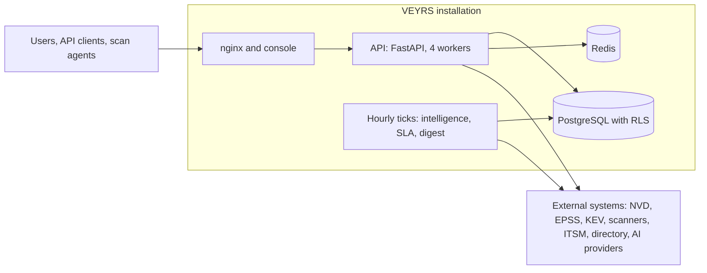

# Executive overview

## What VEYRS is

VEYRS (Unified Cybersecurity Risk Management) answers one question that scanners, asset registers and ticketing systems each answer only in part: *which of the weaknesses in our estate matter this week, who owns them, and can we prove we acted on them?*

It is a multi-tenant web application and API. It ingests vulnerability intelligence (NVD, EPSS, CISA KEV, MITRE CWE) and scanner results, matches them to the software installed on each asset, scores every finding with a transparent risk formula that includes business context, assigns ownership, enforces SLA deadlines, drives remediation through tickets, and keeps the evidence for audits. It does not replace the scanner, the configuration database of record or an enterprise ITSM; it connects to them.

The product spine, from the code's own description (`backend/veyrs/main.py`): CVE, product, version, asset, criticality, exposure, EPSS, CVSS, KEV, VEYRS risk, team, ticket, SLA, escalation, remediation, verification, compliance evidence, audit.

Licence: Elastic License 2.0 (`pyproject.toml`). Version documented: 0.39.1 (the 0.39.1 changes are console-only; the backend is as in 0.39.0).

## Objectives

1. Replace manual reconciliation of scanner output against the asset register with a continuous, per-tenant join.
2. Rank work by risk (severity plus likelihood plus business impact plus exposure), with every score explained from stored data.
3. Make ownership, deadlines and closure auditable: every state change, import and AI call leaves a record.
4. Keep tenants strictly apart: two independent barriers, application filtering and PostgreSQL row level security.
5. Stay operable by a small team: one application, one database, no message broker, two install shapes.

## Scope

| In scope | Out of scope |
|---|---|
| Vulnerability intelligence, asset inventory, correlation, findings, risk scoring, SLA and escalation | Being the scanner (VEYRS imports results and can drive an agent running third-party scanners) |
| Remediation tickets and synchronisation with external ITSM | Being the enterprise ITSM or the CMDB of record |
| Compliance mapping and evidence for four catalogues (identifiers and titles only) | Reproducing licensed standards' text (ISO 27001/27002 are not redistributed) |
| Threat and document intelligence, knowledge base, search | A SIEM, EDR or patch deployment tool |
| Policy-gated AI assistance | Autonomous AI actions; a model never executes a query or a command |

## Capabilities

Status vocabulary: **Verified** (in code and covered by a test read or observed live), **Implemented** (in code, not verified at runtime in this review), **Partial**, **Planned**.

| Capability | What it does | Status | Evidence |
|---|---|---|---|
| Multi-tenancy | Organization on every customer row; RLS forced on 73 of 89 tables | Verified | `backend/veyrs/db.py`, `cli.py:314-330`, `tests/test_audit_rls.py` |
| Authentication | Local Argon2id passwords, JWT access tokens, rotating refresh tokens, API keys, lockout | Verified | `security/auth.py`, `tests/test_phase2_core.py` |
| Multi-factor and SSO | TOTP, e-mail or Telegram codes, RADIUS challenge, LDAP/AD, OpenID Connect | Implemented | `security/mfa.py`, `services/ldap_auth.py`, `radius_auth.py`, `oidc_auth.py` |
| RBAC and team scope | 116 permissions, 10 built-in roles, team-scoped visibility | Verified | `security/permissions.py`, `security/scope.py`, `tests/test_phase26_scope.py` |
| Intelligence feeds | NVD, EPSS, KEV, CWE on an hourly tick with per-tenant schedule | Verified | Timer active and all four feeds succeeded within 24 h on the reference installation; `intel/feeds.py` |
| CVSS engine | v2, v3.0, v3.1, v4.0 from the published algorithms | Verified | `engines/cvss/`, `tests/test_cvss_official.py` (4,379 official vectors) |
| Risk scoring | Four sub-scores, five built-in profiles, KEV and exposure floors, age penalty, stored explanation | Implemented | `engines/risk.py`, `tests/test_phase3_risk.py` |
| Asset inventory and context | Assets, installations with versions, criticality, classification, exposure, business services, teams | Implemented | `models/assets.py`, `services/inventory.py` |
| CMDB and inventory sources | File, generic JSON and NetBox drivers; agent and fleet inventory sweeps | Implemented | `services/cmdb.py`, `integrations/fleet-import/` |
| Scanner imports | 6 network-scanner formats and 14 SAST, SCA, DAST, IaC and cloud formats | Implemented | `services/importers/parsers.py:417`, `parsers_modern.py:887` |
| Scanner connectors | Pull results from Nessus, Tenable.io, Tenable.sc APIs | Implemented | `services/scanners.py` |
| Findings lifecycle | 15 states with validated transitions, regression reopen, configurable deduplication | Implemented | `models/vulnerability.py`, `services/dedupe.py` |
| Engagements and reimport | Scoped reconciliation, absence thresholds, risk acceptance with expiry | Implemented | `services/engagements.py` |
| SLA and escalation | Policy-driven deadlines, warnings, breaches, escalation ladders (needs the hourly tick) | Implemented | `services/sla.py`, `scripts/sync-intel.sh` |
| Ticketing and ITSM | Internal ITIL queue, ServiceNow, Jira Service Management, webhook, signed inbound events | Implemented | `services/ticketing.py`, `itsm.py`, `itsm_inbound.py` |
| Workflow engine | Closed registry of six actions on triggers | Partial | `services/workflow.py:266`; only 5 of 10 declared triggers are fired in code (see Limitations) |
| Notifications and digest | In-app and e-mail; daily digest. Webhook and Slack channels are offered by the workflow builder but have no transport; Telegram carries MFA codes only | Partial | `services/notifications.py:255-259` (`TRANSPORTS`), `services/digest.py`, `security/mfa_delivery.py` |
| Execution agent | Remote scanner runner with leases, allowlist, coverage attestation | Verified | Agent unit running on the reference installation; `tests/test_phase16_agents.py` |
| Threat and document intelligence | Sources, articles, document extraction, entity mining | Implemented | `services/threatintel.py`, `services/documents.py` |
| Search | Lexical substring search (`ILIKE`) across entities, permission-aware; the module docstring's `to_tsvector` claim is stale | Implemented | `services/search.py:84-134` |
| Semantic search | Vector index over documents | Planned | Interface and null backend only; no vector backend ships (`services/search.py:221-246`) |
| AI gateway | 13 capabilities behind one policy-enforcing gateway, deterministic fallback | Verified | `services/ai/gateway.py`, `tests/test_phase6_ai.py` |
| Compliance | NIST CSF 2.0, CIS v8, ISO 27001 and 27002 identifiers, 12 automated signals, assessments | Implemented | `data/frameworks.py`, `services/compliance.py` |
| Risk register | Organization-level risks with RACI and links; can be turned off per tenant | Implemented | `services/risk_register.py` |
| Reporting | Dashboards, JSON, CSV, XLSX and PDF export, ad-hoc report builder | Implemented | `services/reporting.py`, `report_builder.py` |
| Secrets at rest | Fernet envelope, optional HashiCorp Vault or OpenBao | Implemented | `security/secrets.py`, `secret_vault.py` |
| Operator console | Single-page console, plain JavaScript, no build step | Implemented | `frontend/console/` |
| Observability | JSON logs, correlation ids, Prometheus metrics, liveness and readiness probes | Verified | `observability.py`; `/healthz` and `/readyz` answered on both live nodes |
| Signed self-update | Update requested in the console, applied by a root helper after signature verification | Implemented | `scripts/veyrs-updater.sh`; units not installed on the observed nodes |
| High availability | Two stateless app nodes, streaming database standby, manual promotion | Verified | Two app nodes observed; [deployment](../architecture/deployment.md) |
| Kubernetes deployment | Chart and secret management | Planned | Not shipped |

## Main use cases

1. **Weekly prioritisation.** Review the highest risk findings with the explanation for each; adjust the risk profile to the audience (technical, executive, internet exposure, compliance).
2. **Known-exploited vulnerability response.** When KEV adds a CVE that affects the estate, rescoring raises the floor, the SLA clock shortens by policy, and an optional auto-ticket and notification fire.
3. **Scanner onboarding.** Upload exports or connect a scanner or agent; records that cannot be tied to a known asset are rejected with a reason instead of guessed.
4. **Remediation and verification.** Findings flow through assignment, ticket, fix, verification and closure, with regressions reopened automatically.
5. **Audit and compliance evidence.** Controls map to live signals and stored evidence; assessments are frozen snapshots with a partial-coverage disclaimer that cannot be removed.
6. **Executive and team reporting.** Dashboards and exports with denominators and sample sizes shown.
7. **Safe AI assistance.** Explain a risk, draft a ticket, search in natural language, under a per-tenant policy that can forbid external providers entirely.
8. **Multi-tenant operation.** One installation serving several organizations (for example a service provider) with enforced separation.

## High-level architecture

**Legend.** Boxes are processes, cylinders are data stores, arrows show who initiates a call. The "ticks" are systemd timers or container loops that run the command-line tool; there is no queue or worker pool. Detail is in [C4 diagrams](../architecture/c4.md).

## Main components

| Component | Role | Technology |
|---|---|---|
| API | All business logic and authorization | Python 3.11, FastAPI, SQLAlchemy 2, Pydantic 2 |
| Database | All state; tenant isolation by RLS | PostgreSQL 15 or newer |
| Cache and limiter | Rate-limit windows | Redis |
| Console | Operator UI | Plain JavaScript, served by nginx |
| Engines | CVSS calculators and the risk formula | Pure Python modules |
| Intelligence collector | NVD, EPSS, KEV, CWE | `intel/feeds.py`, hourly tick |
| Agent | Runs scanners where the targets are | Standard-library Python |
| AI gateway | The only path to a language model | `services/ai/gateway.py` |
| Installers | Native and container deployment | `install.sh`, `veyrs-setup.sh`, `docker/` |

Sizes (0.39.1): 140 Python modules (about 55,000 lines), 89 tables, 336 routes (330 documented operations over 266 paths), 116 permissions, 60 settings, 20 top-level command-line commands (23 when the four `secrets` subcommands are counted separately), 94 test files.

## Limitations

These are stated plainly because they shape deployment and operations decisions.

| Limitation | Impact | Where to read more |
|---|---|---|
| The database is a single point of failure; promoting the standby is manual | An outage lasts until an operator acts; two primaries cannot be reconciled, so automation is deliberately absent | [deployment](../architecture/deployment.md#5-limits) |
| The standby and its backups may share a physical host with the primary | Loss of that host can lose production and every copy | [deployment](../architecture/deployment.md#5-limits), ADR 0008 |
| No migration tool (no Alembic) | Schema changes beyond adding columns, indexes and foreign keys are manual | [overview](../architecture/overview.md#4-patterns) |
| Everything time-based depends on one hourly tick per installation | If the tick stops, intelligence ages and SLA breaches are not raised, and the console does not say so | [data flows](../architecture/data-flows.md#2-intelligence-feeds-to-catalogue-to-exposure) |
| Container stack is not a production topology | Application and database share a project; background services are off by default | [deployment](../architecture/deployment.md#3-docker-compose-deployment) |
| Single-host agent and intelligence jobs | In the HA shape they run on one node; failover is manual | [deployment](../architecture/deployment.md#22-split-deployment-with-a-standby-ha) |
| Expired agent leases are not reaped automatically | A dead agent's job stays leased until the reap endpoint is called | [data flows](../architecture/data-flows.md#4-agent-job-lifecycle) |
| Workflow triggers partly unwired | `finding.state_changed`, `finding.risk_changed`, `intel.kev_added`, `schedule` and `manual` are declared but nothing fires them in 0.39.1; only `finding.created`, the three SLA events and the two ticket events run | `services/workflow.py:293-307`, `models/workflow.py:25-34` |
| No semantic search, no Kubernetes packaging | Lexical search only; container deployment is Compose | [dependencies](../architecture/dependencies.md#2-external-python-dependencies) |
| Compliance catalogues are partial by design | Identifiers and short titles only until a licensed import | [ADR 0005](../ADRs/0005-partial-catalogues.md) |
| The API service runs as `root` on native installs | Mitigated by systemd sandboxing; see the install guide | `infrastructure/systemd/veyrs-api.service` |

## Where to go next

- Terms and acronyms: [glossary](../reference/glossary.md)
- How the system is built: [architecture overview](../architecture/overview.md), [C4 diagrams](../architecture/c4.md), [data flows](../architecture/data-flows.md), [sequences](../architecture/sequences.md)
- How to run it: [deployment architecture](../architecture/deployment.md), `INSTALL.md`
- What can go wrong: [threat model](../THREAT_MODEL.md)
