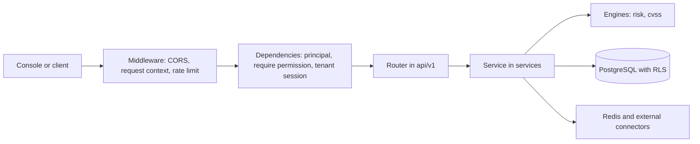

# Functional catalogue

VEYRS is a FastAPI application whose behaviour is split into 24 routers (`backend/veyrs/api/v1/__init__.py`), business logic in `backend/veyrs/services/` and two pure engines (`engines/risk.py`, `engines/cvss/`). Every area document uses the same feature layout: what, why, how it works (with `path:line`), how to use (console area and endpoints), permissions, data, dependencies, errors, exceptional conditions and a Status.

Status values follow the portal vocabulary. `Verified` means read in code **and** observed live on environment A (GET routes) or covered by a test; mutating routes were not exercised on the live system and are `Implemented` unless a test was read. Cross-cutting behaviour (authentication, errors, pagination, rate limits) is in the [API guide](../api/guide.md).

## Areas

| Area | Document | API tags (route count) | Main services |
|---|---|---|---|
| Authentication, accounts, RBAC, API keys, audit, team import | [authentication-accounts](authentication-accounts.md) | authentication (18), part of administration, team import (4) | `ldap_auth`, `oidc_auth`, `radius_auth`, `mfa_admin`, `team_import`, `audit` |
| Administration and platform settings | [administration-platform](administration-platform.md) | administration (organization, scanning, ticketing, risk-register, LDAP/OIDC/RADIUS, secret storage) | `secret_storage`, `scanning`, `ticketing_mode` |
| Software updates and system inventory | [updates](updates.md) | administration (`/admin/updates`, `/admin/system`) | `updates`, `software_inventory`, `network_requirements`, `versions` |
| TLS trust store | [trust-store](trust-store.md) | administration (`/admin/trust-store`) | `trust_store` |
| Agents | [agents](agents.md) | agents (22) | `agents` |
| Assets, inventory, business services | [assets-inventory](assets-inventory.md) | assets (17) | `inventory`, `dedupe`, `correlation` |
| CMDB and asset sources | [cmdb-asset-sources](cmdb-asset-sources.md) | asset sources (15) | `cmdb` |
| Engagements, scan import, risk acceptances | [engagements-scan-import](engagements-scan-import.md) | engagements (15) | `engagements`, `scanning`, `endpoints`, `dedupe`, `importers` |
| Vulnerability management (findings) | [vulnerability-management](vulnerability-management.md) | vulnerability management (findings, vulnerabilities) | `correlation`, `attribution` |
| Risk engine | [risk-engine](risk-engine.md) | vulnerability management (`/risk/*`, rescore) | `engines/risk.py`, `risk` |
| Risk register | [risk-register](risk-register.md) | risk register (10) | `risk_register`, `risk_register_mode` |
| SLA, escalation, assignment | [sla-escalation](sla-escalation.md) | policies (12 of 16) | `sla` |
| Ticketing, ITSM mode, workflows | [ticketing-itsm](ticketing-itsm.md) | ticketing (tickets, automation, workflows) | `ticketing`, `ticketing_mode`, `autoticket`, `workflow`, `itsm` |
| Remediation, verification, fix plans | [remediation-fix-plans](remediation-fix-plans.md) | policies (`/upgrade-path-rules`), fix-plan routes | `fix_plan`, `remediation` |
| Notifications and digest | [notifications-digest](notifications-digest.md) | ticketing tag (`/notifications*`) | `notifications`, `digest` |
| Compliance | [compliance](compliance.md) | compliance (16) | `compliance` |
| Integrations (imports, scanners, ITSM connectors, links) | [integrations](integrations.md) | integrations (25) | `scanners`, `itsm`, `itsm_inbound`, `importers` |
| Threat intelligence | [threat-intelligence](threat-intelligence.md) | threat intelligence (14) | `intelligence`, `intel_pipeline`, `intel_schedule`, `threatintel`, `intel/feeds.py` |
| CVSS | [cvss](cvss.md) | cvss (9) | `engines/cvss`, `cvss_assist` |
| Knowledge and search | [knowledge-search](knowledge-search.md) | intelligence & knowledge (19) | `documents`, `docs`, `search` |
| AI | [ai](ai.md) | ai (19) | `services/ai/*` |
| Dashboards, reports, report builder, saved views | [dashboards-reports](dashboards-reports.md) | dashboards & reports (17), saved views (4) | `analytics`, `reporting`, `report_builder`, `views` |
| Operations probes | [API guide](../api/guide.md#probes-and-metrics) | operations (3: `/healthz`, `/readyz`, `/metrics`) | `observability.py` |

The route counts come from `extract/routes.json` (336 routes, 4 untagged: `/api/v1/openapi.json`, `/docs`, `/docs/oauth2-redirect`, `/redoc`). Tags `policies`, `ticketing` and `vulnerability management` span more than one document; each route is named in exactly the document that owns its behaviour.

## How a request becomes behaviour

**Legend:** rectangles are processing layers named after `main.py`, `security/deps.py`, `api/v1/*.py` and `services/*.py`; the cylinder is the database; arrows are call direction. Middleware is listed in the order a request passes it (`main.py:72-85`). Routers contain validation and authorization; business rules live in services.

## Cross-area findings worth knowing first

These are the defects and gaps found while documenting (full list with evidence in the findings report):

- `POST /risk/simulate` appears to raise `TypeError` (see [risk-engine](risk-engine.md)).
- `POST /ai/threat-summary` references a model attribute that does not exist (see [ai](ai.md)).
- Any tenant admin with `intel:write` can write the global CVE/EPSS/KEV tables, and any tenant admin can import controls into shared built-in compliance frameworks (see [threat-intelligence](threat-intelligence.md), [compliance](compliance.md)).
- Several workflow triggers and webhook notifications have no emitter or transport (see [ticketing-itsm](ticketing-itsm.md), [notifications-digest](notifications-digest.md)).
- Risk-acceptance expiry and agent lease reaping depend on something calling an API route; no in-tree timer does (see [engagements-scan-import](engagements-scan-import.md), [agents](agents.md)).
