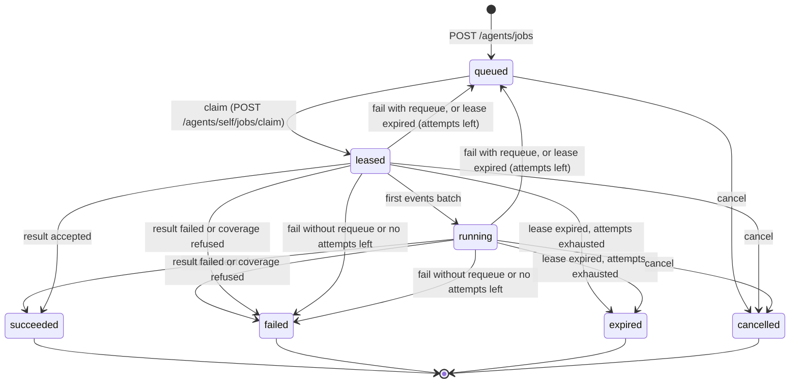

# Execution agents

An execution agent is a small runner installed near the estate (for example running nuclei, or a package-manager sweep). VEYRS never scans by itself: it **queues jobs**, an agent **claims** them under a time-limited lease, streams progress, and **submits** the scanner output, which goes through the normal import pipeline. Agents also **report installed software** so that CVE correlation is continuous.

An agent is deliberately **not** a `Principal`: it has no permission set and can reach only `/agents/self/*` (`backend/veyrs/security/agent_auth.py:1-17`). Its credential is the header `X-Agent-Token: veyrsagent_<prefix>_<secret>` (not `Authorization`). A user credential is rejected by `get_agent` and an agent token by `get_principal` (it does not parse the `veyrsagent` scheme, `security/auth.py:156-170`).

**Legend**: states of `agent_jobs.state` (`models/agent.py:66-76`); `succeeded`, `failed`, `cancelled`, `expired` are terminal (`TERMINAL_JOB_STATES`). Transitions: `claim_next`/`_lease` (`services/agents.py:665-717`), `append_events`/`mark_running` (`:732-780`), `submit_result` (`:918-1058`), `fail_job` (`:1146`), `cancel_job` (`:1168`), `reap_expired_leases` (`:1197`). A result may arrive while the job is still `leased` (no events sent first): `submit_result` checks only the lease, not `running`. Lease expiry is applied only when `POST /agents/maintenance/reap` is called.

Agent statuses (`AgentStatus`): `pending` (enrolled, never checked in), `idle`, `busy`, `offline` (missed heartbeats, jobs stop being offered), `disabled` (operator switched off) (`models/agent.py:51-60`). The whole `agents` tag is refused to team-scoped principals (`security/scope.py:98`).

## Feature: enrolment and agent credential

- **What**: `POST /agents` creates an agent and returns its token **once**; `POST /agents/{agent_id}/rotate-token` mints a new one; `DELETE /agents/{agent_id}` removes it (`api/v1/agents.py:585-612`, `:656-694`, `services/agents.py:110-196`).
- **Why**: enrolment creates a new place scans can originate from, so it needs `agent:admin`, not `agent:write`.
- **How it works**: `enroll` slugifies the name (suffix `-2`, `-3` for duplicates), validates every target rule (`_validate_rule`: non-empty, CIDR must parse), generates `veyrsagent_<10 hex>_<secret>`, stores prefix and Argon2 hash, sets status `pending` and audits `agent.enrolled`. Policy defaults: `allowed_targets` empty (an agent with no allowlist can run **nothing**), `require_asset_match` true, `auto_enable_tools` false, `max_concurrency` 1 (1-32), `lease_seconds` 900 (60-86400), up to 200 rules per list and 40 labels. Authentication looks up by prefix then verifies the hash (`authenticate`, `:197`). A disabled agent still authenticates but is answered **403** `this agent has been disabled by an operator`, so it can tell "rotate" from "switched off" (`security/agent_auth.py:48-55`).
- **Permissions**: `agent:admin`.
- **Data**: `exec_agents` (model `ExecAgent`), `audit_log`.
- **Errors**: 403 when active scanning is off for the organization (`ScanningRefused`, enrolment refused), 422 invalid rule or empty name, 404 `agent not found`, 409 on delete when jobs are still queued/leased/running (`N job(s) are still queued or running on this agent; cancel them or disable the agent instead`), 401 `invalid agent token` on the data plane.
- **Exceptional**: the old token stops working immediately on rotation. The token is never shown again.
- **Status**: Implemented (`tests/test_phase16_agents.py`). Live: `GET /agents` returned 200 (list envelope).

## Feature: agent inventory and policy management

- **What**: `GET /agents` (filter `status`, `limit` 1-200, `offset`), `GET /agents/{agent_id}`, `PATCH /agents/{agent_id}`, `GET /agents/{agent_id}/tools`, `PATCH /agents/{agent_id}/tools/{tool_name}` (`api/v1/agents.py:566-733`).
- **How it works**: PATCH may change name, description, `status` (must be a valid `AgentStatus`; recorded by `set_status` as `agent.status_changed` and sets `disabled_at`), target rules (validated, lower-cased), concurrency, lease, labels; it audits `agent.updated`. Tools are declared by the agent in its heartbeat; a declaration does **not** authorise execution, an operator enables the tool with `PATCH .../tools/{tool_name}` `{"enabled": true}` (audited `agent.tool_enabled|disabled`) unless the agent was enrolled with `auto_enable_tools`. A tool the agent stops declaring is disabled, not deleted, so history is kept and re-adding the binary does not re-authorise it (`declare_tools`, `:306-357`). A parser name the platform does not know is dropped and recorded under `meta.rejected_parser`.
- **Permissions**: `agent:read` (reads), `agent:admin` (patch, tool toggle).
- **Data**: `exec_agents`, `agent_tools`.
- **Errors**: 404 `agent not found`; 422 unknown status, bad rule, `agent <slug> has not declared tool '<name>'`.
- **Status**: Implemented.

## Feature: target authorisation (policy engine)

- **What**: the rule that decides whether a target may be scanned or inventoried (`authorise_target`, `services/agents.py:507-565`). Not a route.
- **How it works**: applied **twice**: when a pinned job is queued, and again inside `claim_next` for the claiming agent (essential for unpinned jobs). Order: (1) a loopback/link-local/multicast IP is refused unless the agent's allowlist contains that exact literal; (2) any matching `denied_targets` rule refuses; (3) an empty allowlist refuses (deny by default); (4) the target must match an allow rule: CIDR rules match IP targets only, name rules are `fnmatch` patterns (`*` matches any name), an IP target matches only an equal IP rule; (5) if `require_asset_match`, the host must resolve to an asset in the register by hostname, FQDN or recorded address. Names are **never resolved** against DNS, to avoid DNS-rebinding between authorisation and execution (module docstring, `:12-17`).
- **Errors**: surfaced as 422 `TargetRefused` with the rule that fired, because the fix is a policy edit.
- **Status**: Implemented.

## Feature: queue, list, inspect and cancel jobs

- **What**: `POST /agents/jobs` (201), `GET /agents/jobs`, `GET /agents/jobs/summary`, `GET /agents/jobs/{job_id}`, `GET /agents/jobs/{job_id}/events`, `POST /agents/jobs/{job_id}/cancel` (`api/v1/agents.py:444-545`, `services/agents.py:567-653`).
- **Why**: operators schedule scans against registered assets; the mandatory `reason` (5-2000 chars) is stored and audited so the trail answers "why was this host scanned".
- **How it works**: `queue_job` refuses when active scanning is off, requires a tool and a reason, and either pins to an agent (agent must be enabled, tool enabled, profile implemented) or leaves it open to any capable agent (refused at once if no enabled agent in the tenant offers the tool). It authorises the target, optionally binds an open engagement, records `meta.authorised_host/matched_rule` and audits `agent.job_queued`. Priority range -100..100, `max_attempts` 1-10. List filters: `state`, `agent_id`, `tool`, `active` (queued/leased/running), `limit` 1-200. Events are an incremental tail: poll with the last `seq` as `since_seq` (limit up to 2000); deliberately not a websocket. Summary returns counts per state plus `active` and `terminal`. Cancel takes an optional `note` in the JSON body.
- **Permissions**: `agent:read` (list, get, events, summary), `agent:write` (queue, cancel).
- **Data**: `agent_jobs`, `agent_job_events`, `engagements`, `audit_log`.
- **Errors**: 403 scanning disabled (`ScanningRefused`); 422 any other refusal (no tool, no reason, tool not enabled, target refused, engagement closed or not found, agent disabled, job already terminal on cancel); 404 `job not found`/`agent not found`.
- **Status**: Verified for `GET /agents/jobs/summary` (live 200, keys `queued, leased, running, succeeded, failed, cancelled, expired, active, terminal`); other routes Implemented.

## Feature: agent data plane (heartbeat, claim, stream, lease, result, fail)

- **What** (all authenticated with `X-Agent-Token`, `api/v1/agents.py:239-440`):

| Route | Purpose |
|---|---|
| `POST /agents/self/heartbeat` | check-in with version, hostname, platform and declared tools; response includes `active_scanning` so the agent can stand down |
| `POST /agents/self/jobs/claim` | lease the next authorised job; 204 when nothing is available; returns job plus a **lease token shown once** |
| `POST /agents/self/jobs/{job_id}/events` | batch of 1-200 progress events (message at most 8000 chars); first batch moves `leased` to `running` |
| `POST /agents/self/jobs/{job_id}/lease` | extend the lease for a long scan |
| `POST /agents/self/jobs/{job_id}/result` | raw request body is the scanner output; query `scanner`, `exit_code`, `filename`, header `X-Agent-Scan-Stats` (JSON) |
| `POST /agents/self/jobs/{job_id}/fail` | report the job could not run (`error`, `exit_code`, `requeue`) |
| `POST /agents/self/inventory` | installed-software report for one host |

- **How it works**:
  - Claim uses `SELECT ... FOR UPDATE SKIP LOCKED` over the oldest highest-priority 20 queued jobs for this agent or unpinned, skips jobs whose tool is not enabled or whose target the agent's policy refuses, and respects `max_concurrency`. It is refused when scanning is off (403).
  - Every write to a job must present the lease token (`verify_lease`, constant-time compare): the job must be leased to this agent, not terminal. The token is sent in the `X-Agent-Lease` header; the old query parameter `lease_token` is still accepted (deprecated, logged) for one release.
  - `submit_result` (limit 64 MiB, `MAX_RESULT_BYTES`) picks the parser from `scanner`, the declared tool parser, or format detection; an **empty** body is valid only when the scan is attested complete and the parser is known. A coverage check (`_coverage`, `:851`) refuses blind runs: no stats and empty output, unreachable probe, scanner completion below 80 percent, or error rate above 50 percent. A failed or unattested run never closes findings (`close_absent` forced off); a successful attested empty run does reconcile, which is how agent-run scans close fixed findings. The import is an `ImportRun`; the job stores `exit_code`, `output_bytes`, `output_sha256`, `import_run_id`.
  - `fail_job` requeues while attempts remain (job returns to the pinned agent or open pool), otherwise `failed`.
  - `submit_inventory` applies the **same target policy** as a scan, then upserts installed software (`replace` default true drops items this agent no longer reports, only its own `detected_by`), creates the asset only in discovery mode (`require_asset_match` false) and runs correlation immediately (`services/agents.py:1061-1143`). Max 20000 items.
- **Allowed while scanning is off**: heartbeat, result, events, lease, fail, inventory. Refused: queueing, claiming, enrolling (table in `services/scanning.py:13-31`).
- **Errors**: 401 `invalid agent token` (missing/malformed/unknown); 403 agent disabled, scanning disabled, or `claim` `AgentError`; 404 `job not found` (including jobs of other tenants); 422 for lease problems (`this job is not leased to this agent`, `job is already <state>`, `invalid or expired lease token`), target refused, oversize result, `at most 200 events per call`, and `an empty result must name its scanner`.
- **Exceptional**: leases are the safety net against dead agents: see housekeeping. Agents older than 0.41.0 send the `lease_token` as a query parameter, so reverse-proxy access logs can contain live lease tokens until the job ends; update them.
- **Status**: Implemented (`tests/test_phase16_agents.py`, `tests/test_phase34_inventory_and_scanning.py`).

## Feature: maintenance (reap)

- **What**: `POST /agents/maintenance/reap?offline_after=` (default 180 s, 30-86400) (`api/v1/agents.py:548-563`).
- **How it works**: `reap_expired_leases` requeues leased/running jobs whose lease expired while attempts remain, otherwise marks them `expired` (not `failed`: nothing is known about whether the scan ran, so it must not be read as "the host was fine"); `mark_stale_agents_offline` flips agents with no heartbeat for `offline_after` seconds to `offline`. Idempotent.
- **Dependencies**: the code comment says it is safe to call from cron; no in-tree scheduler calls it (only this route), so an installation that wants automatic expiry must call it from an external schedule.
- **Permissions**: `agent:write`. **Data**: `agent_jobs`, `exec_agents`, `agent_job_events`.
- **Status**: Implemented.

## Route coverage

All 22 routes of the `agents` tag: `/agents` (GET, POST), `/agents/{agent_id}` (GET, PATCH, DELETE), `/agents/{agent_id}/rotate-token`, `/agents/{agent_id}/tools` (GET), `/agents/{agent_id}/tools/{tool_name}` (PATCH), `/agents/jobs` (GET, POST), `/agents/jobs/summary`, `/agents/jobs/{job_id}` (GET), `/agents/jobs/{job_id}/events` (GET), `/agents/jobs/{job_id}/cancel`, `/agents/maintenance/reap`, and the seven `/agents/self/*` routes. Route order in the module matters: `/self/*` and `/jobs/*` are declared before `/{agent_id}` or "jobs" would be parsed as a UUID and answered 422 (`api/v1/agents.py:11-13`).
