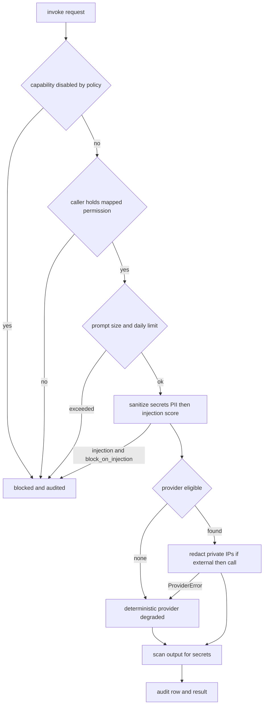

# AI gateway and assistant

Reference per endpoint: [../api/reference/ai.md](../api/reference/ai.md). Threat model: [../AI_SECURITY.md](../AI_SECURITY.md).

## Access model

- The `ai` tag is in `REFUSED_TAGS` (`security/scope.py:98`): a **team-scoped** principal gets 403 on every `/ai/*` route (`enforce_route_policy`). Estate-wide grants are required.
- Each route has a decorator permission **and** `gateway.invoke` re-checks the capability's own permission (`api/v1/ai.py:1-8`). Policy refusals are returned as results (`decision: "blocked"`), not as HTTP errors, so a blocked call stays visible to caller and auditor.
- The model never widens authority: `CAPABILITY_PERMISSION` (`models/ai.py:66`) maps each capability to the permission a human needs.
- AI has no write path into VEYRS. Ticket drafting and team suggestions return **drafts**; the caller applies them through the normal endpoints.

## The gateway pipeline

`gateway.invoke` (`services/ai/gateway.py`) runs, in order:

**Legend.** Rectangles are steps, diamonds are decisions. "Blocked" returns `allowed=false` with a reason; "degraded" answers from VEYRS data without a model.

Details with sources:

1. **Capability and authorization** (`:263-271`): disabled capability or missing permission returns a blocked result.
2. **Budget** (`:272-281`): `max_prompt_chars` (default 24 000) and `daily_call_limit` (default 2 000, counted from `ai_audit_log` rows in the last 24 h that are not blocked; `0` disables the limit).
3. **Sanitize** (`guardrails.sanitize`, `guardrails.py:279`): secrets first, then PII, then infra, then injection scoring on the redacted text. Secret patterns include AWS, GitHub, Slack, Anthropic, OpenAI and Google keys, JWTs, private-key blocks, connection strings. PII patterns: e-mail, IBAN, Luhn-checked cards, US SSN, Swiss AHV, phone numbers. Injection signals are weighted; total >= 5 (`INJECTION_BLOCK_THRESHOLD`) with `block_on_injection` blocks the call.
4. **Provider selection** (`select_provider`, `:154`): enabled providers ordered default first, then local before external, then creation time; skips providers whose `capabilities` list excludes the capability; eligibility (`_provider_allowed`, `:127`) checks enabled, external/local switches, provider and model allow-lists, and the classification ceiling (`max_external_classification` default `public`, `max_local_classification` from `settings.ai_max_data_classification`).
5. **Call**: private IPv4 ranges are redacted on the way to external providers. A `ProviderError` degrades to the deterministic provider and stores `last_error` on the provider row.
6. **Output guard** (`scan_output`): secrets in the reply are always redacted; there is no switch.
7. **Audit**: `record_ai` writes `ai_audit_log` for allowed, degraded and blocked calls. Only a SHA-256 `prompt_digest` is stored, not the prompt. A failure to write the audit row is logged and swallowed (`services/audit.py:149`).

Untrusted third-party text (advisories, article bodies) is fenced between `<<<VEYRS_UNTRUSTED_CONTENT>>>` markers and the system preamble tells the model it is data (`guardrails.py:125,321`).

## Features

### Policy

| Item | Detail |
|---|---|
| What | `GET /ai/policy`, `PUT /ai/policy`. |
| Why | One row per organization decides whether external or local models may be used and for which data. |
| How it works | `get_policy` (`gateway.py:88`) returns the stored row or an unsaved row with restrictive defaults: `allow_external` from `settings.ai_allow_external` (default false), `allow_local` true, ceilings, redaction on, injection blocking on. `write_policy` (`api/v1/ai.py:152`) validates classifications in `public,internal,confidential,restricted` and `disabled_capabilities` against the capability list, applies only non-null fields, audits as `ai.policy.created` or `ai.policy.updated`. |
| Permissions | `ai:read` (GET), `ai:admin` (PUT) |
| Data | `ai_policies` |
| Errors | 422 invalid classification or unknown capability; 422 for `max_prompt_chars` outside 500-200 000 or `daily_call_limit` outside 0-1 000 000. |
| Status | Verified (`tests/test_phase6_ai.py`; GET observed live: `allow_external:false`, `allow_local:true`) |

### Providers

| Item | Detail |
|---|---|
| What | `GET /ai/providers`, `POST /ai/providers`, `POST /ai/providers/{provider_id}/test`, `DELETE /ai/providers/{provider_id}`. |
| How it works | Kinds: `deterministic`, `openai`, `openai_compatible`, `anthropic`, `gemini`, `ollama` (`api/v1/ai.py:114`, `providers.py:370`). `openai`, `anthropic`, `gemini` are always treated as external (`INHERENTLY_EXTERNAL`, `providers.py:382`); others follow `is_external`. API keys are encrypted with `security.secrets.encrypt` and listed only as a masked value. Setting `is_default` clears the previous default. There is no PATCH: to change a provider delete and recreate it. **Authentication** (`auth_mode`): `api_key` (default), `session` (POST user name + password to `auth_config.token_url`, token read from `access_token`/`token`/`id_token` or `auth_config.token_field`) or `oauth2` (client credentials, Basic client ID + secret, optional `scope`); token modes only for `openai`/`openai_compatible` (`services/ai/token_auth.py`). The password / client secret is write-only (`auth_secret`), sealed in `auth_secret_enc`. Lifetime Auto: `expires_in` → `expires_at`/`expiry`/`exp` → JWT `exp` → 240 s (session) / 300 s (oauth2); `auth_config.lifetime_minutes` is a ceiling. Tokens are cached per worker and renewed 10 % (≤ 60 s) before expiry; a 401 from the gateway drops the token, signs in again and retries once. `POST …/test` signs in now and returns `ok`, `lifetime_seconds`, `lifetime_source`, `renews_after_seconds` (or `ok: false` and `error`); audited as `ai.provider.sign_in_tested`. |
| Permissions | `ai:read`, `ai:admin` |
| Data | `ai_providers` |
| Errors | 422 unknown `kind` or capability, invalid `auth_mode`/`auth_config`, missing `auth_secret`, a token mode on a kind other than `openai`/`openai_compatible`, or `test` on a static-key provider; 409 `provider '<slug>' already exists`; 404 `provider not found`. DELETE returns 204. |
| Status | Verified (`tests/test_phase6_ai.py`, `tests/test_ai_token_auth.py`; live list shows one local default Ollama provider, key masked). Token modes not yet verified against a real gateway. |

### Capabilities

| Item | Detail |
|---|---|
| What | `GET /ai/capabilities`: for each of 13 capabilities (`cve_analysis`, `advisory_analysis`, `document_analysis`, `risk_explanation`, `remediation_advice`, `ticket_draft`, `article_draft`, `threat_summary`, `nl_search`, `classify_vulnerability`, `classify_product`, `suggest_team`, `assistant`) whether this caller can use it and why not; plus the provider that would be selected for `assistant` at `internal` classification. |
| Permissions | `ai:read` |
| Notes | `document_analysis`, `article_draft`, `classify_vulnerability` and `classify_product` exist in the enum and permission map but no route or service invokes them in this version (grep of `AiCapability.` shows no caller). |
| Status | Verified (observed live: all `available:true` for a superuser) |

### CVE analysis, risk explanation, remediation, ticket draft, team suggestion

| Route | Permission | Capability | Implementation |
|---|---|---|---|
| `POST /ai/cve/{cve_id}/analysis` | `cve:read` | `cve_analysis` | `capabilities.analyze_cve` (`capabilities.py:143`), prompt limited to 200 words; facts from `cve_facts` (`:48`) including tenant asset counts |
| `POST /ai/findings/{finding_id}/explain` | `risk:read` | `risk_explanation` | `explain_risk` (`:234`) |
| `POST /ai/findings/{finding_id}/remediation` | `finding:read` | `remediation_advice` | `recommend_remediation` (`:262`) |
| `POST /ai/findings/{finding_id}/ticket-draft` | `ticket:write` | `ticket_draft` | `draft_ticket` (`:511`), classification `confidential`, JSON `{summary, description, acceptance_criteria, suggested_priority}`, response `{draft, ai}` |
| `POST /ai/findings/{finding_id}/suggest-team` | `finding:read` | `suggest_team` | `suggest_team` (`:311`) lets the model pick only from the tenant's real team slugs; invented slugs are discarded by `_parse_team_suggestion` |

Common: optional `locale` query (`en,es,de,fr,it`, default `en`). Response `AiAnswer`: `text, decision, provider, model, external, degraded, block_reason, citations, redactions, facts`. Errors: 404 `finding not found` (also for another tenant's finding). Without an eligible model the answer is the deterministic summary of the facts with `degraded: true`. Status: Implemented (no automated test posts these routes; the gateway is covered by `tests/test_phase6_ai.py`).

### Threat summary

| Item | Detail |
|---|---|
| What | `POST /ai/threat-summary?days=7` (1-90), permission `intel:read`, capability `threat_summary`. |
| How it works | `summarize_threats` (`capabilities.py:374`) selects recent `threat_articles` and asks for a briefing of at most 250 words. |
| Defect (fixed in 0.41.0) | `summarize_threats` used to order by and format `ThreatArticle.relevance`, which the model does not have, so the route raised `AttributeError` before the gateway ran. It now ranks by `relevant_asset_count` then `confidence` (test `test_threat_summary_runs_without_a_relevance_column`). |
| Status | Implemented |

### Natural-language search

| Item | Detail |
|---|---|
| What | `POST /ai/search` body `{question}` (1-1000 chars) and `GET /ai/search/grammar`. |
| Why | Let analysts ask "critical internet-facing FortiWeb with EPSS above 0.5 and KEV" without a model ever writing SQL. |
| How it works | `natural_language_search` (`capabilities.py:423`): `nlquery.heuristic_parse` (`nlquery.py:352`) runs first with the tenant's installed product names; only when it finds nothing does the gateway run capability `nl_search` to translate to JSON; `nlquery.validate` (`:133`) accepts only the closed grammar and raises `QueryError` otherwise; `nlquery.compile_query`/`run` build a parameterised query scoped to the organization. The response returns the interpreted `query`, `explanation`, `source` (`heuristic` or `ai`) and results (findings), so the user can verify the interpretation. |
| Closed grammar | Entity: `finding` only. 12 filters max (`MAX_FILTERS`), `limit` max 200, `combine` `and`/`or`, `sort` among `risk_score, cvss_score, epss_score, detected_at, sla_due_at`, `order` `asc`/`desc`. Fields: finding (`severity, risk_level, risk_score, cvss_score, epss_score, kev, state, sla_breached, escalation_level, scanner, detected_at, title`), vulnerability (`cve_id, vulnerability_state`), asset (`asset_name, hostname, asset_type, exposure, criticality, environment, data_classification, operating_system, location`), `product`, `vendor`. Operator sets by kind: number `eq ne gt gte lt lte between`; string `eq ne contains startswith in`; bool `eq`; enum `eq ne in`; date `gt gte lt lte within_days older_than_days` (`nlquery.py:51-55`). `GET /ai/search/grammar` returns it live. |
| Permissions | `ai:read`; results additionally need `finding:read` (else `error: caller lacks finding:read`). |
| Exceptional | Not understood: 200 with `understood:false`, `error`, `hint`. A degraded or blocked AI leg yields the same shape. |
| Status | Verified (`tests/test_phase6_ai.py`; grammar observed live) |

### Assistant (ask) and conversations

| Item | Detail |
|---|---|
| What | `POST /ai/ask` body `{question (1-4000), conversation_id?, locale}`; `GET /ai/conversations`; `GET /ai/conversations/{conversation_id}`. |
| How it works | `ask` (`api/v1/ai.py:459`) resolves or creates an `AiConversation` (stores a `permission_snapshot`), retrieves grounding via `search.search(..., limit_per_type=5)` **with the caller's permissions** (same code path as the search page, so no unfiltered retrieval exists), renders facts and citations, calls capability `assistant` at classification `confidential`, stores user and assistant `AiMessage` rows (blocked replies stored with `block_reason`). |
| Privacy | Threads are private: another user's thread returns 403 `not your conversation` unless the caller is superuser; the list shows only the caller's own threads (all for superusers). |
| Permissions | `ai:read` |
| Data | `ai_conversations`, `ai_messages`, `ai_audit_log` |
| Errors | 404 `conversation not found`; 403 `not your conversation`. |
| Defect (fixed in 0.41.0) | `list_conversations` and `ai_audit` now return the real table count in `total`, and `Page` derives `page`/`size` from `limit`/`offset`. |
| Status | Verified (`tests/test_phase6_ai.py`) |

### AI audit trail

| Item | Detail |
|---|---|
| What | `GET /ai/audit?decision=&limit=&offset=` (limit 1-500, default 100). |
| How it works | Lists `ai_audit_log` newest first: capability, provider, model, `external`, `data_classification`, `decision` (`allowed`, `degraded`, `blocked`), `block_reason`, tokens, redaction report, `prompt_digest`. |
| Permissions | `audit:read` (not `ai:read`) |
| Status | Implemented (`tests/test_phase10_hardening.py`) |

### Guardrail dry run

| Item | Detail |
|---|---|
| What | `POST /ai/scan` body `{"text": "..."}` (any JSON object; text truncated at 100 000 chars). |
| How it works | `guardrails.sanitize` runs and only the **report** is returned (`report, has_secrets, has_pii, injection_score, injection_detected, would_block`); the redacted text is deliberately not returned so the endpoint cannot be used to confirm a guessed secret. |
| Permissions | `ai:read` |
| Exceptional | The body is an untyped `dict`, so a non-object body yields 422 but a missing `text` scans an empty string. |
| Status | Verified (`tests/test_phase6_ai.py`) |

## Configuration

| Setting | Default | Effect |
|---|---|---|
| `ai_allow_external` | false | Default `allow_external` for tenants with no policy row (`config.py:94`) |
| `ai_allow_local` | true | Default `allow_local` |
| `ai_max_data_classification` | `internal` (`config.py:96`) | Default local classification ceiling |

Full list: [../reference/configuration.md](../reference/configuration.md).

## Errors summary

| Code | Conditions |
|---|---|
| 401 | Missing or invalid credentials. |
| 403 | Missing route permission; team-scoped principal (any `/ai/*`); another user's conversation. |
| 404 | Finding, conversation or provider not found. |
| 409 | Provider slug exists. |
| 422 | Invalid policy/provider values; body validation. |
| 200 with `decision: blocked` | Capability disabled, missing capability permission, prompt too large, daily limit, injection, no eligible provider is **degraded**, not blocked. |
