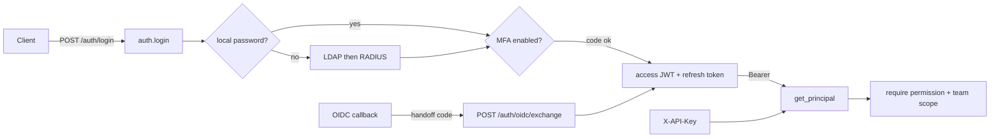

# Authentication and accounts

Every request is authorised on the server. A caller is resolved into a `Principal` (user id, organization id, permission set, team scope) by `get_principal` (`backend/veyrs/security/deps.py:169`), which accepts either `X-API-Key` or `Authorization: Bearer <JWT>` (the API key wins when both are sent). Security internals (hashing, encryption, RLS) are owned by [security-architecture](../security/security-architecture.md); this document describes the behaviour of the features.

Status legend used below is the portal vocabulary. Where a feature was only read in code it is `Implemented`; `Verified` is used only where it was also observed live on 2026-11-17 (read-only GET) .

**Legend**: rectangles are code paths, diamonds are decisions, arrows are the request flow. Source: `api/v1/auth.py:365-560`, `security/deps.py:169-190`.

## Token model

| Item | Behaviour | Source |
|---|---|---|
| Access token | JWT signed with `settings.secret_key` and `settings.jwt_algorithm`, audience `veyrs:access`, lifetime `access_token_minutes` (default 30; `install.sh:1015` writes 60 into a native `.env`). Carries `sub`, `org`. Permissions are re-read from the database on every request, so a revoked role applies immediately. | `security/auth.py:69-110`, `config.py:56`, `security/deps.py:110-143` |
| Refresh token | Opaque random token, stored as a hash in `refresh_tokens`, lifetime `refresh_token_days` (default 14), rotated on every use. | `security/auth.py:112-125`, `api/v1/auth.py:561-617` |
| API key | `veyrs_<8 hex>_<secret>`; the prefix is stored in clear, the secret as an Argon2 hash. | `security/auth.py:129-152` |
| Agent token | `veyrsagent_<10 hex>_<secret>`; a different scheme word so it is refused wherever a user key is expected. | `security/auth.py:156-170` |
| Password hashing | Argon2 (`argon2-cffi` `PasswordHasher`), rehash on login when parameters changed. Minimum length `password_min_length` (12). | `security/auth.py:41-66`, `config.py:59` |

## Feature: password login

- **What**: `POST /auth/login` exchanges `identifier` (username or e-mail; legacy field `email` still accepted) plus `password` for a token pair. Optional `organization` (tenant slug), `mfa_code`, `radius_challenge`.
- **Why**: the single entry point for people; the same 401 body is returned for unknown user, wrong password, locked and disabled accounts and disabled organizations so the route cannot enumerate accounts (`api/v1/auth.py:1-12`, `:50-55`).
- **How it works**:
  1. Candidate users are selected by e-mail or username (`:364-380`). If the identifier exists in several tenants and no slug is sent, passwords are checked first; only when exactly one tenant verifies does it proceed, and if several verify the answer is `409 {"error":"organization_required","organizations":[...]}` (`:380-405`).
  2. No local user: `_provision_from_directory` may create one just in time (see LDAP) (`:178-236`).
  3. `_check_credential` (`:239-283`): local Argon2 first; platform superusers are never delegated; then LDAP, then RADIUS.
  4. A wrong credential is charged to the lockout budget (`_spend_attempt`, `security/lockout.py`): after 5 failures from one address, that address backs off (30 s doubling to 15 min); only failures spread over several addresses (20 counted) lock the account, 1 min doubling to 1 h. A source that is waiting, or a locked account, is refused before the password is checked. MFA failures share the same budget.
  5. If MFA is on and no `mfa_code` was sent the answer is `401` with `detail={"error":"mfa_required","method":...}` (not charged to the lockout budget). For `email`/`telegram` the code is sent at that moment.
  6. On success the lockout state is cleared, `last_login_at` updated, tokens issued by `_issue` (a new refresh-token family per sign-in), an `auth_events` row is written. If the organization requires MFA (`mfa_policy`) and the account has no factor, the answer is an enrolment-only token instead (`mfa_enrollment_required: true`, no refresh token).
- **How to use**: console sign-in page; `POST /api/v1/auth/login` (see [guide](../api/guide.md#authentication) for a request example). Reference: [authentication](../api/reference/authentication.md).
- **Permissions**: none (pre-authentication). Rate limit: strict per-IP auth budget (`auth_rate_limit_per_minute`, default 10 per 60 s) from `security/ratelimit.py`.
- **Data**: `users`, `organizations`, `refresh_tokens`, `auth_events`, `user_roles`, `roles`. Models: `models/tenancy.py`, `models/audit.py`.
- **Components**: `security/auth.py`, `security/mfa*.py`, `services/ldap_auth.py`, `services/radius_auth.py`, Redis (RADIUS challenges, MFA codes).
- **Errors**:

| HTTP | Condition |
|---|---|
| 401 `{"detail":"invalid credentials"}` | unknown user, bad password, locked, inactive, bad MFA code, directory/RADIUS unreachable (the reason is only in `auth_events.reason`) |
| 401 `{"detail":{"error":"mfa_required",...}}` | a second factor is required (not a failure) |
| 409 `organization_required` | same identifier verified in several tenants |
| 503 `mfa_delivery_failed` | e-mail/Telegram code could not be sent or the code store is down |
| 422 | body validation (`LoginRequest`, `api/v1/schemas.py:119`) |
| 429 | rate limit |

- **Exceptional conditions**: unusable stored TOTP secret (key rotated) fails closed (counts as a failure) unless a recovery code is used (`:545-562`); a directory outage returns the generic 401, never admits; `verify_password(…, None)` burns time for unknown users (around `:431`).
- **Status**: Implemented (login not exercised here; `/auth/me` verified live, see below). Covered by `tests/test_phase24_mfa.py`, `tests/test_phase41_directory_auth.py`, `tests/test_phase57_radius.py` (not read in full).

## Feature: refresh and logout

- **What**: `POST /auth/refresh` swaps a refresh token for a new pair; `POST /auth/logout` revokes all of the caller's refresh tokens.
- **Why**: short access tokens with revocable sessions.
- **How it works**: refresh looks up the hash (`api/v1/auth.py:560`). A token already revoked means replay: the whole family (`family_id`) is revoked and `reuse_detected` is audited (`:578-590`). Expired or deactivated user: token revoked and 401. On success the old token is revoked and the new one keeps the family id. Logout updates every non-revoked token of the user (`:619-630`) and returns 204. Access JWTs already issued stay valid until they expire (they are stateless, only the user/organization state is checked per request).
- **Permissions**: refresh none; logout any authenticated principal.
- **Data**: `refresh_tokens`, `auth_events`.
- **Errors**: 401 generic for unknown, replayed, expired or orphaned token.
- **Status**: Implemented.

## Feature: current identity (`/auth/me`)

- **What**: `GET /auth/me` returns the profile, the effective permission list, role slugs, team slugs, the team scope, preferences and three tenant mode flags (`active_scanning`, `ticketing_mode`/`ticketing_usable`, `risk_register_enabled`) (`api/v1/auth.py:634-707`).
- **Why**: the console paints its navigation once at boot from this response; the flags are shipped here so a section does not appear and then vanish.
- **Permissions**: any authenticated principal. API keys have no user row for some keys; the handler answers 401 when `principal.user_id` is null (`:636-638`).
- **Data**: `users`, `user_roles`, `roles`, `team_members`, `teams`, `organizations.settings`.
- **Errors**: 401.
- **Status**: Verified (observed live on 2026-11-17: 200 with the fields above; 401 without a token returns `{"detail":"not authenticated"}`).

## Feature: console preferences and scope view

- **What**: `GET/PATCH /auth/me/preferences` stores console preferences (only key: `dashboard_team_id`, whitelist `PREFERENCE_KEYS`, `api/v1/auth.py:687`). `GET /auth/me/scope` returns the principal's team scope and the number of unowned assets/findings (invisible to team-scoped users) with a warning when non-zero (`:748-769`).
- **Why**: the dashboard team picker needs persistence; the unowned count turns "my queue is empty" into a measurable blind spot.
- **How it works**: PATCH validates the team belongs to the tenant and answers 404 otherwise (not 403, to avoid confirming existence) and stores the id as a string; the whole JSONB is reassigned so SQLAlchemy tracks the change (`:715-745`). Not audited by design (`:671-684`).
- **Permissions**: any authenticated principal.
- **Data**: `users.preferences`, `assets`, `findings` (coverage in `security/scope.py:349`).
- **Errors**: 404 `team not found`; 401.
- **Status**: Implemented.

## Feature: change own password

- **What**: `POST /auth/password` (`current_password`, `new_password` min 12) returns 204 (`api/v1/auth.py:772-800`).
- **How it works**: verifies the current password against the local hash; rejects equal passwords with 422; stores the new hash; revokes every refresh token of the user; audits `password.change`.
- **Errors**: 401 if the current password is wrong or the account has no local password (federated accounts); 422 `new password must differ`.
- **Permissions**: any authenticated user. **Data**: `users`, `refresh_tokens`, `audit_log`.
- **Status**: Implemented. Note: `new_password` minimum 12 is hard-coded in the schema (`api/v1/schemas.py:192`) while `hash_password` uses `settings.password_min_length`; raising the setting above 12 is enforced by `hash_password` as a `ValueError` (500) rather than a 422 (see findings).

## Feature: multi-factor authentication (TOTP, e-mail, Telegram)

- **What**: per-user second factor with three methods and ten single-use recovery codes. Routes: `GET /auth/mfa`, `POST /auth/mfa/enroll`, `POST /auth/mfa/send-code`, `POST /auth/mfa/activate`, `POST /auth/mfa/recovery-codes`, `POST /auth/mfa/disable` (`api/v1/auth.py:862-1016`).
- **Why**: a three-step lifecycle (enroll, activate with a proof code, then enforced) so an administrator cannot lock themselves out by enabling a factor that never arrives (`:795-806`).
- **How it works**:
  - `enroll` refuses when MFA is already enabled (409 `mfa_already_enabled`) or the method is not configured on the installation (409 `mfa_method_unavailable`; availability from `mfa_delivery.available()`, `security/mfa_delivery.py:160`). TOTP: generates a 160-bit secret, stores it sealed (`mfa.seal`), returns secret, `otpauth://` URI and an SVG QR (`security/mfa.py:52-146`). Telegram: validates the numeric chat id (`:178`) then sends a first code.
  - `activate` verifies a code (422 `invalid_code`), then returns the ten recovery codes **once**.
  - TOTP verification: 6 digits, 30 s step, window of one step, replay protection through `mfa_last_step` (`security/mfa.py:42-100`).
  - Delivered codes: stored in Redis (memory fallback), max 5 tries, 30 s resend gap, at most 6 sends per 15 min, TTL `mfa_code_ttl` (default 300 s) (`security/mfa_delivery.py:48-58`, `:260-316`). A Redis outage fails closed.
  - Recovery codes: 12 characters, any method accepts them once MFA is enabled (`:318-350`).
  - `recovery-codes` and `disable` need the password **and** a valid code; a corrupted TOTP secret may be cleared with the password alone (`:961-1016`).
- **Permissions**: any authenticated user. SSO accounts are not asked for VEYRS MFA (see SSO).
- **Data**: `users.mfa_enabled`, `mfa_method`, `mfa_secret`, `mfa_last_step`, `mfa_telegram_chat_id`, `mfa_recovery_codes`; Redis keys `veyrs:mfa:*`.
- **Dependencies**: SMTP settings for e-mail, `telegram_bot_token` for Telegram (`config.py:115-120`).
- **Errors**: 409 (`mfa_already_enabled`, `mfa_not_enrolled`, `mfa_not_enabled`, `mfa_method_not_delivered`), 422 (`invalid_code`, `invalid_chat_id`), 503 `mfa_delivery_failed`, 401 wrong password.
- **Status**: Implemented (`tests/test_phase24_mfa.py`, `tests/test_phase54_mfa_methods.py`).

## Feature: single sign-on (OIDC)

- **What**: OpenID Connect authorization-code flow with PKCE S256, `state` and `nonce`, per organization. Routes: `GET /auth/sso` (boolean availability), `GET /auth/oidc/{org_slug}/start`, `GET /auth/oidc/callback` (hidden from the schema, `include_in_schema=False`), `POST /auth/oidc/exchange`.
- **Why**: delegate authentication to an identity provider; tokens never travel in a URL.
- **How it works** (`services/oidc_auth.py`):
  1. `start` creates `state`, `nonce` and a PKCE verifier, stores them in Redis for 600 s (`FLOW_TTL`) and returns the provider's `authorization_url`. Unknown organization and "not configured" give the same 404.
  2. The provider returns the browser to `/auth/oidc/callback`. The flow is consumed once (`take_flow`). `finish` exchanges the code, verifies the ID token signature against the provider's JWKS (one forced key refresh), issuer, audience, expiry, `at_hash` and nonce, and optionally requires an `amr` second-factor claim (`require_mfa_amr`).
  3. The account is matched by verified e-mail inside the organization (`api/v1/auth.py:1053-1099`). JIT creation only if `jit_provisioning`. Platform superusers are refused (`superuser`). Inactive accounts refused. Group claim to role mapping via `group_role_map` reconciles directory-origin grants.
  4. The browser is redirected with a one-time `h` handoff (TTL 60 s, `HANDOFF_TTL`) to `<console origin>/#/sso`; the console swaps it with `POST /auth/oidc/exchange` for a token pair (`:1102-1119`).
- **Permissions**: none (pre-auth). Configured by `settings:admin` ([administration-platform](administration-platform.md#feature-oidc-ldap-radius-configuration)).
- **Data**: `organizations.settings["oidc"]` (client secret encrypted as `client_secret_enc`), `users`, `user_roles` (`origin='directory'`), `auth_events`; Redis `veyrs:oidc:*`.
- **Errors**: callback failures are not JSON: a 303 redirect to the console with `error=<message>` (or an HTML 400 page if the origin is unknown) (`_sso_back`, `:1042-1050`). `exchange`: 401 for invalid/expired/used handoff or a superuser. `start`: 404.
- **Exceptional**: no VEYRS MFA after SSO; the provider is the authority. If the provider omits a verified e-mail the login is refused (`no_email`).
- **Status**: Implemented (`tests/test_phase58_oidc.py`).

## Feature: directory authentication (LDAP / Active Directory)

- **What**: delegate the password check to LDAP/AD while VEYRS keeps roles, scope and audit. Bind mode is service account + search, then re-bind as the found DN (`services/ldap_auth.py:1-76`). No dedicated login route: it is a branch of `POST /auth/login`.
- **How it works**: `_check_credential` runs it after the local check; `authenticate` (`:661`), `find` (`:489`), `groups` (`:561`) and `roles_for` (`:796`) map group names (full DN or CN) to role slugs from `group_role_map`. `sync_roles_on_login` (default true) reconciles only roles with `origin='directory'`; manual grants are untouchable (`api/v1/auth.py:117-158`). `_apply_identity` copies DN, username, name, and e-mail only when empty. `jit_provisioning` (default off) creates accounts with no local password, roles from `default_role_slugs` (default none) and refuses identities without e-mail (`jit_no_email`).
- **Dependencies**: `ldap3` imported lazily; without it logins fall back to local only and the Directory page reports the missing library.
- **Errors**: LDAP failure surfaces as the generic 401 with audit reason `directory_unavailable`.
- **Status**: Implemented (`tests/test_phase41_directory_auth.py`).

## Feature: RADIUS authentication

- **What**: PAP Access-Request with the server's own Access-Challenge second factor (`services/radius_auth.py`). Branch of `POST /auth/login`.
- **How it works**: after local and directory checks, `_check_radius` asks up to four servers (next only on timeout). Message-Authenticator and Response Authenticator are mandatory (Blast-RADIUS mitigation). A challenge returns 401 `mfa_required` with `method:"radius"` and a `radius_challenge` id (Redis, 180 s, bound to the user); the client re-posts `radius_challenge` and the code in `mfa_code`. When RADIUS did its own second factor VEYRS MFA is skipped. Roles may be mapped from the `Class` or `Filter-Id` reply attribute. No JIT accounts. RadSec is not implemented.
- **Errors**: generic 401; audit reasons `radius_unavailable`, `bad_radius_code`.
- **Status**: Implemented (`tests/test_phase57_radius.py`).

## Feature: users

- **What**: `GET /users` (filters `q`, `active`, `limit` 1-500, `offset`), `POST /users`, `GET /users/{user_id}`, `PATCH /users/{user_id}`, `DELETE /users/{user_id}` (soft delete), `PUT /users/{user_id}/scope` (`api/v1/admin.py:537-790`).
- **How it works**:
  - Create: lower-cases e-mail, hashes the optional password (a user without password can only sign in through LDAP/RADIUS/SSO), assigns roles by slug via `_assign_roles` (`:608-660`) and team memberships. Duplicate e-mail/username returns 409.
  - Privilege-escalation guard: a caller without `role:admin` cannot grant a role whose permissions exceed their own (403).
  - Update: replaces only manual role grants, never `origin='directory'` ones (`:737-752`).
  - Delete: sets `deleted_at` and `is_active=false`; refuses self-delete (422). Refresh tokens are not revoked explicitly, but refresh and access paths reject deleted users.
  - Scope: rewrites every role grant to the given teams (empty list = estate-wide, which is why it needs `role:admin`); refuses narrowing yourself (422) or a user without grants (422).
- **Permissions**: `user:read`, `user:write`, `user:delete`; scope needs `role:admin`.
- **Data**: `users`, `user_roles`, `team_members`, `audit_log` (`user.create|update|delete|scope`).
- **Errors**: 404 `user not found` (also for other tenants), 409 duplicate, 422 (`unknown roles`, `unknown team`, own scope/delete), 403 escalation.
- **Status**: Implemented.

## Feature: teams, departments and team scope

- **What**: `GET/POST /teams`, `PATCH /teams/{team_id}`, `POST/DELETE /teams/{team_id}/members/{user_id}`, `GET/POST /departments` (`api/v1/admin.py:794-915`).
- **Why**: teams own assets and findings and carry escalation chains; **membership does not grant visibility**. Visibility comes from role grants with a `team_id` (`security/scope.py:1-50`). A principal is restricted only if every grant names a team.
- **How scope is enforced**: `get_principal` calls `enforce_route_policy` (`security/scope.py:228`): routes tagged `agents, ai, compliance, engagements, integrations, asset sources` return 403 to restricted principals; routes whose tags are neither scoped nor exempt also 403. `refuse_if_restricted` (`:247`) blocks estate-wide writes. API keys are never narrowed (`security/deps.py:46-49`).
- **Permissions**: `team:read` (list), `team:write` (create, update, members, departments).
- **Errors**: 409 duplicate slug/department name; 404 team/user not found. Adding a member twice is a silent no-op.
- **Data**: `teams`, `team_members`, `departments`, `user_roles.team_id`.
- **Status**: Implemented (`tests/test_phase26_scope.py`, `tests/test_phase26_team_ownership.py`).

## Feature: roles and permissions

- **What**: `GET /roles` (built-in plus tenant), `GET /permissions` (sorted catalogue), `POST /roles`, `PATCH /roles/{role_id}` (`api/v1/admin.py:918-985`).
- **How it works**: permissions are `resource:action` strings validated against `security/permissions.py` (unknown strings 422 `unknown permissions`); `*:*` wildcard exists. Built-in roles: org-admin, security-manager, security-engineer, team-lead, asset-owner, compliance-officer, executive, auditor, service-account, read-only (`extract/permissions.json`). Built-in roles cannot be modified (422). The full matrix is in [permissions reference](../reference/permissions.md).
- **Permissions**: `role:read`; `role:admin` to create/update.
- **Errors**: 409 slug exists, 404 role not found (also for built-ins by id in another tenant), 422.
- **Status**: Implemented.

## Feature: API keys

- **What**: `GET /api-keys`, `POST /api-keys`, `DELETE /api-keys/{key_id}` (revoke) (`api/v1/admin.py:987-1045`).
- **How it works**: create returns the clear key **once** (`api_key`); only the Argon2 hash is stored. Scopes are permission strings, validated, and **cannot exceed the creator's permissions** (403) unless the creator is superuser. Default expiry 365 days (`expires_in_days` 1-3650; null = no expiry). A key authenticates as `apikey:<name>`; usable when not revoked/expired (`ApiKey.is_usable`); `last_used_at` is updated on use (`security/deps.py:139-148`).
- **Permissions**: `apikey:read|write|delete`.
- **Errors**: 422 unknown scopes, 403 scopes exceed own permissions, 404.
- **Data**: `api_keys`, `audit_log` (`apikey.create|revoke`).
- **Status**: Implemented.

## Feature: audit trail query

- **What**: `GET /audit` (filters `action`, `object_type`, `object_id`, `since`; `limit` 1-500) (`api/v1/admin.py:1049-1076`).
- **How it works**: every mutating service calls `audit.record` (`services/audit.py:83`), which writes inside a savepoint and never raises into the caller; secrets are scrubbed by key name (`REDACT_KEYS`, `:21`). Authentication outcomes go to a separate table (`auth_events`, `record_auth`, `:122`) that **no API route exposes** (see findings). AI calls are in `ai_audit_log`, served by `/ai/audit`.
- **Permissions**: `audit:read`. **Data**: `audit_log`. **Errors**: 422 invalid filter values.
- **Console**: Audit Log (`#/audit`).
- **Status**: Implemented.

## Feature: team import (NetBox tenants, LDAP groups)

- **What**: `GET /teams/import/providers`, `POST /teams/import/preview`, `POST /teams/import`, `POST /teams/import/assign-assets` (`api/v1/team_import.py:77-125`, service `services/team_import.py`). Console: Administration, Import teams.
- **Why**: turn a `team_label` on staged assets or a directory group into a real team that findings, SLA and escalation hang off.
- **How it works**: `collect` builds `Candidate` objects from NetBox (tenants/sites/roles of an asset source) or from LDAP groups (`from_netbox` `:106`, `from_ldap` `:160`); `plan` (`:198`) previews creates/updates/orphans and writes nothing; `apply` (`:252`) creates teams, updates only with `update_existing`, optionally syncs members (LDAP only, existing users only, `_sync_members` `:309`); `assign_from_records` (`:363`) points staged assets at the imported team, never overwriting a manual assignment unless `overwrite`.
- **Guarantees**: it never deletes a team (absent ones are reported as `orphan`) and never creates a user.
- **Permissions**: `team:write`. The router carries the tag `asset sources`, so team-scoped principals get 403 (`security/scope.py:98`).
- **Errors**: 404 `asset source not found`; 422 unknown provider; 502 when NetBox or the directory fails (`TeamImportError`).
- **Data**: `teams`, `team_members`, `asset_sources`, `asset_source_records`, `assets`.
- **Status**: Implemented (`tests/test_phase42_netbox_and_team_import.py`).

## Route checklist for this document

All 18 `authentication` routes, the 16 admin routes for users/teams/departments/roles/api-keys/audit and the 4 team-import routes are described above. The route-by-route list is in the findings file.
