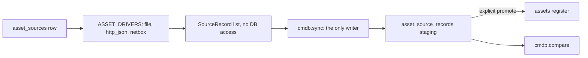

# CMDB and asset sources

Full per-endpoint reference: [`../api/reference/asset-sources.md`](../api/reference/asset-sources.md). Connector internals (driver HTTP details) are owned by [`../integrations/README.md`](../integrations/README.md); this page documents the behaviour contract.

## Design

**Legend.** Rectangles are code or tables. Solid arrows are data flow. The only edge into `assets` is the explicit promote step, which is the design point: a sync never writes to `assets` (`services/cmdb.py:1-40`, `models/cmdb.py:1-45`).

Invariants stated in the code:

- A source is created **disabled** (`AssetSourceWrite.is_enabled=False`, `api/v1/cmdb.py:~64`) and a disabled source refuses to sync (`services/cmdb.py:921-926`).
- A pull source with no `collections` is **inert**, not "everything" (`api/v1/cmdb.py:_out`, `is_inert`).
- Credentials are stored in `credentials_enc` (Fernet envelope, `security/secrets.py`) and never returned: `AssetSourceOut` has only `credentials_set`.
- A record that a source stops reporting is marked **absent**; the asset is never deleted, deactivated or emptied by an import (`services/cmdb.py:1117-1126`).
- Identity per source is `UNIQUE(organization_id, source_id, external_key)`, so NetBox device 42 and CMDB record 42 never collide with `assets.external_id`.

Team scope: tag `asset sources` is in `REFUSED_TAGS` (`security/scope.py:98`), so any team-restricted principal gets 403 `this endpoint reports on the whole estate and cannot be narrowed to a team` on every route here.

## Features

### 1. Driver catalogue

| Item | Detail |
|------|--------|
| What | Lists the three drivers, the normalised field vocabulary and the fields compared between sources. |
| How | `list_drivers` `api/v1/cmdb.py:298` returns `cmdb.describe_drivers()` (`services/cmdb.py:699`). |
| Use | `GET /api/v1/asset-sources/drivers` |
| Permissions | `importer:read` |
| Drivers | `file` (upload of CSV, TSV, JSON or XLSX; no credentials; needs a field map); `http_json` (any JSON API; credentials `scheme`, `token`, `username`, `password`, `header_name`; needs a field map); `netbox` (credential `token`; no field map required, optional overrides; collections `dcim.devices`, `virtualization.virtual-machines`). |
| Known fields | `external_id, name, hostname, fqdn, serial, asset_type, operating_system, os_version, environment, criticality, exposure, data_classification, location, owner_label, team_label, status_label, ip_addresses, mac_addresses, tags` (`services/cmdb.py:86-90`). |
| Status | Verified (observed live: three drivers returned; test `test_the_drivers_endpoint_names_all_three`) |

### 2. Register, read, update, delete a source

| Item | Detail |
|------|--------|
| What | CRUD of `asset_sources`. |
| How | `create_source` `api/v1/cmdb.py:329`, `read_source` `:488`, `update_source` `:497`, `delete_source` `:531`, `list_sources` `:316` (ordered by `priority`, then `slug`). Validation `_validate` (`cmdb.py:~160`): driver must be a known driver; every `field_map` key must be a known field or `extra.<name>`; every `value_maps` target for an enum field must map only to values VEYRS accepts; `include_fields` must be known fields and must keep at least one field the `match_order` ladder can read; `match_order` rungs are `external_id, serial, fqdn, hostname, ip, name`; NetBox `collections` must be one of the two known. On update the **resulting** row is re-validated (an enabled fetching source must have a base URL). Passing `credentials: {}` clears the stored secret; omitting the key keeps it. Delete removes the source and its staging rows only; assets previously promoted are untouched. |
| Use | `GET|POST /api/v1/asset-sources`, `GET|PATCH|DELETE /api/v1/asset-sources/{source_id}`. Console: Integrations, asset sources. |
| Permissions | `importer:read` (read), `importer:admin` (create, update, delete). |
| Data | `asset_sources`, `audit_log` (`cmdb.source.created|updated|deleted`). |
| Key fields | `priority` (default 100; lower number wins at promotion), `auto_promote`, `promote_creates_assets`, `verify_tls`, `record_path` (JSON path to the list), `match_order`, `include_fields`. |
| Errors | 404 `asset source not found`; 409 `asset source '<slug>' already exists`; 422 for each validation above and `base_url is required for a source VEYRS fetches from`. |
| Status | Implemented (tests `test_a_source_is_created_disabled_and_never_echoes_its_credentials`, `test_a_field_map_targeting_a_field_veyrs_does_not_have_is_refused`) |

### 3. Test a source

| Item | Detail |
|------|--------|
| What | Reach the source and report a sample record; writes no VEYRS row. |
| How | `test_source` `api/v1/cmdb.py:551` -> `cmdb.test_connection` (`services/cmdb.py:813`). For `file` it answers `ok` without reaching anything. Otherwise since 0.41.0 it fetches only the first page (`PAGE_SIZE`, 200 records) of each configured collection (`SourceSpec.max_records`) and returns that count, a lower bound for the source's size, and the first record. A sync still uses the full cap (`MAX_RECORDS` 50,000, `MAX_PAGES` 500). |
| Use | `POST /api/v1/asset-sources/{source_id}/test` |
| Permissions | `importer:admin` |
| Errors | 502 with the `CmdbError` message (rejected credentials HTTP 401/403, remote HTTP >= 400, non-JSON body, undecryptable credentials `re-enter them`). |
| Exceptional | Because the test is a full pull it can be slow on a large source, and an inert source raises `this source has no collections configured, so it is inert` (502). |
| Status | Implemented |

### 4. Sync (pull) into staging

| Item | Detail |
|------|--------|
| What | Read every configured collection and write staging rows; optionally preview. |
| How | `sync_source` `api/v1/cmdb.py:564` -> `cmdb.sync` (`services/cmdb.py:900`). Steps: refuse if disabled; build a `SourceSpec`; create an `AssetSourceRun` (not persisted for a dry run); fetch via the driver; `narrow` to `include_fields`; `_ingest` (`cmdb.py:1020`). |
| Ingest rules | Duplicate `external_key` inside one fetch is rejected. An unchanged `content_hash` counts as `records_unchanged`. Otherwise `resolve_asset` walks `match_order` (`services/cmdb.py:831`); if nothing matches, `_sibling` looks for a record of **another** source sharing any match key (JSONB `?|`, `cmdb.py:878`) and inherits its asset or identity key. Status becomes `matched` or `unmatched`; `ignored` records are never re-linked. With `auto_promote` on the source, promotion runs inline. With `mark_absent` (default true for a pull), previously known keys not seen are flagged `is_absent`. |
| Use | `POST /api/v1/asset-sources/{source_id}/sync?dry_run=false`. Response is the run summary (`AssetSourceRunOut`): `records_seen/created/updated/unchanged/rejected`, `assets_matched/unmatched/promoted/created`, `records_absent`, `reject_reasons`, `reject_samples` (max 20). |
| Permissions | `importer:write` |
| Data | `asset_source_runs`, `asset_source_records`, `assets` (only via auto promote), `audit_log` (`cmdb.source.synced`). |
| Errors | 422 `this source is fed by upload; POST the export to /asset-sources/{id}/upload` for a `file` driver; 502 for any `CmdbError` (the failure is committed first so `last_error` is kept); a disabled source is also a `CmdbError` and therefore 502 `source '<slug>' is disabled...`. |
| Exceptional | A dry run creates no rows but counts identically to a real run. On the generic `http_json` driver the `next` link in the response body is followed as given (`services/cmdb.py:~530`); the per-request auth headers travel with it, so a source that returns an absolute `next` URL on another host would receive the credentials (see findings file, Risks). |
| Status | Implemented (tests `test_a_sync_stages_the_record_and_writes_no_asset`, `test_a_dry_run_writes_nothing_at_all`, `test_a_record_the_source_stops_reporting_never_touches_its_asset`) |

### 5. Upload an export

| Item | Detail |
|------|--------|
| What | Feed a `file` source (or any source) with a CMDB export. |
| How | `upload_export` `api/v1/cmdb.py:588`: reads the whole body, rejects over 64 MiB (`MAX_UPLOAD_BYTES`, `services/cmdb.py:65`) or empty, then `cmdb.sync(blob=..., trigger="upload")`. `FileDriver.rows` picks XLSX (by `.xlsx` or `PK` magic), JSON (by `.json` or leading `{`/`[`) or delimited text with its own delimiter. Rows with no identifier at all (no external id, serial, fqdn, hostname, IP or name) are rejected with a reason. `mark_absent` defaults to **false** for uploads, because an operator may upload a filtered extract. |
| Use | `POST /api/v1/asset-sources/{source_id}/upload?dry_run=&mark_absent=` as `multipart/form-data` with field `file`. |
| Permissions | `importer:write` |
| Errors | 413 `export exceeds 64 MB`; 422 `the export is empty`; 422 with the `CmdbError` text (for example a header-less export). Note the size is checked after the whole file has been read into memory. |
| Status | Implemented (tests `test_csv_is_read_with_its_own_delimiter`, `test_an_upload_does_not_declare_the_rest_of_the_estate_absent`) |

### 6. Run history

| Item | Detail |
|------|--------|
| How | `list_runs` `api/v1/cmdb.py:616`, newest first, `limit` 1-200 (default 25). |
| Use | `GET /api/v1/asset-sources/{source_id}/runs` |
| Permissions | `importer:read` |
| Errors | 404 `asset source not found`. |
| Status | Implemented |

### 7. Staged records

| Item | Detail |
|------|--------|
| What | Browse and correct the per-source staging rows. |
| How | `list_records` `api/v1/cmdb.py:395`: filters `source_id`, `match_status`, `is_absent`, `promoted`, `q` (substring on name, hostname, fqdn, serial or external key); `limit` 1-500 (default 100), `offset`; ordered by name. **Returns a plain array** (no `Page` envelope, no total). `patch_record` `:430` accepts `match_status` (`matched|unmatched|ignored`) and `asset_id` (link by hand, `matched_by="manual"`; `null` unlinks). `ignored` removes a row from comparison and promotion without deleting it, so the next sync does not undo the operator's judgement. |
| Use | `GET /api/v1/asset-sources/records`, `PATCH /api/v1/asset-sources/records/{record_id}` |
| Permissions | `asset:read` (list), `asset:write` (patch) |
| Errors | 404 `record not found`, 404 `asset not found`, 422 `match_status must be one of [...]`. |
| Status | Implemented |

### 8. Compare sources

| Item | Detail |
|------|--------|
| What | Side-by-side view of what several sources say about the same host. |
| How | `compare_sources` `api/v1/cmdb.py:379` -> `cmdb.compare` (`services/cmdb.py:1250`). Records are grouped by `asset_id` when resolved, else by `identity_key`, so the comparison works before anything is promoted. `mode=conflicts` (groups where two sources disagree on a comparable field), `gaps` (groups a selected source does not know), `all`. Set fields (IPs, MACs) are compared as sets; strings case-insensitively; a field only one source knows is not a conflict. Comparable fields are listed in `models/cmdb.py` `COMPARABLE_FIELDS`. |
| Use | `GET /api/v1/asset-sources/compare?source_id=...&source_id=...&mode=conflicts&include_absent=false&limit=100&offset=0` (`mode` must match `^(conflicts|gaps|all)$`, `limit` max 500). |
| Permissions | `asset:read` |
| Status | Implemented (tests `test_a_disagreement_between_two_sources_is_one_row`, `test_the_same_ips_in_a_different_order_are_not_a_conflict`, `test_a_host_one_source_has_never_heard_of_is_a_gap`) |

### 9. Summary

| Item | Detail |
|------|--------|
| How | `sources_summary` `api/v1/cmdb.py:371` -> `cmdb.summary` (`services/cmdb.py:1361`): per source `records`, `matched`, `unmatched`, `absent`, `last_sync_at`, `last_error`. |
| Use | `GET /api/v1/asset-sources/summary` |
| Permissions | `asset:read` |
| Status | Verified (observed live on environment A: one NetBox source, 104 records, 104 matched, 0 absent) |

### 10. Promote staged records into the register

| Item | Detail |
|------|--------|
| What | The only act that copies source values into `assets`. |
| How | `promote_records` `api/v1/cmdb.py:473` -> `cmdb.promote` (`services/cmdb.py:1206`) -> `promote_record` (`:1136`). Copies only `PROMOTABLE_FIELDS` (`name, hostname, fqdn, asset_type, operating_system, os_version, environment, criticality, exposure, data_classification, location, ip_addresses, mac_addresses`); ownership foreign keys are never touched. A record with no linked asset is **declined** unless `create_assets=true`. Records are applied from highest `priority` number to lowest, so the lowest number is applied last and its values survive. Provenance is recorded on the asset (`attributes.sources[<slug>]`, `attributes.serial`); `assets.source` is set only when the asset is created. |
| Use | `POST /api/v1/asset-sources/promote` with `{record_ids:[...], create_assets:false}`. Response `{promoted, created, declined, requested}`. |
| Permissions | `asset:write` |
| Data | `assets`, `asset_source_records`, `audit_log` (`cmdb.record.promoted`). |
| Errors | 422 when `record_ids` is empty (`min_length=1`). Unknown ids are silently not selected and counted only in `requested`. |
| Status | Implemented (tests `test_promotion_declines_to_invent_an_asset_by_default`, `test_the_lower_priority_number_is_the_one_whose_value_survives`) |

## NetBox driver notes

NetBox needs no hand-written `field_map`: `netbox_fields` (`services/cmdb.py:592`) reads the known schema, maps device roles to asset types via `NETBOX_ROLE_TYPES` (firewall, router, switch, load balancer and access point to `network_device`, printer/camera/pdu to `iot`; unlisted devices are `server`, VMs are `vm`), and treats NetBox `status` as a lifecycle label, never as an environment. `field_map` entries act as overrides (`netbox_overlay`). Unknown collections are refused at the router (HTTP 422) and by the driver.

## Errors summary

| Code | Condition |
|------|-----------|
| 403 | Team-restricted principal (all routes); missing permission. |
| 404 | Source, record or asset not found in this organization. |
| 409 | Duplicate slug. |
| 413 | Upload over 64 MiB. |
| 422 | Validation (see features 2, 4, 5, 7). |
| 502 | Remote unreachable, credentials rejected or undecryptable, disabled source on sync/test. |

## Tests

`tests/test_phase40_asset_sources.py` (about 40 tests covering normalisation, identity, sync, comparison, promotion and the router) and `tests/test_phase42_netbox_and_team_import.py`.
