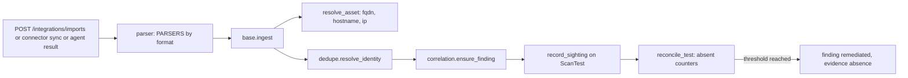
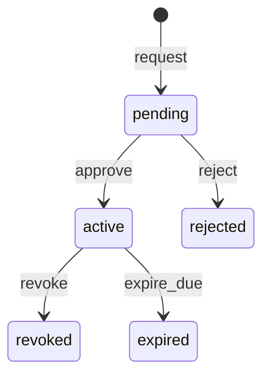

# Engagements, scan import and risk acceptance

Full per-endpoint reference: [`../api/reference/engagements.md`](../api/reference/engagements.md).

## Permission mapping (no dedicated resource)

Stated in `backend/veyrs/api/v1/engagements.py:1-17`: engagements and tests use `importer:*`; endpoints use `asset:*`; risk acceptance uses `risk:*` (the built-in `executive` role carries `risk:write` for formal acceptance). Reusing existing resources avoids a role migration, because unknown permission strings are rejected at import time by `require()` (`security/deps.py`).

Team scope: tag `engagements` is in `REFUSED_TAGS` (`security/scope.py:98`): team-restricted principals receive 403 on every route here. Consequently the helper lookups `_finding`, `_engagement`, `_acceptance` (`engagements.py:564-585`) check only the organization, not team ownership.

## The import pipeline (shared)

**Legend.** Boxes are functions or entry points. The final edge only fires when absence closure is on and the consecutive-absence threshold is reached. Source: `services/importers/__init__.py:29-146`, `services/importers/base.py:623-800`.

Key behaviours in `base.ingest`:

- Every import lands in a `ScanTest` (`resolve_scope`, `base.py:597`), inside an `Engagement`. With no engagement named, the catch-all engagement `continuous-scanning` is created on demand (`engagements.default_engagement`, `services/engagements.py:108`).
- Assets are resolved by FQDN, then hostname/name (also the left label of an FQDN), then IP (`base.py:436-500`). Unknown assets are rejected `unknown asset (create_assets is off)` unless `create_assets` is set; VEYRS never infers an asset. Reports without a host (SAST, SCA, cloud) need `target_asset`.
- A CVE-backed finding keeps NVD scoring; the scanner's own score is used only when no CVE exists (`base.py:~775`).
- `process_finding` (`services/correlation.py`) then scores, assigns and applies SLA to the finding.
- A failed parse is stored as a `FAILED` `ImportRun`, not raised (`importers/__init__.py:83-99`). A failure in the optional inventory pass is recorded and swallowed (`:107-130`).

Supported formats (`importers/parsers.py:417`, `parsers_modern.py:887`): `nessus`, `greenbone` (alias `openvas`), `qualys`, `csv`, `json`, `sarif`, `codeql`, `trivy`, `grype`, `semgrep`, `bandit`, `gitleaks`, `checkov`, `nuclei`, `zap`, `npm_audit`, `pip_audit`, `dependabot`, `prowler`. Format detection (`detect_format`, `parsers.py:433`) sniffs bytes when `source` is not given. Parser details: [`../integrations/README.md`](../integrations/README.md).

## Features

### 1. Engagements

| Item | Detail |
|------|--------|
| What | A scope for imports: a pentest, a CI pipeline, a recurring sweep. Types `ci_cd`, `interactive`, `scheduled`; statuses `not_started`, `in_progress`, `paused`, `completed`, `cancelled` (`models/engagement.py:40-54`). |
| Why | Scoped re-import: before engagements, a three-host export closed every finding of that scanner in the organization (`services/engagements.py:3-9`). |
| How | `create_engagement` `services/engagements.py:62` slugifies the name and de-duplicates the slug (`-2`, `-3`...). A new test moves a `not_started` engagement to `in_progress` (`get_or_create_test`, `:134-198`). Fields include `business_service_id`, `asset_group_id`, `lead_user_id`, target dates, CI provenance (`version`, `branch_tag`, `commit_hash`, `build_id`), `dedupe_within_engagement`, `tags`. |
| Use | `GET /api/v1/engagements` (filters `status`, `engagement_type`; `limit` 1-200, `offset`; newest first), `POST /api/v1/engagements`, `GET /api/v1/engagements/{engagement_id}`. |
| Permissions | `importer:read` (reads), `importer:write` (create). |
| Data | `engagements`, `audit_log` (`engagement.create`). |
| Errors | 404 `engagement not found`; 422 `unknown engagement type '...'`. |
| Exceptional | There is no update, delete or status-change route for engagements: `status` changes only implicitly (not_started to in_progress). `EngagementOut` declares `commit_hash` twice (harmless duplicate, `engagements.py:~58`). |
| Status | Verified (list observed live; create is Implemented) |

### 2. Scan tests

| Item | Detail |
|------|--------|
| What | One scanner's run history inside an engagement. `reuse_test=true` (default) makes the nightly import reconcile against yesterday's sighting set; a pentest uses `reuse_test=false` so every pass is its own record. |
| How | `list_tests` `api/v1/engagements.py:279`, `read_test` `:295` returning `ScanTestDetail`: `scope_size` (findings ever reported), `present`, `absent`, `effective_dedupe` (the config actually applied, `dedupe.config_for`). |
| Use | `GET /api/v1/engagements/{engagement_id}/tests`, `GET /api/v1/engagements/tests/{test_id}`. |
| Permissions | `importer:read`. |
| Data | `scan_tests`, `test_findings` (sightings, with `consecutive_absences`, `status` present or absent). |
| Errors | 404 `engagement not found` / `scan test not found`. |
| Status | Implemented |

### 3. Deduplication registry

| Item | Detail |
|------|--------|
| What | Which identity rule each scanner uses to decide "same finding". |
| How | `dedupe_registry` `api/v1/engagements.py:237` returns the algorithm descriptions, the valid field vocabulary and `dedupe.describe_registry()`. Algorithms (`services/dedupe.py:50-54`): `legacy` (sha256 over org, asset, CVE/plugin ref, port, protocol, path; the default for `nessus`, `qualys`, `greenbone`, `csv`, `json` and any unregistered scanner), `unique_id_from_tool`, `hash_code` (configured field list), `unique_id_or_hash_code` (matches on either, so a tool that starts emitting ids mid-life does not fork findings). Per-scanner defaults live in `SCANNER_REGISTRY` (`dedupe.py:~110-160`), for example `zap` hash of `title, cwe, asset`, `semgrep` `plugin_id, file_path, line, asset`, `trivy` `cve, component_name, component_version, asset`. Valid fields: `title, description, severity, cwe, cve, plugin_id, unique_id, file_path, line, component_name, component_version, endpoint, asset, port, protocol, path, vuln_ref`. A bad config raises `DedupeConfigError`. Missing ids on a `unique_id_from_tool` scanner fall back to `legacy` with a WARNING log. Scope may be `organization` (default) or `engagement`. |
| Use | `GET /api/v1/engagements/dedupe-registry`. Registered **before** `/{engagement_id}` (`engagements.py:237`) so it is not parsed as a UUID. |
| Permissions | `importer:read`. |
| Exceptional | `legacy` reproduces the historical key byte for byte so existing findings never re-key. |
| Status | Verified (observed live) |

### 4. Absence-based reconciliation

| Item | Detail |
|------|--------|
| What | Closing findings a scanner stops reporting, scoped to what that test looked at. |
| How | `reconcile_test` `services/engagements.py:231`. Only findings the test previously reported (sightings) are considered. Each missed run increments `consecutive_absences`; at `absence_threshold` the finding becomes `remediated` with event `remediated`, `evidence: "absence"` (explicitly not a verified fix), the run ids that missed it and any coverage attestation. Default thresholds by engagement type (`DEFAULT_ABSENCE_THRESHOLD`, `:43-47`): `ci_cd` 1, `scheduled` 2, `interactive` 0 (never auto-close). `close_absent` unset defaults to "on when threshold > 0". Endpoint-scoped findings are discussed under feature 5. |
| Use | Options on `POST /api/v1/integrations/imports` and on scanner connectors: `close_absent`, `absence_threshold` (0-30, 422 otherwise), `engagement_id`, `test_id`, `reuse_test`. |
| Data | `test_findings`, `findings`, `finding_events`. |
| Exceptional | The wording `absent from scanner export` is a contract matched by reports and tests (`engagements.py:314`, read back by `services/attribution.py:342`). A host powered off during the window looks identical to a patched host, which is why the threshold exists. `close_missing` is a deprecated alias with threshold 1. |
| Status | Implemented (tests `test_absent_findings_are_stale_candidates_not_closures`, `test_close_missing_is_opt_in_and_records_why` in `tests/test_phase8_integrations.py`) |

### 5. Endpoints and per-endpoint mitigation

| Item | Detail |
|------|--------|
| What | Web-style locations (host, port, path, query) attached to a finding, canonicalised so one endpoint is one row across tools. |
| How | Canonicalisation rules (`services/endpoints.py:1-26`, `canonicalise` `:118`): lower-case scheme and host, drop default port, strip trailing dot, normalise path slashes, sort query parameters, drop empty fragment. `mitigate` `:356` flags `finding_endpoints.mitigated`; `outstanding` counts endpoints that are neither mitigated, false positive nor risk accepted; `fully_mitigated` is true only when the finding **has** endpoints and none are outstanding. The mitigate route deliberately does **not** close the finding: closure remains a lifecycle transition with verification (`engagements.py:392-398`). |
| Use | `GET /api/v1/engagements/endpoints/search?host=&asset_id=&limit=&offset=` (`asset:read`), `GET /api/v1/engagements/findings/{finding_id}/endpoints` (`finding:read`), `POST /api/v1/engagements/findings/{finding_id}/endpoints/mitigate` with `{endpoint_ids:[...]}` (`asset:write`). |
| Data | `endpoints` (unique canonical per organization), `finding_endpoints`. |
| Errors | 404 `finding not found`; 422 empty `endpoint_ids`. |
| Exceptional | Route order matters: `/endpoints/search` is declared after `/tests/{test_id}` but is a distinct two-segment path. The mitigate route has an audit record `finding.endpoints.mitigate`. |
| Status | Implemented |

### 6. Risk acceptance workflow

**Legend.** States are `risk_acceptances.state` (`models/engagement.py:76-81`). `approve` also moves covered findings to `accepted_risk`; `revoke` and `expire_due` (when `reactivate_on_expiry`) put them back.

| Item | Detail |
|------|--------|
| What | A formal, time-limited exception for one or more findings. |
| Why | Previously three columns on `Finding` with no approver and no expiry; ISO 27001 auditors test exactly that (`services/engagements.py:17-19`). |
| Request | `request_acceptance` `:354` creates a `pending` acceptance. Findings are **not** touched. `reason` must be at least 10 chars (`RiskAcceptanceWrite`, `engagements.py:~150`), at least one finding is required, and each finding must belong to the organization. The previous state of each finding is stored on `risk_acceptance_findings.previous_state`. |
| Approve | `POST /engagements/risk-acceptances/{acceptance_id}/approve`, `approve` `:403`: requires `pending`; **the requester cannot approve their own acceptance**; sets state `active`, moves every covered finding to `accepted_risk` (event `risk_accepted`), copies `accepted_by_id`, `accepted_reason`, `accepted_until`. The route additionally refuses a principal with no `user_id` (API keys) with 403 `risk acceptance must be approved by a named user` (`engagements.py:488-492`). |
| Reject | `POST /engagements/risk-acceptances/{acceptance_id}/reject`, `reject` `:454`: requires `pending`; state `rejected`. |
| Revoke | `revoke` `:468`: requires `active`; state `revoked`; findings return to their `previous_state` (or `triaged` if that was not an open state) via `_reactivate` (`:523`). |
| Expire | `expire_due` `:482`: for `active` acceptances with `expires_on <= today` sets `expired`, and if `reactivate_on_expiry` restores the findings; those expiring within `warn_days` (default 14) are warned once (`expiration_warned_at`) through `notifications.queue("risk_acceptance.expiring")` to the requester, best effort. |
| SLA on restore | `_reactivate` recomputes the SLA with `force=True` from the **original** detection date, so an acceptance cannot launder an overdue finding; `restart_sla_on_expiry=true` resets `detected_at`, the breach flags and the escalation level. |
| Use | `GET /api/v1/engagements/risk-acceptances/list?state=&expiring_within_days=&limit=&offset=` (`risk:read`; `expiring_within_days` 0-365 limits to active acceptances), `POST /api/v1/engagements/risk-acceptances`, `POST .../{acceptance_id}/approve|reject|revoke` with `{note}`, `POST /api/v1/engagements/risk-acceptances/expire?warn_days=14`. |
| Permissions | `risk:read`, `risk:write` for every mutation (including approve). |
| Data | `risk_acceptances`, `risk_acceptance_findings`, `findings`, `finding_events`, `notifications`, `audit_log`. |
| Errors | 404 `risk acceptance not found`; 409 `acceptance is <state>, not pending|active` and `the requester cannot approve their own risk acceptance`; 403 for an API key approving; 422 for a missing reason, no findings, or a finding not in this organization. |
| Exceptional | Observed live: list responses built with `Page(items, total, limit, offset)` report the default `size: 50` even when `limit=1` (`{"limit":1,"offset":0,"page":1,"size":50}`); trust `limit`/`offset`. `expire` is idempotent per day. **No scheduler in the repository calls `expire_due`**: the only caller is the `POST .../risk-acceptances/expire` route (grep of `backend/`, `scripts/`, `infrastructure/`; on environment A the only VEYRS timers are `veyrs-digest` and `veyrs-intel-sync`), although the route docstring says it is "also a scheduled job". Unless an operator schedules an authenticated call, acceptances never expire by themselves. `reject_acceptance` writes no audit record, unlike request, approve and revoke. The route path `risk-acceptances/list` is unusual but intentional (a literal `list` segment avoids the `{acceptance_id}` route). |
| Status | Implemented (the list route was observed live with zero acceptances; mutations were not exercised; automatic scheduling is not implemented) |

## Errors summary

| Code | Condition |
|------|-----------|
| 401/403 | Auth, missing permission, team-restricted principal, API key approving. |
| 404 | Engagement, test, finding or acceptance not in this organization. |
| 409 | Acceptance state conflict or self-approval. |
| 422 | Validation (engagement type, reason length, empty lists, `absence_threshold` range, `expiring_within_days` range). |

## Tests

`tests/test_phase8_integrations.py` (import behaviour), `tests/test_phase15_unified_ingest.py` and `tests/test_phase51_attribution.py` reference acceptances or the unified ingest path; `tests/test_phase15_api.py`, `tests/test_phase18_hardening.py` and `tests/test_phase19_coverage.py` mention engagements. Their bodies were not reviewed in detail.
