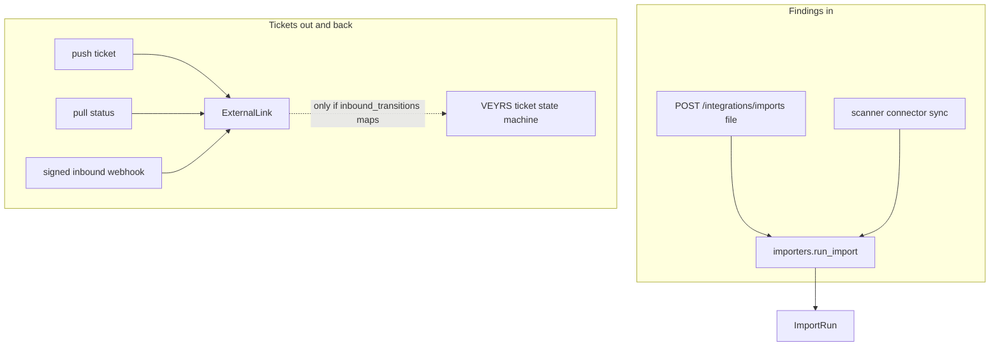

# Integrations

Full per-endpoint reference: [`../api/reference/integrations.md`](../api/reference/integrations.md). Connector and parser internals: [`../integrations/README.md`](../integrations/README.md).

Team scope: tag `integrations` is in `REFUSED_TAGS` (`backend/veyrs/security/scope.py:98`), so a team-restricted principal gets 403 on every route that uses `CurrentPrincipal`. The signed webhook does not use a principal and is unaffected.

Permission reuse: scanner connectors and imports use `importer:*` (a pull **is** an import, and a new resource would need adding to every built-in role, `integrations.py:~740-748`); ITSM connectors, links and push use `ticket:*`.

## Overview

**Legend.** Solid arrows are data flow; the dotted arrow is the opt-in path by which a remote status may move a VEYRS ticket. A remote closure never closes a finding directly (`services/itsm.py:5-9`, `services/itsm_inbound.py:13-25`).

## Features

### 1. Importer catalogue

| Item | Detail |
|------|--------|
| How | `list_importers` `api/v1/integrations.py:145` returns the sorted parser names, a description of every import option and notes on stale handling. |
| Use | `GET /api/v1/integrations/importers` |
| Permissions | `importer:read` |
| Formats | `bandit, checkov, codeql, csv, dependabot, gitleaks, greenbone, grype, json, nessus, npm_audit, nuclei, openvas, pip_audit, prowler, qualys, sarif, semgrep, trivy, zap` (observed live and matches `PARSERS`). |
| Status | Verified (observed live) |

### 2. File import

| Item | Detail |
|------|--------|
| What | Upload a scanner export and ingest it. |
| How | `create_import` `integrations.py:186` reads the whole file, then validates: not empty (422 `file is empty`), at most 128 MiB (`MAX_IMPORT_BYTES`; 413 `file too large`), `source` known (422 `unknown source; known: [...]`), `min_severity` in `informational, low, medium, high, critical`, `absence_threshold` 0-30. Then `importers.run_import` (`importers/__init__.py:29`): format is auto-detected from bytes and filename when `source` is absent; parse failure becomes a `failed` run (HTTP 201 with `status: failed`, `error` set), not an error response. |
| Use | `POST /api/v1/integrations/imports` as `multipart/form-data`. Fields: `file` (required), `source`, `create_assets`, `dry_run`, `close_missing` (deprecated), `min_severity`, `new_asset_criticality`, `new_asset_exposure`, `target_asset`, `engagement_id`, `test_id`, `reuse_test`, `close_absent`, `absence_threshold`, `version`, `branch_tag`, `commit_hash`, `build_id`, `import_inventory`, `inventory_from_plugin_output`. Response `ImportRunOut` (counters, `reject_reasons`, `reject_samples`, `stale_candidates`, `findings_marked_absent`, `findings_closed_absent`, `endpoints_created`, `inventory_*`, `engagement_id`, `test_id`, `dedupe_algorithm`). |
| Permissions | `importer:write` |
| Data | `import_runs`, `findings`, `assets` (only if `create_assets`), `test_findings`, `endpoints`, `asset_products` (if `import_inventory`), `audit_log` (`import.run`). |
| Errors | 413, 422 as above; 401/403. |
| Exceptional | A dry run rolls the whole transaction back (`integrations.py:252-256`), so the `audit.record` written just before it is rolled back too, contrary to the comment "leaves nothing behind except its own audit record": a preview leaves no audit trace (`services/audit.py:98-117` uses the same session). The upload is read fully in memory before the size check. Scanning being switched off (`active_scanning`) does **not** block imports: ingestion is the point of ingest-only mode (`services/scanning.py:11-40`). |
| Status | Implemented (tests `tests/test_phase8_integrations.py`: `test_upload_import_over_http`, `test_dry_run_reports_without_persisting`, `test_empty_upload_is_422`, `test_unknown_source_is_422`) |

### 3. Import history

| Item | Detail |
|------|--------|
| How | `list_imports` `:261` (filter `source`; `limit` 1-200, `offset`; newest first) and `read_import` `:284`. |
| Use | `GET /api/v1/integrations/imports`, `GET /api/v1/integrations/imports/{run_id}` |
| Permissions | `importer:read` |
| Errors | 404 `import run not found`. |
| Status | Verified (list observed live) |

### 4. Scanner connectors (pull)

| Item | Detail |
|------|--------|
| What | VEYRS fetches an export from a scanner's own API and ingests it through the **same** `run_import` as an upload, so no second deduplication rule exists (`services/scanners.py:1-25`). |
| Drivers | `nessus` (Nessus Professional / Manager), `tenable_io` (Tenable cloud), `tenable_sc` (Tenable Security Center) (`scanners.py:368-373`); `GET /api/v1/integrations/scanner-drivers` (`importer:read`) describes credentials. |
| CRUD | `list_scanner_connectors` `integrations.py:794`, `create_scanner_connector` `:807`, `update_scanner_connector` `:858`, `delete_scanner_connector` `:897`. Credentials are encrypted (`encrypt`, Fernet) and never serialised; only `credentials_set` and `is_inert` (no `allowed_scans`) are returned. A connector is created **disabled** and is **inert** until `allowed_scans` names scans. `close_absent` requires an `engagement_id` (checked on create and against the resulting row on patch). `base_url` is required unless the driver has a default. |
| Browse and test | `GET /scanners/{id}/scans` lists the remote scans and marks which are allowed (`importer:read`, so an operator can choose scans without admin rights). `POST /integrations/scanners/{connector_id}/test` lists scans, persists `last_error` (cleared on success) and returns `{ok, scans_visible, driver, inert}`; 502 on `ScannerError` (`importer:admin`). |
| Sync | `POST /integrations/scanners/{connector_id}/sync` body `{scan_ids?, force, dry_run}` (`importer:write`). `scanners.sync` (`scanners.py:461`): refuses a disabled connector, an empty `allowed_scans`, `close_absent` without engagement, and any `scan_ids` outside `allowed_scans` (rejected, not filtered). Each scan becomes its own `ImportRun`; a byte-identical export (SHA-256 kept in `sync_state`) is **skipped** unless `force`; failures are per scan (`failed`), the others continue. Inventory is read from the same bytes when `import_inventory` is true (default true), tagged `detected_by=connector:<slug>`. Response `{connector, dry_run, results:[{scan_id, status: imported|skipped|failed, detail, run_id}]}`. |
| Limits | Export ceiling 128 MiB, wait for remote export 120 s polling every 3 s, HTTP timeout 60 s (`scanners.py:49-57`). |
| Data | `scanner_connectors` (including `sync_state`), `import_runs`, plus the import pipeline tables; audit actions `scanner.connector.created|updated|deleted|tested`, `scanner.sync`. |
| Errors | 404 `scanner connector not found`; 409 `scanner connector '<slug>' already exists`; 409 on any `ScannerError` during sync (disabled, inert, bad scan id); 422 invalid driver, `min_severity`, `close_absent requires an engagement`, `base_url is required for this driver`; 502 on test and on listing remote scans. |
| Exceptional | Dry-run sync also calls `session.rollback()` after the audit record, with the same lost-audit effect as imports. Undecryptable stored credentials fail closed (never an anonymous request). |
| Status | Implemented (tests `tests/test_phase33_scanner_connectors.py`; live system has zero scanner connectors) |

### 5. ITSM and documentation connectors

| Item | Detail |
|------|--------|
| What | Outbound ticket push to ServiceNow, Jira or a generic webhook, and a documentation publisher (Confluence). |
| Design | VEYRS is the system of record for the security finding; the ITSM is the system of record for the work (`services/itsm.py:1-14`). Push is idempotent and digest-guarded (an unchanged ticket is not re-sent). Pull changes only the link's `remote_status`. Adapters are classes in `ADAPTERS` (`servicenow`, `jira`, `webhook`, `itsm.py:366-370`); Confluence is in `docs.DOCS_ADAPTERS` (`services/docs.py:346`). No arbitrary template execution path exists. |
| Adapters | ServiceNow Table API, table `incident` by default (`field_mapping.table` overrides). Jira Cloud uses `/rest/api/3` with email plus API token over Basic; Data Center/Server uses `/rest/api/2` with PAT Bearer or Basic; `api_version` in `field_mapping` selects (default 3). Webhook POSTs the payload and treats the response as advisory; the remote id falls back to the ticket reference. |
| CRUD | `list_connectors` `integrations.py:299` (`ticket:read`; filter `purpose=ticketing|documentation`), `create_connector` `:320`, `update_connector` `:359`, `delete_connector` `:499` (`ticket:admin`). `system` is not patchable (so credentials entered for one system are never sent to another). Omitting `credentials` keeps the stored secret; `credentials: {}` clears it; non-empty replaces it and audits only `"rotated"`. Enabling `inbound_enabled` is refused until a signing secret exists. Delete cascades `external_links`. |
| Test | `POST /integrations/connectors/{connector_id}/test` (`ticket:admin`): per-step diagnosis (`adapter`, `configuration`, `credentials`, `verify`); never raises for a remote failure; does not require the connector to be enabled; dispatches to Confluence or ITSM by `system`. |
| Push | `POST /connectors/{id}/push/{ticket_id}` (`ticket:write`): `itsm.push_ticket` (`itsm.py:412`) refuses a disabled connector and ticket types outside `ticket_types`; creates or updates the remote twin; records failure on both the connector and the link; returns `{remote_id, remote_key, remote_url, remote_status, last_pushed_at}`. |
| Pull | `POST /integrations/connectors/{connector_id}/pull?limit=100` (`ticket:write`, limit 1-500): refreshes `remote_status` of the least recently pulled active links first and reports `{links_total, attempted, refreshed, failed, not_attempted, changed[]}` (`integrations.py:437`). This is the only monitoring leg for deployments the remote system cannot reach. |
| Ticket links | `GET /tickets/{ticket_id}/links` (`ticket:read`) lists remote twins. |
| Data | `itsm_connectors`, `external_links`, `tickets`, `audit_log` (`itsm.connector.created|updated|deleted`, `itsm.ticket.pushed`). |
| Errors | 404 `connector not found`, `ticket not found`; 409 duplicate slug; 422 unknown `system` (`system must be one of [...]`), inbound without secret; 502 remote failure on push. |
| Exceptional | Remote error bodies are not surfaced (`ItsmError` carries a summary only). Connector `base_url` is operator supplied with no allow-list. |
| Status | Implemented (tests `tests/test_phase8_integrations.py` push/pull cases, `tests/test_phase4_itsm.py`; live system has no connectors) |

### 6. Inbound webhook (signed)

| Item | Detail |
|------|--------|
| What | The remote ITSM tells VEYRS that a linked record changed. |
| Secret | `POST /integrations/connectors/{connector_id}/inbound-secret` (`ticket:admin`) mints a 40-byte url-safe secret, stores it encrypted and **returns it once** together with `webhook_url`, header names and the algorithm. Rotating invalidates the old secret. |
| Endpoint | `POST /api/v1/integrations/itsm/{organization_slug}/{connector_slug}/inbound` (no bearer token). The tenant comes from the path, never from the body. Unknown organization, inactive organization, unknown connector and connector with inbound disabled all answer the same 404 `unknown webhook endpoint` (no tenant-slug oracle). |
| Authentication | HMAC-SHA256 over `"<timestamp>." + raw body`, hex, prefixed `sha256=`, in `X-VEYRS-Signature`, with `X-VEYRS-Timestamp` (unix seconds) within 300 s (`REPLAY_WINDOW_SECONDS`) and body at most 1 MiB (`services/itsm_inbound.py:57-58,96-123`). Comparison is constant time. |
| Behaviour | `parse_inbound` understands Jira, ServiceNow (flat or wrapped) and a generic shape. `handle_inbound` finds the `ExternalLink` by `remote_id` (VEYRS never creates twins from outside), updates `remote_status`, `remote_key`, `remote_url`, imports remote comments as non-internal ticket comments, and **only** moves the ticket when the connector's `inbound_transitions` maps the normalised status (case, `_` and spacing ignored); the move goes through `ticketing.transition_ticket`, so the ticket state machine still decides legality (a refused move is recorded as `remote_transition_refused`). Unmapped statuses are recorded as `remote_status_changed` with `applied: false`. Replay is idempotent. Response includes `advisory_only`, `state_changed`, `comments_added`, `new_state`. |
| Permissions | None (HMAC). |
| Errors | 404 `unknown webhook endpoint`; 401 for missing headers, bad timestamp, outside replay window, signature mismatch; 400 payload too large or no secret configured; 422 body not JSON, no remote id found, no VEYRS object linked to the remote record (the module docstring says 404, the code raises `InboundError`, which the route maps to 422). |
| Data | `itsm_connectors` (`last_inbound_at`, `last_error`), `external_links`, `ticket_comments`, `ticket_events`, `audit_log` (`itsm.inbound`). |
| Status | Implemented (tests `tests/test_phase17_itsm_inbound.py`, 19 cases covering signature, replay, enumeration, mapping, idempotence) |

### 7. External-link register

| Item | Detail |
|------|--------|
| What | The screen that replaces the Tickets section when ticketing mode is external: each row relates a remote issue to a finding, an asset and dates, answered from the row alone with no remote calls. |
| How | `list_links` `:1068` filters `finding_id`, `asset_id`, `connector_id`, `object_type` (`ticket|finding`), `remote_status`, `severity`, `q` (summary, remote key, CVE), `is_active`; `page` and `size` (1-200); returns `{items, total, limit, offset, page}`. `_link_out` includes the finding's **current** state next to the snapshot so a finding verified fixed while the Jira issue is open is visible. `refresh_link` `:1127` re-reads one issue and records failures in `last_error` instead of raising. `unlink_link` `:1157` sets `is_active=false` and audits `external_link.unlinked`; it never touches the remote issue. |
| Use | `GET /api/v1/integrations/links`, `POST /api/v1/integrations/links/{link_id}/refresh`, `POST /api/v1/integrations/links/{link_id}/unlink` |
| Permissions | `ticket:read`, `ticket:write`. |
| Errors | 404 `link not found`, `connector not found`. |
| Status | Verified for the list route (observed live, empty); mutations Implemented |

## Errors summary

| Code | Condition |
|------|-----------|
| 400/401 | Webhook: oversize or missing secret / signature failures. |
| 403 | Missing permission or team-restricted principal. |
| 404 | Run, connector, scanner connector, ticket, link not found; unknown webhook endpoint. |
| 409 | Duplicate connector slug; scanner sync refused. |
| 413 | Import file over 128 MiB. |
| 422 | Validation as listed per feature. |
| 502 | Remote system error (push, test, remote scan listing). |

## Tests

`tests/test_phase8_integrations.py`, `tests/test_phase33_scanner_connectors.py`, `tests/test_phase17_itsm_inbound.py`, `tests/test_phase4_itsm.py`, `tests/test_phase34_inventory_and_scanning.py`. Test names were reviewed; bodies were not re-executed.
