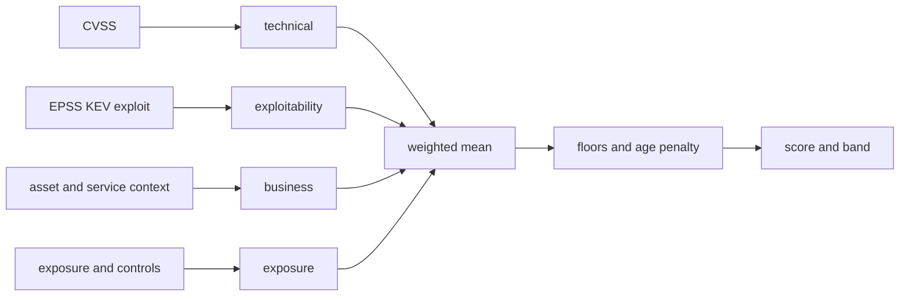

# Risk engine

`backend/veyrs/engines/risk.py` is a pure function module: given a `RiskInput` it returns a 0-100 score, a band and four component scores. `services/risk.py` loads inputs from the database and persists results. Unit coverage: `tests/test_phase3_risk*` (24 tests, read by name only).

## Formula

Overall = (technical x w_t + exploitability x w_x + business x w_b + exposure x w_e) / sum(w). Default weights (the `balanced` profile) are 0.30 / 0.30 / 0.25 / 0.15 (`engines/risk.py:60`).

| Component | Rule as implemented |
|---|---|
| Technical | CVSS x 10; 40 when CVSS is missing. |
| Exploitability | sqrt(EPSS) x 60, +30 if KEV, +15 for active exploitation (else +10 for a known exploit or maturity A, +5 for maturity P); clamped 0-100. |
| Business | criticality x 55 + data class x 25 + environment x 10, plus bonuses (business-service criticality above asset criticality; revenue-per-hour bands 10/7/4/2). |
| Exposure | exposure weight x 60 + attack vector (N 25, A 15, L 8, P 2) + 15 for unauthenticated with no interaction, minus compensating-control credit (cap 0.5). |

Adjustments: floors of 75 (KEV), 90 (KEV on an internet-facing asset) and 80 (active exploitation); an age penalty of 3 per 30 days (doubled when the SLA is breached), capped at 15; CVSS 0.0 with no exploit signal scores 0.

Bands: >= 90 critical, >= 70 high, >= 40 medium, >= 10 low, otherwise informational.

**Legend:** rectangles are computed values; arrows are data flow; the weights come from the active risk profile.

## Profiles

Built-in profiles: `balanced`, `technical-security`, `executive-risk`, `internet-exposure`, `compliance`. They are seeded by `seed_profiles`; on environment A `GET /risk/profiles` returned an empty list, so scoring falls back to engine defaults (`balanced` weights, `profile_id` null). The "balanced" profile description says "even weighting" although the weights are unequal.

## Features and endpoints

| Feature | Endpoint | Permission | Source | Status |
|---|---|---|---|---|
| List profiles | `GET /risk/profiles` | `riskprofile:read` | `api/v1/findings.py:467` | Verified |
| Create profile | `POST /risk/profiles` | `riskprofile:write` | `api/v1/findings.py:479` | Implemented |
| Rescore one finding | `POST /findings/{finding_id}/rescore` | `risk:write` | `api/v1/findings.py:446` | Implemented |
| Rescore everything | `POST /risk/rescore` | `risk:admin` | `api/v1/findings.py:553` | Implemented |
| What-if simulation | `POST /risk/simulate` | `risk:read` | `api/v1/findings.py:510` | Partial |

Errors: 404 finding not found; 422 invalid weights or body.

> [!NOTE]
> `POST /risk/simulate` used to raise `TypeError` (it passed `age_days` and `exposure_days` to `RiskInput`). Fixed in 0.41.0: `age_days` feeds `vulnerability_age_days`; `exposure_days` is still accepted but ignored because the engine has no such input. Route test: `tests/test_fix_api.py::test_risk_simulate_works`.

Data: `findings` (score columns), `risk_profiles`, `vulnerabilities`, `epss_scores`, `kev_entries`, `assets`.
