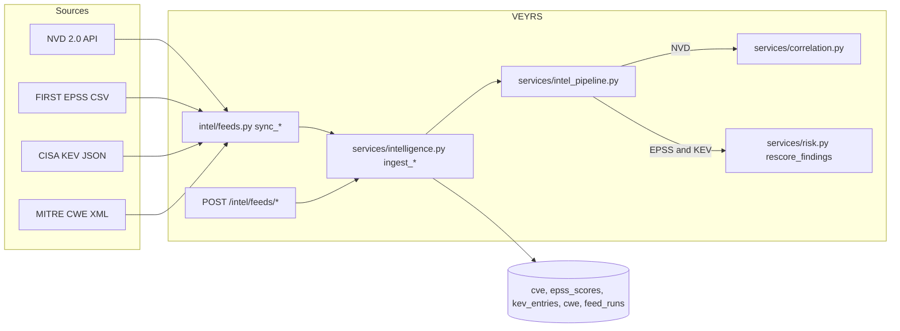

# Threat intelligence

The threat-intelligence area holds the **global vulnerability corpus** (CVE, CPE applicability, EPSS, CISA KEV, CWE) and turns it into tenant findings. Everything under `/api/v1/intel/*` that is tagged `threat intelligence` is described here. The `/intel/sources`, `/intel/articles` and `/intel/news` routes (tagged `intelligence & knowledge`) are in [knowledge-search.md](knowledge-search.md#threat-news-sources-and-articles).

Per-endpoint parameters and schemas are generated in [../api/reference/threat-intelligence.md](../api/reference/threat-intelligence.md). This page covers what the generator cannot know.

## Architecture in one picture

**Legend.** Rectangles are code modules or external sources, the cylinder is storage. Arrows show data flow. NVD records go through full correlation; EPSS and KEV only rescore existing findings.

## Cross-cutting facts

- **The corpus is global, not tenant-scoped.** `cve`, `epss_scores`, `kev_entries`, `cwe`, `feed_runs`, `vendors`, `products` carry no `organization_id` (`services/intel_schedule.py:6-20`). Tenant data is only reached through `Vulnerability`, `Finding`, `AssetProduct`.
- **Team scope.** The `threat intelligence` tag is in `EXEMPT_TAGS` (`security/scope.py:78`), so team-restricted principals read it unfiltered, except `/intel/cve/{id}/exposure`, which applies `team_scope.findings` itself (`api/v1/intel.py:194`).
- **Estate lens.** `estate_cve_ids` (`services/intelligence.py:959`) selects CVEs whose CPE match names a product installed in the tenant. It compares product only, not versions. `exposed_cve_ids` (`:977`) selects CVEs with at least one **open** finding; this is the authoritative "affects you" definition.
- **Feed-run bookkeeping.** Every importer runs inside `intelligence.feed_run` (`:41`) which writes a `feed_runs` row with status `running` then `succeeded` or `failed`; a failure stores `error` (max 2000 chars) and re-raises.
- **Live evidence.** On environment A, `/intel/health` reported nvd/epss/kev `ok` with 417 419 CVEs, 1 785 KEV, 398 137 EPSS rows and 785 feed runs on 2026-11-17.

## Features

### CVE catalogue search

| Item | Detail |
|---|---|
| What | Paginated, filterable list of CVEs. `GET /intel/cve` |
| Why | The catalogue is the index, not the worklist; analysts need the estate-relevant slice by default. |
| How it works | `search_cve` (`api/v1/intel.py:54`) builds a `select(Cve)`; applies `estate_cve_ids` first so `total` reflects the lens (`:84-95`), then `q` (ILIKE over id/title/description), `kev`, `min_cvss`, `min_epss`, `cwe` (array contains), `published_after`; orders by `risk`, `published`, `epss`, `cvss` or `id` (`:122-133`); fills `affected_assets` via `intelligence.affected_asset_counts` (`services/intelligence.py:1053`). |
| How to use | Console: Intelligence > Threat Intel > CVE tab (`frontend/console/app.js:1009`). Query: `?affects_estate=false` to research the whole corpus; `?exposed=true` for CVEs with open findings; `page`, `size` (1-200, default 50). |
| Permissions | `cve:read` |
| Data | `cve`, `cve_cpe_match`, `asset_products`, `findings`, `vulnerabilities` |
| Dependencies | `services/intelligence.py` |
| Errors | 422 for out-of-range `min_cvss` (0-10), `min_epss` (0-1), `order` not in `risk\|published\|epss\|cvss\|id`, `size` > 200. |
| Exceptional | `affects_estate` defaults to **true**: an API client that expects the full corpus gets only estate CVEs unless it passes `false`. A tenant with no resolved inventory sees an empty list. |
| Status | Verified (read in code; GET observed live, see [../api/guide.md](../api/guide.md)) |

### CVE detail

| Item | Detail |
|---|---|
| What | `GET /intel/cve/{cve_id}`: full snapshot with CVSS v2/v3/v4, EPSS, KEV, CWE ids, exploit maturity, references and CPE matches. |
| How it works | `cve_detail` (`api/v1/intel.py:144`) upper-cases the id and calls `intelligence_snapshot` (`services/intelligence.py:840`). Severity prefers v4, then v3, then derived from the best score. |
| How to use | Console: click a CVE in Threat Intel. |
| Permissions | `cve:read` |
| Data | `cve`, `kev_entries`, `epss_scores`, `cve_references`, `cve_cpe_match` |
| Errors | 404 `CVE not found`. |
| Status | Verified. Observed live for `CVE-2023-44487` (KEV true, EPSS 0.99999, CVSS 3.1 7.5). |

### Tenant exposure to a CVE

| Item | Detail |
|---|---|
| What | `GET /intel/cve/{cve_id}/exposure`: assets with an **open** finding for the CVE, internet-facing count, lead vulnerability risk. |
| Why | Bridges global intelligence and tenant reality; feeds the console "Affected assets" table. |
| How it works | `cve_exposure` (`api/v1/intel.py:156`) loads every `Vulnerability` for the CVE in the tenant (several can exist), joins findings and assets, narrows with `team_scope.findings(stmt, principal.scope)`, keeps one row per asset in `OPEN_STATES`, and picks the vulnerability with the highest `risk_score` as lead. |
| Permissions | `finding:read` (not `cve:read`) |
| Errors | None specific. A CVE with no vulnerability row returns 200 with zeros and `risk_score: null`. |
| Status | Verified (covered by `tests/test_phase59_cve_exposure.py`) |

### EPSS history

| Item | Detail |
|---|---|
| What | `GET /intel/cve/{cve_id}/epss-history?days=90`: daily EPSS points. |
| How it works | `intelligence.epss_trend` (`services/intelligence.py:646`) reads `epss_history`; retention is trimmed by `prune_epss_history` (`:660`) and the `prune-epss-history` CLI command (`cli.py:458`). |
| Permissions | `cve:read`. `days` 1-3650. |
| Errors | 422 on `days` out of range. Unknown CVE returns an empty `points` list, not 404. |
| Status | Verified (`tests/test_epss_retention.py`) |

### CISA KEV catalogue

| Item | Detail |
|---|---|
| What | `GET /intel/kev`: KEV entries with due dates, filterable. |
| How it works | `kev_list` (`api/v1/intel.py:241`): `affects_estate` (default true), `exposed`, `due_within_days`; ordered by `due_date` ascending; hand-built page dict carries `total,page,size,limit,offset,items`. |
| Permissions | `cve:read` |
| Status | Verified (observed live: 1 785 entries with `affects_estate=false`) |

### CWE detail

| Item | Detail |
|---|---|
| What | `GET /intel/cwe/{cwe_id}`: weakness metadata plus the count of the tenant's open findings whose CVE lists that CWE. |
| How it works | `cwe_detail` (`api/v1/intel.py:292`); `name` is `null` while the row is only a placeholder created by an NVD id (`resolved` false). |
| Permissions | `cve:read` |
| Errors | 404 `CWE not found`. |
| Status | Verified (`tests/test_phase25_cwe_catalog.py`) |

### Vendor dictionary

| Item | Detail |
|---|---|
| What | `GET /intel/vendors`: the shared CPE vendor dictionary with the tenant's `installations` count. Not third-party risk management. |
| How it works | `list_vendors` (`api/v1/intel.py:416`) left-joins a per-vendor count subquery in SQL so ordering (installed first, then name) is correct across pages. Filters `q`, `in_use`. |
| Permissions | `cve:read` |
| Status | Verified (`tests/test_phase35_operability.py`) |

### Feed ingest endpoints

| Item | Detail |
|---|---|
| What | `POST /intel/feeds/nvd`, `/feeds/epss`, `/feeds/kev`: push records produced elsewhere into the corpus. Platform administrators only since 0.41.0 (TD-04): the corpus is shared by every tenant. |
| Why | Air-gapped or proxy-mediated installs, and tests, can load data without the outbound fetchers. |
| How it works | `ingest_nvd` (`api/v1/intel.py:330`), `ingest_epss` (`:358`), `ingest_kev` (`:379`) call `intelligence.ingest_*` with `collect=touched`, commit, then (query `correlate=true`, default) `intel_pipeline.refresh_after_feed`. Response status is **200** (it was 202 before 0.41.0) because execution is synchronous. |
| Permissions | platform administrator (`is_superuser`, human user); a tenant `intel:write` no longer suffices (0.41.0) |
| Components | `intelligence.ingest_nvd` (`services/intelligence.py:459`), `ingest_epss` (`:503`, batches of 5 000), `ingest_kev` (`:715`). |
| Errors | 422 on schema mismatch of the request body (`NvdIngestRequest`, `EpssIngestRequest`, `KevIngestRequest` in `api/v1/vuln_schemas.py`). |
| Exceptional | These write **global** tables, which is why only a platform administrator may call them (fixed in 0.41.0, TD-04). The routes answer 200 and run synchronously (202 before 0.41.0). |
| Status | Implemented (no test posts to the endpoints; the services are covered by `tests/test_phase3_intel.py`) |

### Correlation and rescoring after a feed

| Item | Detail |
|---|---|
| What | `intel_pipeline.refresh_after_feed(session, feed, cve_ids)` (`services/intel_pipeline.py:146`). |
| How it works | `nvd` -> `correlate_new_cves` (`:51`): for each active organization, bind tenant, `correlation.correlate_batch`, commit. `epss`/`kev` -> `rescore_for_cves` (`:91`): find open findings by CVE in windows of 5 000 ids (`RESCORE_ID_WINDOW`), `risk_service.rescore_findings(..., reason="epss refresh")`. The previous tenant binding is captured and restored (`:169`). |
| Why different | EPSS and KEV change urgency, never applicability; correlating ~250k CVEs daily would find nothing new. |
| Errors | `ValueError("unknown feed ...")` for any other feed name. |
| Status | Verified (`tests/test_phase3_intel.py`) |

### Scheduled sync (CLI and timer)

| Item | Detail |
|---|---|
| What | Outbound fetchers and the schedule that decides when they run. |
| How it works | `intel/feeds.py`: `sync_kev` (`:135`), `sync_epss` (`:204`), `sync_nvd` (`:313`, incremental on `lastModified`, windows of at most 120 days, API key via `settings.nvd_api_key`, delay 7 s anonymous / 1 s keyed), `sync_cwe` (`:477`). `run_cli` (`:494`) backs `python -m veyrs sync-kev\|sync-epss\|sync-nvd\|sync-cwe`. The NVD watermark is the end of the last window asked for (`nvd_window`, `:289`). A fetch that returns nothing raises `FeedError` so no empty "succeeded" run is recorded. `python -m veyrs intel-due` (`cli.py:600`) prints which feeds are due; `scripts/sync-intel.sh` runs from an hourly timer and consults it. |
| Details | Connector/HTTP/retry detail: [../integrations/README.md](../integrations/README.md). |
| Status | Verified (live: four `succeeded` runs within 6 hours; `tests/test_sync_intel_script.py`) |

### Feed run history

| Item | Detail |
|---|---|
| What | `GET /intel/feeds/runs?feed=&page=&size=`: `feed_runs` newest first (default size 25). |
| Permissions | `intel:read` |
| Status | Verified (observed live: `total` 785) |

### Refresh schedule

| Item | Detail |
|---|---|
| What | `GET /intel/schedule` and `PUT /intel/schedule`: per-tenant demand for each feed (`cwe`, `nvd`, `epss`, `kev`), next to the effective schedule. |
| Why | Cadence used to be a systemd unit detail; operators need to see and change it (for example hourly KEV during an exploitation wave). |
| How it works | `intel_schedule.state` (`services/intel_schedule.py:125`) returns requested vs effective values. `effective_schedule` (`:169`) = a feed runs if **any** active tenant enables it, at the **smallest** interval requested; `shared: true` is returned so a tenant that set 24 h and observes 1 h understands why. `set_schedule` (`:227`) refuses unknown feed names and intervals outside 60 to 43 200 minutes, stores the block in `organizations.settings["intel_schedule"]` by reassigning the JSON (in-place mutation is not tracked). `due_feeds` (`:196`) measures from the last **successful** run so a failure does not reset the clock. Defaults: all feeds enabled, 1 440 minutes. |
| How to use | Console: Threat Intel > Schedule tab (`frontend/console/app.js:3776`). |
| Permissions | `intel:read` (GET), `intel:write` (PUT) |
| Errors | PUT: 403 `team-scoped identity` (`refuse_if_restricted`, `api/v1/intel.py:509`), 422 `ScheduleError` (unknown feed, out-of-range interval), 404 organization not found. |
| Exceptional | An audit event `organization.intel_schedule_changed` is recorded. The timer ticks hourly, so intervals under 60 minutes cannot be honoured. |
| Status | Verified (GET observed live; `tests/test_phase35_operability.py`) |

### Feed health

| Item | Detail |
|---|---|
| What | `GET /intel/health`: per feed `ok`/`stale`/`never_run`, age in hours, records seen, watermark; counts of CVE, KEV, EPSS; estate and exposed counts; inventory resolution. |
| How it works | `intel_health` (`api/v1/intel.py:548`). Staleness thresholds: nvd 48 h, epss 48 h, kev 72 h. `estate_inventory_health` (`services/intelligence.py:1029`) reports installations resolved to a CPE product vs unresolved, so a shrinking "affecting you" number caused by a broken inventory is visible. cwe is not included in the health output. |
| Permissions | `intel:read` |
| Status | Verified (observed live) |

## Errors summary

| Code | Condition |
|---|---|
| 401 | No or invalid credentials (global, see [../api/guide.md](../api/guide.md)). |
| 403 | Missing `cve:read`, `intel:read`, `intel:write` or `finding:read`; team-scoped identity on `PUT /intel/schedule`. |
| 404 | Unknown CVE or CWE. |
| 422 | Query bounds, unknown schedule feed, out-of-range interval, invalid ingest body. |

## Sources

- `backend/veyrs/api/v1/intel.py:54-590`
- `backend/veyrs/services/intelligence.py`, `intel_pipeline.py`, `intel_schedule.py`
- `backend/veyrs/intel/feeds.py:122-540`
- `backend/veyrs/security/scope.py:52-99`
