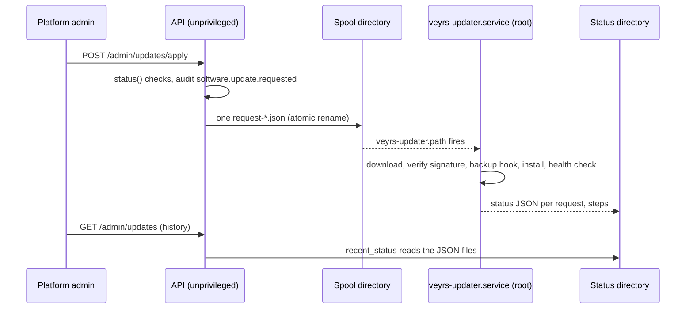

# Software update, installed software and network access

These pages describe the **installation**, not one organization. Every route depends on `platform_admin` (`backend/veyrs/api/v1/updates.py:28-35`): the principal must be `is_superuser` **and** a user (an API key never qualifies), otherwise 403 with a pointer to `veyrs platform-admin --email <you>` on the host. That CLI command grants or revokes the flag (`backend/veyrs/cli.py:697-700`). The routes carry the tag `administration` and are marked `platform_admin` in `extract/routes.json`. Console: Administration, tabs Software update, Installed software, Network access (`frontend/console/app.js:1107-1109`).

**Legend**: solid arrows are calls or file writes; the API never replaces its own code, only the root updater does (`services/updates.py:1-18`). The spool is `/var/lib/veyrs/update-requests` (`infrastructure/systemd/veyrs-updater.path`); the updater writes one `<id>.json` per request into the separate status directory `VEYRS_UPDATE_STATUS_DIR` (default `/var/lib/veyrs/update-status`, `scripts/veyrs-updater.sh:40,61`), which `recent_status` reads (`services/updates.py:552`).

## Feature: update status

- **What**: `GET /admin/updates?refresh=` returns installed version (`current`), latest release, `signed`, `update_available`, install `mode`, `can_apply` with a human `reason`, `pending` requests, local/uploaded release copies, directories, check metadata and the last updater runs (`history`, from `recent_status`) (`api/v1/updates.py:44-54`, `services/updates.py:258-288`).
- **Why**: one answer for the Software update tab, including *why* an update cannot be applied.
- **How it works**: `detect_mode` returns `git` (a `.git` directory, cannot be overridden by configuration), `docker`, `native` (an `install.sh` tree) or `unknown` (`:105-121`). `latest_release` reads `VEYRS_UPDATE_URL` (default the GitHub latest-release API), caches 1 hour on success and 5 minutes on failure, never raises, and an empty URL disables the check (`:162-198`). Version comparison uses `services/versions.compare`. `_can_apply` (`:226-255`) refuses, in order: git mode, docker mode (it returns the host re-install command instead), unknown mode, checks disabled or failed, already latest, release without `SHA256SUMS.sig`, no backup configured (`VEYRS_UPDATE_PRE_HOOK`, `BACKUP_DSN` or `VEYRS_UPDATE_SKIP_BACKUP`; since 0.42.4 a database on this host counts as configured, because `scripts/backup.sh` is then the default hook, `default_backup_hook`), request already pending, spool missing or not writable.
- **Permissions**: platform administrator.
- **Data**: files only: spool `VEYRS_UPDATE_SPOOL` (default `/var/lib/veyrs/update-requests`), status dir `VEYRS_UPDATE_STATUS_DIR`, upload dir. No tables.
- **Dependencies**: outbound HTTPS to the release API (optional), `scripts/verify-release.sh` for advisory verification of local copies.
- **Errors**: 403 not a platform administrator.
- **Status**: Verified (observed live: 200, `mode: git`, `can_apply: false`, reason "managed by git deploy"). Note that the installed version reported live was 0.39.1 while the latest published release reported was 0.35.5. Tests: `tests/test_phase52_updates.py`, `tests/test_phase55_local_update.py`, `tests/test_phase56_platform_admin.py`.

## Feature: queue an update (apply)

- **What**: `POST /admin/updates/apply` with optional body `{version, source}` where `source` is `release` (default), `upload` or `local`. Returns **202** `{"status":"queued","request":{...}}` (`api/v1/updates.py:57-125`).
- **How it works**: for `release` it needs `can_apply` and, if a `version` was sent, it must equal the latest (409 otherwise: the page is stale). For `upload`/`local` the named copy must exist (404) and be applicable (409 with the reason). The request is **audited first** (`software.update.requested`) and only then `request_apply` writes a single `request-<stamp>-<hex>.json` (mode 0600, written under a dot name and renamed so the path unit never sees a half file) containing only `target_version, from_version, requested_by, requested_at, source` (`services/updates.py:291-334`). A failure to write is audited as `software.update.request_failed` and answered 409. The root updater does the download, signature check against the key of the *installed* tree, pre-update backup, install and health check (`/healthz` and `/readyz`); the API restarts during install.
- **Errors**: 409 (cannot apply, stale version, request pending, spool not writable, bad version string `not a release version`), 404 (no such copy), 403.
- **Exceptional**: only one request may be pending. Git and Docker installs never self-update.
- **Status**: Implemented (not exercised live: POST is forbidden in the documentation environment).

## Feature: chunked release upload

- **What**: `POST /admin/updates/uploads` (start, 201, returns `upload_id` and `chunk_bytes`), `PUT /admin/updates/uploads/{upload_id}/{name}?offset=&total=` (append a chunk), `POST /admin/updates/uploads/{upload_id}/finish` (stage as `v<version>`), `DELETE /admin/updates/uploads/{version}` (204) (`api/v1/updates.py:128-180`, `services/updates.py:462-550`).
- **Why**: copy a release through the browser on an air-gapped host without raising a proxy body limit; an interrupted upload resumes at the offset the server reports.
- **How it works**: chunks are at most 8 MB (`CHUNK_MAX_BYTES`), files at most 1 GiB, names must match `ASSET_NAME_RE` (`SHA256SUMS`, `SHA256SUMS.sig`, `veyrs-setup.sh[.sha256]`, `veyrs-<v>-src.tar.gz[.sha256]`, `veyrs-<v>-wheels-x86_64.tar.gz[.sha256]`). `offset` must equal the bytes already received. `finish` requires every announced file to be complete, exactly one source tarball, and that all files belong to the same version; it replaces an existing staged copy and runs advisory verification. Abandoned incoming directories older than 24 h are removed at the next start. Nothing uploaded is trusted: the root updater copies and verifies again. The wheels file is optional (0.42.5): without it the updater checks, before the backup, that the installed virtualenv already satisfies the new `requirements.txt` (`pip --dry-run --no-index`), and refuses naming the file otherwise.
- **Errors**: 413 chunk larger than 8 MB (by `Content-Length`), 409 for any `UploadError` (bad name, wrong offset `expected offset N`, more bytes than announced, incomplete file, wrong file set, unknown or expired upload), 404 `no uploaded copy of <version>` on delete, 403.
- **Data**: files under `VEYRS_UPDATE_UPLOAD_DIR` (default `<install>/var/update-uploads`); audit rows `software.update.uploaded`, `software.update.upload_deleted`.
- **Status**: Implemented (`tests/test_phase52_updates.py`).

## Feature: installed software inventory

- **What**: `GET /admin/system/software?refresh=` (`api/v1/system.py:21-30`, `services/software_inventory.py`). Platform components (nginx, pg_dump, OpenSSL, OpenSSH, curl, git) with the version the **binary reports** and the version the **package manager** records, plus every Python distribution in the API's interpreter with `direct` (declared in `pyproject.toml`) and `locked` (pin in `requirements.txt`) flags and a drift state (`differs`, `not_in_lock`, `missing`), plus the tools reported by each enrolled agent.
- **Why**: auditors and operators need "what runs and at which version"; drift between two app nodes is how a failover serves different code.
- **How it works**: read-only by construction: fixed argv, no shell, 4 s timeouts, a missing binary is reported as not found and a version is never invented; cached 60 s (`refresh=true` bypasses); agent tools are read per organization and never cached (`agent_tools`, `:376`). Scanner binaries are deliberately not probed from the API (sandbox restriction), agents report their own.
- **Permissions**: platform administrator (versions are reconnaissance data).
- **Data**: `agents` (tools list), files and subprocess output.
- **Status**: Verified (live: 200; summary showed 58 Python packages, 19 direct, 0 drift, 8 components found). Test: `tests/test_phase53_system_inventory.py`.

## Feature: network access (firewall checklist)

- **What**: `GET /admin/system/network` (`api/v1/system.py:33-37`, `services/network_requirements.py:396`). Returns `groups`, `destinations` (the fixed registry of outbound destinations grouped by when they are contacted: run time, updater, installer, scan agent), `platform` (destinations created by this installation's settings: database, Redis, mail relay, vault, local AI endpoint), `configured` (enabled connectors, AI providers, directory of this organization), `browser` and `inbound` notes.
- **Why**: a firewall team asks which addresses the host must reach, on which port and what breaks if blocked.
- **How it works**: run-time rows are resolved against live settings, so a feed pointed at an internal mirror shows the mirror. Disabled connectors contact nothing and are omitted. A test scans the source for URL literals and fails if a host is neither in `REGISTRY` nor in `DOCUMENTATION_ONLY`, so a new outbound call cannot ship undocumented (`network_requirements.py:20-24`).
- **Permissions**: platform administrator.
- **Data**: `itsm_connectors`, scanner connectors, `ai_providers`, `organizations.settings` (read).
- **Status**: Verified (live: 200; 20 registered destinations at the time of the check). Test: `tests/test_phase53_system_inventory.py`.

## Support module: version comparison

`backend/veyrs/services/versions.py` compares versions with the NVD/CPE convention (numeric where both sides numeric, lexical otherwise, pre-release markers such as alpha/beta/rc sort before the bare release, `*`/`-`/empty mean any) and strips Debian/RPM epochs and distribution revisions (`compare` `:98`, `in_range` `:132`, `upstream_version` `:192`, `cpe22_to_cpe23` `:224`). It is used by the update check and, more importantly, by product-to-CVE correlation (see [findings](vulnerability-management.md) and [threat intelligence](threat-intelligence.md)). It has no routes. Status: Implemented (`tests/test_distro_version_normalisation.py`).

## Route coverage

`GET /admin/updates`, `POST /admin/updates/apply`, `POST /admin/updates/uploads`, `PUT /admin/updates/uploads/{upload_id}/{name}`, `POST /admin/updates/uploads/{upload_id}/finish`, `DELETE /admin/updates/uploads/{version}`, `GET /admin/system/software`, `GET /admin/system/network` (8 routes).
