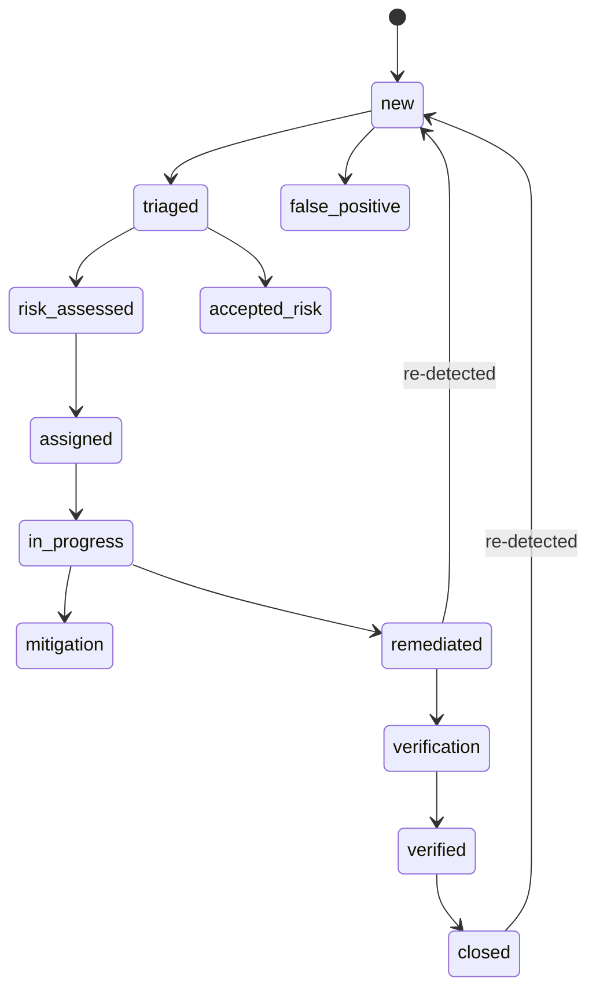

# Vulnerability management (findings)

A **finding** is one vulnerability on one asset. Findings are created by correlation (CVE x installed product) or by scan import, scored by the risk engine, given an SLA deadline, and driven to closure through a state machine. Read routes were observed live on environment A (list, detail, attribution); mutating routes are code-read only.

## Lifecycle

The legal transitions are the `ALLOWED_TRANSITIONS` map in `backend/veyrs/models/vulnerability.py:48`. Open states: `new, triaged, risk_assessed, assigned, in_progress, mitigation, remediated, verification, deferred`. Closed states: `verified, closed, false_positive, duplicate, accepted_risk, exception`. An illegal transition returns 409. `advance` in `services/correlation.py:336-380` walks the shortest legal path to a target state. A re-detection of a finding in `remediated`, `verified` or `closed` reopens it to `new` and restarts the SLA clock (`services/correlation.py:489-521`).

**Legend:** boxes are finding states; arrows are a representative subset of legal transitions (the complete map is `ALLOWED_TRANSITIONS`); `deferred`, `duplicate` and `exception` are omitted for readability. `accepted_risk` is reachable from `triaged`, `risk_assessed`, `assigned`, `in_progress` and `mitigation`, never directly from `new`. The `re-detected` edges are the importer's reopen (`ensure_finding`), not a user transition; it also applies to `verified`.

## Features

### Vulnerability catalogue view

| Item | Detail |
|---|---|
| What | `GET /vulnerabilities`, `GET /vulnerabilities/{vulnerability_id}`: the CVE/advisory records findings point at. |
| Permission | `vulnerability:read` (`api/v1/findings.py:46,97`). |
| Data | `vulnerabilities`, `findings`. |
| Errors | 404 unknown id; 422 bad query. |
| Status | Implemented |

### Findings list and detail

| Item | Detail |
|---|---|
| What | `GET /findings` (paginated with `page`/`size`, `order` in `risk|sla|detected|severity`, filters) and `GET /findings/{finding_id}` (`api/v1/findings.py:167,250`). |
| Why | The work queue of the platform; default order is by risk. |
| Scoping | Results are narrowed to the caller's team scope (`security/scope.py`). |
| Permission | `finding:read`. |
| Live example | 1,972 findings on environment A; each row carries `risk_score`, `risk_level`, the four component risks, `sla_due_at`, `sla_breached`, `escalation_level`, owning team. |
| Errors | 404 not found or out of scope; 422 invalid `order`/`page`/`size`. |
| Status | Verified |

### Transition

| Item | Detail |
|---|---|
| What | `POST /findings/{finding_id}/transition` moves one finding to a new state with an optional note (`api/v1/findings.py:277`). |
| How | Validates against `ALLOWED_TRANSITIONS`, stamps `remediated_at`, closes the SLA clock and writes an audit record. |
| Permission | `finding:write`. |
| Errors | 404; 409 illegal transition; 422 unknown state. |
| Status | Implemented |

### Bulk transition and bulk assign

| Item | Detail |
|---|---|
| What | `POST /findings/bulk-transition` and `POST /findings/bulk-assign` apply one operation to many ids (`api/v1/findings.py:307,345`). |
| Permission | `finding:write`. |
| Note | Check the generated reference for the response shape on partial failure; not exercised live. |
| Status | Implemented |

### Risk acceptance

| Item | Detail |
|---|---|
| What | `POST /findings/{finding_id}/accept-risk` moves a finding to `accepted_risk` with justification (`api/v1/findings.py:411`). |
| Permission | `risk:admin`. |
| Related | Engagement-level acceptances are in [engagements-scan-import.md](engagements-scan-import.md); expiry is not scheduled by this module. |
| Status | Implemented |

### Attribution and change feed

| Item | Detail |
|---|---|
| What | `GET /findings/{finding_id}/attribution` explains why a finding is assigned to a team or person (`api/v1/attribution.py:62`); `GET /findings/changes` lists recently changed findings (`api/v1/attribution.py:32`). |
| How | `services/attribution.py` resolves ownership from asset owner, team, business service and assignment rules. The router is included before `findings` so `/findings/changes` is not captured by `/findings/{id}` (`api/v1/__init__.py`). |
| Permission | `finding:read`. |
| Status | Verified |

Assignment policies (`/policies/assignment`) are in [sla-escalation.md](sla-escalation.md).

## Known defects

- `correlate_cve(close_missing=True)` sets `state = "remediated"` directly (`services/correlation.py:650-672`), bypassing transition validation and the `remediated_at` stamp.
- The `finding.state_changed` workflow trigger has no emitter (see [ticketing-itsm.md](ticketing-itsm.md)).
