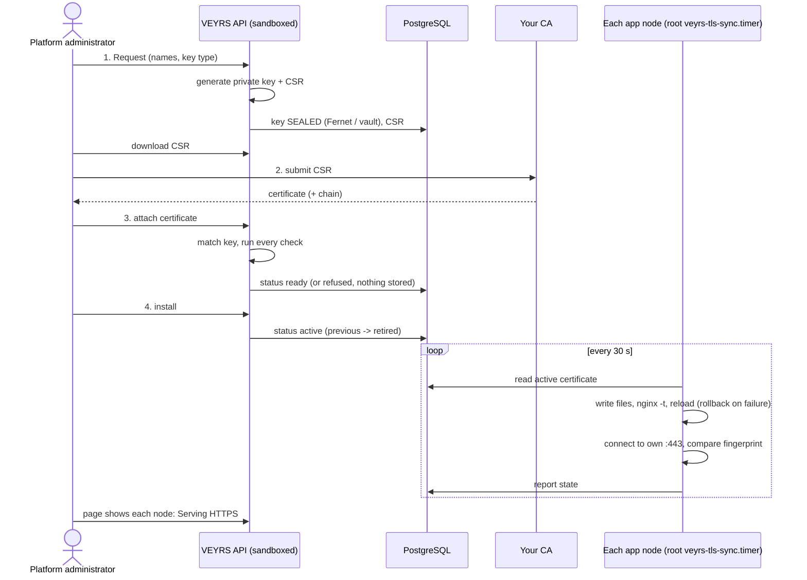

# Web certificate

Console: **Configure → Platform → Web certificate** (`#/admin?tab=webcert`). Platform administrators only: an organization administrator or an API key gets 403, because whoever controls this certificate can impersonate VEYRS to every user.

## Two ways to get the certificate

The page opens on a choice. Both paths end in the same list, **Ready to install**, and both run the same checks.

| | **A · Request it here, sign it with your CA** (recommended) | **B · Upload a certificate and its private key** |
|---|---|---|
| Use it when | you have a CA that signs CSRs: corporate CA, or a public CA | the certificate already exists with its key (issued elsewhere, or a wildcard you already hold) |
| Where the private key is born | in VEYRS, and it never leaves | outside VEYRS: it existed before, on whatever machine made it |
| What you give VEYRS | the names; later, the signed certificate | the certificate (PEM) + private key (PEM), or a PKCS#12 `.pfx`/`.p12` file, with the passphrase if there is one |
| Steps on the page | 1 Generate the key and the request · 2 Have the CSR signed · 3 Upload the signed certificate | one form |
| Then | **Install** under Ready to install | **Install** under Ready to install |

The passphrase of path B is used once to open the key and is not stored; the key is sealed on arrival exactly like path A's. The page remembers the path chosen per browser, and opens on A whenever a request is waiting for its certificate.

Two certificate features exist and they are mirror images:

| | Web certificate (this page) | [Trust store](trust-store.md) |
|---|---|---|
| Question it answers | Which certificate does VEYRS **present** to browsers? | Which CAs does VEYRS **accept** when it connects out? |
| Holds a private key | Yes, generated here, sealed | No, CA certificates only |
| Who uses it | Browsers, proxies, API clients connecting to VEYRS | VEYRS connecting to CMDB, ITSM, LDAP, SMTP… |

They meet in one place: a certificate signed by a **private** CA is only accepted when that CA's root is in the trust store (see check 6 below).

## The flow

1. **Request.** Enter the common name and every extra name users type to reach VEYRS (and node names if anything connects to a node directly). Choose the key: RSA 2048/3072/4096 or ECDSA P-256/P-384; the default is RSA 3072, which every enterprise CA signs. Optional subject fields (organization, unit, city, state, two-letter country). VEYRS generates the key **on the server**, seals it immediately and creates the CSR with every name in the Subject Alternative Name and `serverAuth` requested.
2. **Sign.** Download the CSR (`<name>.csr`) or show it and paste it into your CA's form. The CSR is public: it holds the names and the public key, never the private key.
3. **Attach.** Upload what the CA returned: the certificate, ideally with its intermediates (a "full chain" file is fine), or the chain as a second file. PEM or DER. VEYRS finds the request by matching the certificate's public key, then runs every check. Any failed check refuses the certificate with the list of reasons, and nothing is stored.
4. **Install.** The checks run again (the certificate may have expired, or its CA may have left the trust store, since it was attached). It becomes the **active** certificate; the previous one becomes **retired**. Every app node applies it within about 30 seconds and reports back on the page.

Path **B** replaces steps 1 to 3 with one upload (PEM pair, encrypted keys with passphrase, or PKCS#12 `.pfx`/`.p12`). The same checks apply and the key is sealed on arrival. Path A is recommended because then the key never existed anywhere else.

## The checks

| # | Check | Fails when | Why |
|---|---|---|---|
| 1 | Server certificate | it is a CA certificate | a CA certificate is not a server certificate; its place is the trust store |
| 2 | Extended key usage | EKU present without `serverAuth` | browsers refuse it for TLS servers |
| 3 | Names (SAN) | no SAN at all | browsers ignore the common name. **Warning** (accepted) when the CA dropped a requested name: users reaching VEYRS at that name would get an error |
| 4 | Validity | expired, or not valid yet | **Warning** under 30 days left, or a lifetime over 398 days (accepted from a private CA; a public CA certificate that long is refused by browsers) |
| 5 | Key and signature | RSA < 2048, curves other than P-256/384/521, Ed25519/Ed448, MD5/SHA-1 signature | not accepted by browsers |
| 6 | Chain of trust | the chain does not verify for a name it covers, against the public roots plus the [trust store](trust-store.md) | RFC 5280 path building (`cryptography.x509.verification`). A private CA must be in the trust store first. The intermediates found are what nodes serve after the leaf (never the root) |

## What runs where, and why

- **The API never touches the web server.** It runs sandboxed (`ProtectSystem=strict`, `NoNewPrivileges`) and only records the decision in the database. Writing nginx's files and reloading it is done by a separate **root** oneshot, `veyrs-tls-sync.service`, started every 30 seconds by `veyrs-tls-sync.timer` on every app node. A compromised API process therefore cannot rewrite the web server configuration.
- **The database is the source of truth.** Every node reads the same active row, so installing once installs on all nodes, and a failover node never serves a different certificate for more than one tick.
- **The private key** is stored with `security.secrets.encrypt` (Fernet with `VEYRS_ENCRYPTION_KEY`, or the vault when the installation uses one). No API response contains it. Only the root installer unseals it, and only when the node does not already hold that key. On disk it is `/etc/veyrs/tls/server.key`, mode 0600, root.
- **Files on each node** (`/etc/veyrs/tls`, managed, rewritten every cycle):

| File | Content |
|---|---|
| `server.crt` | leaf + intermediates |
| `server.key` | private key, 0600 |
| `nginx/listen.conf` | `listen 443 ssl http2`, the two files, TLS 1.2/1.3, modern ciphers, no session tickets |
| `nginx/redirect.conf` | only when **Redirect HTTP to HTTPS** is on |

- **Every VEYRS nginx server block** carries `include /etc/veyrs/tls/nginx/*.conf;`: the console (`infrastructure/nginx-veyrs-console.conf`, and the one `install.sh` writes), the Docs Center (`nginx-veyrs-docs.conf`) and the product site (`nginx-veyrs-web.conf`). One certificate serves all three, so its names must cover the three host names. Until a certificate is installed the glob matches nothing (valid nginx), so the line is shipped from the start.

### One installer cycle

1. Read the active certificate and the redirect setting.
2. Compare the managed files with what they should be. If they are identical, skip to step 5.
3. Back up the current set to `.previous`, write the new set, run `nginx -t`. If nginx refuses it: **restore the previous set and do not reload**. The node keeps serving what it served before and reports `error` with nginx's message.
4. Reload nginx. If the reload fails: restore and report.
5. Check the include is in the loaded configuration (`nginx -T`), then connect to `127.0.0.1:443` with the certificate's name (SNI) and compare the SHA-256 of what is served with the active certificate.
6. Report `applied`, `off`, `not_configured` or `error` with a detail, plus the nginx version, in `web_tls_nodes`.

## Node states on the page

| State | Meaning | What to do |
|---|---|---|
| Serving HTTPS | the node served the active certificate in its last check | nothing |
| HTTP only | no certificate is installed | install one |
| nginx not prepared | the files are written, but no server block includes them | add `include /etc/veyrs/tls/nginx/*.conf;` to each VEYRS server block, then `nginx -t && systemctl reload nginx`. `install.sh` warns about it on existing vhosts |
| Error | nginx refused the configuration (rolled back), the reload failed, nothing answers on 443, or another certificate answers on 443 | read the detail; on the node `journalctl -u veyrs-tls-sync -n 20` |
| Not reporting | no report for 3 minutes | `systemctl status veyrs-tls-sync.timer` on that node |
| (no row) | no node has ever reported | the timer is not installed: re-run `install.sh` (0.42.0+). Docker deployments do not run it: terminate TLS on the proxy in front of the stack |

## Redirect HTTP to HTTPS

Off by default. When on, every node answers plain HTTP with a 301 to HTTPS, **except `/healthz`, `/readyz` and `/metrics`** (load balancers and monitoring reach those on HTTP, the metrics scrape by IP address, which no certificate names; a redirect would mark every node down at once or break the scrape). Turn it on only when all users and every proxy in front of VEYRS reach it on 443: a proxy that still talks HTTP to the nodes would loop. It cannot be turned on with no certificate installed, and it is switched off when HTTPS is uninstalled.

## Renewal and rollback

- **Renew:** create a new request (a new key), have it signed, attach, install. The old certificate becomes retired. The page shows days left and colours the expiry under 30 days.
- **Roll back:** **Install again** on a retired certificate.
- **Stop HTTPS:** **Stop serving HTTPS** removes the 443 block from every node within one tick (and the redirect with it). The certificate is kept as retired.
- **Discard** destroys the sealed key; a certificate the CA issues later for that request can no longer be attached. The active certificate cannot be discarded.

## API

All under `/api/v1/admin/web-certificate`, platform administrators only, every change audited (`web_certificate.*`).

| Method and path | What |
|---|---|
| `GET /admin/web-certificate` | active, pending, ready, retired certificates; node reports; redirect policy; key types |
| `POST /admin/web-certificate/requests` | generate key + CSR `{common_name, extra_names, key_type, organization, organizational_unit, locality, state, country, note}` |
| `GET /admin/web-certificate/{id}/csr` | the CSR as a `.csr` download |
| `POST /admin/web-certificate/certificate` | attach `{certificate, chain?, request_id?}` (PEM, or base64 DER); 422 with `detail.checks` when refused |
| `POST /admin/web-certificate/import` | `{certificate, private_key, chain?, passphrase?}` or `{pkcs12_base64, passphrase?}` |
| `POST /admin/web-certificate/{id}/install` | serve it (re-checked first) |
| `POST /admin/web-certificate/uninstall` | stop serving HTTPS |
| `DELETE /admin/web-certificate/{id}` | discard (not the active one) |
| `PUT /admin/web-certificate/policy` | `{redirect_http}` |

## Behind a reverse proxy

A proxy or load balancer in front of VEYRS can keep terminating the browser's TLS. With a certificate installed on the nodes, point the proxy at the nodes' port 443 (`proxy_pass https://…`, with `proxy_ssl_verify on`, `proxy_ssl_trusted_certificate` = your CA, `proxy_ssl_name` = a name in the certificate) so the hop between proxy and nodes, which carries sign-ins and tokens, is encrypted too. Keep it on HTTP until every node reports **Serving HTTPS**.

## Tests

`tests/test_web_tls.py`: names, CSR content and sealed key, every check (private CA refused until its root is trusted, chain in one file or two, wrong key, CSR uploaded by mistake, expired, client-only EKU, dropped name = warning), PEM-pair and PKCS#12 import with passphrases, active/retired transitions and re-check on install, the installer against a fake nginx (apply, refused configuration rolled back, redirect, missing include, foreign certificate on 443, uninstall), the installer against a **real nginx** on a test port with a client that verifies the name, the API flow with the key absent from every response, and guards on the vhosts (include present, no `add_header` inside a location), the units and the installer.
