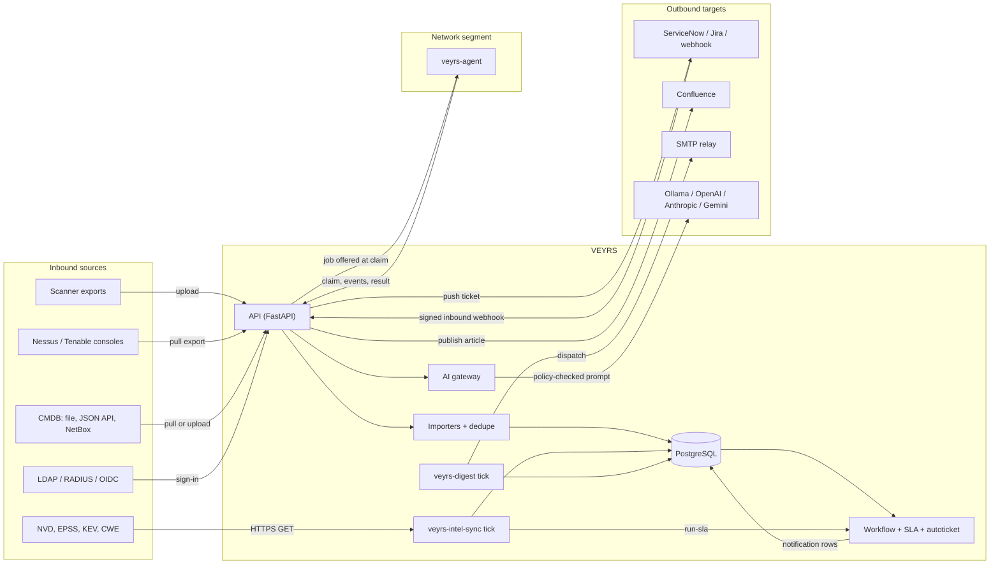

# Integration map

VEYRS talks to the outside world in three ways:

- **It receives.** Scanner exports uploaded over the API, results posted by execution agents, signed ITSM webhooks.
- **It pulls.** Threat-intelligence feeds, scanner consoles, CMDB sources, ITSM issue status.
- **It pushes.** Tickets to ITSM systems, runbooks to Confluence, prompts to AI models, mail to SMTP.

Nothing runs on its own except the two systemd timers (or their container twins) described in [Automation](automation.md). Every pull connector is created **disabled or inert** and does nothing until an operator names what it may touch.

## Diagram

**Legend.** Rectangles are services or external systems; the cylinder is PostgreSQL; arrows show the direction of the initiating request and are labelled with the mechanism. "Job offered at claim" means the agent polls; VEYRS never connects to an agent. Boxes in `EXT_IN` feed data in, boxes in `EXT_OUT` receive data from VEYRS; ITSM appears in both because the inbound webhook is a separate path.

## Integration inventory

| Integration | Direction | Mechanism | Document | Status |
|---|---|---|---|---|
| Scanner file import, 20 parser names (Nessus, Qualys, Greenbone/OpenVAS, CSV, JSON, SARIF, CodeQL, Trivy, Grype, Semgrep, Bandit, Gitleaks, Checkov, Nuclei, ZAP, npm audit, pip-audit, Dependabot, Prowler) | in | `POST /integrations/imports` multipart | [Scanners](scanners.md) | Verified |
| Scanner pull connectors (Nessus, Tenable.io, Tenable SC) | in, pull | `/integrations/scanners/*` | [Scanners](scanners.md#scanner-connectors-pull) | Implemented |
| Host inventory harvested from a Nessus export | in | second read of the same bytes | [Scanners](scanners.md#host-inventory-from-a-scan-report) | Implemented |
| Execution agent (nuclei) | in, agent polls | `/agents/self/*` with `X-Agent-Token` | [Agent](agent.md) | Verified |
| Execution agent tools nmap, trivy, zap, semgrep | in, agent polls | same | [Agent](agent.md#tools-the-reference-runner-ships) | Implemented |
| Agent installed-software inventory | in | `POST /agents/self/inventory` | [Agent](agent.md#inventory-reporting) | Implemented |
| CMDB asset sources: `file`, `http_json`, `netbox` | in, pull or upload | `/asset-sources/*` | [ITSM and webhooks](itsm-and-webhooks.md#cmdb-and-asset-sources) | Verified |
| Team import from NetBox tenants and LDAP groups | in | `/teams/import/*` | [ITSM and webhooks](itsm-and-webhooks.md#team-import) | Implemented |
| Fleet collector and `import-inventory` CLI | in | JSON file | [ITSM and webhooks](itsm-and-webhooks.md#fleet-collector) | Implemented |
| ITSM push: ServiceNow, Jira Cloud and Data Center, generic webhook | out | `/integrations/connectors/*` | [ITSM and webhooks](itsm-and-webhooks.md) | Implemented |
| ITSM status poll | out, pull | `POST /integrations/connectors/{id}/pull` | [ITSM and webhooks](itsm-and-webhooks.md#status-pull) | Implemented |
| ITSM inbound webhook | in | `POST /integrations/itsm/{org}/{connector}/inbound`, HMAC | [ITSM and webhooks](itsm-and-webhooks.md#inbound-webhook) | Implemented |
| External ticketing mode | out | `PUT /ticketing` | [ITSM and webhooks](itsm-and-webhooks.md#external-ticketing-mode) | Implemented |
| Confluence runbook publishing | out | `POST /knowledge/{id}/publish` | [ITSM and webhooks](itsm-and-webhooks.md#confluence) | Implemented |
| Threat feeds NVD, EPSS, CISA KEV, MITRE CWE | in, pull | `veyrs sync-*`, hourly tick | [Threat intelligence](threat-intel.md) | Verified |
| Threat sources RSS, Atom, JSON, MISP, OpenCTI | in | source registry plus `POST /intel/articles` | [Threat intelligence](threat-intel.md#threat-sources-and-articles) | Partial |
| AI providers `ollama`, `openai`, `openai_compatible`, `anthropic`, `gemini`, `deterministic` | out | `services/ai/gateway.invoke` | [Notifications and AI](notifications.md#ai-providers) | Verified |
| E-mail through SMTP | out | `smtplib`, STARTTLS | [Notifications and AI](notifications.md#e-mail) | Implemented |
| In-app notifications | internal | `notifications` rows | [Notifications and AI](notifications.md#channels) | Verified |
| Telegram | out, sign-in codes only | `security/mfa_delivery.py` | [Notifications and AI](notifications.md#telegram) | Partial |
| Outbound webhooks and Slack | out | table and signer exist, no sender | [Notifications and AI](notifications.md#outbound-webhooks-and-slack) | Partial |
| Daily digest | out | `veyrs digest`, hourly tick | [Notifications and AI](notifications.md#daily-digest) | Verified |
| LDAP, RADIUS, OIDC sign-in | in | `/ldap`, `/radius`, `/oidc`, `/auth/oidc/*` | [Security docs](../SECURITY.md) | Implemented |
| Prometheus scrape of `/metrics` | out, scraped | text exposition | [Architecture](../ARCHITECTURE.md) | Implemented |
| Scheduled jobs (timers, CLI) | internal | systemd or `docker/tick.sh` | [Automation](automation.md) | Verified |
| Plugins | none | there is no plugin loader | [Extending](extending.md) | Planned |

**How Status was assigned.** `Verified` means the code path was read and either observed on the running node on 2026-11-17 (timers, feed runs, the agent, a NetBox source, AI providers, the digest) or covered by a test that was read. `Implemented` means read in code and covered only by tests or by nothing observable on that node (no ITSM connector or scanner connector was configured there). `Partial` means a real piece is missing; the linked document says which.

## Rules every integration shares

1. **Credentials are encrypted at rest** (Fernet envelope, `security/secrets.py`) and never returned by any response schema. Responses carry `credentials_set: true` instead.
2. **Connectors are created inert.** Scanner connectors default `is_enabled=false` and an empty `allowed_scans` means "may pull nothing". CMDB sources refuse to sync while disabled. The agent's empty allowlist means "may scan nothing".
3. **Absence is evidence, not proof.** Scanners and sources that stop reporting something do not delete or close it by default ([ADR 0006](../ADRs/0006-no-autoclose-on-absence.md)).
4. **An external system cannot close a security finding.** ITSM status is advisory unless an operator opts in per connector, and then it only moves a ticket through the ticket state machine.
5. **Everything is audited.** Connector create, update and delete, imports, agent job queue and finish, schedule changes and digest sends all write `audit` rows.

## Where the live node stood on 2026-11-17

These are observations, not configuration advice.

| Check | Result |
|---|---|
| `veyrs-intel-sync.timer`, `veyrs-digest.timer` | active, hourly, last run within the hour |
| `GET /intel/health` | NVD, EPSS and KEV `ok`, ages 5 to 6 hours |
| Agent `veyrs-agent.service` | running, one agent `idle`, one tool (`nuclei`) enabled |
| Active scanning switch (`GET /scanning`) | disabled for the organization: no new jobs can be queued or claimed |
| ITSM connectors, scanner connectors | none configured |
| CMDB sources | one NetBox source, enabled |
| Digest | enabled, channel `in_app` only |
