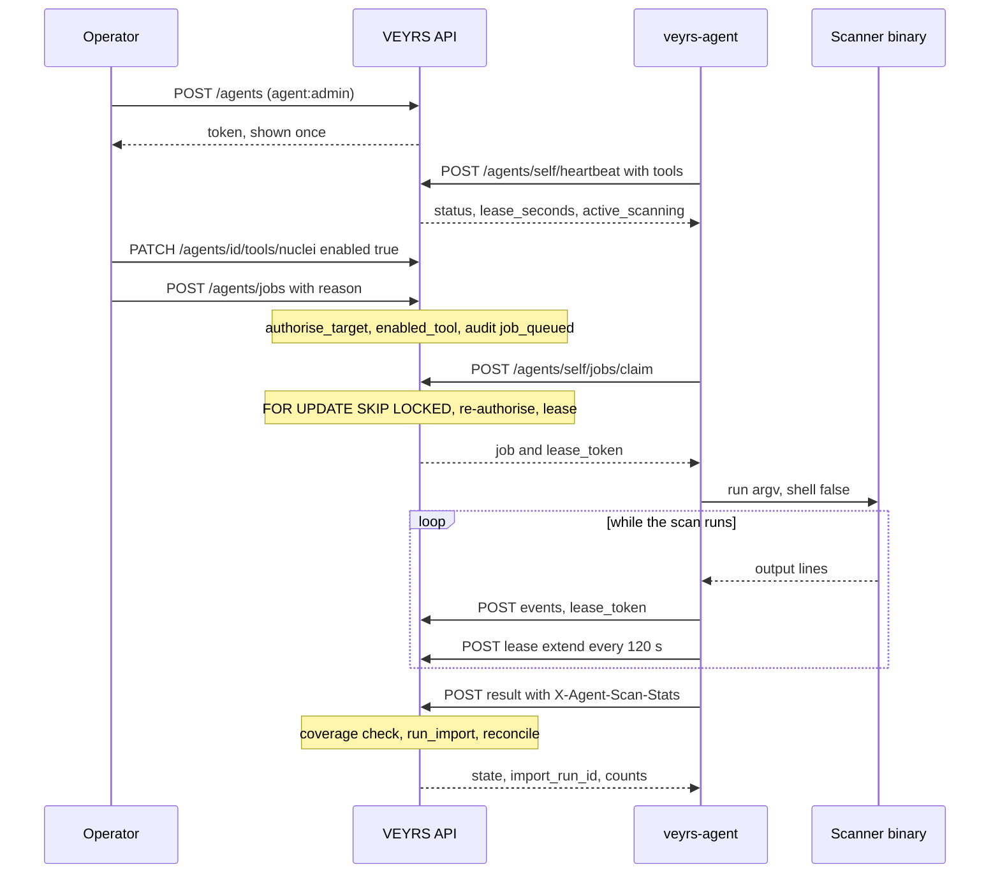
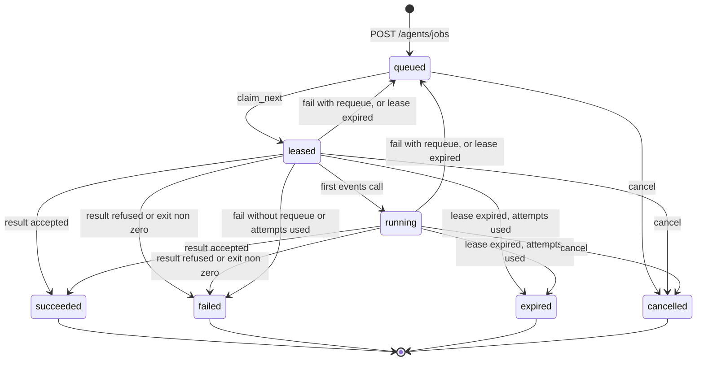

# Execution agent

VEYRS can run scanners, not only import what somebody else ran. An **agent** is a long-lived worker inside a network segment. It polls VEYRS for work, builds the command line itself, runs a scanner, streams output and submits the result into the normal ingestion pipeline. VEYRS never connects to an agent.

## Trust model

The server sends `{tool, target, profile, params}` and nothing else. The agent owns the mapping to a command line.

| Rule | Enforced by |
|---|---|
| No command line from the server, no shell | The runner builds `argv` as a list and calls `subprocess.Popen(argv, shell=False)`; each `build_*()` whitelists and clamps its knobs. |
| A declared tool is not an authorised tool | `AgentTool.enabled` defaults false. An operator with `agent:admin` enables it. `auto_enable_tools` (default off) would skip that. |
| A target must be in scope | `services/agents.authorise_target`: deny rules, then allowlist, then the asset register (`require_asset_match`, default on). |
| Empty allowlist means nothing allowed | Enrolment with no `allowed_targets` yields an inert agent. |
| Reserved ranges refused | Loopback, link-local (including the cloud metadata address), multicast and unspecified need an **exact literal** allow entry; a CIDR that merely contains one does not count. |
| Names are never resolved to match a CIDR | A name matches name globs only; an address matches networks and addresses only. Resolving at authorisation time would be a DNS-rebinding primitive. |
| Authorised twice | At queue time for a pinned job, and again at claim time against the claiming agent's own policy. |
| Local allowlist on the agent | The runner re-checks every target against `VEYRS_AGENT_ALLOW` and refuses to start without one. |
| Dispatch is audited | `agent.job_queued` records who, what, where and the mandatory `reason` (5 to 2,000 characters). |

An agent token is **not** a principal: it reaches `/agents/self/*` only, and a user token does not work there. The token has the form `veyrsagent_<prefix>_<secret>`, is sent in `X-Agent-Token` (not `Authorization`), and only the Argon2 hash of the secret is stored. The clear token is returned once at enrolment and once per `rotate-token`.

## The active-scanning switch

A tenant switch (`organizations.settings.scanning.enabled`, default **true**; API `GET`/`PUT /scanning`, `settings:read`/`settings:admin`) decides whether VEYRS probes anything. It is enforced where work is created and handed out, not where it finishes:

| Call | With scanning off |
|---|---|
| `queue_job`, `claim_next`, `enroll` | Refused (`403`). |
| `heartbeat` | Allowed; the response says `active_scanning: false` so a live agent stands down. |
| `submit_result`, `/self/inventory`, `run_import` | Allowed: a scan already in flight has already touched the estate, and ingestion is the point of the mode. |
| Queued jobs when the switch is turned off | Cancelled (through `cancel_job`, so each is audited). Running jobs are left alone. |

The verified node has scanning **disabled** for its organization: its agent is `idle` and cannot claim.

## Permissions

| Permission | Covers |
|---|---|
| `agent:admin` | Enrol, rotate token, delete, change policy or status, enable a tool: everything that widens what may run where. |
| `agent:write` | Queue and cancel jobs inside the policy; call `maintenance/reap`. |
| `agent:read` | See agents, jobs, events. |

See [Permissions reference](../reference/permissions.md) and [agents API](../api/reference/agents.md).

## Job lifecycle



**Legend.** Solid arrows are requests, dashed arrows responses. `Note` boxes are server-side decisions. The agent calls out only to VEYRS; the lease token is returned once to the winner of the claim and must accompany every later write to that job. The lease extension is drawn inside the loop but, since 0.41.0, is made by a watchdog thread on its own clock, not per output line.

### Job states



**Legend.** States are `agent_jobs.state` values (`JobState`). Terminal states (`succeeded`, `failed`, `cancelled`, `expired`) cannot be left. `attempts` is incremented on each lease; `max_attempts` defaults to 3 (1 to 10 via the API).

| State | Meaning |
|---|---|
| `queued` | Waiting. `agent_id` is null (any capable agent) or the pinned agent. |
| `leased` | Claimed; the agent holds a time-limited lease (`lease_seconds`, default 900, 60 to 86,400). |
| `running` | The agent has streamed at least one event batch. A result can be submitted from `leased` as well. |
| `succeeded` | Result ingested. |
| `failed` | Non-zero exit, refused coverage, failed import, or `fail` with attempts exhausted. |
| `expired` | Lease ran out with no attempts left. **Not** `failed`: nothing is known about whether the scan ran, so it must not be read as "the host is clean". |
| `cancelled` | An operator, or turning scanning off, cancelled it. |

### Details that matter

- **Claim** (`POST /agents/self/jobs/claim`): returns `204` when there is nothing, or `{job, lease_token, lease_expires_at}`. Candidates are the highest `priority` then oldest; `FOR UPDATE SKIP LOCKED` makes several agents polling one queue safe without a broker. A job whose tool is not enabled for this agent, or whose target this agent's policy refuses, is skipped, not failed. If the agent already holds `max_concurrency` active jobs (default 1), the answer is `204`.
- **Events** (`/self/jobs/{id}/events`): at most 200 per call, 8,000 characters each; `seq` is assigned server-side. Kinds: `stdout`, `stderr`, `progress`, `status`, `partial`. The log is durable in `agent_job_events`; read it with `GET /agents/jobs/{id}/events?since_seq=`.
- **Lease token** is sent in the `X-Agent-Lease` header (since 0.41.0). The server still accepts the old `?lease_token=` query parameter for one release and logs each use as deprecated: in a URL it appears in the access log of every proxy in the path. Update the server before the agents. It is only valid until the job leaves `leased` or `running`.
- **Result** (`/self/jobs/{id}/result`): the raw body is the scanner output, at most 64 MiB. Query: `scanner`, `exit_code`, `filename`; header `X-Agent-Scan-Stats` (JSON). The format is `scanner`, else the tool's declared `parser`, else sniffed. An empty body must still name its scanner.
- **A clean scan is a result.** An empty body from a completed scan is imported with `allow_empty` so reconciliation sees "the test reported nothing", which is how fixed findings close. `ImportOptions.allow_empty` is off for human uploads. Since 0.41.0 (ADR 0009) closure counts only on assets the run covered: the assets its records name and, when the coverage gate attested the run, the asset the job **target** resolves to. Jobs for different targets share the engagement's test for their scanner, so a clean run against host B no longer closes anything on host A.
- **Coverage gate** (`services/agents._coverage`): an exit code is not proof a scan looked at the target. With stats, the run is refused when the reachability probe says the target was unreachable, when the scanner completed under `MIN_COVERAGE_PERCENT = 80`, or when `errors / requests` exceeds `MAX_ERROR_RATE = 0.5`. A refused run is a **failed** job and may not close anything. Output with no stats is believed (findings are added) but is "not attested" and cannot close; no output and no stats is refused outright. The stats and verdict are kept on the job (`meta.scan_stats`) and on any closing event's `coverage` field.
- **Failure paths.** A non-zero exit never closes findings; with no output it is not imported at all. The job error carries the last three output lines (ANSI stripped). `POST .../fail` with `requeue` (default true) returns the job to `queued` while attempts remain.
- **Housekeeping.** `POST /agents/maintenance/reap` (`agent:write`) requeues or expires jobs whose lease passed and marks agents silent for more than 180 s (`offline_after`, 30 to 86,400) `offline`; a heartbeat brings an `offline` or `pending` agent back to `idle`.

> [!WARNING]
> **No scheduler calls `maintenance/reap`.** Nothing in the timers, the installer, the compose stack or the agent itself invokes it; the unit file and compose comments say the lease "is collected by" it, and only an operator or an external cron does that. Until it runs, a job whose agent crashed stays `leased`, counts toward that agent's `max_concurrency`, and a restarted agent with the default concurrency of 1 gets `204` forever. Run it from cron, for example every five minutes with an automation token holding `agent:write`:
>
> ```bash
> # On any host that can reach the API. $TOKEN must hold agent:write; keep it out of the crontab text.
> curl -sS -X POST -H "Authorization: Bearer $TOKEN" https://veyrs.example.com/api/v1/agents/maintenance/reap
> ```

## API summary

Control plane (user token, prefix `/api/v1/agents`):

| Route | Permission |
|---|---|
| `POST /agents` | `agent:admin` (body: `name`, `allowed_targets`, `denied_targets`, `require_asset_match`, `auto_enable_tools`, `max_concurrency` 1 to 32, `lease_seconds`, `labels`) |
| `GET /agents`, `GET /agents/{id}`, `GET /agents/{id}/tools` | `agent:read` |
| `PATCH /agents/{id}`, `POST /agents/{id}/rotate-token`, `DELETE /agents/{id}`, `PATCH /agents/{id}/tools/{tool}` | `agent:admin`. Delete is `409` while jobs are queued or running. |
| `POST /agents/jobs` | `agent:write` (`tool`, `target`, `agent_id`, `profile`, `params`, `engagement_id`, `reason`, `priority` -100 to 100, `max_attempts`) |
| `GET /agents/jobs`, `/jobs/summary`, `/jobs/{id}`, `/jobs/{id}/events` | `agent:read` |
| `POST /agents/jobs/{id}/cancel`, `POST /agents/maintenance/reap` | `agent:write` |

Data plane (`X-Agent-Token`): `POST /agents/self/heartbeat`, `/self/jobs/claim`, `/self/jobs/{id}/events`, `/self/jobs/{id}/lease`, `/self/jobs/{id}/result`, `/self/jobs/{id}/fail`, `/self/inventory`.

**Target rules** are CIDRs (`198.51.100.0/24`), bare addresses, or name globs (`*.example.com`); a malformed CIDR is rejected at write time. Rules are lower-cased on save.

## Inventory reporting

`POST /agents/self/inventory` reports a host's installed software so correlation is continuous: a CVE published tomorrow raises a finding tomorrow without a rescan. It is held to **the same target policy as a scan** (allowlist, deny rules, reserved-range rule, asset match), because an agent that could rewrite any asset's inventory could make a host look clean. `replace` defaults true (a package-manager sweep is complete) and is scoped to `detected_by = agent:<slug>`, so hand-entered or other-source rows are not touched. The runner enables it with `--inventory-target` and `--inventory-interval` (default 6 hours; `0` disables) and collects from `dpkg-query`, then `rpm`, then `apk info -v` (a heuristic split, treat Alpine as best effort).

## The reference runner

`integrations/veyrs-agent/veyrs_agent.py` (version 1.2.0) is one standard-library Python file. Declared tools are only those found on `PATH`.

| Setting | Flag | Default | Meaning |
|---|---|---|---|
| `VEYRS_URL` | `--url` | required | API base URL. |
| `VEYRS_AGENT_TOKEN` | `--token` | required | The enrolment token. |
| `VEYRS_AGENT_ALLOW` | `--allow` | required | Comma-separated local allowlist; empty refuses to start. |
| `VEYRS_AGENT_RESOLVERS` | `--resolvers` | `/etc/veyrs-agent/resolvers.txt` | DNS resolvers to scan with. |
| `VEYRS_AGENT_POLL` | `--poll` | 15 s | Wait between empty claims. |
| `VEYRS_AGENT_JOB_TIMEOUT` | `--job-timeout` | 3600 s | Hard kill for one scan. |
| `VEYRS_AGENT_INVENTORY_TARGET` | `--inventory-target` | none | Host name the local software list belongs to. |
| `VEYRS_AGENT_INVENTORY_INTERVAL` | `--inventory-interval` | 21,600 s | Seconds between reports. |
| none | `--once`, `--dry-run`, `--insecure`, `--inventory-now` | off | One poll; print argv only; skip TLS verification (lab only); report inventory once and exit. |

It heartbeats every 60 s (between jobs), extends the lease every 120 s from a watchdog thread on a monotonic clock (independent of output since 0.41.0; the same thread kills the scanner at `--job-timeout`), batches 25 output lines per events call, and sends API errors to the log with a back-off of `min(poll x 4, 120)` seconds.

### Tools the reference runner ships

| Tool | Binary | Parser it declares | Profiles | Status |
|---|---|---|---|---|
| `nuclei` | `nuclei` | `nuclei` | `quick` (critical, high), `full` (all severities) | Verified: live agent runs it, 10 succeeded jobs |
| `trivy` | `trivy` | `trivy` | `quick`, `full` | Implemented |
| `zap` | `zap-baseline.py` (`zap-full-scan.py` for `full`) | `zap` | `quick`, `full` | Implemented |
| `semgrep` | `semgrep` | `semgrep` | `default` | Implemented; host-less output uses the job's authorised host as `target_asset` |
| `nmap` | `nmap` | `nmap` | `quick`, `full`, `default` | Implemented (0.41.0): one informational finding per open port; see [Scanners](scanners.md#nmap) |

Until 0.41.0 the `nmap` tool declared a parser the server did not have, so every non-empty nmap result failed with `unknown importer 'nmap'`. The parser exists now, and `tests/test_fix_ingest.py::test_every_agent_tool_names_a_parser_the_server_has` fails if any runner tool names a parser `importers.PARSERS` lacks. An agent that declared `nmap` before the upgrade had the parser dropped (`meta.rejected_parser`); its next heartbeat declares it again and it is accepted.

Server knobs a job may pass in `params` are clamped by the runner: for nuclei `rate_limit` (1 to 1000, default 150), `timeout` (1 to 120, default 10) and `templates` (only `cves`, `exposures`, `misconfiguration`: a server-supplied template path would be code execution); for nmap `top_ports` (10 to 65,535); for trivy `kind` (`image` or `fs`).

### Resolvers: read before trusting a green scan

nuclei ignores the system resolver and uses public ones compiled in. On a split-horizon network it resolves an internal host to its public address, cannot route to it, and exits 0 having scanned almost nothing. Measured in the repository's notes: 5 % complete with more errors than requests, versus 97 % once an internal resolver is passed. Put one address per line in `/etc/veyrs-agent/resolvers.txt` (comments are stripped by the agent, which hands nuclei a sanitised copy, because nuclei would treat a comment as a resolver). With no file the agent starts anyway and logs a warning. The coverage gate above is the safety net: nuclei `-stats-json` counters plus a reachability probe taken with the system resolver, so a disagreement between them is the diagnosis.

### Running it

Host (the unit shipped in `integrations/veyrs-agent/veyrs-agent.service`; **the installer does not install it**, it is placed by hand):

```ini
[Service]
User=root
WorkingDirectory=/opt/veyrs/integrations/veyrs-agent
EnvironmentFile=/etc/veyrs-agent/agent.env
ExecStart=/opt/veyrs/venv/bin/python veyrs_agent.py --poll 5 --job-timeout 1800
KillSignal=SIGINT
Restart=always
```

`agent.env` holds `VEYRS_URL`, `VEYRS_AGENT_TOKEN`, `VEYRS_AGENT_ALLOW`, `VEYRS_AGENT_RESOLVERS` and must be mode `0600`. `KillSignal=SIGINT` because the agent exits 0 on `KeyboardInterrupt`; a job in flight is abandoned either way.

Container: service `agent` in `docker/compose.yaml`, compose profile `agent`, build target `agent`, `stop_signal: SIGINT`. It talks to `http://api:8000` directly, mounts a `veyrs-agent-home` volume for the nuclei template corpus, and its entrypoint refuses to start if that corpus is empty (a nuclei with no templates reports a clean scan for everything). `NET_RAW` is deliberately not granted.

Enrolment walk-through:

```bash
# 1. Enrol (agent:admin). The response contains "token" exactly once.
curl -sS -X POST https://veyrs.example.com/api/v1/agents -H "Authorization: Bearer $TOKEN" \
  -H "Content-Type: application/json" \
  -d '{"name":"dmz-runner","allowed_targets":["198.51.100.0/24","*.example.com"]}'
# 2. Start the runner (it heartbeats and declares its tools, all disabled).
# 3. Enable one tool.
curl -sS -X PATCH https://veyrs.example.com/api/v1/agents/$AGENT_ID/tools/nuclei \
  -H "Authorization: Bearer $TOKEN" -H "Content-Type: application/json" -d '{"enabled": true}'
# 4. Queue work; `reason` is mandatory and audited.
curl -sS -X POST https://veyrs.example.com/api/v1/agents/jobs -H "Authorization: Bearer $TOKEN" \
  -H "Content-Type: application/json" \
  -d '{"tool":"nuclei","target":"app.example.com","reason":"weekly external sweep"}'
```

A tool the agent stops declaring is **disabled**, not deleted, so history stays readable and re-adding the binary does not silently re-authorise it. An unknown declared parser is dropped, not guessed.

## Failure modes

| Symptom | Cause | Action |
|---|---|---|
| Agent `idle` but never gets work | Scanning switch off; tool not enabled; target refused by that agent's policy; max concurrency reached by a stale lease | `GET /scanning`; `GET /agents/{id}/tools`; run `maintenance/reap` |
| Job `failed`, error `scan coverage refused: ...` | Aborted or blind scan (split-horizon DNS is the usual cause) | Configure resolvers; re-run |
| Job `expired` | Agent died and attempts ran out | Check agent logs; requeue |
| Empty result refused: `the agent reported no scan coverage` | Agent older than 1.1.0 | Upgrade the agent |
| `an empty result must name its scanner` | Tool has no declared parser and no `scanner=` | Declare a parser in the heartbeat |
| nmap job `failed`, `unknown importer 'nmap'` | Server older than 0.41.0 | Upgrade the server |
| An attested clean run closed nothing | The job target matches no asset (closure counts only on covered assets; a CIDR target is not expanded) | Register the asset under the name, FQDN or IP the job targets |

## Risks and observations

- **Fixed in 0.41.0: lease extension and the job timeout were driven by output lines**, and nuclei's stats lines (stored and skipped with `continue`) bypassed both, so a quiet scan lost its lease and outlived `--job-timeout`. `JobWatchdog` in `veyrs_agent.py` now does both on its own clock. An agent must be updated to the new `veyrs_agent.py` to get the fix; the server is unchanged.
- **The runner does not heartbeat while a scan runs** (it beats between jobs, every 60 s). A `reap` with the default `offline_after=180` can mark a busy agent `offline` during a long scan; it returns to `idle` at its next heartbeat.
- `services/agents.submit_inventory` assigns `agent.last_seen_at`, an attribute that is not a column on `exec_agents` (the heartbeat uses `last_heartbeat_at`). The assignment is a harmless plain Python attribute and persists nothing.
- The live agent on the verified node is version 1.2.0, `idle`, with `nuclei` enabled and parser `nuclei`; the job summary showed 10 succeeded, 4 failed, 1 cancelled, 0 active.
