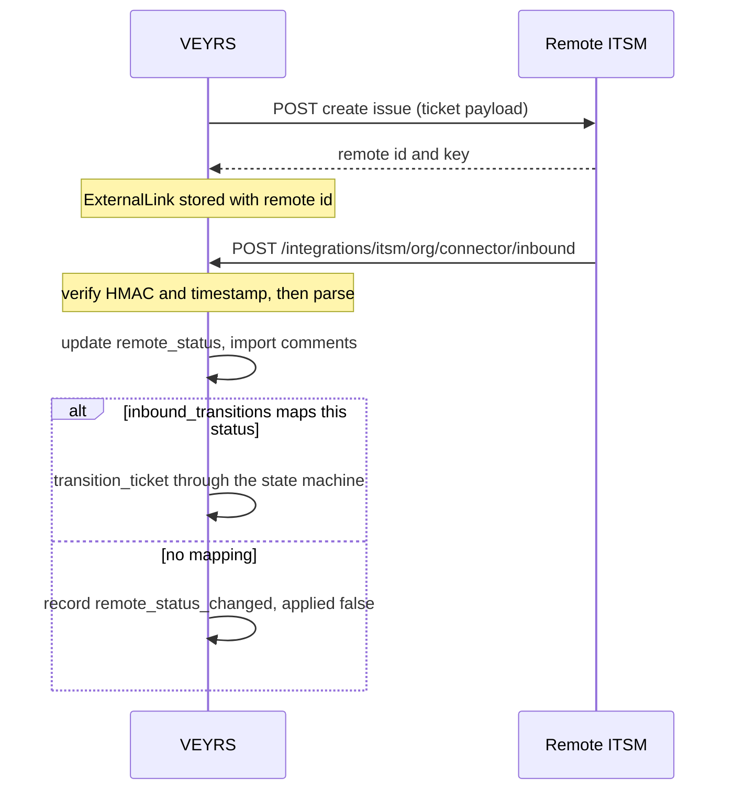

# ITSM, CMDB and webhooks

VEYRS is the system of record for the **security finding**; an ITSM system is the system of record for the **work**. Everything below follows from that split: VEYRS pushes work out, an external status never closes a finding, and a runbook published to a wiki stays owned by VEYRS.

## ITSM connectors

A connector is a row in `itsm_connectors`: `slug`, `name`, `system`, `base_url`, encrypted `credentials`, `ticket_types` (empty list means all), `field_mapping`, `is_enabled` (default **true** for ITSM connectors, unlike scanner connectors), `inbound_enabled`, `inbound_transitions`.

| `system` | Endpoint used | Credentials | `field_mapping` keys |
|---|---|---|---|
| `servicenow` | `{base}/api/now/table/{table}` | `{token}` as Bearer, or `{username, password}` as Basic | `table` (default `incident`), `category` (default `security`), `extra_fields` |
| `jira` | `{base}/rest/api/{2 or 3}/issue` | Cloud: `{email, token}` Basic. Data Center: `{token}` Bearer, or `{username, password}` Basic | `api_version` (`3` default, `2` for Data Center), `project_key` (default `SEC`), `issue_type` (default `Task`), `priority_field`, `extra_fields` |
| `webhook` | `POST` to `base_url` itself | optional `{token}` sent as Bearer | `headers` (merged in) |
| `confluence` | wiki pages, see [Confluence](#confluence) | `{email, token}` or PAT | `space_key`, `parent_page_id`, `deployment` |

Jira Cloud uses Atlassian Document Format for the description and Data Center a plain string; the version in `field_mapping` selects the pair. A Jira credential with none of `email`, `token` or `username` is named as an error rather than sent empty. ServiceNow priority maps critical to 1, high 2, medium 3, low 4. The ServiceNow link URL always points at `incident.do` even when `table` is another table.

```bash
# Prerequisite: a bearer token with ticket:admin (create/edit) or ticket:write (push).
curl -sS -X POST https://veyrs.example.com/api/v1/integrations/connectors \
  -H "Authorization: Bearer $TOKEN" -H "Content-Type: application/json" \
  -d '{"slug":"jira-sec","name":"Security Jira","system":"jira",
       "base_url":"https://example.atlassian.net",
       "credentials":{"email":"svc-veyrs@example.com","token":"<api-token>"},
       "ticket_types":["remediation"],
       "field_mapping":{"project_key":"SEC","issue_type":"Task"}}'
```

| Route | Permission | Notes |
|---|---|---|
| `GET /integrations/connectors?purpose=ticketing\|documentation` | `ticket:read` | Never returns credentials; `credentials_set` and `inbound_secret_set` are computed flags. |
| `POST /integrations/connectors` | `ticket:admin` | `system` must be a registered adapter; slug unique per organization. An empty credentials object stores nothing. |
| `PATCH /integrations/connectors/{id}` | `ticket:admin` | `system` is not patchable. Omitting `credentials` keeps the stored secret; `{}` clears it. |
| `POST /integrations/connectors/{id}/test` | `ticket:admin` | Step-by-step diagnosis: authenticate, project, issue type; a generic webhook reports `skipped` because it has no read contract. |
| `POST /integrations/connectors/{id}/push/{ticket_id}` | `ticket:write` | Remote failure is `502` and recorded on the connector and the link. |
| `POST /integrations/connectors/{id}/pull?limit=100` | `ticket:write` | Status refresh, see below. |
| `DELETE /integrations/connectors/{id}` | `ticket:admin` | Cascades `external_links`: deleting loses the ticket correspondence. Prefer PATCH to rotate a token. |
| `GET /integrations/tickets/{id}/links`, `GET /integrations/links`, `POST /integrations/links/{id}/refresh`, `POST /integrations/links/{id}/unlink` | `ticket:read` or `ticket:write` | Inspect and manage correspondences. |

Reference: [integrations API](../api/reference/integrations.md).

### Push

`itsm.push_ticket` builds the canonical payload (`reference`, `summary`, `description`, `priority`, `type`, `state`, `labels` `["veyrs","veyrs-<type>"]`, `veyrs_url`, `due_at`), hashes it, and **skips the call when the hash equals the stored `payload_digest`**: an unchanged ticket is never re-sent. First push creates the remote issue and an `ExternalLink` (`object_type=ticket`); later pushes update it. A disabled connector, or a ticket type outside `ticket_types`, is refused. One ticket may be linked into several systems because links are rows, not a column.

### Status pull

`pull_status` reads the remote status into `ExternalLink.remote_status` and nothing else. The route is bounded (default 100 links, least recently pulled first) and reports `not_attempted`, so repeated calls sweep the whole set. **There is no scheduler for it**: nothing calls the route automatically. For a Jira Cloud tenant that cannot reach VEYRS, it is the only monitoring leg; run it from your own cron.

### Inbound webhook

For systems that can reach VEYRS, a push-back is faster than polling.



**Legend.** Solid arrows are HTTP requests; the dashed arrow is the response. The two notes are VEYRS-side steps; nothing in VEYRS moves unless the `alt` branch has a configured mapping.

1. Mint the secret (shown once, `ticket:admin`): `POST /integrations/connectors/{id}/inbound-secret` returns `secret`, `webhook_url`, header names and `replay_window_seconds` (300).
2. Enable: `PATCH` with `inbound_enabled: true`. This is refused with `422` until a secret exists.
3. The remote system signs each delivery:

```http
POST /api/v1/integrations/itsm/example-org/jira-sec/inbound HTTP/1.1
X-VEYRS-Timestamp: 1786500000
X-VEYRS-Signature: sha256=<hex hmac-sha256 over "<timestamp>." + raw body>
Content-Type: application/json
```

The timestamp must be within 300 seconds of the server clock and the body at most 1 MiB. The tenant comes from the **path**, never from the body. Unknown organization, unknown connector and a connector with inbound disabled all answer the same `404 unknown webhook endpoint`; a bad or missing signature or timestamp is `401`. After the signature verifies, a payload with no recognisable remote id, or with no VEYRS link for that remote id, is `422` with a real reason (VEYRS never creates a link from an inbound event; it only tracks twins it pushed). The endpoint has no user credential and is not rate-limited by anything in this module.

Payload shapes parsed: Jira (`issue.id`, `issue.key`, `issue.fields.status.name`, `comment`, `webhookEvent`), ServiceNow (flat, or wrapped in `result`: `sys_id`, `number`, `state`, `comments`), and a generic canonical shape for `webhook` connectors (`remote_id` or `id`, `status`, `key`, `url`, `actor`, `comments`, `event`).

**Behaviour.** By default the event is **advisory**: it updates `remote_status`, `remote_key`, `remote_url` and imports comments onto the ticket. State changes need an explicit mapping, for example `"inbound_transitions": {"Done": "resolved"}` (status text is compared case-insensitively with underscores treated as spaces), and even then the move goes through `ticketing.transition_ticket`. An illegal move is recorded as `remote_transition_refused` and not forced. An unmapped status is recorded as `remote_status_changed` with `applied: false` so the operator can see the mapping they meant to add. Replays are idempotent. Every accepted event writes an `itsm.inbound` audit row.

### External ticketing mode

An organization that already runs Jira can stop VEYRS from keeping a second queue. `PUT /ticketing` (`settings:admin`, refused to team-scoped identities) sets `mode` to `internal` or `external` and, for external, a required `connector_id`. In external mode:

| Operation | Behaviour |
|---|---|
| `POST /tickets` | Refused `409`. |
| `remediation.open_for_finding`, autoticket, workflow `create_ticket` | Redirected: the issue is raised in the external system by `itsm.push_finding`, one per finding (`object_type=finding`). |
| `POST /tickets/{id}/transition`, `GET /tickets` | Still allowed, so existing internal tickets can be finished and audited. |
| Inbound webhook | Allowed; it updates the relation row. |

`push_finding` puts device, address, vulnerability, severity, CVSS, EPSS, KEV, risk score, dates, owning team and the VEYRS finding id in the issue body, so an engineer never has to open VEYRS to start. The link row carries the same relation (finding, asset, CVE, severity, risk, due date). Verified node mode: `internal`, 66 open internal tickets.

### Confluence

`confluence` is a *documentation* connector (`purpose=documentation`). `POST /knowledge/{id}/publish` writes a knowledge article as a wiki page: one-way, idempotent (the same page is updated, not duplicated), no pull. The current Confluence version is read immediately before each write (Confluence needs exactly current plus one), `/wiki` is appended for Cloud hosts, and the v1 content API is used because it works on Cloud and Data Center. `field_mapping` takes `space_key`, `parent_page_id` and `deployment` (`cloud` or `datacenter`, guessed from `.atlassian.net`). `GET /knowledge/{id}/publications` lists where an article was published.

## CMDB and asset sources

An **asset source** reads somebody else's asset inventory and stages it. It never writes `assets` directly.

```text
AssetSource -> ASSET_DRIVERS[driver] -> SourceRecord[] -> sync() -> staging rows -> compare -> promote()
```

| Driver | Input | Credentials | Notes |
|---|---|---|---|
| `file` | CSV, TSV, JSON or XLSX **uploaded** to `POST /asset-sources/{id}/upload` | none | Up to 64 MiB and 50,000 records; needs a `field_map`. The only option when VEYRS may not reach the CMDB. |
| `http_json` | Any JSON API, path list in `collections` | `scheme` (`bearer`, `token`, `header`, `basic`), `token`, `username`, `password`, `header_name`, `page_style` (`next` or `offset`) | The operator declares the field map and optional `record_path`. Page size 200, at most 500 pages. |
| `netbox` | NetBox REST | `{token}` sent as `Authorization: Token` | Closed set of collections: `dcim.devices`, `virtualization.virtual-machines`. Schema is known, so no field map is required; a `field_map` may override. A source with no collections is inert. |

Normalised fields (`KNOWN_FIELDS`): `external_id, name, hostname, fqdn, serial, asset_type, operating_system, os_version, environment, criticality, exposure, data_classification, location, owner_label, team_label, status_label, ip_addresses, mac_addresses, tags`. A value for an enum field that is not one of VEYRS's own enum values is kept under `extra["unmapped"]` and reported, never coerced.

`sync()` matches each record to an existing asset (`matched`), leaves it `unmatched` (the queue of things the register does not know, usually the most useful output of a first import) or lets an operator mark it `ignored`. `mark_absent` defaults to true for a pull and **false for an upload**, because a file may be a filtered extract. A disabled source refuses to sync. Copying values into `assets` is a separate, explicit `POST /asset-sources/promote`, limited to `PROMOTABLE_FIELDS` (not ownership foreign keys). A source can opt in to promotion during sync with `auto_promote` (default off), and may create unknown assets only with `promote_creates_assets` (default off); when two sources disagree, the lower `priority` wins. `GET /asset-sources/compare` shows disagreement between sources.

| Route | Permission |
|---|---|
| `GET /asset-sources/drivers`, `GET /asset-sources`, `GET /asset-sources/{id}`, `GET .../runs` | `importer:read` |
| `POST /asset-sources`, `PATCH`/`DELETE /asset-sources/{id}`, `POST .../test` | `importer:admin` |
| `POST /asset-sources/{id}/sync`, `POST .../upload` | `importer:write` |
| `GET /asset-sources/summary`, `/compare`, `/records`, `PATCH /records/{id}`, `POST /promote` | `asset:read` or `asset:write` |

Like scanner connectors, sources are **not scheduled**: `trigger` defaults to `manual` and nothing in the timers calls `sync`. The verified node has one enabled NetBox source. Reference: [asset sources API](../api/reference/asset-sources.md).

### Team import

`GET /teams/import/providers`, `POST /teams/import/preview`, `POST /teams/import`, `POST /teams/import/assign-assets` (`team:write`) bring teams that already exist elsewhere: NetBox tenancy collections (`tenancy.tenants`, `dcim.sites`, `tenancy.contact-groups`) via an existing NetBox source, and LDAP groups via the directory integration. **It never deletes a team** (absent teams are reported as orphans) and **never creates a user** (membership maps to accounts that already exist).

### Fleet collector

`integrations/fleet-import/collect_fleet.py` builds an inventory JSON over SSH from an existing register plus each host's package manager (read-only: one `/etc/os-release` read and one package query per host; unreachable hosts are recorded as skipped). The file has the shape `{"hosts": [{name, hostname, fqdn, ip_addresses, ..., items: [{cpe|vendor, product, version, raw_version, install_path}]}]}` and is loaded by either of:

```bash
# On an app node, as root. Initial load of assets and software from a collector file.
cd /opt/veyrs/backend && set -a && . ../.env && set +a
PYTHONPATH=. ../venv/bin/python -m veyrs import-inventory --file /root/fleet.json --org example-org \
  --source cmdb --no-correlate
# or, same payload: POST /api/v1/assets/inventory/import   (asset:write)
```

`--replace` treats the file as the complete inventory for `--source` and drops what it no longer lists; `--no-correlate` loads without raising findings yet. An asset register without versions produces zero findings, because the version comparator refuses to judge an unknown version.

## Directory integrations

LDAP, RADIUS and OIDC are sign-in integrations configured at `/ldap`, `/radius`, `/oidc` (`settings:admin`, each with a `/test` route) and `/auth/oidc/*`. They are documented with the security model in [Security](../SECURITY.md); the integration-specific facts here are only that LDAP groups can feed [team import](#team-import) and that MFA codes can be delivered by e-mail or Telegram ([Notifications](notifications.md#telegram)).

## Risks specific to this area

- Connector, scanner and CMDB `base_url` values are administrator-supplied and the HTTP clients apply no address allow-list: a connector administrator can make the API server request any URL it can reach. Restrict `ticket:admin` and `importer:admin` accordingly.
- Connector requests are synchronous inside the API request, with 30 s (ITSM) or 60 s (scanner, CMDB) timeouts.
