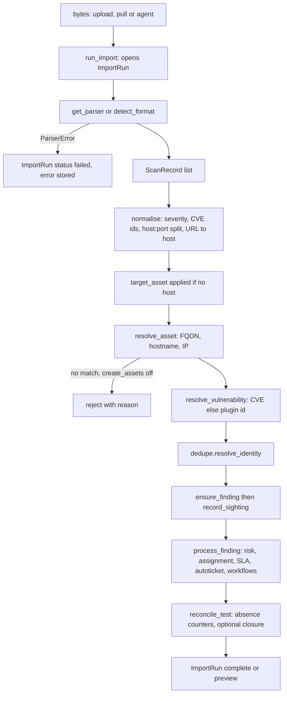

# Scanner import and connectors

Every vulnerability observation, whether it comes from an uploaded file, a pulled console export or an agent run, goes through one pipeline. Parsers only translate; all judgement is in `ingest()`.



**Legend.** Rectangles are steps in `services/importers/__init__.py` and `base.py`; the two terminal boxes are the only outcomes recorded on `import_runs`. A rejection removes one record, not the run (its host still counts as covered for reconciliation). A `ParserError` removes the whole file. `reconcile_test` counts absences only on assets the run covered (ADR 0009).

## Submitting a file

```bash
# Prerequisite: a bearer token with importer:write. Run from any host that can reach the API.
curl -sS -X POST https://veyrs.example.com/api/v1/integrations/imports \
  -H "Authorization: Bearer $TOKEN" \
  -F file=@scan.nessus -F source=nessus \
  -F create_assets=false -F min_severity=low
```

The response is the `ImportRun`, status `201` even when the run itself failed: read `status` and `error`, not the HTTP code.

| Form field | Default | Meaning |
|---|---|---|
| `file` | required | Up to 128 MiB (`MAX_IMPORT_BYTES`). An empty file is `422`; larger is `413`. |
| `source` | sniffed | One of the parser names below. An unknown name is `422`. Omit to let `detect_format` choose. |
| `create_assets` | false | Create assets the scanner reports and VEYRS does not know (`new_asset_criticality`, `new_asset_exposure` apply). |
| `target_asset` | none | Asset name for reports with no host of their own. |
| `min_severity` | none | Skip records below `informational`, `low`, `medium`, `high` or `critical`. |
| `dry_run` | false | Parse and report; the API rolls the transaction back and keeps nothing except the response. |
| `engagement_id`, `test_id`, `reuse_test` | default engagement, reuse | Where the import lands. See [Reimport closure](#reimport-closure). |
| `close_absent`, `absence_threshold` | engagement default | `absence_threshold` must be 0 to 30. `close_missing=true` is a deprecated alias for `close_absent` with threshold 1. |
| `version`, `branch_tag`, `commit_hash`, `build_id` | none | CI provenance stamped on the test. |
| `import_inventory`, `inventory_from_plugin_output` | false | See [Host inventory](#host-inventory-from-a-scan-report). |

`ImportOptions.dedupe_config` and `allow_empty` exist in code but are **not** form fields: they cannot be set through this endpoint.

`GET /integrations/importers` lists the parser names and option help. `GET /engagements/dedupe-registry` lists each scanner's algorithm and fields (verified live: 23 entries). Reference: [integrations API](../api/reference/integrations.md), [engagements API](../api/reference/engagements.md).

### Format detection

`detect_format(payload, filename)` is a fallback; naming the source is always safer.

1. Filename ending `.nessus`, or `NessusClientData_v2` in the first 2 KB: `nessus`.
2. Payload starting with `{` or `[`: first `detect_modern_format`. A filename that starts with, or contains `-` or `_` before, a parser name wins (`codeql-results.sarif` becomes `codeql`, not `sarif`). Then content markers: SARIF `runs`+`tool`, Trivy `ArtifactName`, Grype `matches`+`vulnerability`, ZAP `site`+`alerts`, Checkov `check_type`+`failed_checks`, Bandit `issue_severity`, Gitleaks `RuleID`+`Fingerprint`/`StartLine`, Dependabot `security_advisory`, npm audit `vulnerabilities`+`via`, pip-audit `vulns`+`dependencies`, Nuclei `template-id`/`templateID`, Prowler `check_id`+`status_code`/`finding_info`/`CheckID`, Semgrep `check_id`+`extra`. Unrecognised JSON falls back to `json`.
3. Payload starting with `<`: `NessusClientData_v2` means `nessus`; `<VULN` or `SCAN_RESULT` means `qualys`; `<nmaprun` means `nmap`; `<result` or `get_reports_response` means `greenbone`; anything else is `ParserError: unrecognised XML report format`.
4. `.csv`, or a comma or semicolon in the first 2 KB: `csv`. Otherwise `ParserError: could not determine the report format`.

## The normaliser rules

These apply to every parser (`ScanRecord.normalise`, `resolve_asset`).

- **Asset identity is matched, never invented.** Order: FQDN, then hostname (also against asset name, against the asset FQDN, and against the left label of the asset FQDN), then IP. IP is last because it is the least stable identity on DHCP networks.
- **No match and `create_assets` off:** the record is rejected with `unknown asset (create_assets is off)`. With it on, VEYRS creates a `server` asset with `external_id=import:<key>`; if that row exists soft-deleted it is revived (deleted flag cleared, identity refreshed from the record) rather than failing the run on the unique `(organization_id, external_id)`. Since 0.41.0 the live assets are indexed once per run rather than read again for every record; the matching rules are unchanged.
- **`target_asset`** supplies the host for records that carry none (SAST, SCA, cloud reports). It is applied only when the record has no `asset_key` (FQDN, hostname or IP), and the asset must still exist or `create_assets` must be on. It is attribution of a named artefact, not inference.
- **`host_is_artifact`** is set by a parser when `hostname` carries an image reference, cloud resource id or repository rather than a network host. It stops `_split_host_port` from cutting `registry.example.com/api:2.4.1` at the colon. A second guard, a shape test, protects parsers that forget the flag. Parsers that set it: Trivy, Grype, Prowler.
- **`host:port` in a host field** (nuclei does this for non-HTTP templates) is split into host and `port` before matching, unless the value looks like a path, contains `@`, or is a bare IPv6 literal.
- **URL-only records** (DAST) are unpacked into FQDN or hostname or IP, port and protocol.
- **Vulnerability identity:** the first CVE the record names that exists in the `cves` table; otherwise a scanner-native vulnerability keyed on `plugin_id` (or a hash of the title). A CVE not yet ingested is flagged for enrichment after the next NVD sync.
- **Scoring:** a CVE-backed finding keeps NVD's values; a finding with no CVE takes the scanner's own CVSS and severity.

### Rejection reasons

A rejected record is counted in `records_rejected`, grouped in `reject_reasons`, and the first 25 are kept in `reject_samples` (reason, title, asset key, plugin id). **Read `reject_reasons` after every import.**

| Reason (verbatim) | Cause |
|---|---|
| `record has no title` | Empty title after trimming. |
| `below min_severity=<value>` | Record is under the floor you set. |
| `unknown asset (create_assets is off)` | No asset matched and creation is off. By far the most common. |
| `record carries no hostname, FQDN or IP` | No usable identity and creation is on. Supply `target_asset`. |
| `inventory pass failed` | The optional inventory read raised; the findings import still succeeded. |

Whole-file failures set `status=failed` and `error` to a `ParserError` message, for example `not a Nessus v2 report (root element is ...)`, `no <result> elements found; not a Greenbone report`, `no <HOST> elements found; not a Qualys VM report`, `invalid JSON: ...`, `CSV has no recognisable title column`, `CSV has no asset identity column (hostname, FQDN or IP)`, `unknown importer '...'`, or an XML entity refusal.

Every XML parser refuses documents that declare entities (`services/xmlsafe.py`), because scanner exports are attacker-influenced input.

## Deduplication in one paragraph

`dedupe.config_for(scanner)` picks an algorithm per scanner label from `SCANNER_REGISTRY`; a scanner not in the registry gets `legacy`. The algorithms: `legacy` (sha256 of organization, asset, CVE or vulnerability id, port, protocol, path), `unique_id_from_tool`, `hash_code` (sha256 over named fields, field names included), and `unique_id_or_hash_code` (the tool's id wins when present, the hash otherwise). The valid field vocabulary is `title, description, severity, cwe, cve, plugin_id, unique_id, file_path, line, component_name, component_version, endpoint, asset, port, protocol, path, vuln_ref`; `endpoint` and `asset` come from the resolved identity, not the record. An algorithm whose inputs are missing falls back to `legacy` with a warning. Scope is `organization` unless the engagement sets `dedupe_within_engagement`, in which case the engagement id is part of the key.

`cve`, like `endpoint` and `asset`, is resolved rather than read from the record: it is the CVE of the vulnerability the record resolved to, else that vulnerability's internal ref (the advisory id). Until 0.41.0 it was read from the record, which has no such attribute, so it hashed as empty and every CVE on one package and asset of Trivy, Grype, Snyk, Dependabot, npm audit and pip-audit merged into the first finding. Findings stored before the fix are at `dedupe_revision` 1; `veyrs dedupe rehash --apply` re-keys them in place, and an import re-keys the one belonging to the same vulnerability if it meets it first, so no finding is duplicated by the upgrade ([lifecycle](../database/lifecycle.md#identity)). A finding that had merged several CVEs keeps the one it was created for; the others appear as their own findings on the next import.

## Per-scanner reference

Columns used in every table: **Schema** is the documented format the parser was written against; **Host** is where the asset identity comes from; **`target_asset`** says whether the report carries its own host; **Dedupe** is the registry entry (algorithm and fields); **Granularity** is what one finding means.

Registered names (`importers.PARSERS`, 21): `nessus, greenbone, openvas, qualys, csv, json, nmap, sarif, codeql, trivy, grype, semgrep, bandit, gitleaks, checkov, nuclei, zap, npm_audit, pip_audit, dependabot, prowler`. Test coverage: `tests/test_phase8_integrations.py` (first five), `tests/test_phase15_parsers.py` (modern parsers), `tests/test_phase20_artifact_identity.py` (artifact identity), `tests/test_fix_ingest.py` (`nmap`, and that every agent tool's parser is registered).

### nessus

| | |
|---|---|
| Format | Nessus v2 XML, `.nessus`. Root must be `NessusClientData_v2`. |
| Schema | Tenable's `.nessus` v2 report format. |
| Host | `HostProperties` tags `host-fqdn`, `host-ip`, `mac-address`, `operating-system`; falls back to the `ReportHost` name. An IP-shaped name is not used as a hostname. |
| `target_asset` | Not needed; hosts are in the report. |
| `host_is_artifact` | No. |
| Dedupe | `legacy` |
| Granularity | One finding per asset, CVE or plugin, port, protocol. |
| Severity | Item severity 0 to 4 maps to informational, low, medium, high, critical. CVSS v3 score and vector preferred over v2. |
| Evidence | `plugin_output` (first 4,000 characters), plugin family. |
| Also | Has an inventory reader (see [Host inventory](#host-inventory-from-a-scan-report)), as does `nmap`. Also the format all three pull connectors fetch. |

### nmap

| | |
|---|---|
| Format | nmap XML (`-oX`). Root must be `nmaprun`. The agent's `nmap` tool produces it. |
| Schema | nmap's documented XML output: `host` with `status`, `address` (`ipv4`, `ipv6`, `mac`), `hostnames/hostname` (`user` is the name the scan was given, `PTR` is reverse DNS), `ports/port` with `state` and `service` (`cpe` children with `-sV`), `os/osmatch`. |
| Host | The `user` hostname, else the first hostname (dotted means FQDN), the first IPv4 or IPv6 address, the MAC, the best `osmatch` as operating system. Hosts whose status is not `up` are skipped. |
| `target_asset` | Not needed. |
| Dedupe | `legacy` (not in the registry). |
| Granularity | One **informational** finding per open port per host, titled `Open port <n>/<proto>`, `plugin_id` `nmap:<proto>/<n>`, so one vulnerability row per port with a finding per host. Only `open` counts; `open\|filtered`, `filtered` and `closed` produce nothing. nmap observes exposure, not vulnerability: no CVE, no severity above informational, no product inferred from a banner. Service name, product, version and CPEs go in `evidence`. |
| Inventory | With `import_inventory`, the service CPEs (CPE 2.2 from nmap, converted) are recorded against the host; banner text is not mined. |

### qualys

| | |
|---|---|
| Format | Qualys VM scan report XML (`HOST`, `VULN` elements). The CSV export is not parsed. |
| Schema | Qualys VM report layout. |
| Host | `DNS` else `NETBIOS` as hostname, `IP`, `OPERATING_SYSTEM`. |
| `target_asset` | Not needed. |
| Dedupe | `legacy` |
| Granularity | One finding per asset, CVE or QID, port, protocol. |
| Severity | 1 to 5 maps to informational, low, medium, high, critical. |

### greenbone and openvas

| | |
|---|---|
| Format | GMP `get_reports` XML (`<result>` elements). `openvas` is an alias of the same parser and stays a distinct scanner **label** on the finding. |
| Host | `<host>` text is the IP; a nested `<hostname>` is the hostname. |
| Dedupe | `greenbone`: `legacy`. `openvas` has **no** registry entry and so also resolves to `legacy`. |
| Granularity | One finding per asset, CVE or NVT oid, port, protocol. |
| Severity | Threat word: Log, Debug and False Positive are informational; Low, Medium, High, Critical map directly. |
| Evidence | NVT oid and QoD. CVSS vector is mined from `cvss_base_vector=` in the NVT tags. |

### csv

| | |
|---|---|
| Format | Delimited text; the delimiter is sniffed from `, ; tab |`. |
| Schema | None. Header aliases in `CSV_ALIASES` (for example `title` accepts `name`, `vulnerability`, `plugin name`, `issue`, `finding`). Extend the aliases to support a new tool's CSV without new code. |
| Host | `hostname`, `fqdn`, `ip_address` columns. The file is refused unless it has a title column and at least one identity column. |
| Dedupe | `legacy` |
| Granularity | One finding per asset, CVE or plugin id, port, protocol. |
| Severity | Words (`critical`, `high`, `moderate`, `info`, and so on). |

### json

| | |
|---|---|
| Format | A bare list, or an object with a `findings`, `results`, `vulnerabilities`, `items` or `data` list. |
| Schema | VEYRS canonical shape or loose objects; keys matched case-insensitively against `JSON_KEYS`. |
| Host, dedupe, granularity | As for `csv`. It is also the fallback when sniffing recognises no specific tool. |

### sarif and codeql

| | |
|---|---|
| Format | SARIF JSON; must contain a `runs` array. |
| Schema | SARIF 2.1.0 (OASIS). `codeql` is an alias of the same parser and keeps its own scanner label. |
| Host | None. Records carry only `file_path` and `line`. |
| `target_asset` | **Required.** Without it every record is rejected `unknown asset (create_assets is off)` or `record carries no hostname, FQDN or IP`. |
| Dedupe | `unique_id_or_hash_code` over `plugin_id, file_path, line, asset`. The tool's id is `<ruleId>:<first fingerprint>` when the result has `fingerprints` or `partialFingerprints`. |
| Granularity | One finding per rule at a file and line on the named artefact. |
| Severity | `security-severity` (0 to 10) wins; otherwise result `level`, then the rule's default level, then `medium`. |
| Other fields | CWE from rule tags, CVE ids from rule id, tags and message. |

### trivy

| | |
|---|---|
| Format | Trivy JSON; needs a `Results` key (older bare arrays are wrapped). |
| Schema | Trivy JSON report (`Vulnerabilities`, `Misconfigurations`, `Secrets` per result). |
| Host | `ArtifactName` (image reference or path). |
| `host_is_artifact` | **Yes.** `target_asset` is used only if `ArtifactName` is absent. The artefact name must still match an asset or `create_assets` must be on. |
| Dedupe | `hash_code` over `cve, component_name, component_version, asset`. |
| Granularity | One finding per CVE per package version per artefact (before 0.41.0, one per package version: see [Deduplication](#deduplication-in-one-paragraph)). |
| Severity | Trivy word. CVSS taken from NVD, then Red Hat, GHSA, Bitnami, then any vendor. Secrets default to `high`. |
| Safety | The matched secret and code lines are never stored. |

### grype

| | |
|---|---|
| Format | Grype JSON with a `matches` array. |
| Host | `source.target` or `userInput`; `host_is_artifact` is set. |
| Dedupe | `hash_code` over `cve, component_name, component_version, asset`. |
| Granularity | As Trivy. Fix versions populate the recommendation. |

### semgrep

| | |
|---|---|
| Format | Semgrep JSON with a `results` array. |
| Host | None; `target_asset` required. |
| Dedupe | `unique_id_or_hash_code` over `plugin_id, file_path, line, asset`. Tool id is `<check_id>:<fingerprint>` when a fingerprint exists. |
| Granularity | One finding per rule at a file and line. |
| Severity | `metadata.impact` first, then ERROR high, WARNING medium, INFO low, default medium. |

### bandit

| | |
|---|---|
| Format | Bandit JSON; needs `results` or `metrics`. |
| Host | None; `target_asset` required. |
| Dedupe | `hash_code` over `plugin_id, file_path, line, asset`. |
| Granularity | One finding per test id at a file and line. Severity from `issue_severity`; CWE from `issue_cwe`. |

### gitleaks

| | |
|---|---|
| Format | A bare JSON array (or an object with `findings`). Every finding must carry a `RuleID` or the file is refused. |
| Host | None; `target_asset` required. |
| Dedupe | `hash_code` over `title, file_path, line, asset`. The tool fingerprint is stored as `unique_id_from_tool` but not used for matching under `hash_code`. |
| Granularity | One finding per secret location. Severity is always `high`. The secret and match text are removed from stored raw data. |

### checkov

| | |
|---|---|
| Format | Checkov JSON, an object or list of objects with a `results` block; only `failed_checks` are imported. |
| Host | None; `target_asset` required. |
| Dedupe | `hash_code` over `plugin_id, file_path, asset`. |
| Granularity | One finding per check at a file (resource name is evidence, not identity). Ungraded checks are `medium`. |

### nuclei

| | |
|---|---|
| Format | JSON Lines or a JSON array; each record needs `template-id` or `templateID` (an empty file is accepted as a clean scan). |
| Schema | Nuclei `-jsonl` output. |
| Host | `matched-at`, `matched` or `host`: a URL is unpacked into host, port and protocol; a bare value is the hostname. |
| `target_asset` | Not needed. |
| Dedupe | `unique_id_or_hash_code` over `plugin_id, endpoint, severity`. Tool id is `<template-id>:<matcher>:<matched-at>`. |
| Granularity | One finding per template match per URL, because Nuclei reports one match per location. |
| Severity | Nuclei `info.severity`; CVSS, CVE and CWE from `classification`. |
| Live | Observed: nuclei imports complete with `unique_id_or_hash_code`, 0 rejects. |

### zap

| | |
|---|---|
| Format | ZAP JSON report with a `site` (object or array) containing `alerts`. |
| Host | `@host`, `@port`, `@ssl` of the site; URLs from instances. |
| Dedupe | `hash_code` over `title, cwe, asset`. The endpoint is deliberately **not** in the hash. |
| Granularity | One finding per **alert** per asset, with every instance attached as an endpoint. ZAP reports one alert with many instances, so it is triaged once and fixed in N places. |
| Severity | `riskcode` 0 to 3 maps to informational, low, medium, high. HTML tags are stripped from descriptions. |

### npm_audit

| | |
|---|---|
| Format | `npm audit --json`, npm 7+ (`vulnerabilities` with `via` chains) or npm 6 (`advisories`). Purely transitive entries are skipped so the real advisory is not double counted. |
| Host | None; `target_asset` required. |
| Dedupe | `hash_code` over `cve, component_name, asset`. |
| Granularity | One finding per advisory per package. `file_path` is `package.json`. |

### pip_audit

| | |
|---|---|
| Format | pip-audit JSON, a `dependencies` list (or bare list) where at least one entry has `vulns`. |
| Host | None; `target_asset` required. |
| Dedupe | `hash_code` over `cve, component_name, asset`. |
| Severity | **None**: pip-audit reports no severity and the parser does not invent one; CVE enrichment supplies it later. `file_path` is `requirements.txt`. |

### dependabot

| | |
|---|---|
| Format | GitHub REST Dependabot alert list (array, or object with `alerts`); needs `security_advisory`. |
| Host | None; `target_asset` required. |
| Dedupe | `hash_code` over `cve, component_name, asset`. Tool id `dependabot:<alert number>` is stored. |
| Granularity | Alerts whose `state` is not `open` or `auto_dismissed` are skipped, so a decision made on GitHub is not resurrected. |

### prowler

| | |
|---|---|
| Format | JSON Lines or array; native or OCSF (`check_id`, `status_code`, `finding_info`, `CheckID`). Only `FAIL`, `FAILED` and `MANUAL` rows are imported; `PASS` rows are dropped. |
| Host | Resource uid, else account uid, as an artefact id; `host_is_artifact` is set. |
| Dedupe | `hash_code` over `plugin_id, asset, title`. |
| Granularity | One finding per check per cloud resource. |

### Registry entries without a parser

`burp`, `nikto`, `snyk` and `aws_security_hub` have a `SCANNER_REGISTRY` entry but **no parser**: `source=burp` is refused with `unknown source`. The entries are ready for a parser to be added ([Extending](extending.md#add-a-scanner-parser)). `openvas` is the reverse: a parser with no registry entry.

## Reimport closure

Closure is the part of the importer most likely to surprise an operator. [ADR 0006](../ADRs/0006-no-autoclose-on-absence.md) set the principle: a scan omitting a finding is evidence, not proof. [ADR 0009](../ADRs/0009-closure-per-covered-asset.md) supersedes its mechanism and records what the code does since 0.41.0: closure after N **consecutive** absences (N by engagement type), within the scan test, and only on assets the run covered. The default `Continuous scanning` engagement is `scheduled`, so closure is on by default for imports that name no engagement.

### What is a scope

Every import lands in a **test**: `ScanTest` = (engagement, scanner label). With no `engagement_id` the import lands in the engagement `Continuous scanning` (type `scheduled`, slug `continuous-scanning`). With `reuse_test=true` (default) the test is reused, which is what lets tonight's import be compared with last night's. `reuse_test=false` opens a new test every time, which is right for a pentest and means no reconciliation ever happens.

Each finding the test has reported has a **sighting** (`TestFinding`) with a `consecutive_absences` counter. After each import, every sighting whose finding was not touched by this import, is on an asset **this run covered**, and is still in a state an observed fix may leave (open, but not already `remediated` or in `verification`) gets its counter incremented. A seen finding resets to 0. A sighting on an asset the run did not cover is left exactly as it was.

### What a run covers

| Source of coverage | Example |
|---|---|
| An asset any record of the run resolves to, including records then rejected for `min_severity` or a missing title | A Nessus host that reported only informational items still covers that host |
| `target_asset` | A SAST upload about one repository |
| `ImportOptions.covered_targets` (service-level; not an upload form field) | A caller asserting it scanned a host that came back clean |
| The agent job target, when the agent's coverage check attested the scan (`coverage_attestation.attested = true`) | An empty nuclei result for `app.example.com` |

Targets resolve against existing assets with the normaliser's rules; a name that matches nothing covers nothing and a CIDR is not expanded. So a host-less export (a header-only CSV, an empty JSON list) covers nothing and closes nothing on its own.

### Thresholds by engagement type

| Engagement type | Default consecutive absences before closure | Why |
|---|---|---|
| `ci_cd` | 1 | A build either contains the dependency or does not. |
| `scheduled` (includes the default `Continuous scanning`) | 2 | Hosts come and go; one missed run is not a fix. |
| `interactive` | 0, never | Human assessments are not repeated sweeps. |

Source: `DEFAULT_ABSENCE_THRESHOLD`. Resolution order for one import: an explicit `absence_threshold` wins; otherwise `close_missing=true` means 1; otherwise the engagement type's value. `close_absent` defaults to "closure is on when the threshold is above 0". Consequences worth knowing:

- `absence_threshold=0` disables closure even when `close_absent=true`.
- `close_absent=true` on an `interactive` engagement with no explicit threshold still closes nothing, because the default threshold is 0.
- A pull connector stores `absence_threshold` default **0**, so enabling `close_absent` on a connector without also setting a threshold of 1 or more never closes anything.

A closed finding moves to `remediated` and the event records `reason: "absent from scanner export"`, `evidence: "absence"` (explicitly *not* a verified fix), the test, engagement, consecutive count, threshold, the absent import run ids and any coverage attestation. A finding that reappears after `remediated` is reopened as a regression, not duplicated.

### Per-scanner behaviour

The thresholds depend on the **engagement**, not on the scanner, so the table is the same for every parser. What differs per scanner is the **scope** (the test is per scanner label) and the typical import shape.

| Scanner label | Test scope | Typical use | Practical threshold |
|---|---|---|---|
| `nessus`, `qualys`, `greenbone`, `openvas`, `csv`, `json` | one test per label per engagement | scheduled sweeps | 2 in `Continuous scanning` |
| `sarif`, `codeql`, `semgrep`, `bandit`, `gitleaks`, `checkov` | one per label per engagement | CI on a repository | 1 in a `ci_cd` engagement |
| `trivy`, `grype`, `npm_audit`, `pip_audit`, `dependabot` | one per label per engagement | CI on an image or lockfile | 1 in a `ci_cd` engagement |
| `nuclei`, `zap` | one per label per engagement | DAST sweeps | 2 in a scheduled engagement |
| `prowler` | one per label per engagement | cloud posture sweeps | 2 in a scheduled engagement |

Aliases are separate tests: `nessus` and `openvas` never share a sighting set, and neither do `sarif` and `codeql`.

Until 0.41.0 the sighting set belonged to the test alone, so a partial export, or an agent job against host B (jobs for different targets share the engagement's test for their scanner), counted absences on every host the test had ever reported and closed them. Coverage is the fix; the per-test scope is kept. Source: `engagements.reconcile_test`, `importers/base.py` `ingest`, `ImportOptions.attested_targets`.

### Reading a run

```json
{
  "status": "complete", "records_seen": 4120,
  "findings_created": 380, "findings_updated": 3610, "assets_created": 0,
  "records_rejected": 130,
  "reject_reasons": {"unknown asset (create_assets is off)": 130},
  "stale_candidates": 42,
  "findings_marked_absent": 42, "findings_closed_absent": 0,
  "dedupe_algorithm": "legacy"
}
```

`stale_candidates` is the count of findings the test reported before, on assets this run covered, and did not report now, whether or not they were closed. A dry run has `status: "preview"`. Re-uploading a byte-identical file is detectable through `content_hash`; `previous_run_with_hash` exists in code, but the upload route does not warn, so identical files are processed again (they update, not duplicate).

## Scanner connectors (pull)

Three drivers fetch a `.nessus` export from a console and feed it to `run_import` with `source=nessus`, so a pull cannot introduce a second deduplication rule.

| Driver | Console | Credentials | Transport |
|---|---|---|---|
| `nessus` | Nessus Professional or Manager | `access_key`, `secret_key` | `X-ApiKeys` header; `POST /scans/{id}/export`, poll status every 3 s up to 120 s, download |
| `tenable_io` | Tenable Vulnerability Management | `access_key`, `secret_key` | Same API; default base `https://cloud.tenable.com` |
| `tenable_sc` | Tenable Security Center | `username`, `password` | Session token (`/rest/token`) plus cookie; `/rest/scanResult`; the download is a zip and the report member is extracted |

Exports are capped at 128 MiB (`MAX_EXPORT_BYTES`). The poll runs inside the request: a sync of large scans holds an API worker for the duration.

```text
GET    /api/v1/integrations/scanner-drivers          importer:read
GET    /api/v1/integrations/scanners                 importer:read
POST   /api/v1/integrations/scanners                 importer:admin   create (disabled, inert)
PATCH  /api/v1/integrations/scanners/{id}            importer:admin
DELETE /api/v1/integrations/scanners/{id}            importer:admin
POST   /api/v1/integrations/scanners/{id}/test       importer:admin   check credentials, import nothing
GET    /api/v1/integrations/scanners/{id}/scans      importer:read    what the console holds
POST   /api/v1/integrations/scanners/{id}/sync       importer:write   body: scan_ids, force, dry_run
```

Safeguards, each enforced in `services/scanners.sync` and the create and patch routes:

1. Created **disabled**. A disabled connector refuses to sync.
2. An empty `allowed_scans` makes the connector **inert**.
3. A `scan_ids` value outside `allowed_scans` is rejected, not filtered.
4. `close_absent` requires an `engagement_id`, on create, on patch (validated against the resulting row) and again at sync time.
5. One `ImportRun` per scan, so a rejection count is attributable.
6. A byte-identical export is skipped using the stored sha256 per scan in `sync_state`; `force` overrides. A dry run writes no `sync_state`.
7. Credentials are Fernet-encrypted; an undecryptable credential fails closed.
8. `verify_tls` defaults true.

There is **no scheduler** for scanner connectors: nothing in the timers, CLI or compose stack calls `sync`. It runs only when someone (or an external cron) calls `POST .../sync`. `GET /integrations/scanners` on the verified node returned an empty list.

Permissions reuse `importer:*`; the router is in `security.scope.REFUSED_TAGS`, so a team-scoped identity is refused rather than shown a narrowed view.

## Host inventory from a scan report

A Nessus export says what is wrong with each host and also what it has. With `import_inventory`, VEYRS reads the same bytes a second time and records installed software against the asset. This is what the correlation engine joins CVEs against: without inventory, `affected_installations` is empty and an estate looks unaffected.

| Where | Option | Default |
|---|---|---|
| Upload | `import_inventory` form field | false |
| Scanner connector | `import_inventory` | **true** |
| Both | `inventory_from_plugin_output` | false |

The asymmetry is deliberate: a person uploading one file is triaging it; a connector exists to keep VEYRS fed.

Identity comes from, in order of authority:

1. **CPE tags** in `HostProperties` (`cpe`, `cpe-0`, `cpe-1`, ...). Nessus emits CPE 2.2 URIs, converted by `versions.cpe22_to_cpe23`. The scanner names the dictionary entry, so there is no inference.
2. **Software-enumeration plugin output** (plugin 20811 on Windows, 22869 over SSH), only when `inventory_from_plugin_output` is on. Lines that do not match a known rpm, dpkg or `[version ...]` shape are skipped, not approximated.

Rules: it never prunes (a partial or unauthenticated scan does not erase earlier knowledge); it attaches to hosts VEYRS already knows unless `create_assets` is on; a dry run writes nothing; its failures are recorded as `inventory pass failed` without failing the findings import. `inventory_hosts`, `inventory_added`, `inventory_updated` and `inventory_unmatched` are on the run; an unmatched install is a name to fix, not a safe host. `GET /assets/inventory/coverage` lists the offenders. Detected-by labels are `scanner:<source>` or, for connectors, `connector:<slug>`.

A known consequence: NVD sometimes carries two dictionary entries for one product, so the same software reported through a scanner CPE and through the agent can occupy two `AssetProduct` rows. `detected_by` tells which channel produced which row.

## Sources

- Pipeline: `services/importers/__init__.py:run_import`, `base.py:ingest`, `resolve_asset`.
- Parsers and detection: `importers/parsers.py:417-470`, `parsers_modern.py:887-957`.
- Dedupe: `services/dedupe.py:SCANNER_REGISTRY`, `_field_value`; live `GET /api/v1/engagements/dedupe-registry`.
- Closure: `services/engagements.py` `DEFAULT_ABSENCE_THRESHOLD`, `reconcile_test`; `correlation.observe_fix`; ADR 0009.
- Connectors: `services/scanners.py`, `api/v1/integrations.py:779-1060`.
