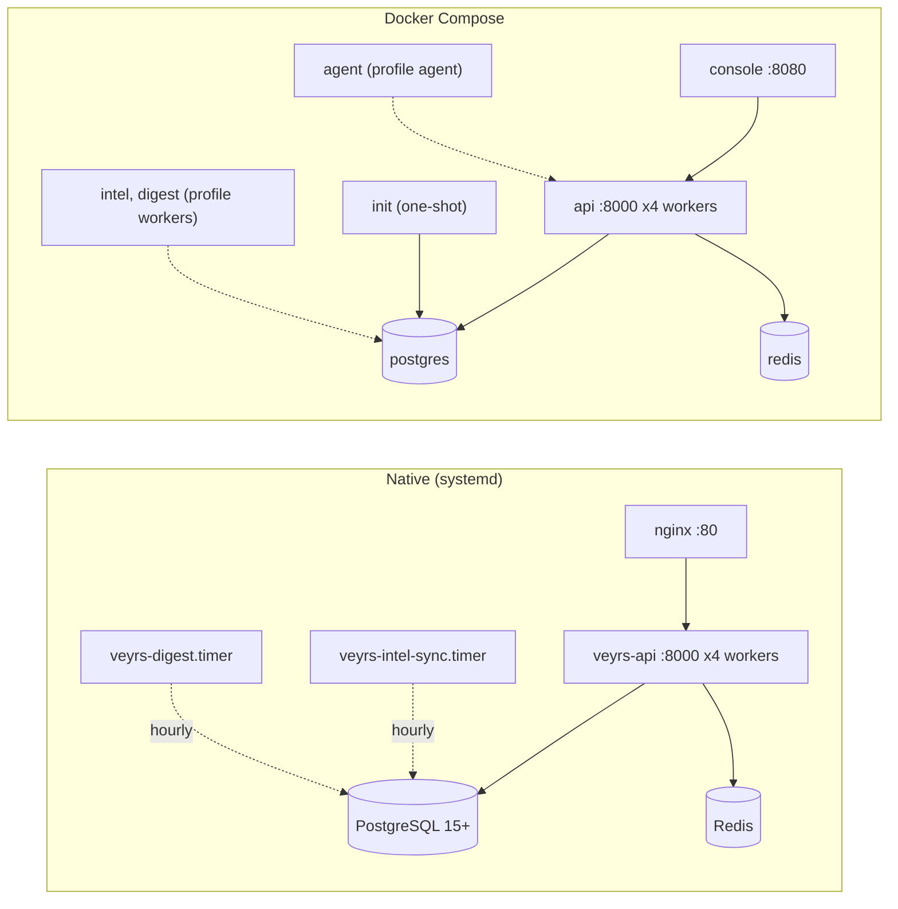

# Operations manual

This is the entry point for the people who run VEYRS: install it, keep it healthy,
upgrade it, back it up and recover it. Everything here was read from the code and
scripts of the 0.39.1 source tree. Where a statement was also observed on a running
installation, the "Status" column says `Verified`; otherwise it says `Implemented`.

## The documents

| Document | Read it when you want to | Status |
|---|---|---|
| [Installation](installation.md) | install VEYRS from nothing, natively or with Docker Compose, and verify a release first | Implemented |
| [Services](services.md) | know every systemd unit, timer, container, nginx vhost, port and header VEYRS ships | Verified |
| [Upgrade and rollback](upgrade-rollback.md) | move to a new version, check it landed, restart safely or go back | Implemented |
| [Monitoring](monitoring.md) | probe health, scrape metrics, read logs and decide what to alert on | Verified |
| [Backup and disaster recovery](backup-dr.md) | take a backup that restores, rehearse it, rotate keys, recover | Implemented |
| [Release](release.md) | produce, sign and publish a release | Implemented |
| [Troubleshooting](../troubleshooting/README.md) | find a symptom and its fix | Implemented |
| [System manual](../SYSTEM_MANUAL.md) | look up a setting, a CLI command, a surface or an integration | Verified |
| [High availability](../HIGH_AVAILABILITY.md) | run two application nodes and a database standby | Implemented |
| [Docker Compose manual](../DOCKER_COMPOSE_MANUAL.md) | operate the container stack in depth | Implemented |
| [Configuration reference (generated)](../reference/configuration.md) | see every `VEYRS_*` setting with its type and default | Implemented |

## Conventions used in these documents

**Roles of a host.** An *application node* runs `veyrs-api` and nginx. A *database
node* runs PostgreSQL (and, in the reference topology, Redis). On a single-node
install one host plays both roles. Each command says which role it runs on.

**The `veyrs` command.** The CLI is a Python module, not an installed program
(`pyproject.toml` declares no console script). Everywhere these documents write
`veyrs <command>`, they mean this, run from the install root so that `.env` is
found (`config.Settings` reads `.env` from the current directory):

```bash
cd /opt/veyrs
veyrs() { PYTHONPATH=backend venv/bin/python -m veyrs "$@"; }
veyrs check
```

`python -m veyrs.cli <command>` is equivalent. In the Docker stack the same
command is `docker/veyrs-docker.sh cli <command>` (or `veyrs-docker cli <command>`
on an install made by `veyrs-setup.sh`). The full command list is in the
[System manual §3](../SYSTEM_MANUAL.md#3-command-line-reference).

**Paths.** `/opt/veyrs` is the install root of a native install (`install.sh`,
`VEYRS_DIR`). `/opt/veyrs-docker` is the root of a Docker install made by
`veyrs-setup.sh`. `/var/www/veyrs-console` is the console document root.
Examples use `veyrs.example.com` and the RFC 5737 range `192.0.2.0/24`.

**Destructive commands** are marked with a CAUTION callout and say what they destroy.

## Deployment shapes



**Legend.** Boxes are processes or containers, cylinders are data stores, solid
arrows are request paths, dotted arrows are background work. In Docker the
`init` container runs once per `up`, before `api`.

| Shape | Installed by | Intended use | Verified |
|---|---|---|---|
| Single node, native | `veyrs-setup.sh` (native) or `install.sh` | an installation you operate | Implemented |
| Two application nodes and a database node | `install.sh --skip-postgres --skip-redis` on each application node | production ([High availability](../HIGH_AVAILABILITY.md)) | Verified |
| Docker Compose | `veyrs-setup.sh` (Docker) or `docker/veyrs-docker.sh` | evaluation, development, a small single node | Implemented |

The Docker stack is not a smaller production: it puts the application and its
database in one Compose project (`docker/compose.yaml`, header comment).

## Requirements

### Hardware

| Resource | Hard minimum | Recommended | Source |
|---|---|---|---|
| CPU | 1 core (warning below 2) | 2 vCPU for fewer than 50,000 findings; 4 vCPU from 50,000 | `veyrs-setup.sh` `check_requirements`; `INSTALL.md` Sizing |
| RAM | 2 GB (the installer refuses below ~1.9 GB) | 4 GB; 8 GB from 50,000 findings; building images needs 4 GB | `veyrs-setup.sh` `check_requirements` |
| Disk on `/` | 5 GB (installer refuses below) | 12 GB for Docker mode; **60 GB** for a single node with the default EPSS retention; 100 GB for a database node that also holds WAL and dumps | `veyrs-setup.sh`; `INSTALL.md` Sizing |

CPU and RAM follow the number of findings. **Disk follows the intelligence feeds**,
not the findings: the NVD corpus, CPE dictionary and EPSS take about 5 to 6 GB
after the first sync, and `epss_history` adds about 80 MB per scored day for
`VEYRS_EPSS_HISTORY_DAYS` days (default 365, roughly 30 GB; 90 days is roughly
7 GB). The default retention is in `backend/veyrs/config.py`
(`epss_history_days`).

Each API worker process can open up to 30 PostgreSQL connections (pool 10,
overflow 20, `backend/veyrs/db.py`). The unit runs four workers, so one API node
can reach 120 connections at peak while PostgreSQL's stock `max_connections`
is 100. Raise `max_connections` on the database before raising the worker count
or adding application nodes.

### Software

| Component | Requirement | Where it is enforced |
|---|---|---|
| Operating system | Debian 12, Ubuntu 24.04 (tested); Ubuntu 22.04, Debian 13 (same family); Rocky or AlmaLinux 9 (tested), RHEL 9; openSUSE Leap 15.6 (tested), SLES 15. x86-64. systemd is mandatory for `veyrs-setup.sh` | `veyrs-setup.sh` `detect_os`; `install.sh` header |
| Python | 3.11 or newer, with `venv`, `ensurepip`, `ssl`, `sqlite3`, `lzma` and `pyexpat` importable | `install.sh` `MIN_PY_MINOR=11`, `PY_STDLIB_PROBE` |
| PostgreSQL | 15 or newer, database encoding **UTF8**, application role not a superuser and without `BYPASSRLS` | `install.sh` `MIN_PG_MAJOR=15`; `veyrs-setup.sh` `evaluate_role` |
| Redis | 7 or newer in practice (the Docker stack runs `redis:7`); `requirepass` is set by `install.sh` when Redis is local | `docker/compose.yaml`; `install.sh` step 3 |
| nginx | any current release | `install.sh` step 8 |
| Docker (Docker mode) | Engine with Compose v2.20 or newer; not `docker-compose` v1 | `veyrs-setup.sh` `ensure_docker` |
| OpenSSH client | `ssh-keygen` from OpenSSH 8.1 or newer, to verify release signatures | `veyrs-setup.sh`, `scripts/verify-release.sh` |
| PostgreSQL client tools | `pg_dump` and `pg_restore` 15 or newer on the host that backs up | `scripts/backup.sh`, `docker/veyrs-docker.sh backup` |

The installer measures instead of trusting names: it asks Python candidates for
their version, imports the standard-library modules pip needs, reads the nginx
vhost directory out of `nginx.conf`, and tests a password login to PostgreSQL
before it relies on one (`install.sh`, `resolve_python`, `nginx_resolve_site`,
`pg_ensure_password_auth`). Behind SELinux in Enforcing mode it sets
`httpd_can_network_connect` so nginx can reach the API (`selinux_allow_proxy`).

### Ports

| Port | Who listens | Who connects | Notes |
|---|---|---|---|
| 80/tcp | nginx (native) | clients or a TLS proxy | the shipped vhost serves plain HTTP; TLS is yours ([Services](services.md#tls-termination)) |
| 443/tcp | nothing by default | clients | you add it, in nginx or on a proxy in front |
| 8000/tcp | uvicorn, on `127.0.0.1` (native) or the stack network (Docker) | nginx | never publish it |
| `VEYRS_HTTP_BIND`, default `127.0.0.1:8080` | `console` container | proxy or browser | the only published port of the Docker stack |
| 5432/tcp | PostgreSQL | API nodes; standby for replication | one `/32` per node in `pg_hba.conf` |
| 6379/tcp | Redis | API nodes | `requirepass` |

Outbound destinations (feeds, release checks, mail, AI providers, connectors) are
listed with their ports and the setting that moves or disables each in
[Technical requirements, Network](../TECHNICAL_REQUIREMENTS.md) and, for a live
installation, on the console page Administration, Network access
(`GET /api/v1/admin/system/network`, platform administrators only).

## Where state lives

| State | Location | Backed up by |
|---|---|---|
| All data, including uploaded documents (stored as rows in `documents`) | PostgreSQL database `veyrs` | `scripts/backup.sh`, `veyrs-pgdump` ([Backup](backup-dr.md)) |
| `VEYRS_SECRET_KEY`, `VEYRS_ENCRYPTION_KEY`, connection strings | `/opt/veyrs/.env` (mode 0600) | `scripts/backup.sh` copies it into the archive |
| Files under `var/` (backups, update uploads; `var/documents` exists but no code in 0.39.1 writes to it) | `/opt/veyrs/var` | `scripts/backup.sh` archives `var/documents` if it exists |
| Rate-limit windows, MFA codes, SSO hand-offs | Redis | not needed: short-lived |
| Console, docs and product-site files | `/var/www/veyrs-console`, `/var/www/veyrs`, `/var/www/veyrs-web` | rebuilt from the source tree |

Application nodes hold no state of their own beyond `.env` and the document roots
([ADR 0007](../ADRs/0007-stateless-app-nodes.md)).

## Sources

- `install.sh`, `veyrs-setup.sh`, `docker/compose.yaml`, `docker/veyrs-docker.sh`
- `infrastructure/systemd/veyrs-api.service`, `backend/veyrs/db.py`, `backend/veyrs/config.py`
