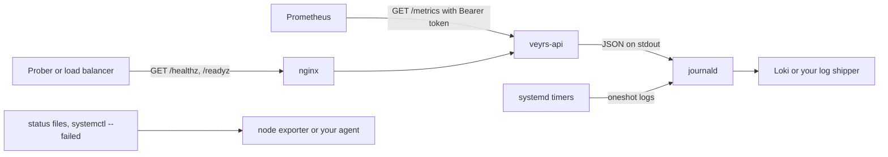

# Monitoring and observability

VEYRS ships probes, one Prometheus endpoint and JSON logs. It ships **no alerting**:
nothing in the product watches a `failed` systemd unit, and `veyrs-intel-sync` once
failed three nights in a row before anyone noticed. Everything below is something
you must wire into your own monitoring.



**Legend.** Boxes are components; labelled arrows are what is read. Only the API,
the units and the status files are VEYRS; the rest is yours.

## Probes

| Endpoint | Auth | Answers | Use for |
|---|---|---|---|
| `GET /healthz` | none | `200 {"status":"ok","app":"VEYRS","version":"0.39.1"}`; no I/O, so it stays 200 when the database is gone | liveness, and **version after a deploy** |
| `GET /readyz` | none | `200 {"status":"ok","checks":{"database":"ok","redis":"ok"}}`, or `503 {"status":"degraded","checks":{"database":"error: <ExceptionType>", ...}}` | readiness; what a load balancer and the container health check use |

Both are exempt from rate limiting (`ratelimit.EXEMPT_PATHS`) and nginx adds
`Cache-Control: no-store`. The Docker `api` container probes `/readyz` every 10 s
(start period 45 s, 6 retries); `/healthz` would report healthy from a process that
lost its database.

```bash
curl -s http://127.0.0.1:8000/healthz
curl -s -w '\n%{http_code}\n' http://127.0.0.1:8000/readyz
```

Observed on the reference installation, 2026-11-17: both nodes answered
`{"status":"ok","app":"VEYRS","version":"0.39.1"}` and `/readyz` 200.

For a deeper check that needs no running API, `veyrs check` self-tests the
configuration, PostgreSQL, Redis, the CVSS engine (three known vectors) and the RBAC
tables and prints `all checks passed` (exit 0) or the failing layer (exit 1).

## `/metrics`

Prometheus text format 0.0.4, implemented without `prometheus_client`
(`observability.metrics_response`).

| Metric | Type | Labels | Meaning |
|---|---|---|---|
| `veyrs_build_info` | gauge, always 1 | `version`, `env`, `worker` (pid) | which build answered, and which worker |
| `veyrs_requests_total` | counter | `method`, `status`, `path` | requests by route **template** (`/api/v1/findings/{id}`); unmatched requests collapse to `<unmatched>`; unhandled exceptions count as status 500 |
| `veyrs_request_duration_ms` | summary | `quantile` 0.5, 0.95, 0.99 plus `_count`, `_sum` | latency over the last 5,000 requests of that worker |
| `veyrs_metrics_series` | gauge | `metric` | label sets held per metric; each metric is capped at 256 series, then new ones collapse into `overflow="1"` |

**Access.** `VEYRS_METRICS_TOKEN` is a Bearer token. Unset: open in development,
**404 in production**. A missing or wrong token also returns **404, not 401**, so a
probe cannot learn that the endpoint exists. The generated nginx vhost and the
container do not proxy `/metrics`; scrape the API directly on the application node
(`127.0.0.1:8000`) from a local exporter or over a private network. An IP allowlist in
nginx is not a control when every request arrives from a reverse proxy: the allowlist
matches the proxy, so the token is the control.

```yaml
# prometheus.yml (scrape the API itself, not the public hostname)
scrape_configs:
  - job_name: veyrs
    metrics_path: /metrics
    authorization:
      type: Bearer
      credentials_file: /etc/prometheus/veyrs-metrics-token   # contains VEYRS_METRICS_TOKEN, mode 0600
    static_configs:
      - targets: ["192.0.2.83:8000"]   # only if the API is reachable; the shipped unit binds 127.0.0.1
```

> [!WARNING]
> The registry lives **in each worker process** and the unit runs four. One scrape
> samples whichever worker answered (the `worker` label on `veyrs_build_info` is the
> pid), counters reset on restart, and `rate()` over successive scrapes mixes
> workers. Treat `/metrics` as a sampled indicator. For exact error and latency
> accounting, count log lines (below), which are not sampled.

## Logs

Everything is JSON on stdout, collected by journald. Nothing writes its own log file
except nginx (`/var/log/nginx/veyrs-console.access.log` and `.error.log`).

```bash
journalctl -u veyrs-api -f                                  # follow
journalctl -u veyrs-api --since '1 hour ago' --no-pager | grep '"level":"ERROR"'
journalctl -u veyrs-intel-sync --since yesterday            # the feed tick, per feed
journalctl -u veyrs-digest --since today
journalctl -u veyrs-agent -n 100 --no-pager
```

A request line (observed):

```json
{"ts":"2026-11-17T06:17:52.764Z","level":"INFO","logger":"veyrs.request","msg":"request","correlation_id":"d7946b0b-c6f1-4998-a9a2-e2ef9cbad71c","path":"/api/v1/agents/self/heartbeat","method":"POST","status":200,"duration_ms":4.2}
```

| Field | Meaning |
|---|---|
| `ts`, `level`, `logger`, `msg` | UTC time, severity, logger (`veyrs.request`, `veyrs.ratelimit`, `veyrs.updates`, `veyrs.secrets`, `veyrs.digest`, ...) |
| `correlation_id` | taken from the caller's `X-Correlation-ID` or generated; echoed in the response header and in error bodies. **Ask users to quote it** |
| `path`, `method`, `status`, `duration_ms` | the request; `path` is the real path here (the metric label is the template) |
| `org_id`, `actor` | present when the request resolved a principal |
| `exc` | formatted traceback on `unhandled error` |

`uvicorn.access` and `sqlalchemy.engine` are set to WARNING, so the request line
above is the access log. A rate-limited request logs `rate limit exceeded path=... ip=...`
from `veyrs.ratelimit`. Responses carry `X-Correlation-ID` and `X-Response-Time-ms`.
The audit trail (`GET /api/v1/audit`, `auth_events`) is application data, not logs:
see [Security](../SECURITY.md).

In Docker: `docker/veyrs-docker.sh logs -f api`, `logs --tail 50 init`,
`logs -f intel digest` (lines such as `tick[intel]: ok at ...` or
`tick[intel]: FAILED (exit N) ... retrying on the next tick`).

## Intelligence-sync health

Stale intelligence is silently wrong prioritisation. Four independent views:

1. **The journal.** Every tick prints a reason for every feed:

   ```text
   skip cwe   723 min since last success, interval 1440 min
   skip nvd   363 min since last success, interval 1440 min
   === run-sla 2026-11-17T06:04:35+00:00 ===
   === done 2026-11-17T06:04:35+00:00, status 0 ===
   ```

   `DUE <feed> never completed successfully` means the feed has never worked.
   `!!! sync-<feed> failed` and `status 1` mean a failure (`veyrs sync-nvd` itself exits 3 when
   some records were rejected by the database, and the script reports that as a failure too). A failed run does not reset the clock:
   the feed stays due and is retried every hour.

2. **The CLI**, any time: `veyrs intel-due` prints `DUE`/`skip` and the reason per feed
   (exit 0 always).

3. **The API.** `GET /api/v1/intel/health` (permission `intel:read`) returns, for
   `nvd`, `epss` and `kev`, `status` (`ok`, `stale` or `never_run`), `age_hours`,
   `records_seen` and `watermark`. Staleness limits are fixed in code: NVD 48 h, EPSS
   48 h, KEV 72 h. **CWE is not in this endpoint**; read it from
   `GET /api/v1/intel/feeds/runs` (`feed`, `status` `succeeded` or otherwise,
   `records_seen`, `started_at`, `finished_at`). `GET /api/v1/intel/schedule` shows the
   effective cadence and `next_due_at`.

4. **The compliance signal** `threat_feeds_active` reports staleness as a control
   finding ([Disaster recovery, continuity of intelligence](backup-dr.md#continuity-of-intelligence)).

Observed on the reference installation, 2026-11-17: NVD age 6.3 h, EPSS and KEV
5.1 h, all `ok`; the tick ran hourly with `status 0`.

> [!NOTE]
> With the timer enabled and `systemctl list-timers` showing a next run, nothing may
> have run: the timer only asks the database which feeds are due. If feeds are
> disabled by every tenant, the answer is `disabled by every tenant` and the tick
> exits 0. Check the journal lines, not the timer state.

## Backup and replication health

The units on the database node record their last result in `/var/lib/veyrs-backup/`:

```bash
cat /var/lib/veyrs-backup/status               # pgdump: status=ok|failed, at, file, bytes, offhost
cat /var/lib/veyrs-backup/verify-status        # weekly restore proof: tables, policies, counts
cat /var/lib/veyrs-backup/replication-status   # status=ok|failed, standby, lag_bytes
systemctl list-timers 'veyrs-*' --no-pager
journalctl -u veyrs-pgdump -u veyrs-pgverify -u veyrs-replcheck --since yesterday --no-pager
```

`veyrs-replcheck` exits non-zero (the unit goes `failed`) when the slot is missing,
inactive or `lost`, the walsender is not `streaming`, or lag exceeds 128 MB of WAL.
The same facts by hand, on the primary:

```sql
select slot_name, active, wal_status from pg_replication_slots;
select client_addr, state, pg_wal_lsn_diff(pg_current_wal_lsn(), replay_lsn) as lag_bytes from pg_stat_replication;
```

Replication lag is measured in **bytes**, not seconds: `replay_lag` reads 0 on an
idle primary whether the standby is current or has just disconnected.

## Agents and scans

An agent that quietly stops scanning looks exactly like an estate with no findings.
Watch: the agent unit (`systemctl is-active veyrs-agent`), the console page
Settings, Agents (status and heartbeat), `GET /api/v1/agents/jobs/summary`, and
queued jobs that never start. The agent heartbeats every 60 s. Abandoned leases are
collected by `POST /api/v1/agents/maintenance/reap` (permission `agent:write`); run it
from cron. A job that completed with no coverage evidence is refused by the server
(`scan coverage refused`), which shows in the job's result.

## What to alert on

| Alert | Condition and source | Severity | Then |
|---|---|---|---|
| API not ready | `/readyz` not 200 for 2 minutes; the body names `database` or `redis` | critical | [readyz 503](../troubleshooting/README.md#readyz-returns-503-database-or-redis) |
| API process down | `/healthz` fails, or `systemctl is-active veyrs-api` not `active` | critical | [API does not start](../troubleshooting/README.md#api-does-not-start-226namespace) |
| Failed unit | `systemctl --failed` lists any `veyrs-*` unit | warning | read `journalctl -u <unit>` |
| Feed stale | `/api/v1/intel/health` `status != ok` for any feed, or `age_hours` above 24 on a daily schedule | warning | [Intelligence sync](../troubleshooting/README.md#intelligence-sync-silently-failing) |
| KEV stale | `kev` age above 72 h | critical: a stale KEV is a missed emergency | same |
| Backup failed or old | `status=failed` in `/var/lib/veyrs-backup/status`, or its `at` older than 26 h | critical | [Backup and DR](backup-dr.md) |
| Restore proof failed | `verify-status` `status=failed` | critical | a backup that does not restore is not a backup |
| Replication unhealthy | `veyrs-replcheck` failed, or `lag_bytes` above 128 MB | critical | [High availability](../HIGH_AVAILABILITY.md) |
| 5xx rate | `status="500"` and `5xx` log lines, or `veyrs_requests_total` with the sampling caveat | warning | quote the `correlation_id` |
| Rate limiting | repeated `rate limit exceeded` log lines from one `ip=` | warning | proxy trust or credential stuffing: [rate limit](../troubleshooting/README.md#all-users-are-rate-limited-as-one-client) |
| Login failures | many `auth_events` with reason `locked`, `throttled` or `unknown_user` (`GET /api/v1/auth-events`) | warning | `throttled`: one address is backing off; `locked`: failures from several addresses locked the account (security/lockout.py) |
| Secret storage | log `secret storage error` or API 503 `secret_storage_unavailable` | critical | `veyrs secrets status` |
| AI blocked-call spike | `ai_audit_log` decisions `blocked` rising | info | `GET /api/v1/ai/audit` |
| Disk | database node volume above 80 % | warning | `epss_history` grows about 80 MB per day: lower `VEYRS_EPSS_HISTORY_DAYS` |
| Certificates | expiry of the TLS certificate on your proxy | warning | VEYRS ships no ACME client |
| Agent silent | agent heartbeat older than 3 minutes while jobs are queued | warning | agent unit and token |

## Sources

- `backend/veyrs/main.py` (`healthz`, `readyz`, `metrics`), `backend/veyrs/observability.py`
- `backend/veyrs/security/ratelimit.py`, `backend/veyrs/api/v1/intel.py` (`/health`), `backend/veyrs/services/intel_schedule.py`
- `backend/veyrs/cli.py` (`check`, `intel_due`), `scripts/sync-intel.sh`, `infrastructure/backup/*.sh`
- Live read-only observation of the reference installation, 2026-11-17 (probe answers, metric names, log lines, intel health)
