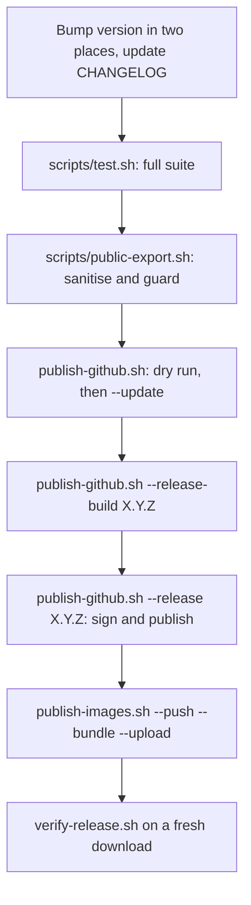

# Release process

A release is a **sanitised derivative** of the maintainer's working tree. The working
tree is the running deployment, so it contains things that must never be public; the
public tree is produced deterministically by a script, checked by guards, and only
then published as one commit with signed assets.



**Legend.** Boxes are steps, in order. Every step stops the pipeline on failure;
nothing after a failed guard may be run by hand to "get past it".

## Version in two places

The version lives in `pyproject.toml` (`version = "X.Y.Z"`) **and** in
`backend/veyrs/config.py` (`Settings.version`). `/healthz`, `/metrics`
(`veyrs_build_info`) and the API title serve the second one; installers, the updater
and the image labels read the first. A release that bumps only `pyproject.toml`
reports the old number after a correct deploy.

`tests/test_phase24_dependencies.py` fails if the two differ, and
`scripts/publish-images.sh` refuses to build when they do.

Also in the same change: add the entry to `docs/CHANGELOG.md`, and regenerate the
dependency lock if `pyproject.toml` changed (`./scripts/freeze-deps.sh`, run in the
venv a node really uses; commit it with `pyproject.toml`). `requirements.txt` is the
full pinned graph and is what installers use; `pyproject.toml` lists direct
dependencies only.

## Tests

```bash
./scripts/test.sh                                   # the whole suite
./scripts/test.sh tests/test_phase46_risk_register.py
```

**Never run bare `pytest`.** `scripts/test.sh` is the canonical entry point:

| What it does | Why |
|---|---|
| sources `.env`, then sets `VEYRS_ENVIRONMENT=development` | the suite must not run production's guards, and needs `VEYRS_DATABASE_URL` |
| points the suite at `VEYRS_TEST_DATABASE_URL`, deriving it by replacing only the trailing `/veyrs` with `/veyrs_test` | a naive substitution hits the `//veyrs:` in the user part first. A name that does not end in `_test` is not known to be a test database, and `tests/conftest.py` refuses it ("no test database configured") so the suite never runs against production |
| sets both rate limits to 100000 | hundreds of calls from one identity; the limiter has its own test with a small limit |
| blanks `VEYRS_SMTP_HOST` and `VEYRS_TELEGRAM_BOT_TOKEN`, keeps `VEYRS_NOTIFY_EMAIL_ENABLED=true` | a node's `.env` may point at a real mail relay or chat bot; tests must never hand fixture addresses to a live channel, and the notification tests assert the "no relay configured" path |

Documentation guards run with everything else and fail a release that lets a manual
drift (`tests/test_docs_are_current.py`): the generated schema reference must match
the models (`python3 scripts/gen-schema-doc.py`, then `--check`), the database manual
must state the real table count, every setting in `config.Settings` and every CLI
command must appear in `docs/SYSTEM_MANUAL.md`, every shipped unit's `ExecStart` must
exist, and the recovery manual must warn about the row-level-security backup trap and
say to verify a dump with `pg_restore --list`. Container work has two more checks:
`tests/test_container_stack.py` (static, no daemon) and `scripts/test-docker-stack.sh`
against a running stack (privileges, cross-tenant reads returning zero rows, no
secrets in the image).

## Public export

```bash
./scripts/public-export.sh --out /tmp/veyrs-public       # builds and guards
./scripts/public-export.sh --check-only --out /tmp/veyrs-public   # re-check an earlier export
```

It copies the tracked tree (`git ls-files`) minus a denylist, rewrites internal
topology (addresses, host names, container ids, hypervisor names) into documentation
values, then **guards the result and exits non-zero if anything internal or
secret-shaped survived**. A substitution map is a best effort; the guards are the
contract. Never fix a failure by weakening a guard.

What is never exported (`EXCLUDE_GLOBS`): the credentials file, the `var/` runtime
tree (a production backup was committed there once), the deploy script, the export
script itself, and the internal implementation plan. **Any new private folder or
document set must be added to `EXCLUDE_GLOBS` before its first commit**, and no public
document may link to it: the link guard below fails on a link that leaves the export.

| Guard | Fails when |
|---|---|
| topology | an internal host name, container id or hypervisor name survives (the licensor's name is matched only as a host name) |
| addresses (`scripts/ip-guard.sh`) | any IPv4 literal is outside a deny-by-default allowlist: loopback, RFC 5737 documentation ranges, the benchmarking range used by the exporter, netmasks, public resolvers, the RFC 1918 block definitions with their prefix length, and the Docker stack defaults. rc 0 clean, 1 findings, 2 the guard itself failed, which must be treated as failure. It is a deliberately different implementation from the exporter's own renumbering pass, so one shared bug cannot blind both |
| credentials | secret-shaped patterns, except documented fake literals |
| excluded files | any `EXCLUDE_GLOBS` entry is present |
| binaries | a file whose MIME type is not text, JSON, image or JavaScript (no dumps or archives). Since 0.39.1 `font/woff2` is accepted only under `frontend/console/fonts/` (`scripts/public-export.sh:509-512`); a font anywhere else still fails. From 0.37.0 to 0.39.0 the console fonts blocked the export (`test_phase52_release_signing::test_the_offline_publish_harness_passes`, fixed in 0.39.1) |
| documentation links | a relative Markdown link points outside the export; a document written but never `git add`ed is invisible to the exporter, so the manual would ship while its appendix does not |
| Gitea URL shapes | a rewritten `/src/branch/` or `/raw/branch/` path appears under `github.com` |
| licence | `LICENSE` is missing or is not the Elastic License 2.0 with its hosted-service limitation |

The licence file is exempt from substitution by design. See
[Troubleshooting](../troubleshooting/README.md#the-public-export-guard-fails) when a
guard fails.

## Publish to GitHub

`scripts/publish-github.sh` publishes the **exported** tree as a repository with
**one derived commit**; the internal history never leaves, because it carries a
plaintext credential and a database dump in earlier commits. It does not touch the
internal remote.

```bash
./scripts/publish-github.sh                 # dry run: export, verify, publish nothing
./scripts/publish-github.sh --publish       # create the repository (fails if it exists)
./scripts/publish-github.sh --update        # replace the derived commit of an existing repository (guarded force-push; idempotent if the remote already holds exactly this tree)
```

| Variable | Default | Meaning |
|---|---|---|
| `REPO` | the project's public repository | destination `<owner>/<name>` |
| `VIS` | `public` | visibility |
| `OUT` | `/tmp/veyrs-public` | the exported tree |
| `ASSETS` | `$OUT.assets` | release assets directory |
| `GH_TOKEN` | none | token for the REST path when `gh` is not installed or `USE_GH=no` |
| `PUB_NAME`, `PUB_EMAIL` | maintainer name, noreply address | author of the public commit and tag; `PUB_EMAIL` **must** be a `users.noreply.github.com` address or the script refuses, because the exporter sanitises files, not git metadata |

The token travels in a 0600 header file and in git's environment, never in argv or a
URL.

## Build, sign and publish the release assets

```bash
./scripts/publish-github.sh --release-build X.Y.Z   # build and verify the assets from the exported tree
./scripts/publish-github.sh --release X.Y.Z         # re-verify, SIGN, tag vX.Y.Z, create or update the release
```

`--release-build` writes into `ASSETS`: `veyrs-setup.sh` (taken from the **exported**
tree, not the checkout), `veyrs-X.Y.Z-src.tar.gz` (a reproducible tarball from the
exported tree: fixed order, owner 0, fixed mtime from `SOURCE_DATE_EPOCH` or the commit
time, `gzip -n`), `veyrs-X.Y.Z-wheels-x86_64.tar.gz` (the pinned wheels for CPython
3.11 to 3.13, fetched from PyPI by default; `VEYRS_WHEELS=skip` or a directory
changes that), a `.sha256` for each, and `SHA256SUMS` over all of them. It verifies
that the wheelhouse holds only wheels and resolves `requirements.txt` offline.

`--release` signs `SHA256SUMS` with `ssh-keygen -Y sign -n veyrs-release`, producing
`SHA256SUMS.sig`, and **proves the signature against `release/allowed_signers`
before anything is uploaded**: a release signed by a key the installers do not trust
would be refused by every one of them.

| Variable | Meaning |
|---|---|
| `VEYRS_RELEASE_SIGNING_KEY` | **path** to the OpenSSH ed25519 private key (never its contents); the file must not be readable by group or other, and must have no passphrase for a non-interactive run |
| `VEYRS_RELEASE_ALLOWED_SIGNERS` | public key(s) to self-verify against; default `release/allowed_signers` |

`--unsigned` publishes without a signature and is refused unless named: an unsigned
release is one `veyrs-setup.sh` 0.33.0 and later will not install without
`--allow-unsigned`. Re-running `--release` replaces assets; it never duplicates them.
The private key is the trust root of every installation: keep it off build hosts that
other people can use, and if it is ever exposed, rotate `release/allowed_signers`, the
copy embedded in `veyrs-setup.sh` (a test fails if the two differ) and re-sign.

## Container images

```bash
./scripts/publish-images.sh                                  # build and verify; publish nothing
GH_TOKEN=<token> ./scripts/publish-images.sh --push --bundle ./out --upload [--latest]
```

Requires `docker` with `buildx` and `jq`, and a **committed** tree (images are built
from a commit so they can be traced; the tree must be clean). It builds from a
sanitised export, never the working tree, for `linux/amd64`: `veyrs`
(api, init and workers), `veyrs-console` and `veyrs-agent`, tagged with the version
(and `latest` only with `--latest`, for the newest release).

Every step measures the thing just produced: version and revision labels on all
three images; the user id each image runs as (api and agent 10001, console 101, none
root); no IPv4 outside the public allowlist inside any image; no `.env`,
`.bootstrap-credentials`, dumps or `.git` in the api image; the application imports and
reports the version; `nginx -t` passes in the console as uid 101 on a read-only root;
nuclei runs in the agent image; after the push, the registry's digest equals the one
pushed and an **anonymous** client can pull each image (a package pushed from a
personal account starts private, and looks published from the pushing account);
`--bundle` writes `veyrs-images-X.Y.Z-amd64.tar.gz` (api, console, postgres and redis,
the last two pinned by digest in `docker/compose.yaml`) and its `.sha256`; `--upload`
attaches both to the release, which must already exist.

`GH_TOKEN` is read from the environment only and handed to `docker login` on stdin
and to curl through a 0600 header file, in a throw-away `DOCKER_CONFIG`.

## Verify the published release

On a host that has never seen the release, with the public key from the repository
(not from the release):

```bash
mkdir /tmp/verify && cd /tmp/verify
GH=https://github.com/<owner>/veyrs; V=<X.Y.Z>
for f in veyrs-setup.sh SHA256SUMS SHA256SUMS.sig veyrs-$V-src.tar.gz veyrs-$V-wheels-x86_64.tar.gz; do
  curl -fsSLO $GH/releases/download/v$V/$f
done
curl -fsSLo allowed_signers https://raw.githubusercontent.com/<owner>/veyrs/main/release/allowed_signers
/path/to/checkout/scripts/verify-release.sh --allowed-signers allowed_signers .    # exit 0
sudo bash veyrs-setup.sh --check
docker pull ghcr.io/<owner>/veyrs:$V          # anonymous: run it from a host with no docker login
```

Then upgrade a non-production installation with the new release
([Upgrade and rollback](upgrade-rollback.md)). The release notes the script writes
repeat the verification commands and the `SHA256SUMS` contents.

## Test harnesses for the release tooling

| Harness | Covers |
|---|---|
| `scripts/test-publish-github.sh` | `--publish`, `--update` and the release on both the `gh` and REST paths, against stubs and a local bare repository; it never touches GitHub. `SCRIPT=` runs it against a mutated copy to check that the guards bite |
| `scripts/test-docker-stack.sh` | a running bundled stack: privileges, FORCE-RLS count, cross-tenant isolation, login replay, no secrets in the image |
| `scripts/test-setup-docker.sh` | the guided installer's Docker mode |

## Sources

- `pyproject.toml`, `backend/veyrs/config.py`, `tests/test_phase24_dependencies.py`
- `scripts/test.sh`, `scripts/freeze-deps.sh`, `scripts/gen-schema-doc.py`
- `scripts/public-export.sh` (header, `EXCLUDE_GLOBS`, guards), `scripts/ip-guard.sh`
- `scripts/publish-github.sh` (usage, `build_release_assets`, `sign_release_assets`), `scripts/publish-images.sh`, `scripts/verify-release.sh`
