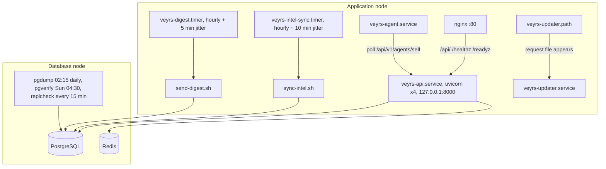

# Services, units, vhosts and ports

VEYRS has **no task queue and no worker daemon**. The only long-running VEYRS
process on a host is the API; background work is done by two hourly systemd
ticks that call the CLI, and by an optional scanner agent
(`tests/test_docs_are_current.py` fails if a document presents a queue as a
component). The shipped units and their live state on the reference
installation are below; the state columns were read with `systemctl is-enabled`
and `systemctl is-active` on 2026-11-17.

## Unit inventory (native install)

| Unit | Source file | Type | Installed by `install.sh` | Runs | User |
|---|---|---|---|---|---|
| `veyrs-api.service` | `infrastructure/systemd/` | long-running | yes, enabled | uvicorn `veyrs.main:app`, 4 workers | `veyrs` (since 0.41.0) |
| `veyrs-intel-sync.timer` and `.service` | `integrations/systemd/` | hourly tick, oneshot | yes, enabled (unless `--skip-timers`) | `scripts/sync-intel.sh` | root |
| `veyrs-digest.timer` and `.service` | `infrastructure/systemd/` | hourly tick, oneshot | yes, enabled (unless `--skip-timers`) | `scripts/send-digest.sh` | root |
| `veyrs-updater.path` and `.service` | `infrastructure/systemd/` | path-triggered oneshot | yes, `.path` enabled | `scripts/veyrs-updater.sh` | root |
| `veyrs-agent.service` | `integrations/veyrs-agent/` | long-running | **no**, by hand | `veyrs_agent.py --poll 5 --job-timeout 1800` | root |
| `veyrs-pgdump.timer` and `.service` | `infrastructure/backup/` | nightly, oneshot | opt-in: `--with-backup-timers`, database node only | `/usr/local/sbin/veyrs-pgdump.sh` | root |
| `veyrs-pgverify.timer` and `.service` | `infrastructure/backup/` | weekly, oneshot | opt-in: `--with-backup-timers`, database node only | `/usr/local/sbin/veyrs-pgverify.sh` | root |
| `veyrs-replcheck.timer` and `.service` | `infrastructure/backup/` | every 15 min, oneshot | opt-in: `--with-backup-timers`, database node only | `/usr/local/sbin/veyrs-replcheck.sh` | root |
| `veyrs-alert@.service` | `infrastructure/backup/` | template, oneshot | with `--with-backup-timers` | `/usr/local/sbin/veyrs-alert.sh <failed unit>` | root |

The three backup services name `OnFailure=veyrs-alert@%n.service`. The alert always writes
a `crit` journal line tagged `veyrs-alert`, mails `VEYRS_ALERT_MAIL` (set in
`/etc/default/veyrs-alert`) when `mail` exists, and calls an executable
`/etc/veyrs/alert-hook` if present (a chat webhook or a pager), so a failed backup is no
longer visible only in `systemctl --failed`.

`install.sh` rewrites `/opt/veyrs` in the units to the chosen install root and
the `redis-server.service` and `postgresql.service` ordering names to the
units this host really has (`redis@default` on SUSE, `redis` on RHEL). A
stale ordering name is not an error in systemd: it is ignored, and the API could
start before Redis (`install.sh`, step 7). The units are installed into
`/etc/systemd/system/`.



**Legend.** Rectangles are units or scripts, cylinders are data stores. Solid
arrows are calls. The updater and the agent exist only where installed. The
backup units run on the database node, not on application nodes.

## `veyrs-api.service`

```ini
ExecStart=/opt/veyrs/venv/bin/uvicorn veyrs.main:app \
    --host 127.0.0.1 --port 8000 --workers 4 \
    --proxy-headers --forwarded-allow-ips=${VEYRS_FORWARDED_ALLOW_IPS} \
    --timeout-keep-alive 30 --no-server-header
```

| Property | Value | Why it matters |
|---|---|---|
| Type, restart | `Type=exec`, `Restart=on-failure`, `RestartSec=5`, `KillSignal=SIGTERM`, `TimeoutStopSec=30` | in-flight requests get 30 s on stop; `ExecReload` sends `SIGHUP` |
| Environment | `EnvironmentFile=/opt/veyrs/.env`, `PYTHONPATH=/opt/veyrs/backend`, `VEYRS_FORWARDED_ALLOW_IPS=127.0.0.1` | systemd lets `EnvironmentFile=` override `Environment=`, so `.env` can widen the trusted-proxy list |
| Ordering | `After=network-online.target postgresql.service redis-server.service` | rewritten per host by `install.sh` |
| Bind | `127.0.0.1:8000` | only nginx reaches it |
| Workers | `--workers 4` | handlers are synchronous SQLAlchemy: throughput comes from processes. Raise together with `max_connections`: each worker can open `VEYRS_DB_POOL_SIZE` + `VEYRS_DB_MAX_OVERFLOW` connections (8 + 12 = 20 by default, so 4 workers stay at 80, under PostgreSQL's default `max_connections` of 100; it was 4 × 30 = 120 before 0.41.0) |
| Sandbox | `NoNewPrivileges`, `PrivateTmp`, `ProtectSystem=strict`, `ProtectHome=yes`, `ProtectKernelTunables/Modules`, `ProtectControlGroups`, `RestrictSUIDSGID`, `RestrictRealtime`, `LockPersonality`, `MemoryDenyWriteExecute`, `SystemCallArchitectures=native`, `LimitNOFILE=65535` | `MemoryDenyWriteExecute` is why scanners (nuclei) cannot run inside the API and why the agent is a separate unit |
| Writable paths | `ReadWritePaths=/opt/veyrs/var` and `ReadWritePaths=-/var/lib/veyrs/update-requests` | the API can only write `var/` and drop update requests into the spool |
| User | `veyrs` / group `veyrs` (since 0.41.0; was `root`) | unprivileged system account created by `install.sh` or `scripts/migrate-service-user.sh`. `CapabilityBoundingSet=` is empty, `RestrictAddressFamilies=AF_INET AF_INET6 AF_UNIX`, `PrivateDevices=yes`. It owns `var/` only; `.env` is `0640 root:veyrs`; `var/backups` is root-only; the spool is `root:veyrs 0770`. The container runs as uid 10001 |

> [!IMPORTANT]
> `/opt/veyrs/var` must exist when the unit starts. Under `ProtectSystem=strict`
> a missing `ReadWritePaths` entry is fatal: systemd fails the start with status
> `226/NAMESPACE` before any VEYRS code runs. `install.sh` creates it and git keeps
> it through `var/.gitkeep`; a tree deployed from a tarball that drops empty
> directories will not have it ([Troubleshooting](../troubleshooting/README.md#api-does-not-start-226namespace)).

## Intelligence tick: `veyrs-intel-sync`

The timer is `OnCalendar=hourly`, `RandomizedDelaySec=600`, `Persistent=true`. It
is a **tick, not a schedule**: since 0.21.0 the cadence lives in
`organizations.settings.intel_schedule` (Threat Intel, Schedule in the console;
default one day per feed, minimum 60 minutes, maximum 30 days) and `veyrs
intel-due` answers which feeds have reached their interval. The tightest interval
requested by any active organization wins, because the CVE corpus is global
(`backend/veyrs/services/intel_schedule.py`).

`scripts/sync-intel.sh` then:

1. prints the schedule with a reason for every feed, due or not (`DUE` or `skip`, with "N min since last success, interval M min"), so a tick that does nothing is distinguishable from one that crashed;
2. runs the due feeds in the fixed order CWE, NVD, EPSS, KEV: CWE names what NVD creates, EPSS skips CVEs it has never seen, KEV is the last word on priority. Each feed is isolated: one failure does not stop the others, and the exit status is non-zero if any failed;
3. always runs `veyrs run-sla`, because SLA deadlines elapse with the clock, not with new intelligence.

The service sets `TimeoutStartSec=infinity` (NVD allows 5 requests per 30 s without
an API key, so a large delta legitimately takes hours), `OOMPolicy=continue`
(systemd's default `stop` SIGTERMs the whole unit when any process in it is
OOM-killed; that once stopped `sync-kev` for three nights), `Nice=10` and
`IOSchedulingClass=idle`. `--full-run` on the script forces every feed.

Verified on the reference installation: the log shows lines such as
`skip nvd 248 min since last success, interval 1440 min`, then `=== run-sla`, then
`=== done ..., status 0`.

## Digest tick: `veyrs-digest`

Same pattern: `OnCalendar=hourly`, `RandomizedDelaySec=300`, `Persistent=true`.
`scripts/send-digest.sh` runs `veyrs digest`, which asks each organization's
settings (Notifications, Digest) whether this is its hour and whether one already
went out in the last 12 hours. It exits 0 when nothing was due, so the timer is not
painted failed every quiet hour. `TimeoutStartSec=600`: a digest stuck on an SMTP
transport is killed and retried by the next tick; the notification rows already
written are not lost.

## Updater: `veyrs-updater.path` and `.service`

The sandboxed API cannot write its own tree. In the console, Administration,
Software update, a platform administrator queues a request: the API writes one JSON
file into `/var/lib/veyrs/update-requests` (`VEYRS_UPDATE_SPOOL`). The `.path` unit
(`PathExistsGlob=/var/lib/veyrs/update-requests/*.json`) starts the root
`.service`, which runs `scripts/veyrs-updater.sh` (`TimeoutStartSec=3h`,
`PrivateTmp=yes`, deliberately without `NoNewPrivileges` because the installer
uses `su` and the package manager). The flow is in
[Upgrade and rollback](upgrade-rollback.md#in-product-update).

## `veyrs-agent.service`

Runs `veyrs_agent.py` (standard library only) from
`/opt/veyrs/integrations/veyrs-agent`, with its own environment file
`/etc/veyrs-agent/agent.env` (mode 0600: `VEYRS_URL`, `VEYRS_AGENT_TOKEN`,
`VEYRS_AGENT_ALLOW`, `VEYRS_AGENT_RESOLVERS`). `Restart=always`, `RestartSec=10`,
`KillSignal=SIGINT` (the runner exits cleanly on `KeyboardInterrupt`; a job in flight
is abandoned and its lease collected by `POST /api/v1/agents/maintenance/reap`),
`TimeoutStopSec=60`, `ProtectSystem=full`.

The unit deliberately does **not** set `ProtectHome`: nuclei reads about 13,500
templates from `/root/nuclei-templates`. Locking `/root` does not fail loudly, it
produces a zero-template run that exits 0. The server refuses to believe an empty
result with no coverage numbers (`services/agents.py`, `_coverage`; minimum 80 %
completion, at most 50 % request errors).

## Backup units (database node)

| Unit | Schedule | Script behaviour |
|---|---|---|
| `veyrs-pgdump.timer` | `*-*-* 02:15:00`, 300 s jitter, `Persistent=true` | refuses to run unless the connected role is a superuser; counts canary tables first; dumps with `pg_dump -Fc -Z6`; enforces a 20 MB floor; verifies `TABLE DATA` for each canary table; checksums; pushes off-host over ssh and re-verifies the checksum remotely; prunes last. Service: `Nice=10`, `MemoryMax=2G`, `TimeoutStartSec=3600` |
| `veyrs-pgverify.timer` | `Sun *-*-* 04:30:00`, 600 s jitter | restores the newest dump into scratch database `veyrs_restore_check` (UTF8 from `template0`), compares row counts of `assets`, `findings`, `organizations`, `users`, `asset_products`, `import_runs` and the RLS policy count against the live database, then drops the scratch database. Service: `TimeoutStartSec=5400` |
| `veyrs-replcheck.timer` | `OnBootSec=5min`, `OnUnitActiveSec=15min` | fails (unit `failed`) if the replication slot is missing, inactive or `lost`, the walsender is not `streaming`, or lag exceeds 128 MB |

The scripts keep their last result in `/var/lib/veyrs-backup/{status,verify-status,replication-status}`.
Their defaults for the off-host target and the standby address are environment
specific (`REMOTE_HOST`, `REMOTE_USER`, `REMOTE_DIR`, `STANDBY_IP`, `SLOT`):
set them for your site before enabling the timers
([Backup and DR](backup-dr.md#scheduled-logical-backups)).

> [!NOTE]
> Nothing in VEYRS alerts on a `failed` systemd unit. `veyrs-intel-sync` once failed
> three nights before anyone noticed. Alert on `systemctl --failed` and on the
> status files in your own monitoring ([Monitoring](monitoring.md)).

## Singleton units on multi-node installs

With two application nodes sharing one database, run these on **one** node only
([High availability](../HIGH_AVAILABILITY.md)): `veyrs-agent.service` (two runners
claiming the same jobs corrupt state) and `veyrs-intel-sync.timer` (it is a
singleton). Keep `veyrs-digest.timer` on the same node: `services/digest.py` `due_now`
skips an organization whose digest ran in the last 12 hours, which stops a repeat but is
not a lock against two nodes firing in the same minute. `install.sh` honours an operator's decision on re-run: a timer that was
already installed and is `disabled` or `masked` is left that way. Observed on the
reference installation: the primary node has the agent, both timers and the local
PostgreSQL enabled; the secondary has the API and nginx only, with the agent and
intel timer installed but disabled.

## Docker Compose services

Project name `veyrs`. Every VEYRS container is read-only, drops all capabilities
and sets `no-new-privileges` (`x-hardening` in `docker/compose.yaml`); `init` is
the one exception (it needs `CHOWN`, `DAC_OVERRIDE`, `FOWNER`, `SETUID`,
`SETGID` to fix the volume owner, then drops to uid 10001 with `setpriv`).

| Service | Image | Profile | User | Ports | Purpose |
|---|---|---|---|---|---|
| `postgres` | `postgres:15-bookworm` pinned by digest | default | image account | none | cluster; `initdb.d/10-app-role.sh` creates the `NOSUPERUSER NOBYPASSRLS` role and both databases on first start only |
| `redis` | `redis:7-alpine` pinned by digest | default | image account | none | `--save "" --appendonly no`: no persistence |
| `init` | `veyrs` | default | root, then 10001 | none | `init-db`, then bootstrap only if the administrator is absent; exits 78 if there is no administrator and no `VEYRS_ADMIN_PASSWORD` |
| `api` | `veyrs` | default | 10001 | `expose 8000` only | `docker/entrypoint.sh`: uvicorn on `0.0.0.0:8000`, `VEYRS_WORKERS` (default 4); refuses to start with an empty `VEYRS_SECRET_KEY` (exit 78) |
| `console` | `veyrs-console` (nginx 1.28-alpine) | default | 101 | `${VEYRS_HTTP_BIND:-127.0.0.1:8080}` to 8080 | static console, same-origin `/api/` proxy, fixed address `VEYRS_CONSOLE_IP` |
| `intel` | `veyrs` | `workers` | 10001 | none | `docker/tick.sh intel 3600 600 bash scripts/sync-intel.sh` |
| `digest` | `veyrs` | `workers` | 10001 | none | `docker/tick.sh digest 3600 300 bash scripts/send-digest.sh` |
| `agent` | `veyrs-agent` | `agent` | 10001 | none | nuclei 3.11.1 pinned by SHA-256; refuses to start with fewer than 100 templates (exit 78); needs `VEYRS_AGENT_TOKEN` and a non-empty `VEYRS_AGENT_ALLOW` |

Volumes: `veyrs-pgdata` (database), `veyrs-var` (`/opt/veyrs/var`), `veyrs-agent-home`
(nuclei templates and cache). Network: bridge `veyrs`, subnet `VEYRS_SUBNET`
(default `172.29.0.0/16`), console pinned to `VEYRS_CONSOLE_IP` (default
`172.29.0.10`). `api` gets no fixed address, because `docker compose run` (used by
the `cli` verb) creates a second container of the service and cannot reuse one.

Health checks: `api` probes `/readyz` (Postgres and Redis both, 503 if either is
down) with `urllib`, because the image has no curl; `console` fetches its own index;
`postgres` performs a real login as the application role; `init`, `intel`, `digest`
and `agent` have none. `api` forwards trust only to the console:
`VEYRS_FORWARDED_ALLOW_IPS` is `$VEYRS_CONSOLE_IP` plus `$VEYRS_FRONT_PROXY_IPS`.

`docker/tick.sh` is the container counterpart of a timer: it carries an interval and
jitter, never a schedule; it ticks once at start-up (the equivalent of
`Persistent=true`) and never exits on a failed run, so `restart: unless-stopped`
cannot turn a feed outage into a restart storm against NVD.

The external-database overlay `docker/compose.external-db.yaml` replaces `postgres`
with a `sleep infinity` probe and points `init`, `api`, `intel` and `digest` at
`VEYRS_EXT_DATABASE_URL`.

## nginx

### Console vhost (`infrastructure/nginx-veyrs-console.conf`, generated by `install.sh`)

| Location | Behaviour |
|---|---|
| `/` | `try_files $uri $uri/ /index.html`, `expires -1` (`Cache-Control: no-cache`): hash routing, and a deploy is visible immediately |
| `/fonts/` | `expires 30d` (self-hosted Inter and JetBrains Mono) |
| `/api/` | proxy to `127.0.0.1:8000`, `proxy_read_timeout 300s`, `client_max_body_size 128m`; sets `Host`, `X-Real-IP`, `X-Forwarded-For` (`$proxy_add_x_forwarded_for`), `X-Forwarded-Proto` |
| `= /healthz`, `/readyz` | proxy, `Cache-Control: no-store` |
| `= /documentation` | 302 to the documentation site (`DOCS_URL` in `install.sh`) |
| `/static/` | the console page links `/static/veyrs-tokens.css` and the logos. The reference vhost aliases the docs site tree (`alias /var/www/veyrs/static/`, cached 1 h); the container image bakes `frontend/brand` into `/static/`. The vhost that `install.sh` generates has **no** `/static/` block and `install.sh` does not copy `frontend/brand`, so on a native install without the docs site the stylesheet request falls through to `index.html` and the console renders unstyled: copy the brand files into `$CONSOLE_DIR/static/` ([Installation](installation.md#post-install-checks)) |
| `/metrics` | **not proxied** by the generated vhost or the container; it is Bearer-authenticated in the application |

Headers added on every response (`always`):

| Header | Value |
|---|---|
| `X-Frame-Options` | `DENY` |
| `X-Content-Type-Options` | `nosniff` |
| `Referrer-Policy` | `no-referrer` |
| `Permissions-Policy` | `geolocation=(), microphone=(), camera=()` |
| `Strict-Transport-Security` | `max-age=31536000; includeSubDomains` (host vhost only; the container sends none because it speaks plain HTTP and a pinned `localhost` origin would affect every project on that machine) |
| `Content-Security-Policy` | `default-src 'self'; script-src 'self'; style-src 'self' 'unsafe-inline'; img-src 'self' data:; font-src 'self'; connect-src 'self'; frame-ancestors 'none'; base-uri 'self'; form-action 'self'` |

The API adds its own set on every response (`observability.SECURITY_HEADERS`: the
same plus `Cross-Origin-Opener-Policy` and `Cross-Origin-Resource-Policy` both
`same-origin`, and a CSP with `base-uri 'none'`), together with `X-Correlation-ID`
and `X-Response-Time-ms`.

> [!IMPORTANT]
> The cache rule is written with `expires`, never `add_header`: an `add_header`
> inside a `location` silently discards every `add_header` declared on the server.
> The console is a static copy (`/var/www/veyrs-console`) of `frontend/console/`; a
> deploy that does not refresh the copy serves the new API behind the old UI while
> every request still answers 200.

### Hostnames and the default server

`server_name` of the console vhost must list **every** hostname that reaches the
node. A name that is missing does not 404: nginx falls through to the
`default_server`, which on a node that also hosts the documentation site serves
that site with HTTP 200. A failover test that asserts only `200` would pass while
operators receive documentation pages. `tests/test_console_vhost_names.py` asserts the
set of names, and that the console vhost is not a catch-all (`_` or wildcards).
Check on a live node with `nginx -T | grep server_name`.

### Documentation and product sites

Both are static trees built by dependency-free generators and copied to local
document roots on each application node:

| Site | Generator | Default output | Notes |
|---|---|---|---|
| Documentation (Docs Center) | `python3 site/build.py [--out DIR]` | `/var/www/veyrs` | renders every Markdown file under `docs/`; served by the `default_server` vhost on the reference installation |
| Product site and manual | `python3 site/web/build_web.py [--out DIR]` | `/var/www/veyrs-web` | its own vhost, `try_files $uri $uri.html $uri/ =404`, assets cached 7 days |

All three vhosts are versioned in `infrastructure/` since 0.41.0:
`nginx-veyrs-console.conf`, `nginx-veyrs-docs.conf` (the `default_server`) and
`nginx-veyrs-web.conf`. `tests/test_fix_deploy.py` asserts their `server_name` sets (no name in two
vhosts, the docs vhost stays the default) and that no `location` with its own `add_header`
drops the server-level security headers.

Publish with **`scripts/publish-sites.sh`**, once per node: it builds the Docs Center, the
product site and the console copy (`frontend/console/` whole, fonts included, plus the brand
files under `static/`), each beside its live directory, and swaps it in atomically
(`renameat2(RENAME_EXCHANGE)`; `site/atomic_swap.py`). The previous tree stays in
`<root>.prev` for rollback (`mv`). It ends with one fingerprint line per tree: run it on both
nodes and compare the lines. `site/build.py` itself now builds and swaps the same way, so a
rebuild no longer removes `static/` from under a loading console, and a document deleted from
`docs/` no longer lingers.

## TLS termination

Neither shipped shape listens on HTTPS. VEYRS refuses to boot in production with an
`http://` `VEYRS_PUBLIC_BASE_URL` (`Settings.assert_production_safe`).

**Option A: a reverse proxy in front** (the reference installation, and the only
option for the Docker stack). The proxy terminates TLS and forwards to nginx
port 80 (native) or `VEYRS_HTTP_BIND` (Docker), preserving the `Host` header. Then:

1. Set `VEYRS_PUBLIC_BASE_URL` and `VEYRS_CORS_ORIGINS` to the `https://` origin.
2. Tell uvicorn which proxies to believe. In `/opt/veyrs/.env` (native) list **every** hop in front of the API: `VEYRS_FORWARDED_ALLOW_IPS=127.0.0.1,192.0.2.40` (the second address is the outer proxy as seen by the node's nginx). In Docker set `VEYRS_FRONT_PROXY_IPS`. If you skip this, every user is recorded and rate-limited as the proxy ([Troubleshooting](../troubleshooting/README.md#all-users-are-rate-limited-as-one-client)).
3. Add each public hostname to the console vhost's `server_name`.

**Option B: nginx terminates TLS** on the application node. Add a second server
block (or `listen 443 ssl` to the existing one) with your certificate, keep the
same `location` blocks, and redirect port 80:

```nginx
server {
    listen 443 ssl;
    server_name veyrs.example.com;
    ssl_certificate     /etc/ssl/veyrs/fullchain.pem;
    ssl_certificate_key /etc/ssl/veyrs/privkey.pem;
    ssl_protocols       TLSv1.2 TLSv1.3;
    # ... same root, headers and location blocks as the port-80 server ...
}
server { listen 80; server_name veyrs.example.com; return 301 https://$host$request_uri; }
```

Certificates are your responsibility; VEYRS ships no ACME client. After changing
nginx: `nginx -t && systemctl reload nginx`.

## Sources

- `infrastructure/systemd/*.service|*.timer|*.path`, `integrations/systemd/*`, `integrations/veyrs-agent/veyrs-agent.service`, `infrastructure/backup/*`
- `docker/compose.yaml`, `docker/compose.external-db.yaml`, `docker/Dockerfile`, `docker/entrypoint.sh`, `docker/init.sh`, `docker/tick.sh`, `docker/console.conf`
- `infrastructure/nginx-veyrs-console.conf`, `install.sh` (steps 7 and 8), `tests/test_console_vhost_names.py`
- `backend/veyrs/observability.py`, `backend/veyrs/services/intel_schedule.py`, `backend/veyrs/services/agents.py`
- Live read-only inspection of both application nodes, 2026-11-17 (state columns and observations)
