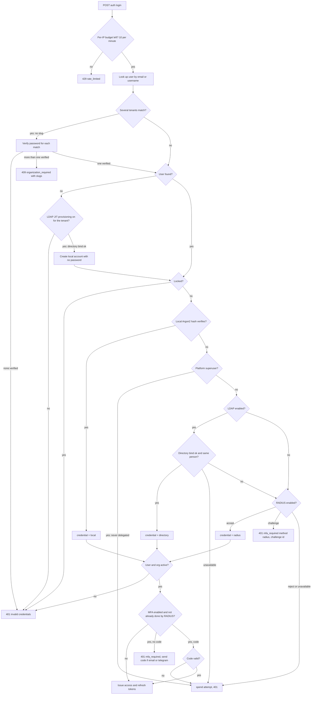

# Authentication

VEYRS has four credential types, each with its own entry point and dependency:

| Credential | Presented as | Resolved by | Principal kind |
|---|---|---|---|
| User JWT access token | `Authorization: Bearer <jwt>` | `_principal_from_jwt` (`backend/veyrs/security/deps.py:280`) | `user` |
| API key | `X-API-Key: veyrs_<prefix>_<secret>` | `_principal_from_api_key` (`backend/veyrs/security/deps.py:316`) | `apikey` |
| Agent token | `X-Agent-Token: veyrsagent_<prefix>_<secret>` | `get_agent` (`backend/veyrs/security/agent_auth.py:425`) | not a principal |
| Signed webhook | `X-VEYRS-Signature` + `X-VEYRS-Timestamp` | `itsm_inbound.verify` (`backend/veyrs/services/itsm_inbound.py:104`) | none |

If both `X-API-Key` and `Authorization` are sent, the API key wins (`backend/veyrs/security/deps.py:345-350`). Every failure is the same `401 not authenticated` with `WWW-Authenticate: Bearer`.

## Sign-in paths in order

`POST /api/v1/auth/login` is the only password endpoint. It accepts a username **or** e-mail address (`identifier`, or the legacy `email` field), the password, an optional organization slug, an optional `mfa_code` and an optional `radius_challenge` (`backend/veyrs/api/v1/schemas.py:119-141`, `backend/veyrs/api/v1/auth.py:364`).

**Legend.** Rectangles are steps, diamonds are decisions. `FAIL` always charges the lockout budget (per source and, for a source's first five failures, per account; see Lockout) and writes an `auth_events` row; `401 mfa_required` and the RADIUS challenge do **not** spend the budget. "Locked?" also means "is this source waiting out its back-off". Since 0.41.0, when the organization requires MFA and the account has no factor, "Issue tokens" issues an enrolment-only token instead (see MFA). Sources: `backend/veyrs/api/v1/auth.py` (`_check_credential`, `login`), `backend/veyrs/security/lockout.py`.

### Why this order

- **Local first.** A stored hash needs one Argon2 verification and works when the network is broken, which is exactly when an operator needs the break-glass login (`backend/veyrs/api/v1/auth.py:239-253`).
- **Platform superusers are never delegated.** The account that repairs a broken directory or SSO configuration must not depend on it (`backend/veyrs/api/v1/auth.py:256-257`, `backend/veyrs/services/ldap_auth.py` module docstring). SSO refuses them as well (`backend/veyrs/api/v1/auth.py:1089,1106`).
- **LDAP before RADIUS.** When an organization runs both, the directory is asked first because it also describes the person (`backend/veyrs/api/v1/auth.py:271-274`).
- **Unavailable is not wrong, and is not a way in.** A directory or RADIUS outage returns `directory_unavailable` / `radius_unavailable` internally (distinct audit reason, same `401` to the client).

### Local password

| Property | Value | Source |
|---|---|---|
| Algorithm | Argon2id, `argon2-cffi` default parameters, per-password salt | `backend/veyrs/security/auth.py:27` |
| Minimum length | 12 (`VEYRS_PASSWORD_MIN_LENGTH`, and a hard `min_length=12` in the request schemas) | `backend/veyrs/config.py:59`, `backend/veyrs/api/v1/schemas.py:486,192` |
| Maximum length | 512 | `backend/veyrs/api/v1/schemas.py:140` |
| Composition rules | None. No breached-password check. | not implemented |
| Rehash | On successful local login when the stored parameters are outdated; never for directory logins | `backend/veyrs/api/v1/auth.py:545` |
| Change | `POST /auth/password` needs the current password (a wrong one is charged to the lockout budget), rejects reuse of the same value, and ends every session of the user, access tokens included | `backend/veyrs/api/v1/auth.py` (`change_password`) |
| Federated-only accounts | `password_hash` is `NULL`; a dummy hash is computed so timing does not reveal it | `backend/veyrs/security/auth.py:47-52` |

### Lockout

Since 0.41.0 (`backend/veyrs/security/lockout.py`; R-13 and R-24 in the [risk register](risk-register.md)) there are two layers:

- **Per source** (one account, one client address): the first 5 failures are free; each further failure makes that address wait 30 s, 60 s, 2 min ... doubling to 15 min before its next attempt is evaluated. Counters live in Redis for a day. A guesser at one address slows only itself down.
- **Per account**: only a source's free failures count toward `users.failed_logins`, so one address can never lock the account. At 20 counted failures (at least four addresses) `users.locked_until` is set for 1 min, doubling per further counted failure up to 1 h. Sources inside `VEYRS_LOCKOUT_EXEMPT_NETWORKS` are not refused by this layer. Platform administrators get the same policy.
- A refused attempt (source waiting or account locked) is answered with the generic `401` without checking the password and without being counted. A success clears both layers. `veyrs unlock --email <address> --reason "<text>"` clears both for one account (audited).
- The same budget is charged by the password and code checks of `/auth/password`, `/auth/mfa/disable` and `/auth/mfa/recovery-codes`, each with an `auth_events` row; a waiting source gets `429` with `Retry-After` there.
- A locked account is also refused by `get_principal` and by `/auth/refresh` (the refresh token is not revoked; the session continues after the lock). An automatic lock does not end sessions: that would let anyone who can fail a login sign the real person out everywhere.
- Without Redis the per-source layer is skipped and every failure counts toward the account layer.
- The per-IP request limit (10 per minute) is separate and still applies to `/auth/login`, `/auth/refresh`, `/auth/mfa*` and `/auth/password*` (`backend/veyrs/security/ratelimit.py`).

## LDAP and Active Directory

Implemented in `backend/veyrs/services/ldap_auth.py`; configured per organization under Administration.

- **Bind mode.** Service account plus search: bind as the read-only service account, find the person by account name, then re-bind as the found DN with the typed password (`ldap_auth.py` module docstring). Direct bind is deliberately not supported.
- **Transport.** `use_ssl` defaults to true, `start_tls` false, `verify_certificate` true (`ldap_auth.py:98-100`); enabling the integration without either TLS mode is refused (`:269`); certificate checking can be disabled per organization (`:415-420`).
- **Injection and anonymous bind.** Filter values are escaped with `ldap3.utils.conv.escape_filter_chars` (`:387-389`); an empty password is refused before it reaches the wire because RFC 4513 treats it as an unauthenticated bind (`:666-671`).
- **Identity match.** The directory entry must match the local row by DN, then username, then e-mail; otherwise the login fails (`backend/veyrs/api/v1/auth.py:321-335`).
- **Roles.** `group_role_map` translates directory groups to VEYRS roles. Directory-derived grants carry `origin="directory"`, are estate-wide, and are reconciled at login when `sync_roles_on_login` is on; manual grants are never touched (`backend/veyrs/api/v1/auth.py:117-158`).
- **Just-in-time provisioning** is off by default. When on, the first successful bind creates an account with no password and with `default_role_slugs` (default empty), so the person can sign in and read nothing until granted (`backend/veyrs/api/v1/auth.py:178-236`).
- **Bind password storage.** The service account password is stored encrypted (`organizations.settings.ldap.bind_password_enc`); if it cannot be decrypted the bind is refused instead of falling back to anonymous (`ldap_auth.py:152`).

## RADIUS

Implemented in `backend/veyrs/services/radius_auth.py`.

- **Message-Authenticator is mandatory.** It is sent first in every Access-Request and **required on every answer**; an answer without it, or with a wrong one, is refused (Blast-RADIUS mitigation, `radius_auth.py:27,133,159-184`). The setting is reported as "required (not configurable)" (`:286`).
- **Shared secret.** Stored encrypted; the response authenticator and the Message-Authenticator are compared in constant time (`:173-184`). RADIUS itself uses MD5 and UDP; protect the path between VEYRS and the server on the network.
- **Access-Challenge.** A challenge is stored in Redis with a random id, short TTL, single use, bound to the user id (`radius_auth.py:377-397`). The client repeats `POST /auth/login` with `radius_challenge` and the response code in `mfa_code`. When RADIUS answers the challenge, VEYRS does not ask for its own second factor (`backend/veyrs/api/v1/auth.py:475-479`). With no Redis, the challenge fails closed (`:313-315`).
- **Roles** can be mapped from reply attributes (`radius_auth.py:362`), reconciled like directory roles.

## OIDC single sign-on

Implemented in `backend/veyrs/services/oidc_auth.py` and `backend/veyrs/api/v1/auth.py:1020-1119`. Authorization-code flow only.

| Step | Endpoint | What happens |
|---|---|---|
| 0 | `GET /auth/sso` | Returns `{"available": true/false}` only, so tenants cannot be enumerated (`auth.py:1020-1026`) |
| 1 | `GET /auth/oidc/{org_slug}/start` | Discovery, then a redirect URL with random `state`, `nonce`, PKCE `code_challenge` (S256). Flow data goes to Redis for 600 s. The response also sets the cookie `veyrs_oidc_bind` (random binder, `HttpOnly`, `SameSite=Lax`, `Secure` in production, path `/api/v1/auth/oidc`, 600 s); the flow stores its SHA-256. Unknown and unconfigured organizations answer the same 404. |
| 2 | `GET /auth/oidc/callback` | `state` is single-use (deleted on read). The flow is refused unless the browser presents the matching binder cookie (login CSRF, R-11). The code is exchanged with the client secret and `code_verifier`; the ID token is verified for signature (RS/PS/ES families only), issuer, audience, `at_hash` and `nonce`; optionally the `amr` claim must show a second factor (`require_mfa_amr`) |
| 3 | callback continues | The e-mail claim must be present and `email_verified` must be present **and true** (R-10); the organization must be active; superusers, inactive users and **locked** users are refused (R-12); roles are mapped from `groups_claim` through `group_role_map` |
| 4 | `POST /auth/oidc/exchange` | The browser returns with a one-time handoff (60 s, single use, bound to the same binder cookie) and receives the normal token pair; a user locked or an organization disabled in the meantime is refused; the lock counters are not reset; audit reason `auth:sso` |

Configuration constraints: issuer and endpoints must be `https`; the redirect URI must be `https://<host>/api/v1/auth/oidc/callback` (`oidc_auth.py` `validate`). The identity provider must send `email_verified: true` (Microsoft Entra ID does not by default: add the optional claim or the flow is refused). JIT provisioning (`jit_provisioning`) creates a password-less account on first sign-in. SSO sign-ins do **not** go through VEYRS's own MFA and are not affected by the organization's `require_mfa`; require MFA at the identity provider and enable `require_mfa_amr` to enforce it.

## MFA

MFA is opt-in per user unless the organization requires it (since 0.41.0, R-07): `PUT /api/v1/mfa-policy {"require_mfa": true}` (`settings:admin`, `backend/veyrs/services/mfa_policy.py`). It applies to local, directory and RADIUS password logins that were not already second-factored by RADIUS, platform administrators included.

With the policy on, an account without a factor still signs in with its password, but receives an **enrolment-only** access token (`scp: mfa_enroll`, 15 minutes, `mfa_enrollment_required: true`, no refresh token, no permission). It reaches only `/auth/me`, `/auth/mfa`, `/auth/mfa/enroll`, `/auth/mfa/send-code`, `/auth/mfa/activate` and `/auth/logout`; anything else answers `403 {"error": "mfa_enrollment_required"}`. `POST /auth/mfa/activate` then also returns a normal token pair in `tokens`. Nobody is locked out of enrolling. Password-only sessions that predate the policy are refused at their next refresh, so they pass through enrolment too.

| Method | How the code is produced | Storage | Source |
|---|---|---|---|
| `totp` | Authenticator app, RFC 6238, SHA-1, 6 digits, 30 s, window +/- 1 step, secret 160 bits; each accepted step is stored in `mfa_last_step` so a code cannot be replayed | Secret encrypted with the Fernet envelope (`security/secrets.py`) | `backend/veyrs/security/mfa.py` |
| `email` | 6-digit code mailed to the account address through `VEYRS_SMTP_*`; offered only if SMTP is configured | SHA-256 of `user_id:code` in Redis, TTL `VEYRS_MFA_CODE_TTL` (default 300 s, 60-900) | `backend/veyrs/security/mfa_delivery.py:260-314` |
| `telegram` | Same code through a bot; chat id registered at enrolment; offered only if `VEYRS_TELEGRAM_BOT_TOKEN` is set | as above | same |
| recovery codes | 10 single-use codes `xxxx-xxxx-xxxx` shown once at activation | SHA-256 of the normalised code in `users.mfa_recovery_codes`; accepted in place of any method | `mfa_delivery.py:326-350` |

Behaviour that matters:

- **Code is sent only after the password verified**, so nobody can make VEYRS message a person by typing their address (`auth.py:481-486`). Sending is throttled to one per 30 s and six per 15 minutes per account (`mfa_delivery.py:52-54`).
- **Five wrong guesses burn a delivered code** and every wrong code also spends the shared lockout budget. The guesses are counted with an atomic Redis `INCR` before the comparison, so parallel guesses cannot exceed five (R-26, `mfa_delivery.check`).
- **Fail closed.** A user with MFA enabled whose TOTP secret cannot be decrypted (key rotated) cannot sign in by TOTP; only a recovery code works. With no Redis, delivered codes cannot be issued or checked and the login fails (`auth.py:501-516`, `:837-839`).
- **Enrolment is three steps** so nobody locks themselves out: `POST /auth/mfa/enroll` (picks a method, proves nothing), `POST /auth/mfa/activate` (proves the factor works and returns the recovery codes), then it is enforced at login. Disabling (`POST /auth/mfa/disable`) and replacing recovery codes (`POST /auth/mfa/recovery-codes`) need the password **and** a valid code (`auth.py:877-1017`). A federated user without a local password therefore cannot disable MFA through the API.
- **Operator recovery** when every factor is lost: `veyrs mfa-reset --email <address> --reason "<text>"` turns MFA off, ends every session of the account and records the reason in the audit trail; `veyrs mfa-setup`, `veyrs mfa-test` and `veyrs unlock` are the other operator commands (`backend/veyrs/services/mfa_admin.py`). Run them on the host as the application user, in `/opt/veyrs`, with the environment from `.env`.

## Tokens and sessions

| Item | Behaviour | Source |
|---|---|---|
| Access JWT | Claims `sub`, `org`, `perms`, `su`, `aud=veyrs:access`, `iss=<app name>`, `iat`, `exp`, `jti`, `tv` (token version) and, for an enrolment-only token, `scp=mfa_enroll`; signed HS256 (or HS384/HS512) with `VEYRS_SECRET_KEY`; lifetime `VEYRS_ACCESS_TOKEN_MINUTES` (code default 30; the `.env` written by `install.sh` sets 60) | `backend/veyrs/security/auth.py` (`create_access_token`) |
| What a request trusts from the JWT | `sub`, `org`, `tv` and `scp` only; user state and permissions are re-read from the database (`perms` and `su` are not used for decisions). `tv` must equal `users.token_version` (a token without `tv`, issued before 0.41.0, reads as 0); an unknown `scp` is refused | `backend/veyrs/security/deps.py` (`_principal_from_jwt`) |
| Ending sessions | `security.auth.end_sessions` bumps `users.token_version` (every older access token is refused from the next request; the user row is read anyway, so no extra query) and revokes every refresh token. Called by logout, password change, `veyrs mfa-reset`, user deactivation and user deletion. Not by an automatic lockout | `backend/veyrs/security/auth.py` |
| Refresh token | `VEYRS_REFRESH_TOKEN_DAYS` (default 14); one-time use; the old row is revoked and a new one issued. Refused for a deleted, inactive or locked user, a disabled organization, and a password-only session of an account that its organization now requires to have MFA | `backend/veyrs/api/v1/auth.py` (`refresh`) |
| Reuse detection | Each sign-in starts its own family (random `family_id`); rotation keeps it. Presenting an already-revoked refresh token revokes that family only, so the person's other devices stay signed in. Tokens from before 0.41.0 carry `family_id = user.id` and age out | `backend/veyrs/api/v1/auth.py` (`_issue`, `refresh`) |
| Logout | Signs out everywhere: every refresh token revoked and every access token voided | `backend/veyrs/api/v1/auth.py` (`logout`) |
| Password change | Same as logout | `backend/veyrs/api/v1/auth.py` (`change_password`) |
| Disabled user or organization | Takes effect on the next request, because state is re-read on every call; deactivation also ends sessions, so reactivating the account does not revive them | `backend/veyrs/security/deps.py`, `backend/veyrs/api/v1/admin.py` |
| Client storage | The console keeps both tokens in browser `localStorage` | `frontend/console/app.js:16-26` |

## API keys

- Created by a principal holding `apikey:write` through `POST /api/v1/admin/api-keys`; the clear key is returned **once**. A key can never carry scopes beyond the creator's own permissions unless the creator is a platform administrator (`backend/veyrs/api/v1/admin.py:996-1025`).
- Only the Argon2id hash of the secret and the 8-hex-character prefix are stored; verification is a prefix lookup followed by one hash check (`backend/veyrs/security/auth.py:129-147`).
- Optional `expires_in_days`; revocation sets `revoked_at` (`admin.py:1028-1038`); `last_used_at` is written on use (`deps.py:326`).
- A key's permissions are exactly its scopes, expanded; an API key principal is never superuser and is never narrowed by team scope (`deps.py:221-225,328-336`).
- API key requests are rate-limited per key once the key has verified in that worker process; until then, and for keys that never verify, per client address (`ratelimit.py` `_identity`, R-14).

## Execution agents

- Token `veyrsagent_<prefix>_<secret>` (prefix 10 hex characters), Argon2id-hashed secret, in the `X-Agent-Token` header rather than `Authorization` so proxy and log scrubbers can treat the two differently (`security/auth.py:156-170`, `security/agent_auth.py:1-23`).
- An agent has no permission set and can reach only `/api/v1/agents/self/*`: heartbeat, claim work, stream events, extend a lease, submit a result, report failure, post inventory (`backend/veyrs/api/v1/agents.py:239-420`).
- A disabled agent gets `403` (valid credential, switched off) rather than `401` so it can tell "rotate" from "stopped" (`agent_auth.py:440-447`).
- The tenant is bound immediately after authentication (`agent_auth.py:437`).
- The job lease token travels in the `X-Agent-Lease` header (since 0.41.0; `security/agent_auth.py` `lease_token`). The old `?lease_token=` query parameter is still accepted for one release and logged as deprecated; a URL ends up in proxy access logs.

## Operator commands that touch authentication

| Task | Command (host, in `/opt/veyrs`, application user, environment loaded) |
|---|---|
| Create the first organization and administrator | `python -m veyrs bootstrap --org <slug> --email <address> --superuser` (omit the password to be prompted; avoid `--password`, which is visible in `ps`) |
| Grant or revoke platform administration | `python -m veyrs platform-admin --email <address> [--revoke]` (refuses to revoke the last one; audited) |
| Reset MFA for a locked-out user | `python -m veyrs mfa-reset --email <address> --reason "<text>"` |
| Lift a sign-in lockout | `python -m veyrs unlock --email <address> --reason "<text>"` |
| Generate an encryption key | `python -m veyrs keygen` |

Sources: `backend/veyrs/cli.py:629-675,677-790`, `backend/veyrs/services/mfa_admin.py`. See [hardening.md](hardening.md) for how to verify the settings that govern authentication.
