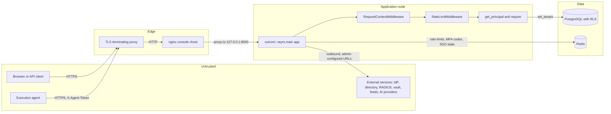
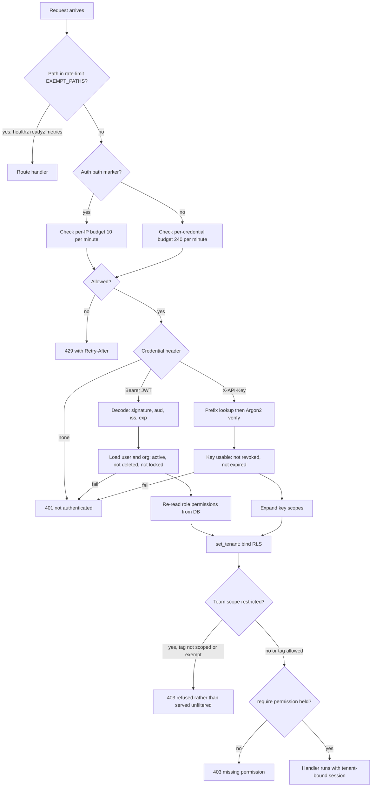

# Security architecture

This is the map of VEYRS's security controls. Each control row names the code that implements it and a **Status** using the portal vocabulary. `Verified` means the behaviour was read in code and either observed on a running node on 2026-11-17 (read-only requests only) or covered by a test whose assertions were read. `Implemented` means it is in the code and was read, but not observed at runtime. Findings against these controls are in the [risk register](risk-register.md).

## Security model in one page

1. **Every request is authenticated and authorized on the server.** There is no client-side-only check. The only public routes are the sign-in endpoints, the SSO entry points, the probes and the OpenAPI schema ([authorization.md, section 7](authorization.md#7-public-and-permissionless-routes)).
2. **A principal always carries an organization.** `get_principal` binds the PostgreSQL session variable `veyrs.current_org` for the whole request, so row level security (RLS) filters every tenant table even if a query forgets its `WHERE`.
3. **Permissions are re-read from the database on every request.** The JWT's `perms` claim is informational; revoking a role takes effect on the next call.
4. **Secrets are reversibly encrypted or held in an external vault.** Passwords and API-key secrets are hashed with Argon2id; refresh tokens and recovery codes with SHA-256.
5. **Failures are generic to the caller and specific in the audit log.** A wrong password, unknown user, locked or disabled account all return the same `401 invalid credentials`.

## Trust boundaries

**Legend.** Rectangles are processes; cylinders are data stores; solid arrows are request flow. The boundary between *Untrusted* and *Edge* is where TLS is terminated; VEYRS ships no TLS configuration (the vhost listens on plain HTTP, `infrastructure/nginx-veyrs-console.conf:8`), so a TLS-terminating proxy in front of nginx is required. The application binds `127.0.0.1` only (`infrastructure/systemd/veyrs-api.service:23`). Middleware runs outside-in: CORS, then `RequestContextMiddleware`, then `RateLimitMiddleware`, so a 429 still carries a correlation id and the security headers (`backend/veyrs/main.py:72-85`).

| Boundary | Crossing | Controls | Status |
|---|---|---|---|
| Internet to edge | Browser, API client, agent | TLS at the front proxy (operator-supplied), HSTS header | Verified (header observed) |
| Edge to application | nginx to uvicorn on loopback | Trusted-proxy list `VEYRS_FORWARDED_ALLOW_IPS`; `--no-server-header` | Implemented |
| Application to database | SQLAlchemy | Parameterized queries, RLS bound per request, `statement_timeout` 30 s | Implemented |
| Application to Redis | Rate limits, sign-in back-off counters, MFA codes, SSO flow state | Fail closed for MFA and SSO; rate limits fall back to per-worker windows and retry Redis every 30 s; the back-off falls back to the account lock | Implemented |
| Application to external services | IdP, LDAP, RADIUS, vault, ITSM, scanners, AI | Admin-configured URLs only; TLS verification on by default; one outbound guard (`services/net_guard.py`) always refuses link-local/metadata, and refuses loopback and private ranges per `VEYRS_OUTBOUND_ALLOW_LOOPBACK` / `VEYRS_OUTBOUND_ALLOW_PRIVATE` (R-09, fixed in 0.41.0) | Yes |
| Agent to application | `/api/v1/agents/self/*` | Separate credential type, no permission set | Implemented |

## Request authentication and authorization decision flow

**Legend.** Diamonds are decisions, rectangles are steps, `X4xx` boxes are terminal error responses. Sources: `backend/veyrs/security/ratelimit.py:166-201`, `backend/veyrs/security/deps.py:87-209` (`effective_permissions`, `_principal_from_jwt`, `_principal_from_api_key`, `get_principal`, `require`), `backend/veyrs/security/scope.py:228-244`.

Agents do not take this path. `/agents/self/*` routes depend on `get_agent` (`backend/veyrs/security/agent_auth.py:425`), which resolves the `X-Agent-Token` header and binds the agent's tenant; it never produces a `Principal`.

## Control catalogue

### Authentication and sessions

| Control | Implementation | Status |
|---|---|---|
| Password hashing | Argon2id via `argon2-cffi` defaults, `backend/veyrs/security/auth.py:27,41-44`; rehash on login when parameters change (`backend/veyrs/api/v1/auth.py:545`) | Implemented |
| Constant-ish time for unknown users | A dummy hash is computed when the account is missing or federated-only (`backend/veyrs/security/auth.py:47-52`, `backend/veyrs/api/v1/auth.py:410-411`) | Implemented |
| Generic failure | One `GENERIC_401` body for every credential problem (`backend/veyrs/api/v1/auth.py:60-64`) | Implemented |
| Lockout | Per-source exponential back-off after 5 failures (30 s doubling to 15 min); account lock only from failures spread over several sources (20 counted, 1 min doubling to 1 h); exempt networks; `veyrs unlock`. Password and MFA failures share one budget, including the password checks of `/auth/password` and the MFA management routes (`backend/veyrs/security/lockout.py`) | Verified (`tests/test_fix_auth.py`) |
| MFA policy | Per organization `require_mfa`: an account without a factor gets an enrolment-only token from its password (`backend/veyrs/services/mfa_policy.py`, `backend/veyrs/security/deps.py`) | Verified (`tests/test_fix_auth.py`) |
| Access token | JWT HS256/384/512, audience `veyrs:access`, issuer = app name, default 30 min, 60 in the `.env` written by `install.sh:1015` (`backend/veyrs/security/auth.py:69-106`, `backend/veyrs/config.py:56-58`) | Verified (expired and forged token tests: `tests/test_phase10_hardening.py:339`) |
| Refresh token | Opaque 48-byte random, stored as SHA-256, rotated on use; one family per sign-in, replay revokes that family; refused for locked users and disabled organizations (`backend/veyrs/security/auth.py`, `backend/veyrs/api/v1/auth.py` `refresh`) | Verified (`tests/test_fix_auth.py`) |
| Session end | Logout, password change, MFA reset, deactivation and deletion bump `users.token_version`, voiding every earlier access token (`backend/veyrs/security/auth.py` `end_sessions`, `deps.py` `_principal_from_jwt`) | Verified (`tests/test_fix_auth.py`) |
| API keys | `veyrs_<prefix>_<secret>`, Argon2id hash of the secret, prefix lookup, optional expiry, revocation, scopes capped to the creator's permissions (`backend/veyrs/security/auth.py:129-147`, `backend/veyrs/api/v1/admin.py:996-1025`) | Implemented |
| Agent tokens | `veyrsagent_<prefix>_<secret>`, distinct scheme, separate header and dependency (`backend/veyrs/security/auth.py:156-170`, `backend/veyrs/security/agent_auth.py`) | Implemented |
| MFA | TOTP (RFC 6238, replay-protected), e-mail and Telegram codes, 10 recovery codes (`backend/veyrs/security/mfa.py`, `backend/veyrs/security/mfa_delivery.py`) | Implemented |
| Federated sign-in | LDAP/AD, RADIUS (Message-Authenticator required), OIDC with PKCE S256, state and nonce (`backend/veyrs/services/ldap_auth.py`, `radius_auth.py`, `oidc_auth.py`) | Implemented |

Details and the sign-in order are in [authentication.md](authentication.md).

### Authorization and tenant isolation

| Control | Implementation | Status |
|---|---|---|
| RBAC | 29 resources x 4 actions = 116 permissions plus wildcards; `require()` rejects unknown strings at import time (`backend/veyrs/security/permissions.py:9-43`, `backend/veyrs/security/deps.py:363-378`) | Verified (`tests/test_phase10_hardening.py:305`) |
| Anonymous probe of every route | Mechanical walk of the live route table (`tests/test_phase10_hardening.py:229`) | Verified |
| Privilege-escalation guard | A caller without `role:admin` cannot grant a role or an API-key scope exceeding their own permissions (`backend/veyrs/api/v1/admin.py:636-646,1005-1011`) | Implemented |
| Row level security | `ENABLE` + `FORCE ROW LEVEL SECURITY` and policy `veyrs_tenant_isolation` on 72 tables, plus `auth_events` with its own policies (73 forced); 4 credential-keyed tables use a permissive-when-unbound variant (`backend/veyrs/cli.py:30-62,303-340`) | Implemented |
| Tenant binding per request | `set_config('veyrs.current_org', ..., true)` and re-applied on every new transaction (`backend/veyrs/db.py:49-79`, `backend/veyrs/security/deps.py:352`) | Verified (`tests/test_phase10_hardening.py:321`, `tests/test_audit_rls.py`) |
| Non-superuser application role | The container initdb script creates the role `NOSUPERUSER NOBYPASSRLS` (`docker/initdb.d/10-app-role.sh`) | Implemented |
| Team scope | Grants with `team_id` narrow a principal; routes whose tag is not scope-aware are refused (`backend/veyrs/security/scope.py:52-244`) | Verified (`tests/test_phase26_scope.py`, existence read) |
| Platform administrator | `is_superuser`; installation-wide pages call `platform_admin` (`backend/veyrs/api/v1/updates.py:28`); never delegated to LDAP or SSO (`backend/veyrs/api/v1/auth.py:256-257,1089`) | Implemented |

Details in [authorization.md](authorization.md). Where the *application-layer* tenant filter is only a coding convention, not an enforced guard, see R-23 in the risk register.

### Secrets and cryptography

| Control | Implementation | Status |
|---|---|---|
| Reversible secrets at rest | Fernet (AES-128-CBC with HMAC-SHA256, from `cryptography`) with prefix `v1:`; `MultiFernet` for rotation (`backend/veyrs/security/secrets.py:55-111`) | Implemented |
| Key hygiene | `VEYRS_ENCRYPTION_KEY` required in production; must not also appear in `..._PREVIOUS` (`backend/veyrs/config.py:222-228`) | Verified (`tests/test_phase10_hardening.py:354`) |
| External vault | HashiCorp Vault or OpenBao KV v2; `local`, `mirror`, `vault` modes; credential files must not be world-readable (`backend/veyrs/security/secret_vault.py:146-170`, `backend/veyrs/security/secrets.py:228-290`) | Verified (`tests/test_phase48_secret_vault.py`, existence read) |
| Rekey | `veyrs secrets rekey --apply` re-seals local copies under the current key (`backend/veyrs/cli.py:776-781`, `backend/veyrs/security/secrets.py:143`) | Implemented |
| Production boot guard | Refuses debug on, unset secret key, bootstrap DB password, unset or non-HTTPS public URL, SMTP host without sender, missing encryption key, incomplete vault block (`backend/veyrs/config.py` `assert_production_safe`); at start-up also a database role that bypasses RLS (`backend/veyrs/main.py`) | Verified (`tests/test_phase10_hardening.py`, `tests/test_fix_auth.py`) |
| Secret key | Minimum 32 characters; unset yields a random per-process key, which production refuses (`backend/veyrs/config.py`) | Verified (`tests/test_fix_auth.py`) |
| Key derivation | Development-only derived Fernet key: HKDF-SHA256 from `cryptography`, byte-identical to the earlier hand-written version (`backend/veyrs/security/secrets.py`) | Verified (`tests/test_fix_auth.py`, fixed vectors) |
| Credentials never in audit | `scrub()` redacts keys containing `password`, `secret`, `token` (`backend/veyrs/services/audit.py:59-69`) | Implemented |

### API protection and transport

| Control | Implementation | Status |
|---|---|---|
| Rate limiting | Per-IP auth budget (default 10/min); general budget (240/min) keyed by a verified identity (the subject of a bearer token that verifies, or an API key already verified in that worker), otherwise by client address; Redis with in-process fallback, Redis retried every 30 s (`backend/veyrs/security/ratelimit.py`) | Verified (`tests/test_phase10_hardening.py`, `tests/test_fix_auth.py`) |
| Client address | `request.client.host` only; uvicorn resolves it through `VEYRS_FORWARDED_ALLOW_IPS` (`backend/veyrs/security/ratelimit.py:128-137`, `infrastructure/systemd/veyrs-api.service:14-24`) | Verified (`tests/test_phase10_hardening.py:129`) |
| CORS | Explicit origin list from `VEYRS_CORS_ORIGINS`, credentials allowed, fixed method and header lists (`backend/veyrs/main.py:77-85`) | Implemented |
| Security headers (API) | `nosniff`, `X-Frame-Options: DENY`, `Referrer-Policy: no-referrer`, COOP/CORP `same-origin`, Permissions-Policy, CSP, HSTS (`backend/veyrs/observability.py:36-52,228-229`) | Verified (observed on a live node) |
| Security headers (console) | Same set plus CSP without script `unsafe-inline` (`infrastructure/nginx-veyrs-console.conf:24-30`, `docker/console.conf:28-36`); HSTS omitted in the container stack on purpose | Implemented |
| Error handling | Validation errors omit submitted values; DB errors return a correlation id; secret errors map to a generic 503 (`backend/veyrs/main.py:141-180`) | Verified (`tests/test_phase10_hardening.py:427`) |
| Operational endpoints | `/metrics` needs a Bearer token and answers 404 otherwise; always 404 in production without a token; `/docs` and `/redoc` disabled in production (`backend/veyrs/main.py:66-67,115-139`) | Verified (live: `/metrics` 404 without token, `/docs` 404) |
| Request size | nginx `client_max_body_size 128m`; per-endpoint caps 32 MB documents, 128 MB scanner exports, 8 MB compliance imports, 1 MB ITSM webhooks (`infrastructure/nginx-veyrs-console.conf:69`, `backend/veyrs/api/v1/knowledge.py:27`, `integrations.py:31`, `compliance.py:32`, `services/itsm_inbound.py:58`) | Implemented |
| XML hardening | Entity declarations refused in every XML parser (`backend/veyrs/services/xmlsafe.py`) | Implemented |
| Inbound webhook | HMAC-SHA256 over `timestamp.body`, 5-minute window, identical 404 for unknown org or connector (`backend/veyrs/services/itsm_inbound.py:28-119`, `backend/veyrs/api/v1/integrations.py:608-640`) | Verified (`tests/test_phase17_itsm_inbound.py`, existence read) |

### Logging, audit and monitoring

| Control | Implementation | Status |
|---|---|---|
| Business audit | `audit_log` rows with actor, object, field diff, correlation id, IP, user agent (`backend/veyrs/services/audit.py:83-119`) | Implemented |
| Authentication events | `auth_events` for login, refresh, logout, SSO and the password checks of the account routes, with a reason code (`backend/veyrs/services/audit.py`); row policies per organization and `GET /api/v1/auth-events` (`audit:read`) | Verified (`tests/test_fix_auth.py`) |
| Append-only audit | A trigger refuses UPDATE, DELETE and TRUNCATE on `audit_log`, `ai_audit_log` and `auth_events`, except retention deletes under `SET LOCAL veyrs.audit_prune = 'on'` and foreign-key cascades (`backend/veyrs/schema_steps/step_auth.py`). The table owner (today the application role) can still disable a trigger | Partial (owner separation pending) |
| AI audit | `ai_audit_log` per call, including blocked calls; prompt stored as digest only (`backend/veyrs/services/ai/gateway.py:248-262,371-384`) | Implemented |
| Structured logs | JSON lines with correlation id, org, actor, path, status, duration (`backend/veyrs/observability.py:61-76,231-242`) | Implemented |
| Correlation id | Accepted only if 1-64 characters of `[A-Za-z0-9._:-]` (longer values truncated, others replaced by a UUID; `observability.sanitize_correlation_id`) | Yes (R-04, fixed in 0.41.0) |
| Audit write failure | Logged at ERROR and swallowed so the request survives (`backend/veyrs/services/audit.py:118-119,145-146`) | Implemented |
| Metrics | In-process Prometheus text, per-worker readings, bounded label space (`backend/veyrs/observability.py`) | Implemented |

### Platform hardening

| Control | Implementation | Status |
|---|---|---|
| systemd sandbox | `NoNewPrivileges`, `ProtectSystem=strict`, `ProtectHome`, `PrivateTmp`, `MemoryDenyWriteExecute`, `RestrictSUIDSGID`, single writable path; runs as `User=root` (`infrastructure/systemd/veyrs-api.service:9,32-51`) | Verified (unit read, user observed live); root user is R-06 |
| Container hardening | `cap_drop: ALL`, `no-new-privileges`, `read_only`, tmpfs `/tmp`, non-root UID 10001 for API and workers, internal DB with no published port (`docker/compose.yaml:129-151`, `docker/Dockerfile:87`) | Implemented |
| Self-update split | The API only writes a JSON request; a root path-activated unit verifies and installs; git checkouts and containers are refused (`backend/veyrs/config.py:125-148`, `infrastructure/systemd/veyrs-api.service:41-43`) | Implemented |
| Release signing | `SHA256SUMS` signed with an ed25519 OpenSSH key; installer verifies against an embedded copy of `release/allowed_signers` (`release/allowed_signers`, `veyrs-setup.sh`, `scripts/verify-release.sh`) | Verified (`tests/test_phase52_release_signing.py`, existence read; a real public key is committed) |
| Dependency pinning | 54 exact pins in `requirements.txt`; no hashes; no CI scan (R-21); installer can use an offline wheelhouse (`install.sh:903-925`) | Partial |

### AI safeguards

The gateway, guardrails and classification ceilings are documented in [AI_SECURITY.md](../AI_SECURITY.md). Summary: every call goes through `backend/veyrs/services/ai/gateway.py:231` (capability check, permission check, budget, sanitization, provider selection, call or degrade, output guard, audit); external providers are off by default (`backend/veyrs/config.py:94-98`); hosted vendors cannot be labelled internal (`backend/veyrs/services/ai/providers.py:382`). Status: Implemented; the confidential-data ceiling is covered by a named test per the legacy document (`test_confidential_data_cannot_reach_an_external_provider`), not re-read here.

## What is verified live and what is not

On 2026-11-17 the following were observed on a running node with read-only requests: security headers on `/healthz`; `/metrics` and `/docs` answering 404 anonymously; an anonymous `GET /api/v1/assets` answering 401; `/api/v1/auth/sso` answering `{"available":false}`; `/api/v1/openapi.json` answering 200 without credentials; the service running as `root`; `.env` mode `0600`; `VEYRS_ENVIRONMENT=production`, debug off, external AI off, a secret key of at least 32 characters, a metrics token set, and two entries in the forwarded-IP list. The node's access-token lifetime is 60 minutes (the code default is 30). No write request, login attempt or crafted request was sent.
